# 큰 이미지는 왜 받는 데 오래 걸릴까요?

## 새 노드에서만 한참 걸려요

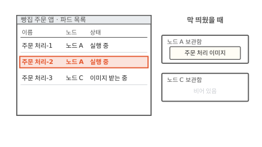

동네 빵집 주문 앱은 주문 화면, 주문 처리, 주문 장부 세 부품으로 돌아가요. 점심에 주문이 몰려서 주문 처리 파드를 두 개 더 띄웠어요. 파드는 쿠버네티스가 함께 띄우는 컨테이너 묶음이에요. 노드 A에 놓인 주문 처리-2는 곧바로 실행 중이 됐어요. 노드는 파드가 올라가는 컴퓨터 한 대예요.

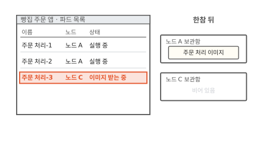

주문 처리-3은 오늘 새로 들어온 노드 C에 놓였어요. 한참이 지나도 "이미지 받는 중"이에요.

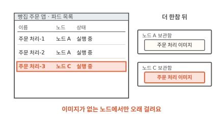

더 기다리자 그제야 실행 중이 됐어요. 같은 파드인데 노드 A에서는 바로 뜨고 노드 C에서는 한참 걸렸어요. 그림 오른쪽처럼 노드 A에는 주문 처리 이미지가 이미 있었고 노드 C에는 없었어요. 노드 C는 그사이 무엇을 했을까요?

## 이미지를 받는다는 건 무슨 일일까요?

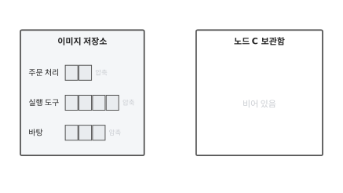

이미지는 컨테이너를 만드는 틀이에요. 이미지는 투명 필름을 겹치듯 층 여러 장으로 되어 있어요([2편](02-image-layers.md)). 이 층 하나를 레이어라고 해요. 주문 처리 이미지에는 그림처럼 세 층이 있어요. 운영체제의 기본 파일이 든 바탕 층, 프로그램을 돌리는 실행 도구 층, 주문 처리 프로그램이 든 층이에요.

이미지는 평소 이미지 저장소에 있어요. 이미지 저장소는 이미지를 올려 두고 내려받게 해 주는 서버예요. 영어로는 레지스트리(registry)라고 불러요.

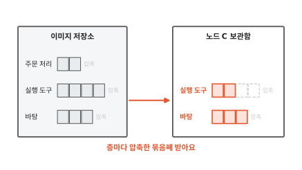

노드 C는 이 층들을 저장소에서 하나씩 내려받아요. 층은 압축해 묶은 파일 하나로 되어 있어요.[^content] 노드는 압축된 묶음을 그대로 받아서 보관함에 넣어요. 큰 층일수록 오래 걸려요.

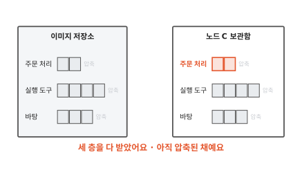

세 층을 다 받았어요. 그런데 보관함에 든 것은 아직 압축된 묶음이에요. 이 묶음을 컨테이너가 바로 쓸 수 있을까요?

## 받은 묶음은 바로 쓸 수 있을까요?

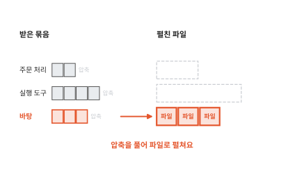

못 써요. 컨테이너가 읽는 것은 압축된 묶음 안에 든 파일들이에요. 그래서 노드는 받은 묶음의 압축을 풀어 파일로 펼쳐 놓아요.[^content] 그림처럼 바탕 층부터 펼쳐요.

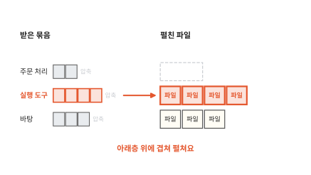

다음 층은 바로 아래층 위에 겹쳐 펼쳐요. 위층은 아래층에서 바뀐 것만 담고 있기 때문이에요. 그래서 층은 아래에서 위로 차례를 지켜 펼쳐요.

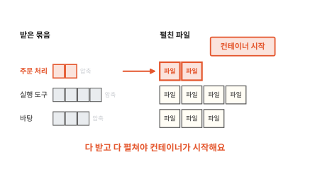

마지막 층까지 펼쳐야 컨테이너가 시작해요. 처음 장면의 노드 C는 그동안 이 일을 하고 있었어요. 받는 시간과 펼치는 시간을 다 기다린 거예요.

전집만 파는 서점과 같아요. 1권만 읽고 싶어도 전집이 다 배달돼야 해요. 상자까지 다 뜯어 꽂아야 겨우 읽어요. 그럼 컨테이너는 시작할 때 이 파일을 정말 다 읽을까요?

??? info "심화: 노드 하나가 이미지 여러 개를 한꺼번에 받을까요?"
    파드 여러 개가 한 노드에 한꺼번에 놓여서 이미지도 여러 개를 받아야 할 때 보는 칸이에요.

    노드에서 파드를 돌보는 프로그램(kubelet)은 기본으로 이미지를 하나씩 차례로 받아요. 받기 요청을 한 번에 하나만 보내고 다른 요청은 앞 요청이 끝날 때까지 기다려요. 그래서 큰 이미지 하나가 앞에 서 있으면 뒤의 작은 이미지도 그만큼 늦게 떠요.

    kubelet 설정에서 `serializeImagePulls`를 `false`로 바꾸면 여러 이미지를 동시에 받아요. 이때 `maxParallelImagePulls`로 동시에 받는 수를 묶어 둘 수 있어요. 다만 파드 하나에 든 컨테이너 이미지들은 이 설정을 켜도 동시에 받지 않아요.[^serial]

## 시작할 때 그 파일이 다 필요할까요?

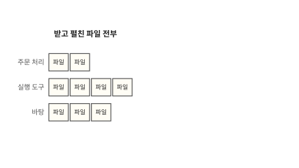

그림은 노드 C가 받고 펼친 파일 전부예요. 주문 처리 컨테이너가 시작할 때 이 가운데 무엇을 읽을까요?

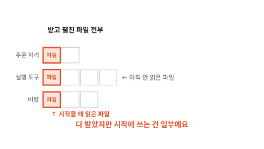

시작할 때는 프로그램 파일과 그 프로그램이 부르는 파일 몇 개만 읽어요. 바탕 층에는 프로그램이 한 번도 쓰지 않는 도구도 많이 들어 있어요. 컨테이너가 시작할 때 읽는 데이터는 받은 이미지의 작은 일부라는 연구도 있어요.[^slacker]

이미지에서 쓰지 않는 파일을 덜어 내면 받을 양 자체가 줄어요. 그런데 덜어 낼 수 없는 파일도 많아요. 실행 도구처럼 나중에 쓸 수도 있는 파일이에요. 그렇다면 시작에 필요한 파일만 먼저 받을 수는 없을까요?

## 필요한 파일만 먼저 받을 수는 없을까요?

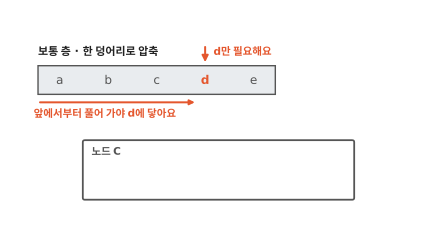

보통 층은 파일을 한데 모아 한 덩어리로 압축해요. 이런 압축은 앞에서부터 차례로 풀어야 해요. 그래서 그림처럼 파일 d 하나만 필요해도 앞부분을 다 받아서 풀어야 d에 닿아요.

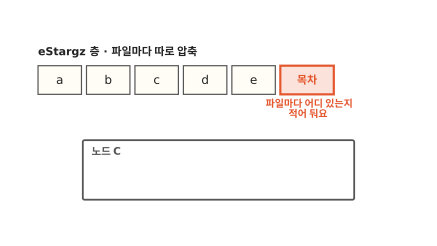

이번에는 층을 만들 때 파일마다 따로 압축해서 이어 붙여요. 그리고 맨 끝에 목차를 붙여요. 목차에는 파일마다 층 안의 어느 자리에 있는지 적혀 있어요. 이렇게 만든 층 모양을 eStargz라고 해요.[^estargz]

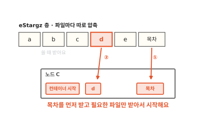

노드는 먼저 목차만 받아요. 그다음 필요한 파일 d의 자리만 저장소에 요청해요. 저장소는 파일 하나에서 원하는 구간만 떼어 보내 줄 수 있어요. 나머지 파일은 컨테이너가 처음 읽으려 할 때 받아요. 이렇게 이미지를 다 받기 전에 컨테이너를 시작하고 파일은 쓸 때 받는 방식을 **지연 로딩**(lazy pulling)이라고 해요.

containerd라는 컨테이너 실행 프로그램에서는 stargz-snapshotter가 이 일을 맡아요.[^snapshotter] 전집 서점으로 치면 목차를 먼저 보내 주고 손님이 펼친 권만 그때그때 보내 주는 서점이에요. 그러면 기다림은 모두 사라질까요?

처음 읽는 파일은 그 순간에 저장소에서 받아 오느라 느려요. 그래서 stargz-snapshotter는 시작할 때 자주 읽는 파일을 층 앞쪽에 모아 두고 한꺼번에 미리 받아요.[^estargz] 실행 중에도 아직 안 받은 파일은 저장소에 기대요. 그리고 이미지를 이 모양으로 다시 만들어 올려야 해요. eStargz 층도 보통 압축 파일로 읽을 수 있어서 지연 로딩을 모르는 실행 프로그램도 그대로 받아 써요.

??? info "심화: 이미지를 다시 만들지 않고 지연 로딩을 할 수는 없을까요?"
    이미 만들어 둔 이미지가 많아서 eStargz로 다시 만들기가 부담스러울 때 보는 칸이에요.

    SOCI(Seekable OCI) snapshotter는 이미지 층을 고치지 않아요. 대신 보통 층 안에서 파일을 찾아갈 수 있게 해 주는 색인을 따로 만들어 저장소에 함께 올려요. 노드는 그 색인을 보고 필요한 부분만 받아요. 원래 이미지가 그대로라서 이미지에 붙인 서명도 그대로 맞아요.[^soci]

    처음 방식(SOCI 색인 v1)에서는 색인이 이미지와 따로 있어서 누가 나중에 붙이거나 뗄 수 있었어요. 그러면 같은 이미지인데 시작 속도가 날마다 달라질 수 있었어요. 그래서 v2는 색인과 이미지를 하나로 묶은 이미지를 새로 만드는 단계를 둬요. 층 파일은 원래 것을 그대로 써서 늘어나는 저장 공간은 작아요. snapshotter 0.10.0부터는 v2가 기본이에요.[^sociv2]

지연 로딩은 이미지가 없는 노드에서 기다림을 줄여요. 아예 이미지가 없는 노드를 만들지 않는 길도 있어요.

## 아예 미리 받아 둘 수는 없을까요?

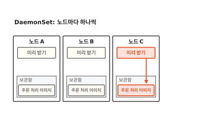

주문 처리 이미지를 쓰는 작은 파드를 노드마다 하나씩 띄워 둬요. 이 파드는 아무 일도 하지 않아요. 파드를 띄우려면 노드가 이미지를 받아야 하니 노드마다 보관함에 이미지가 생겨요. 노드마다 파드를 하나씩 띄우는 일은 쿠버네티스의 DaemonSet이 해요. DaemonSet은 노드가 새로 들어오면 그 노드에도 파드를 띄워요.[^daemonset]

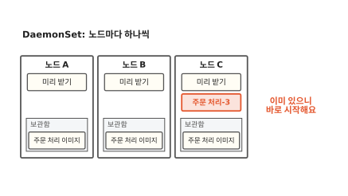

이제 주문 처리-3이 노드 C에 놓이면 보관함에 이미지가 이미 있어요. 쿠버네티스는 이미지가 노드에 있으면 다시 받지 않고 그대로 쓸 수 있어요.[^policy] 이렇게 쓸 이미지를 노드에 미리 받아 두는 일을 **사전 풀**(pre-pull)이라고 해요. 여기서 풀은 영어 pull, 곧 받기예요. 압축을 푸는 일과는 다른 말이에요.

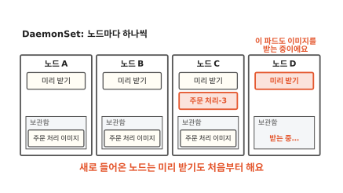

사전 풀에도 빈틈이 있어요. 새 노드 D가 들어오면 DaemonSet이 미리 받기 파드를 띄우지만 그 파드도 이미지를 처음부터 받아야 해요. 주문 처리 파드가 그사이 노드 D에 놓이면 결국 같이 기다려요. 주문 처리 이미지가 새 버전으로 바뀔 때마다 미리 받기도 새 버전으로 다시 해야 해요. 전집 서점으로 치면 단골이 올 지점마다 전집을 미리 꽂아 두는 거예요. 새로 연 지점에는 아직 꽂혀 있지 않아요.

## 지연 로딩과 사전 풀은 언제 쓸모 있을까요?

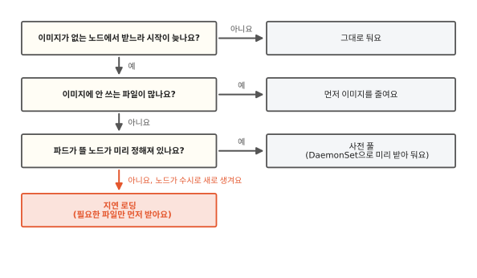

고르는 길을 그림 한 장에 모았어요. 먼저 이미지에서 안 쓰는 파일을 덜어 내요. 받을 양이 줄면 어느 방법에서든 덜 기다려요. 파드가 뜰 노드가 늘 같고 이미지가 자주 바뀌지 않으면 사전 풀이 단순해요. 노드가 수시로 새로 생기면 새 노드는 늘 빈 보관함으로 시작해요. 이때는 지연 로딩이 기다림을 줄여 줘요.

이미지를 다 받은 뒤에도 프로그램이 뜨는 데는 또 시간이 걸려요. 자바 프로그램이 뜰 때 하는 일은 [16편](16-jvm-startup.md)에서 이어 가요.

## 다시 노드 C를 볼게요

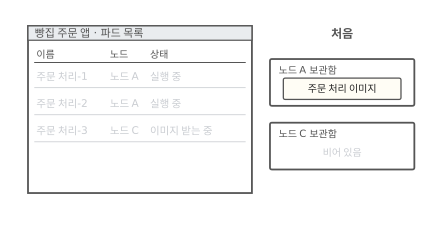

처음 장면의 목록으로 돌아왔어요. 그때 노드 C는 이미지를 다 받고 다 펼칠 때까지 주문 처리-3을 시작하지 못했어요.

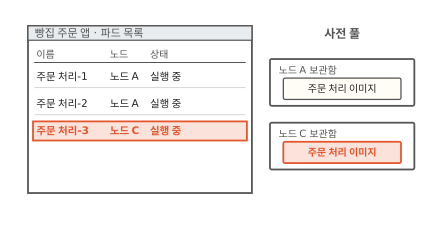

미리 받아 둔 노드라면 받을 것이 없어서 곧바로 시작해요.

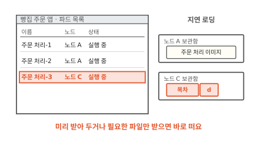

지연 로딩이라면 목차와 시작에 필요한 파일만 받고 시작해요. 이미지가 수백 메가든 수 기가든 컨테이너는 이미지가 노드에 있어야 떠요. 기다림을 줄이는 길은 미리 받아 두거나 필요한 만큼만 먼저 받는 것이에요.

### 이 편에서 줄여 그린 것

그림을 쉽게 하려고 실제와 다르게 줄인 곳이 네 군데 있어요.

1. 노드가 층 묶음만 받는 것처럼 그렸어요. 실제로는 이미지의 층 목록과 설정 파일도 함께 받아요.[^content]
2. 보관함을 상자 하나로 그렸어요. 실제 containerd는 받은 압축 묶음을 두는 곳과 펼친 파일을 두는 곳을 따로 둬요.
3. eStargz 층을 파일 다섯 칸으로 그렸어요. 실제 층에는 파일이 아주 많고 큰 파일은 더 작은 조각으로 나눠 담아요.
4. 사전 풀 그림에서 노드를 세 대로 그렸어요. 노드가 몇 대든 DaemonSet은 노드마다 미리 받기 파드를 하나씩 띄워요.

### 이 편에서 새로 나온 말

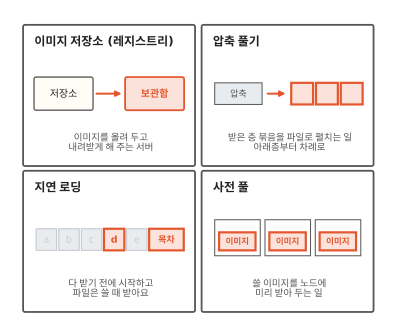

[^content]: containerd는 이미지를 받을 때 이미지 목록, 층 목록(manifest), 설정, 층 파일을 받아 해시 이름으로 저장해요. 층 파일은 gzip으로 압축한 tar 묶음이라 컨테이너가 바로 쓸 수 없어요. 그래서 층마다 차례로 아래층 위에 펼쳐서(스냅숏) 쌓아요. <https://github.com/containerd/containerd/blob/main/docs/content-flow.md>
[^serial]: <https://kubernetes.io/docs/concepts/containers/images/#serial-and-parallel-image-pulls>
[^slacker]: Harter 외, "Slacker: Fast Distribution with Lazy Docker Containers", USENIX FAST '16. stargz-snapshotter와 SOCI snapshotter 문서도 이 연구를 지연 로딩의 근거로 들어요. <https://www.usenix.org/conference/fast16/technical-sessions/presentation/harter>
[^estargz]: eStargz는 파일마다 따로 gzip으로 압축하고 층 끝에 목차(TOC)를 둬요. 저장소에 HTTP 구간 요청(Range Request)을 보내 파일 하나만 받을 수 있어요. 미리 받을 파일은 층 앞쪽에 모으고 표시 파일(prefetch landmark)로 구분해요. 보통 gzip tar로도 읽히게 만든 모양이에요. <https://github.com/containerd/stargz-snapshotter/blob/main/docs/estargz.md>
[^snapshotter]: <https://github.com/containerd/stargz-snapshotter>
[^soci]: <https://github.com/awslabs/soci-snapshotter>
[^sociv2]: <https://github.com/awslabs/soci-snapshotter/blob/main/docs/soci-index-manifest-v2.md>
[^daemonset]: DaemonSet은 모든(또는 고른) 노드에서 파드 하나씩이 돌게 해요. 노드가 들어오면 그 노드에 파드를 더하고 노드가 빠지면 그 파드를 치워요. <https://kubernetes.io/docs/concepts/workloads/controllers/daemonset/>
[^policy]: 컨테이너의 `imagePullPolicy`가 `IfNotPresent`면 노드에 없을 때만 받아요. `Always`여도 이미 받아 둔 층은 다시 받지 않아요. 미리 받아 둔 이미지를 쓰는 방법은 쿠버네티스 문서의 "Pre-pulled images"에 있어요. <https://kubernetes.io/docs/concepts/containers/images/#image-pull-policy>
