# 자바 서비스는 왜 늦게 뜰까요?

## 떴는데도 한동안 느려요

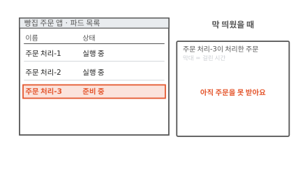

동네 빵집 주문 앱에서 주문을 받아 처리하는 부품은 자바로 만들었어요. 점심에 주문이 몰려서 주문 처리 파드를 하나 더 띄웠어요. 파드는 쿠버네티스가 함께 띄우는 컨테이너 묶음이에요. 이미지는 노드에 이미 있어서 받을 것도 없었어요([15편](15-image-pull.md)). 그런데 주문 처리-3은 한참 동안 "준비 중"이에요.

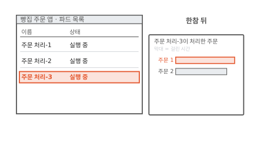

한참 뒤에야 실행 중이 됐어요. 그런데 처음 들어온 주문들은 처리하는 데 오래 걸렸어요. 그림 오른쪽 막대가 주문 하나에 걸린 시간이에요.

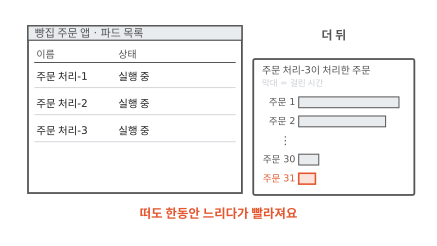

주문이 수십 개 지나자 같은 주문이 금방 끝나요. 프로그램은 같은데 뜨는 데 한참, 뜬 뒤에도 한동안 느렸어요. 주문 처리-3은 그동안 무엇을 했을까요?

## 자바 프로그램은 시작할 때 무엇을 할까요?

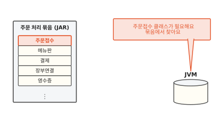

자바 프로그램은 클래스라는 조각 여러 개로 되어 있어요. 주문 처리라면 주문을 받는 조각, 메뉴판 조각, 결제 조각처럼 일마다 클래스가 있어요. 클래스들은 JAR라는 압축 묶음 파일에 담겨 있어요. 이 클래스를 읽어 돌리는 프로그램이 자바 가상 머신(JVM)이에요. 이름에 가상 머신이 들어가지만 운영체제를 통째로 띄우는 5편의 VM과는 달라요. 자바 프로그램을 돌리는 보통 프로그램이에요.

JVM은 클래스가 처음 필요해지는 순간에 그 클래스를 묶음에서 찾아요. 그림에서는 주문접수 클래스가 처음 필요해졌어요.

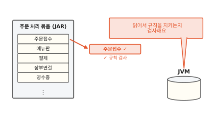

찾은 클래스를 읽어서 JVM이 쓰는 모양으로 바꿔요. 그다음 클래스가 규칙을 어기지 않는지 검사해요. 예를 들어 숫자 자리에 엉뚱한 것을 넣거나 들어가면 안 되는 곳을 건드리는 명령이 없는지 봐요. 검사를 통과해야 그 클래스를 써요.[^jep483]

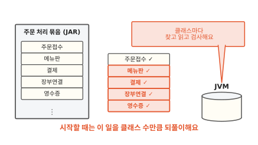

이 일을 클래스마다 해요. 실제 서비스는 직접 쓴 클래스에 남이 만든 도구 클래스까지 더해 수천 개를 읽어요. 그래서 시작하는 데 한참 걸려요. 가게 문을 열 때 창고에서 재료를 하나씩 찾아와 상하지 않았는지 살피는 것과 같아요. 재료 가짓수가 많으면 문 여는 데 오래 걸려요.

그런데 클래스를 다 읽은 뒤에도 처음 주문은 느렸어요. 그때는 무슨 일이 있었을까요?

## 다 떴는데 왜 처음 주문은 느릴까요?

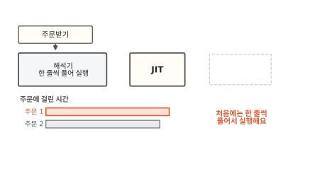

클래스 안에는 JVM이 읽는 명령이 들어 있어요. 이 명령은 CPU가 바로 알아듣지 못해요. 그래서 JVM은 처음에 명령을 한 줄씩 풀어 가며 실행해요. 한 줄 한 줄 풀어 가니 느려요.

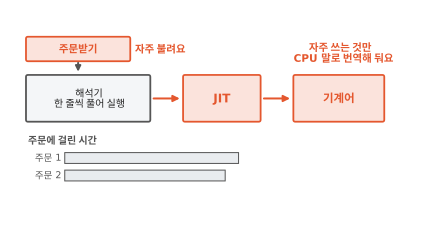

JVM은 실행하면서 어느 부분이 자주 불리는지 기록해요. 주문받기처럼 자주 불리는 부분이 보이면 그 부분을 CPU가 바로 알아듣는 명령인 기계어로 번역해 둬요. 실행하는 도중에 그때그때 번역하는 이 부품을 **JIT**(Just-In-Time) 컴파일러라고 해요.

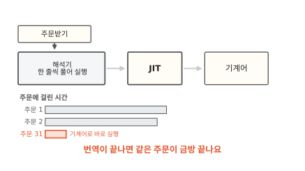

번역이 끝나면 같은 주문이 금방 끝나요. 처음 장면에서 주문이 수십 개 지나자 빨라진 것도 이 번역이 끝나서예요. 번역이 끝날 때까지 천천히 도는 시간을 워밍업이라고 불러요.[^jep515] 아침에 오븐이 다 데워질 때까지는 빵이 늦게 나오는 것과 같아요. 오븐과 다른 점도 있어요. JIT는 전부를 데우지 않고 자주 쓰는 부분만 골라 데워요.

주문 처리-3이 한 일은 두 가지예요. 뜨기 전에는 클래스를 찾아 읽고 검사했어요. 뜬 뒤에는 자주 쓰는 부분을 번역했어요. 그런데 클래스를 찾고 읽고 검사한 결과는 파드를 몇 번 띄우든 매번 똑같아요. 이 결과를 저장해 둘 수는 없을까요?

## 읽고 검사한 결과를 저장해 둘 수는 없을까요?

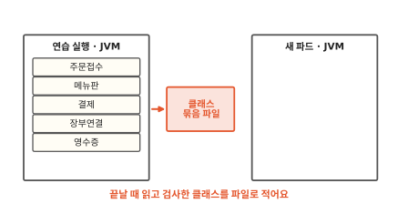

한 번 미리 실행해 보고 끝날 때 JVM이 읽고 검사한 클래스를 파일 하나에 적어 두게 할 수 있어요. 그림의 클래스 묶음 파일이에요. 이 파일에는 JVM이 바로 쓸 수 있는 모양으로 클래스가 담겨요.[^jep350]

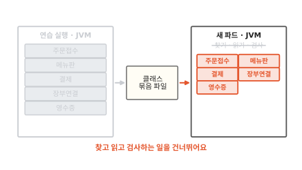

다음에 파드를 띄울 때는 JVM이 이 파일을 메모리에 그대로 올려요. 클래스마다 묶음에서 찾고 읽고 검사하던 일을 건너뛰어요.[^jep310] 이렇게 미리 정리한 클래스 묶음을 쓰는 기능을 **AppCDS**라고 해요. Application Class-Data Sharing을 줄인 이름이에요. 전날 밤에 재료를 손질해 상자 하나에 담아 둔 것과 같아요. 아침에는 상자만 열면 돼요.

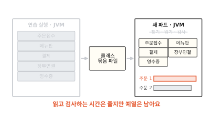

하지만 AppCDS가 저장하는 것은 클래스뿐이에요. JIT가 번역한 기계어는 들어 있지 않아요. 그래서 새 파드는 더 빨리 뜨지만 처음 주문은 여전히 느려요.

묶음 파일에는 조건이 있어요. 만들 때와 같은 JVM에서 같은 클래스 묶음 목록으로 실행해야 써요. 프로그램 묶음이 바뀌면 묶음 파일도 다시 만들어야 해요.[^jep310] 컨테이너라면 묶음 파일을 이미지 안에 함께 넣어 두면 돼요. 이미지 안의 JVM과 프로그램이 묶음 파일과 늘 짝이 맞아요.

??? info "심화: 최근 JDK에서는 무엇이 더 저장될까요?"
    AppCDS를 쓰고 있는데 더 줄일 수 있는지 궁금할 때 보는 칸이에요.

    AppCDS는 JDK 10에서 들어왔어요(JEP 310). 처음에는 클래스 목록을 뽑는 실행, 묶음 파일을 만드는 실행, 그 파일로 쓰는 실행의 세 단계가 필요했어요. JDK 13부터는 `-XX:ArchiveClassesAtExit`을 붙여 한 번 실행하면 끝날 때 묶음 파일이 생겨요(JEP 350).

    JDK 24에서는 AOT 캐시가 들어왔어요(JEP 483). 클래스를 읽고 검사한 데서 더 나아가 서로 이어 붙인 상태까지 저장해요. 연습 실행 때 `-XX:AOTMode=record`로 기록하고 `-XX:AOTMode=create`로 캐시를 만든 뒤 `-XX:AOTCache`로 써요. 같은 JDK, 같은 하드웨어 종류와 운영체제, 같은 클래스 경로라는 조건은 그대로예요.[^jep483]

    JDK 25에서는 연습 실행 때 모은 실행 기록도 AOT 캐시에 담을 수 있게 됐어요(JEP 515). 어느 부분이 자주 불리는지 적은 기록이에요. 그러면 JIT가 기록을 처음부터 모으지 않고 바로 번역을 시작해서 예열이 짧아져요.[^jep515]

예열까지 건너뛰려면 클래스만으로는 모자라요. 다 데워진 상태를 통째로 저장해야 해요.

## 다 뜬 상태를 통째로 저장하면 어떨까요?

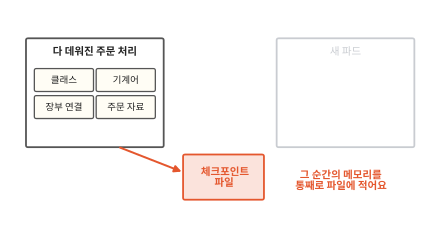

이미 다 뜨고 다 데워진 주문 처리 프로세스가 있어요. 프로세스는 실행 중인 프로그램이에요. 이 프로세스를 잠깐 멈추고 그 순간의 메모리 내용을 통째로 파일에 적어요. 리눅스에서는 CRIU라는 도구가 이 일을 해요. CRIU는 돌고 있는 프로세스를 얼려서 그 상태를 디스크에 적어요.[^criu]

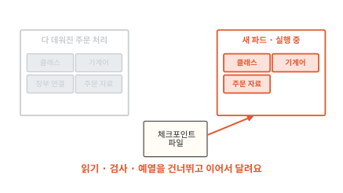

새 파드는 처음부터 시작하지 않아요. 이 파일에서 메모리를 되살려서 멈췄던 순간부터 이어 달려요. 클래스도 이미 읽혀 있고 기계어도 이미 번역돼 있어요. 이렇게 돌고 있는 상태를 저장해 두는 일과 거기서 다시 이어 가는 일을 **체크포인트·복원**이라고 해요.

자바에서는 OpenJDK의 CRaC 프로젝트가 이 일을 다뤄요. CRaC는 Coordinated Restore at Checkpoint를 줄인 이름이에요. 체크포인트 직전과 복원 직후에 프로그램에 알려 줘요.[^crac] 리눅스에서는 CRIU로 실제 저장과 복원을 해요.[^cracrepo] 가게로 말하면 한창 영업 중인 가게를 그대로 얼렸다가 다음 날 녹여서 바로 손님을 받는 거예요. 실제 가게는 얼릴 수 없으니 여기서 비유는 멈출게요. 그런데 왜 저장 직전에 프로그램에 알려 줘야 할까요?

## 통째로 저장하면 무엇이 걸릴까요?

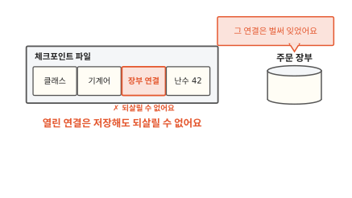

메모리 밖의 것은 저장되지 않아요. 주문 처리는 주문 장부와 연결을 열어 두고 일해요. 이 연결의 다른 쪽 끝은 주문 장부에 있어요. 파일에 연결을 적어 두어도 주문 장부는 그사이 그 연결을 잊어요. 그래서 CRaC는 열린 파일이나 연결이 남아 있으면 체크포인트를 거부해요.[^cracex]

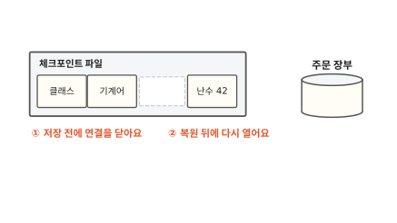

그래서 프로그램이 저장 직전에 연결과 파일을 닫고 복원 직후에 다시 열어야 해요. CRaC가 체크포인트 직전과 복원 직후에 프로그램에 알려 주는 것도 이 손질을 하게 하려는 거예요. 프로그램은 그 알림을 받는 자리(`beforeCheckpoint`, `afterRestore`)에 이 일을 적어 둬요.[^cracuse] 시계도 같은 손질이 필요해요. 저장과 복원 사이에 시간이 흘러서 복원된 프로그램에게는 시계가 갑자기 뛴 것처럼 보여요.

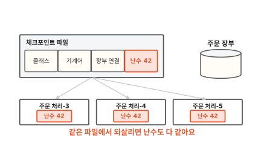

난수도 걸려요. 프로그램은 겹치지 않는 번호나 비밀 열쇠를 만들 때 난수를 써요. 난수를 만드는 장치는 메모리에 지금 상태를 들고 있어요. 같은 파일에서 파드 셋을 되살리면 셋 모두 같은 상태에서 출발해요. 그러면 셋이 똑같은 "임의" 값을 내요. CRaC가 들어간 JDK는 기본 설정으로 만든 보안 난수 장치를 복원 뒤에 새로 씨앗을 뿌려 다시 섞어요. 프로그램이 직접 씨앗을 준 난수 장치는 프로그램이 챙겨야 해요.[^reseed]

파일에는 그 순간 메모리에 있던 것이 다 들어가요. 비밀번호나 열쇠도 메모리에 있었다면 파일에 남아요. 그래서 체크포인트 파일은 비밀값처럼 다뤄야 해요.

??? info "심화: 쿠버네티스에서 체크포인트·복원을 쓰려면 무엇이 더 필요할까요?"
    파드에서 CRaC를 써 보려다 권한 오류를 만났을 때 보는 칸이에요.

    CRIU는 다른 프로세스의 메모리를 읽고 되살려야 해서 보통 프로그램보다 큰 권한이 필요해요. CRaC 저장소의 안내도 체크포인트와 복원에 root에 가까운 권한이 든다고 적어요.[^cracrepo] 컨테이너에 이 권한을 더 주면 그만큼 칸막이가 얇아져요([4편](04-shared-kernel.md)).

    체크포인트 파일을 이미지에 넣어 두면 파드마다 같은 파일에서 복원해요. 그래서 앞에서 본 난수 손질이 파드 수만큼 더 중요해져요. 체크포인트 파일은 이미지를 받을 수 있는 누구나 받게 되니 비밀값이 들지 않게 저장 직전에 지워 둬야 해요.

## AppCDS와 체크포인트·복원은 언제 쓸모 있을까요?

고르는 길을 그림 한 장에 모았어요. AppCDS는 프로그램 코드를 고치지 않아요. 실행 설정을 바꾸고 묶음 파일을 만들면 돼요. 그래서 먼저 해 보기 좋아요. 체크포인트·복원은 예열까지 건너뛰지만 프로그램이 연결과 난수를 손질해야 하고 컨테이너에 권한도 더 줘야 해요. 주문이 몰릴 때 파드를 자주 늘려야 하고 처음 주문까지 빨라야 할 때 그 수고가 값을 해요.

## 다시 새 파드를 볼게요

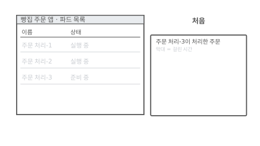

처음 장면으로 돌아왔어요. 그때 주문 처리-3은 클래스를 하나하나 찾고 읽고 검사하느라 한참 준비 중이었어요.

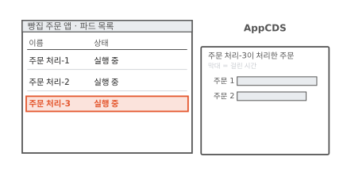

AppCDS를 쓰면 클래스를 한 번에 불러와서 더 빨리 실행 중이 돼요. 처음 주문은 아직 느려요.

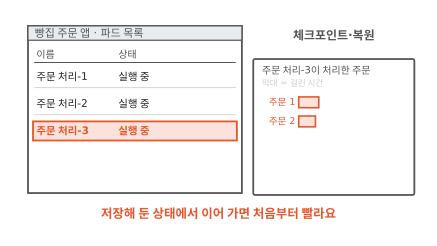

체크포인트에서 복원하면 데워진 상태에서 이어 가요. 처음 주문부터 빨라요. 클래스가 열 개든 수천 개든 JVM이 시작할 때 하는 일은 같아요. 그 일을 미리 해서 저장해 둘수록 시작이 빨라져요.

### 이 편에서 줄여 그린 것

그림을 쉽게 하려고 실제와 다르게 줄인 곳이 네 군데 있어요.

1. 클래스 읽기를 찾기, 읽기, 검사 세 걸음으로 그렸어요. 실제로는 클래스끼리 서로 가리키는 이름을 실제 위치로 이어 붙이는 일과 클래스가 처음 쓰일 때 값을 채우는 일도 있어요.[^jep483]
2. JIT가 자주 불리는 부분을 한 번에 번역하는 것처럼 그렸어요. 실제 JVM은 실행하며 모은 기록을 보고 번역해요. 그래서 기록이 쌓일수록 번역이 더 좋아져요.[^jep515]
3. AppCDS 묶음 파일을 클래스 카드 다섯 장으로 그렸어요. 실제 파일은 메모리에 그대로 올릴 수 있는 모양이라 같은 노드의 여러 JVM이 한 파일을 나눠 쓸 수 있어요.[^jep310]
4. 체크포인트 파일에 칸 네 개만 그렸어요. 실제로는 그 순간 프로세스의 메모리 전부가 들어가요.

### 이 편에서 새로 나온 말

[^jep483]: JEP 483(JDK 24)은 시작할 때 하는 일을 JAR 파일 훑기, 클래스 파일 읽기와 풀이, 읽어 들이기와 이어 붙이기(바이트코드 검사 포함), 정적 초기화로 나눠 적어요. <https://openjdk.org/jeps/483>
[^jep515]: JEP 515(JDK 25)는 JIT가 자주 쓰는 부분을 기계어로 번역하기 전까지 프로그램이 더 느리게 도는 시간을 워밍업 기간이라고 불러요. <https://openjdk.org/jeps/515>
[^jep350]: JEP 350(JDK 13)으로 실행이 끝날 때 묶음 파일을 만들 수 있게 됐어요. 실행 중에 읽어 들인 클래스만 담기고, 프로그램이 비정상으로 끝나면 파일이 만들어지지 않아요. <https://openjdk.org/jeps/350>
[^jep310]: JEP 310(JDK 10)에 따르면 묶음에 든 클래스는 읽고 풀이하는 일과 검사를 건너뛰어요. 묶음을 만들 때의 클래스 경로가 실행할 때의 클래스 경로와 같거나 그 앞부분이어야 해요. 여러 자바 프로세스가 같은 묶음 파일을 나눠 써서 메모리도 아껴요. <https://openjdk.org/jeps/310>
[^criu]: <https://criu.org/Main_Page>
[^crac]: <https://openjdk.org/projects/crac/>
[^cracrepo]: 지금 구현은 리눅스에서 CRIU를 써요. <https://github.com/openjdk/crac>
[^cracex]: 열린 파일이나 소켓 때문에 체크포인트를 못 만들면 예외(`CheckpointOpenFileException`, `CheckpointOpenSocketException`)가 나고 프로그램은 그대로 계속 돌아요. <https://docs.azul.com/crac/usage/crac-exceptions>
[^cracuse]: 파일은 체크포인트 때 닫고 복원 때 다시 열고, 소켓과 데이터베이스 연결도 닫았다가 다시 열라고 안내해요. 시계가 갑자기 바뀌는 일도 같은 자리에서 다뤄요. <https://docs.azul.com/crac/usage/integrating-crac>
[^reseed]: OpenJDK CRaC 저장소에 들어간 변경 "Reseed secure random on checkpoint restore". 기본 씨앗 생성기로 만든 SHA1PRNG만 복원 때 다시 씨앗을 뿌려요. <https://github.com/openjdk/crac/pull/7>
