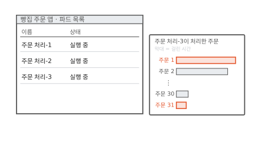
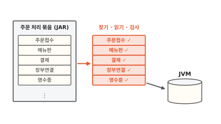
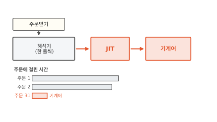
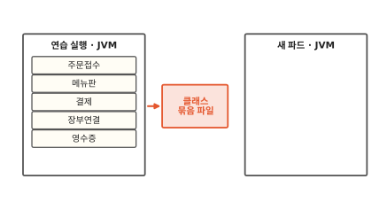
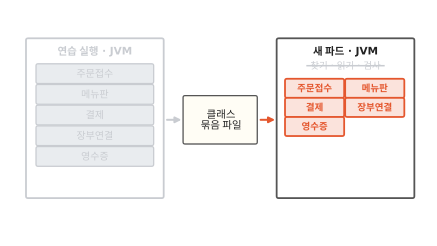
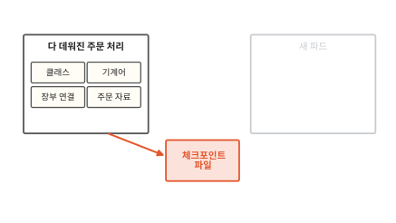
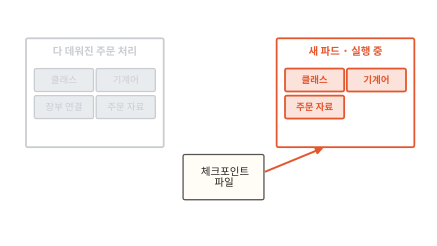
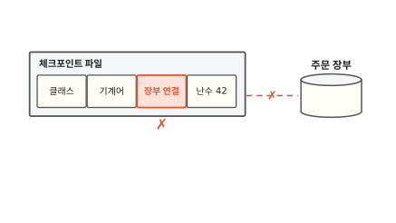
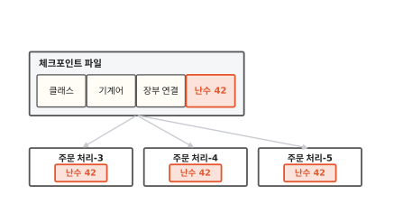
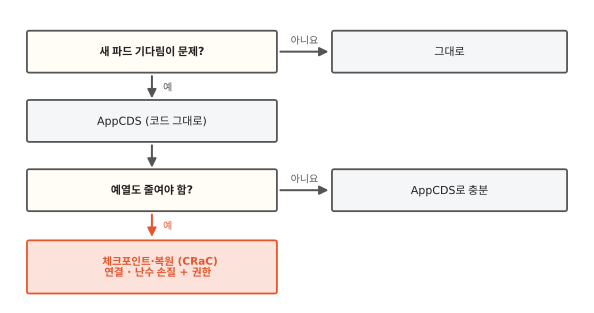

# 자바 프로그램의 시작 준비: 클래스 읽기, 예열, 미리 저장하기

이미지가 노드에 이미 있는데도 자바로 만든 서비스는 "준비 중"에 한참 머물러요. 겨우 떠도 처음 들어온 요청은 유난히 느리고요. 이 글을 읽고 나면 자바 프로그램이 시작하면서 하는 두 가지 준비를 알게 돼요. 그 준비를 미리 해서 저장해 두는 방법 두 가지와 각각 치르는 값도 함께 보여요.

!!! abstract "이 글에서 알게 되는 것"
    1. 자바 프로그램은 시작할 때 클래스를 하나씩 찾고 읽고 검사해요. 뜬 뒤에도 JIT가 자주 쓰는 부분을 기계어로 번역할 때까지 한동안 느려요.
    2. AppCDS는 읽고 검사한 클래스를 파일에 담아 두고 다음 시작 때 한 번에 불러와요. 뜨는 시간은 줄지만 예열은 그대로 남아요.
    3. 체크포인트·복원은 다 데워진 프로세스를 통째로 저장했다가 거기서 이어 달려요. 대신 열린 연결과 난수를 손질해야 하고 권한도 더 줘야 해요.

## 1. 자바 서비스는 떠도 한동안 느려요

동네 빵집 주문 앱에서 주문을 받아 처리하는 부품은 자바로 만들었어요. 점심에 주문이 몰려서 주문 처리 파드를 하나 더 띄웠어요. 이미지는 노드에 이미 있어서 받을 것도 없었어요([15편](15-image-pull.md)). 그런데 주문 처리-3은 한참 동안 "준비 중"이었어요.

겨우 "실행 중"이 된 뒤에도 이상해요. 아래 그림 오른쪽 막대는 주문 처리-3이 주문 하나를 처리하는 데 걸린 시간이에요. 주문 1과 주문 31의 막대 길이를 비교해 보세요.

**그림 1.** 처음 들어온 주문 1은 막대가 길고 주문 31은 짧아요. 같은 일인데 걸린 시간이 달라요.
{ .fig-cap }

프로그램은 똑같은데 뜨는 데 한참 걸리고 뜬 뒤에도 한동안 느렸어요. 주문 처리-3은 그동안 두 가지 준비를 하고 있었어요. 하나씩 볼게요.

## 2. 시작할 때 클래스를 하나씩 찾고 읽고 검사해요

자바 프로그램은 클래스라는 조각 여러 개로 되어 있어요. 주문 처리라면 주문을 받는 클래스, 메뉴판 클래스, 결제 클래스처럼 일마다 클래스가 있어요. 클래스들은 JAR라는 압축 묶음 파일에 담겨 있어요.

이 클래스를 읽어서 돌리는 프로그램이 자바 가상 머신, 줄여서 JVM이에요. 이름에 가상 머신이 들어가지만 운영체제를 통째로 띄우는 [5편](05-microvm.md)의 VM과는 달라요. 자바 프로그램을 돌려 주는 보통 프로그램이에요.

JVM은 클래스가 처음 필요해지는 순간에 그 클래스를 묶음에서 찾아요. 찾은 클래스를 읽어서 JVM이 쓰는 모양으로 바꾸고 클래스가 규칙을 어기지 않는지 검사해요. 숫자 자리에 엉뚱한 것을 넣는 명령이나 들어가면 안 되는 곳을 건드리는 명령이 없는지 보는 거예요. 검사를 통과해야 그 클래스를 써요.[^jep483] 아래 그림에서 클래스 카드마다 붙은 ✓를 보세요.

**그림 2.** JVM은 클래스 하나마다 찾고 읽고 검사한 다음에야 그 클래스를 써요.
{ .fig-cap }

그림에는 클래스가 다섯 개뿐이에요. 실제 서비스는 직접 쓴 클래스에 남이 만든 도구 클래스까지 더해 수천 개를 읽어요. 이 일을 클래스 수만큼 되풀이하니까 시작하는 데 한참 걸려요. 아침에 가게 문을 열면서 창고에서 재료를 하나씩 꺼내 상하지 않았는지 살피는 것과 같아요. 재료 가짓수가 많으면 문 여는 데 오래 걸려요.

## 3. 처음에는 한 줄씩 풀어 실행하다가 자주 쓰는 부분만 번역해요

클래스를 다 읽은 뒤에도 처음 주문은 느렸어요. 클래스 안에 든 명령은 JVM이 읽는 명령이라 CPU가 바로 알아듣지 못하거든요. 그래서 JVM은 처음에 명령을 한 줄씩 풀어 가며 실행해요. 한 줄씩 풀어 가니 느려요.

JVM은 실행하면서 어느 부분이 자주 불리는지 기록해요. 주문받기처럼 자주 불리는 부분이 보이면 그 부분을 CPU가 바로 알아듣는 명령인 기계어로 번역해 둬요. 실행하는 도중에 그때그때 번역하는 이 부품을 **JIT**(Just-In-Time) 컴파일러라고 해요. 아래 그림에서 JIT를 거친 다음의 막대를 보세요.

**그림 3.** JIT가 주문받기를 기계어로 번역한 다음부터 주문 31처럼 막대가 짧아져요.
{ .fig-cap }

처음 장면에서 주문이 수십 개 지나자 빨라진 것도 이 번역이 끝나서예요. 번역이 끝날 때까지 천천히 도는 시간을 워밍업, 우리말로 예열이라고 해요.[^jep515] 아침에 오븐이 다 데워질 때까지 빵이 늦게 나오는 것과 비슷해요. 다만 JIT는 전부를 데우지 않고 자주 쓰는 부분만 골라 데워요.

주문 처리-3은 뜨기 전에 클래스를 찾고 읽고 검사했어요. 뜬 뒤에는 자주 쓰는 부분을 번역했고요. 그런데 클래스를 찾고 읽고 검사한 결과는 파드를 몇 번 띄우든 매번 똑같아요. 이 결과를 저장해 둘 수는 없을까요?

## 4. AppCDS는 읽고 검사한 클래스를 파일에 담아 둬요

먼저 프로그램을 한 번 연습 삼아 실행해요. 그리고 끝날 때 JVM이 읽고 검사한 클래스를 파일 하나에 적어 두게 해요. 이 파일에는 클래스가 JVM이 바로 쓸 수 있는 모양으로 담겨요.[^jep350] 아래 그림에서 빨간 파일을 보세요.

**그림 4.** 연습 실행이 끝날 때 읽고 검사한 클래스가 묶음 파일 하나에 담겨요.
{ .fig-cap }

다음에 파드를 띄울 때는 JVM이 이 파일을 메모리에 그대로 올려요. 클래스마다 묶음에서 찾고 읽고 검사하던 일을 건너뛰는 거예요.[^jep310] 아래 그림에서 새 파드 쪽 줄이 그어진 글자를 보세요.

**그림 5.** 새 파드는 묶음 파일에서 클래스 다섯 장을 한꺼번에 불러오고 찾기, 읽기, 검사를 건너뛰어요.
{ .fig-cap }

이렇게 미리 정리한 클래스 묶음을 쓰는 기능을 **AppCDS**라고 해요. Application Class-Data Sharing을 줄인 이름이에요. 가게로 말하면 전날 밤에 재료를 손질해 상자 하나에 담아 둔 거예요. 아침에는 상자만 열면 돼요.

AppCDS가 담는 건 클래스뿐이에요. JIT가 번역한 기계어는 들어 있지 않아요. 그래서 새 파드는 더 빨리 뜨지만 처음 주문은 여전히 느려요.

묶음 파일에는 조건도 있어요. 만들 때와 같은 JVM에서 같은 클래스 목록으로 실행해야 써요. 프로그램이 바뀌면 묶음 파일도 다시 만들어야 해요.[^jep310] 컨테이너라면 묶음 파일을 이미지 안에 함께 넣어 두면 돼요. 그러면 이미지 안의 JVM과 프로그램이 묶음 파일과 늘 짝이 맞아요.

## 5. 체크포인트·복원은 다 데워진 상태를 저장하지만 손질이 필요해요

예열까지 건너뛰려면 클래스만으로는 모자라요. 다 데워진 상태를 통째로 저장해야 해요.

이미 다 뜨고 다 데워진 주문 처리 프로세스가 있다고 해 볼게요. 프로세스는 실행 중인 프로그램이에요. 이 프로세스를 잠깐 멈추고 그 순간의 메모리 내용을 통째로 파일에 적어요. 리눅스에서는 CRIU라는 도구가 이 일을 해요. 돌고 있는 프로세스를 얼려서 그 상태를 디스크에 적는 도구예요.[^criu] 아래 그림에서 파일로 가는 화살표를 보세요.

**그림 6.** 다 데워진 주문 처리의 메모리가 클래스와 기계어까지 통째로 체크포인트 파일에 들어가요.
{ .fig-cap }

새 파드는 처음부터 시작하지 않아요. 이 파일에서 메모리를 되살려서 멈췄던 순간부터 이어 달려요. 아래 그림에서 새 파드 상자 안을 보세요.

**그림 7.** 새 파드는 클래스도 기계어도 이미 들어 있는 상태로 시작해요.
{ .fig-cap }

클래스는 이미 읽혀 있고 기계어도 이미 번역돼 있어요. 그래서 처음 주문부터 빨라요. 이렇게 돌고 있는 상태를 저장해 두는 일과 거기서 다시 이어 가는 일을 **체크포인트·복원**이라고 해요. 자바에서는 OpenJDK의 CRaC 프로젝트가 이 일을 다뤄요. CRaC는 Coordinated Restore at Checkpoint를 줄인 이름이에요. 실제 저장과 복원은 CRIU로 해요.[^crac][^cracrepo]

통째로 저장하니까 좋기만 할 것 같죠. 그런데 메모리 밖의 것은 저장되지 않아요.

주문 처리는 주문 장부와 연결을 열어 두고 일해요. 이 연결의 다른 쪽 끝은 주문 장부에 있어요. 파일에 연결을 적어 두어도 주문 장부는 그사이 그 연결을 잊어버려요. 아래 그림에서 장부 연결 칸 아래의 ✗를 보세요.

**그림 8.** 장부 연결은 파일에 적혀 있어도 주문 장부 쪽에서 이미 끊겨서 되살릴 수 없어요.
{ .fig-cap }

그래서 CRaC는 열린 파일이나 연결이 남아 있으면 체크포인트를 만들지 않아요.[^cracex] 프로그램이 저장 직전에 연결과 파일을 닫고 복원 직후에 다시 열어야 해요. CRaC는 이 손질을 하라고 체크포인트 직전과 복원 직후에 프로그램에 알려 줘요. 프로그램은 그 알림을 받는 자리(`beforeCheckpoint`, `afterRestore`)에 할 일을 적어 둬요.[^cracuse] 시계도 같은 자리에서 챙겨요. 저장과 복원 사이에 시간이 흘러서 복원된 프로그램에게는 시계가 갑자기 뛴 것처럼 보이거든요.

난수도 걸려요. 프로그램은 겹치지 않는 번호나 비밀 열쇠를 만들 때 난수를 써요. 난수를 만드는 장치는 메모리에 지금 상태를 들고 있어요. 아래 그림처럼 같은 파일에서 파드 셋을 되살리면 어떻게 될까요?

**그림 9.** 같은 파일에서 되살린 파드 셋이 모두 난수 42에서 출발해요.
{ .fig-cap }

셋 모두 같은 상태에서 출발하니 셋이 똑같은 "임의" 값을 내요. CRaC가 들어간 JDK는 기본 설정으로 만든 보안 난수 장치에 복원 뒤 새 씨앗을 뿌려 다시 섞어요. 프로그램이 직접 씨앗을 준 난수 장치는 프로그램이 챙겨야 해요.[^reseed]

파일에는 그 순간 메모리에 있던 것이 다 들어가요. 비밀번호나 열쇠가 메모리에 있었다면 파일에도 남아요. 그래서 체크포인트 파일은 비밀값처럼 다뤄야 해요.

권한도 더 줘야 해요. CRIU는 다른 프로세스의 메모리를 읽고 되살려야 해서 보통 프로그램보다 큰 권한이 필요해요.[^cracrepo] 컨테이너에 이 권한을 더 주면 그만큼 칸막이가 얇아져요([4편](04-shared-kernel.md)).

## 6. 먼저 AppCDS를 쓰고 예열까지 줄여야 하면 체크포인트·복원을 써요

두 방법이 치르는 값이 달라요. 아래 그림을 위에서부터 따라가 보세요.

**그림 10.** AppCDS를 먼저 쓰고 예열까지 줄여야 할 때만 체크포인트·복원으로 가요.
{ .fig-cap }

AppCDS는 프로그램 코드를 고치지 않아요. 실행 설정을 바꾸고 묶음 파일을 만들면 돼요. 그래서 먼저 해 보기 좋아요. 체크포인트·복원은 예열까지 건너뛰지만 프로그램이 연결과 난수를 손질해야 하고 컨테이너에 권한도 더 줘야 해요. 주문이 몰릴 때 파드를 자주 늘려야 하고 처음 주문까지 빨라야 할 때 그 수고를 들일 만해요.

??? info "심화: 최근 JDK에서 더 저장되는 것"
    AppCDS를 쓰고 있는데 더 줄일 수 있는지 궁금할 때 보는 칸이에요.

    AppCDS는 JDK 10에서 들어왔어요(JEP 310). JDK 13부터는 `-XX:ArchiveClassesAtExit`을 붙여 한 번 실행하면 끝날 때 묶음 파일이 생겨요(JEP 350).[^jep350]

    JDK 24에서는 AOT 캐시가 들어왔어요(JEP 483). 클래스를 읽고 검사한 데서 더 나아가 클래스끼리 서로 이어 붙인 상태까지 저장해요. 같은 JDK, 같은 하드웨어 종류와 운영체제, 같은 클래스 경로라는 조건은 그대로예요.[^jep483]

    JDK 25에서는 연습 실행 때 모은 실행 기록도 AOT 캐시에 담을 수 있게 됐어요(JEP 515). 어느 부분이 자주 불리는지 적은 기록이에요. 그러면 JIT가 기록을 처음부터 모으지 않고 바로 번역을 시작해서 예열이 짧아져요.[^jep515]

## 정리

처음 장면의 주문 처리-3은 두 가지 준비를 하고 있었어요. 뜨기 전에는 클래스를 하나씩 찾고 읽고 검사했어요. 뜬 뒤에는 JIT가 주문받기처럼 자주 쓰는 부분을 기계어로 번역할 때까지 천천히 돌았어요. 그래서 "준비 중"이 길었고 주문 1은 느렸어요.

AppCDS를 쓰면 연습 실행에서 읽고 검사한 클래스를 파일에서 한 번에 불러와서 더 빨리 떠요. 예열은 그대로라서 처음 주문은 아직 느려요. 체크포인트·복원을 쓰면 다 데워진 상태에서 이어 가서 처음 주문부터 빨라요. 그 대신 연결과 난수를 손질하고 권한을 더 줘야 해요.

다음 편에서는 비밀번호 같은 비밀값을 쿠버네티스에 넣는 Secret을 볼게요([17편](17-secret.md)).

### 새로 나온 말

- **JVM**: 자바 클래스를 읽어서 돌려 주는 프로그램. 주문 처리의 클래스를 찾고 읽고 검사했어요.
- **JIT**: 자주 쓰는 부분을 실행 도중에 기계어로 번역하는 JVM의 부품. 주문받기를 번역한 다음부터 주문이 빨라졌어요.
- **AppCDS**: 읽고 검사한 클래스를 파일에 담아 두고 다음 시작 때 한 번에 불러오는 기능. 새 파드는 클래스 찾기, 읽기, 검사를 건너뛰었어요.
- **체크포인트·복원**: 돌고 있는 프로세스의 상태를 파일에 저장하고 거기서 이어 가는 일. 자바에서는 CRaC가 다루고 실제 저장은 CRIU가 해요.

[^jep483]: JEP 483(JDK 24)은 시작할 때 하는 일을 JAR 파일 훑기, 클래스 파일 읽기와 풀이, 읽어 들이기와 이어 붙이기(바이트코드 검사 포함), 정적 초기화로 나눠 적어요. <https://openjdk.org/jeps/483>
[^jep515]: JEP 515(JDK 25)는 JIT가 자주 쓰는 부분을 기계어로 번역하기 전까지 프로그램이 더 느리게 도는 시간을 워밍업 기간이라고 불러요. <https://openjdk.org/jeps/515>
[^jep350]: JEP 350(JDK 13)으로 실행이 끝날 때 묶음 파일을 만들 수 있게 됐어요. 실행 중에 읽어 들인 클래스만 담겨요. <https://openjdk.org/jeps/350>
[^jep310]: JEP 310(JDK 10)에 따르면 묶음에 든 클래스는 읽고 풀이하는 일과 검사를 건너뛰어요. 묶음을 만들 때의 클래스 경로가 실행할 때의 클래스 경로와 같거나 그 앞부분이어야 해요. <https://openjdk.org/jeps/310>
[^criu]: <https://criu.org/Main_Page>
[^crac]: <https://openjdk.org/projects/crac/>
[^cracrepo]: 지금 구현은 리눅스에서 CRIU를 써요. 체크포인트와 복원에 root에 가까운 권한이 든다고 안내해요. <https://github.com/openjdk/crac>
[^cracex]: 열린 파일이나 소켓 때문에 체크포인트를 못 만들면 예외(`CheckpointOpenFileException`, `CheckpointOpenSocketException`)가 나고 프로그램은 그대로 계속 돌아요. <https://docs.azul.com/crac/usage/crac-exceptions>
[^cracuse]: 파일은 체크포인트 때 닫고 복원 때 다시 열고, 소켓과 데이터베이스 연결도 닫았다가 다시 열라고 안내해요. 시계가 갑자기 바뀌는 일도 같은 자리에서 다뤄요. <https://docs.azul.com/crac/usage/integrating-crac>
[^reseed]: OpenJDK CRaC 저장소에 들어간 변경 "Reseed secure random on checkpoint restore". 기본 씨앗 생성기로 만든 SHA1PRNG만 복원 때 다시 씨앗을 뿌려요. <https://github.com/openjdk/crac/pull/7>
