# Secret은 왜 암호가 아닐까요?

## 비밀번호를 Secret에 넣었는데 다시 보여요

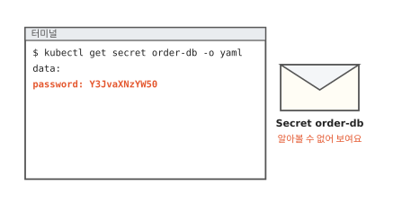

동네 빵집 주문 앱에는 주문 처리 서버가 있어요. 이 서버는 주문 장부(데이터베이스)에 접속해서 주문을 적어요. 접속하려면 비밀번호가 필요해요. 이 편에서는 그 비밀번호를 `croissant`라고 지어 둘게요.

이 비밀번호를 쿠버네티스의 Secret에 넣고 다시 꺼내 봤어요. 화면에는 `croissant` 대신 `Y3JvaXNzYW50`이 보여요. 알아볼 수 없으니 잠겨 있는 것 같아요.

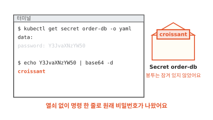

그런데 `base64 -d`라는 명령 한 줄을 붙이자 `croissant`가 그대로 나왔어요. 열쇠도 비밀번호도 넣지 않았어요. 그렇다면 Secret은 무엇으로 비밀번호를 지킬까요?

먼저 `Y3JvaXNzYW50`이 어떻게 만들어졌는지부터 볼게요.

## Y3JvaXNzYW50은 어떻게 만들어졌을까요?

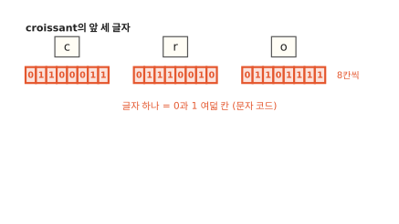

컴퓨터는 글자를 번호로 적어 두고 그 번호를 0과 1로 저장해요([컴퓨터 3편](../computer/03-how-computers-keep-letters.md)). 영어 글자 하나는 0과 1 여덟 칸이에요. 그림은 `croissant`의 앞 세 글자 c, r, o예요. 세 글자를 모으면 0과 1이 스물네 칸이에요.

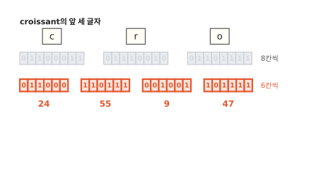

이번에는 같은 스물네 칸을 여섯 칸씩 끊어요. 그러면 네 토막이 나와요. 토막마다 0과 1을 숫자로 읽으면 24, 55, 9, 47이에요. 여섯 칸으로 만들 수 있는 숫자는 0부터 63까지 64가지예요. 이 숫자를 글자로 바꾸려면 표가 하나 있어야 해요.

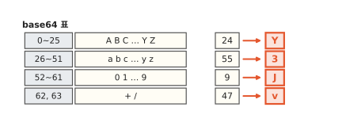

표에는 64가지 숫자마다 글자가 하나씩 정해져 있어요. 24는 Y, 55는 3, 9는 J, 47은 v예요.

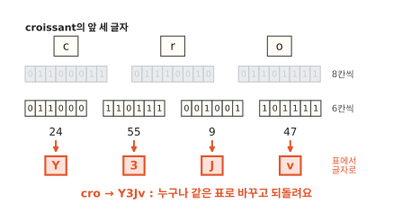

그래서 cro는 Y3Jv가 돼요. 나머지 글자도 세 글자씩 같은 일을 하면 `croissant` 전체가 `Y3JvaXNzYW50`이 돼요. 이렇게 데이터를 여섯 칸씩 끊어 64가지 글자로 옮겨 적는 방법을 **base64**라고 해요.

되돌리기도 쉬워요. Y를 표에서 찾으면 24이고 24는 011000이에요. 거꾸로 따라가면 c, r, o가 다시 나와요. 표는 세상 모두가 같은 것을 써요. 그래서 누구든 `Y3JvaXNzYW50`을 보면 `croissant`로 되돌려요.

??? info "심화: 글자 수가 셋으로 안 나뉘면 어떻게 할까요?"
    `croissant`처럼 글자가 아홉 개면 세 글자씩 딱 나뉘어요. 글자 수가 셋의 배수가 아닐 때 끝이 어떻게 되는지 궁금하면 보는 칸이에요.

    base64는 늘 세 글자(24칸)를 네 글자로 바꿔요. 끝에 한두 글자가 남으면 모자란 칸을 0으로 채워 바꾸고 채운 만큼 `=`를 붙여요. `butter-roll`처럼 열한 글자면 끝에 두 글자가 남아서 `YnV0dGVyLXJvbGw=`처럼 `=` 하나가 붙어요.

    그래서 base64로 옮기면 길이가 4/3배쯤으로 늘어나요. 숨기는 데는 쓸모가 없고 길이만 늘어나요.

## base64는 왜 암호가 아닐까요?

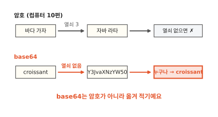

[컴퓨터 10편](../computer/10-how-to-keep-messages-secret.md)의 암호를 떠올려 봐요. "바다 가자"를 세 칸씩 밀어 "자바 라타"로 바꿨어요. 몇 칸 밀었는지는 보내는 사람과 받는 사람만 알아요. 이 몇 칸이 열쇠예요. 열쇠를 모르는 사람은 되돌리지 못해요.

base64에는 열쇠가 없어요. 바꾸는 표가 하나뿐이고 그 표는 누구나 알아요. 공식 문서도 base64는 암호화 방법이 아니고 그냥 적은 글자보다 더 지켜 주는 것이 없다고 적어요.[^good]

봉투에 넣은 쪽지와 같아요. 봉투에 넣으면 지나가는 사람 눈에 글자가 바로 들어오지는 않아요. 하지만 봉투는 잠기지 않아서 집어 든 사람은 누구나 열어 봐요. 실제 봉투와 다른 점이 하나 있어요. 봉투는 찢으면 흔적이 남아요. base64를 되돌리는 일은 흔적을 남기지 않아요.

쿠버네티스는 이 봉투를 왜 쓸까요? Secret에는 비밀번호 같은 글자만 담지 않아요. 인증서처럼 0과 1이 아무렇게나 늘어선 데이터도 담아요. 쿠버네티스에 보내는 문서는 글자로 쓰는 문서예요. 그래서 어떤 데이터든 글자로 옮겨 적으려고 base64를 써요.[^secret] 숨기려고 쓰는 것은 처음부터 아니었어요.

이렇게 쿠버네티스가 비밀번호나 열쇠 같은 값을 따로 담아 두는 물건을 **Secret**이라고 해요. 이름은 비밀이지만 봉투만으로는 지켜 주지 않아요. 그럼 이 봉투는 쿠버네티스 안 어디에 보관될까요?

## Secret은 어디에 보관될까요?

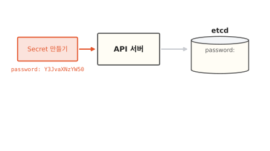

쿠버네티스에 무언가를 만들어 달라고 하면 그 요청은 늘 API 서버로 가요. API 서버는 쿠버네티스의 접수 창구예요. 원하는 상태를 적은 문서(매니페스트, [7편](07-reconcile-loop.md))도 여기로 들어와요. 그림에서 Secret을 만드는 요청이 API 서버에 닿았어요.

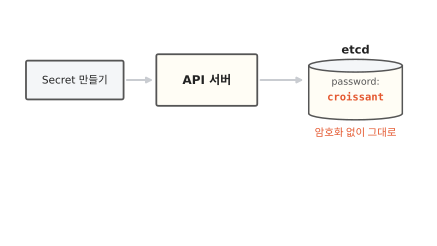

API 서버는 받은 것을 etcd에 적어 둬요. etcd는 쿠버네티스가 만든 물건을 모두 적어 두는 저장소예요.[^etcd] 기본 설정에서 Secret은 etcd에 암호화 없이 저장돼요.[^secret] 그림처럼 `croissant`가 그대로 들어 있어요.

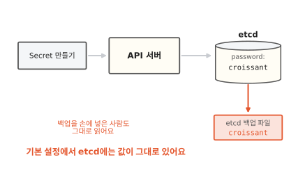

etcd는 디스크에 파일로 남아요. 고장에 대비해 백업 파일도 떠 둬요. 누군가 그 디스크나 백업 파일을 손에 넣으면 API 서버를 거치지 않고도 `croissant`를 읽어요. 이 길을 막으려면 저장할 때부터 잠가야 해요.

## 저장할 때 잠그면 무엇이 달라질까요?

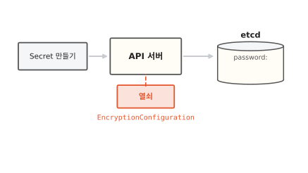

API 서버에 열쇠를 하나 쥐여 줄 수 있어요. 어떤 물건을 어떤 방식과 열쇠로 잠글지 적은 설정 파일을 API 서버에 넘기면 돼요. 이 파일의 종류 이름은 `EncryptionConfiguration`이에요.[^encrypt]

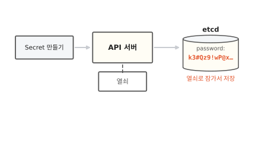

이제 API 서버는 Secret을 etcd에 쓰기 직전에 열쇠로 암호화해요. etcd에는 알아볼 수 없는 글자만 남아요. 읽을 때는 거꾸로 API 서버가 열쇠로 풀어서 내줘요. 이렇게 저장소에 쓸 때 암호화하는 일을 **저장 시 암호화**(at rest)라고 해요.

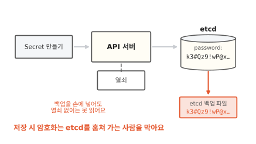

백업 파일을 훔쳐 가도 열쇠가 없으면 `croissant`를 못 봐요. base64와 달리 여기에는 진짜 열쇠가 있어요.

저장 시 암호화는 쿠버네티스가 알아서 켜 주지 않아요. 기본은 꺼져 있고 클러스터를 꾸리는 사람이 이 설정 파일을 만들어 넘겨야 켜져요.[^encrypt] 켠 뒤에도 할 일이 남아요. 이미 etcd에 있던 Secret은 다시 쓰일 때까지 잠기지 않은 채로 있어요. 그래서 켜고 나면 있던 Secret을 한 번씩 다시 써 줘요.

??? info "심화: 설정 파일만 넘기면 바로 잠길까요?"
    `EncryptionConfiguration`을 만들었는데도 etcd에 값이 그대로 보일 때 확인할 곳을 적은 칸이에요.

    설정 파일에는 잠그는 방식(provider)을 차례로 적어요. 새로 쓰는 값은 맨 앞 방식으로 잠가요. 그런데 `identity`라는 방식은 잠그지 않고 그대로 적는 방식이에요. 이것이 맨 앞에 있으면 파일을 넘겨도 아무것도 잠기지 않아요.[^encrypt]

    잠그는 방식은 두 갈래예요. `aescbc`, `aesgcm`, `secretbox`는 열쇠를 설정 파일에 직접 적어요. KMS 방식은 열쇠를 밖의 열쇠 관리 서비스에 맡겨요. 열쇠를 설정 파일에 적으면 그 파일이 놓인 컴퓨터를 손에 넣은 사람은 열쇠까지 가져가요. 그래서 공식 문서는 열쇠를 따로 지키는 방법도 함께 안내해요.

그렇다면 열쇠를 쥔 API 서버는 누구에게 풀어 줄까요?

## API 서버는 누구에게 풀어 줄까요?

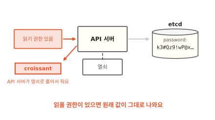

API 서버는 Secret을 읽을 권한이 있는 요청에게 열쇠로 풀어서 내줘요. 내줄 때는 다시 base64로 옮겨 적은 모양이에요. 그러니 받은 사람은 처음 장면처럼 명령 한 줄로 `croissant`를 봐요. 저장 시 암호화는 etcd를 통째로 가져가는 사람만 막아요. 권한을 가진 사람 앞에서는 아무 일도 하지 않아요.

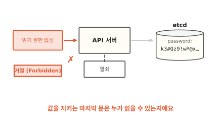

권한이 없는 요청은 API 서버가 거절해요. 그러니 Secret을 읽을 권한이 곧 값을 볼 권한이에요. 공식 문서도 API를 쓸 수 있는 사람은 Secret을 꺼내 보거나 고칠 수 있다고 적어요.[^secret]

권한은 생각보다 넓게 새요. 파드(함께 뜨는 컨테이너 묶음)를 만들 수 있는 사람은 그 파드에 Secret을 넣어 값을 봐요.[^secret] 어디까지 열어 줄지 좁히는 방법은 [18편](18-least-privilege.md)에서 이어 가요. 그 전에 Secret을 받아 쓰는 앱 쪽을 볼게요.

## 앱은 Secret을 어떻게 받아 쓸까요?

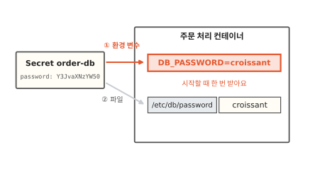

주문 처리 컨테이너가 이 비밀번호를 받는 길은 두 가지예요. 하나는 환경 변수예요. 환경 변수는 프로그램이 시작할 때 받는 "이름=값" 쪽지예요. 그림에서는 `DB_PASSWORD=croissant`예요. 프로그램은 시작할 때 이 쪽지를 읽어요. 그래서 Secret을 나중에 바꿔도 컨테이너를 다시 띄우기 전까지는 옛 값을 써요.[^env]

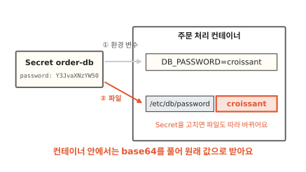

다른 하나는 파일이에요. 컨테이너 안 `/etc/db/password` 같은 자리에 파일이 생기고 그 안에 비밀번호가 들어 있어요. Secret을 고치면 파일 내용도 잠시 뒤 따라 바뀌어요.[^secret]

두 길 모두 컨테이너 안에서는 base64를 풀어 `croissant` 그대로 받아요. 앱이 이 값을 로그에 찍으면 로그를 보는 사람도 비밀번호를 봐요. 공식 문서도 앱이 받은 비밀값을 로그에 그대로 남기지 말라고 적어요.[^good]

## Secret은 언제 쓸모 있을까요

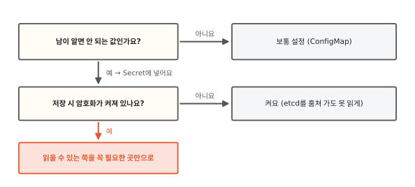

첫째 물음은 "남이 알면 안 되는 값인가요?"예요. 주문 화면의 가게 이름이나 영업시간처럼 알려져도 되는 설정은 보통 설정 묶음(ConfigMap)에 넣어요. 주문 장부 비밀번호는 Secret에 넣어요. Secret도 기본으로는 그대로 저장되니 차이가 없어 보여요. 하지만 Secret으로 따로 두어야 저장 시 암호화를 Secret에만 켜고 읽을 권한도 Secret에만 따로 좁혀요.

둘째 물음은 "저장 시 암호화가 켜져 있나요?"예요. 꺼져 있으면 etcd 디스크나 백업을 손에 넣은 사람이 값을 봐요. 켜져 있어도 끝이 아니에요. API 서버는 권한 있는 요청에게 언제든 풀어 주니까요. 그래서 마지막 갈림길은 늘 같은 곳에 닿아요. 읽을 수 있는 쪽을 꼭 필요한 곳만으로 줄여요.

## 다시 주문 장부 비밀번호를 꺼내 볼게요

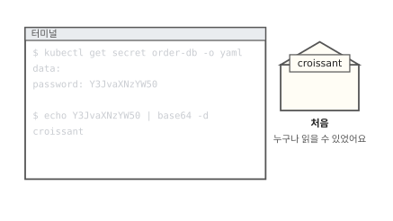

처음 장면으로 돌아왔어요. 그때는 Secret을 꺼낸 사람 누구나 명령 한 줄로 `croissant`를 봤어요.

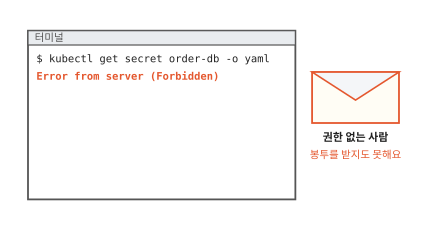

이번에는 읽을 권한이 없는 사람이 같은 명령을 쳤어요. API 서버가 거절해서 봉투를 받지도 못해요.

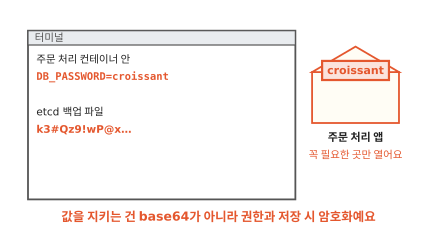

주문 처리 컨테이너는 `croissant`를 받아 주문 장부에 접속해요. etcd 백업 파일에는 열쇠로 잠근 글자만 남아요. 비밀번호가 하나든 수백 개든 값을 지키는 일은 base64 봉투가 하지 않아요. 누가 읽을 수 있는지와 저장할 때 잠그는 일이 해요.

### 이 편에서 줄여 그린 것

그림을 쉽게 하려고 실제와 다르게 줄인 곳이 네 군데 있어요.

1. etcd 안에 `croissant`를 글자 그대로 적어 그렸어요. 실제 etcd는 Secret 전체를 정해진 형식으로 묶어서 저장해요. 다만 저장 시 암호화가 꺼져 있으면 그 안에서 값을 그대로 찾아낼 수 있다는 점은 같아요.
2. API 서버를 하나로 그렸어요. API 서버가 여럿이면 모두 같은 설정 파일과 열쇠를 가져야 해요.
3. 열쇠를 API 서버 옆 상자 하나로 그렸어요. 실제로는 설정 파일 안에 적기도 하고 밖의 열쇠 관리 서비스(KMS)에 맡기기도 해요.
4. 권한 확인을 "권한 있음/없음" 두 가지로 그렸어요. 실제로는 누가 어떤 일을 어느 물건에 하려는지를 따져요. [18편](18-least-privilege.md)에서 봐요.

### 이 편에서 새로 나온 말

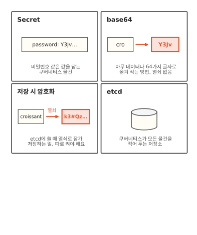

[^secret]: Secret의 `data` 값은 base64로 적어야 해요. 기본 설정에서 Secret은 etcd에 암호화 없이 저장돼요. API를 쓸 수 있는 사람과 etcd에 닿는 사람은 Secret을 꺼내 보거나 고칠 수 있어요. 파드를 만들 수 있는 사람도 같은 묶음의 Secret을 읽을 수 있어요. 파일로 넣은 Secret은 고치면 잠시 뒤 따라 바뀌어요(하위 경로 `subPath`로 넣은 것은 제외). <https://kubernetes.io/docs/concepts/configuration/secret/>
[^good]: Secret 다루기 좋은 습관. base64는 암호화 방법이 아니라는 경고, 받은 비밀값을 로그에 그대로 남기지 말라는 안내가 있어요. <https://kubernetes.io/docs/concepts/security/secrets-good-practices/>
[^encrypt]: 저장 시 암호화 설정. 기본은 꺼져 있어요. kube-apiserver에 `--encryption-provider-config`로 `EncryptionConfiguration` 파일을 넘겨 켜요. 이미 있던 값은 다시 쓰일 때까지 잠기지 않아요. <https://kubernetes.io/docs/tasks/administer-cluster/encrypt-data/>
[^env]: 환경 변수로 받은 Secret은 Secret을 고쳐도 컨테이너를 다시 띄우기 전까지 바뀌지 않아요. <https://kubernetes.io/docs/tasks/inject-data-application/distribute-credentials-secure/>
[^etcd]: 쿠버네티스 구성 요소. etcd는 클러스터의 모든 데이터를 담는 저장소예요. <https://kubernetes.io/docs/concepts/overview/components/>
