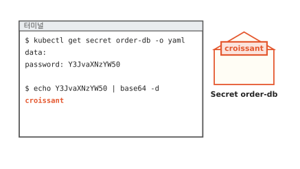
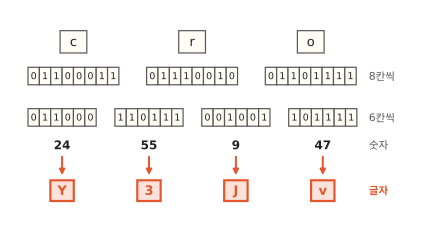
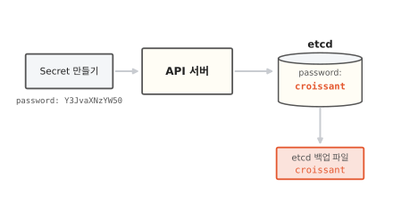
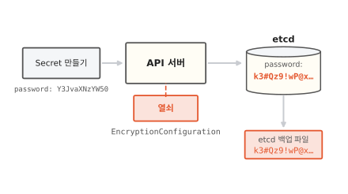
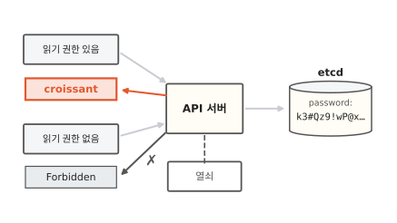
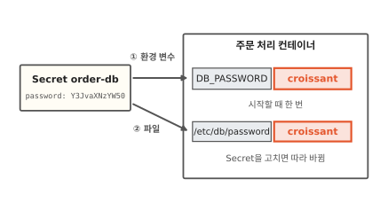

# Secret: 쿠버네티스가 비밀번호를 담는 봉투

동네 빵집 주문 앱의 주문 처리 서버는 주문 장부(데이터베이스)에 접속할 비밀번호를 쿠버네티스의 Secret에 넣어 둬요. 다시 꺼내 보면 `Y3JvaXNzYW50`처럼 알아볼 수 없는 글자인데 명령 한 줄이면 원래 비밀번호가 나와요. 이 글을 읽고 나면 그 글자가 어떻게 만들어지는지와 비밀번호를 실제로 지키는 것이 무엇인지 알게 돼요.

!!! abstract "이 글에서 알게 되는 것"
    1. Secret의 값은 base64로 적혀 있어요. base64는 누구나 아는 표로 글자를 옮겨 적는 방법이라서 열쇠 없이 누구나 되돌려요.
    2. 기본 설정에서 쿠버네티스는 Secret을 저장소(etcd)에 원래 값 그대로 저장해요. 저장 시 암호화를 켜야 저장소 파일이나 백업을 가져간 사람이 못 읽어요.
    3. 읽을 권한이 있는 요청에게는 쿠버네티스가 언제든 원래 값을 내줘요. 그래서 값을 지키는 마지막 문은 누가 읽을 수 있느냐예요.

## 1. Secret에 넣은 비밀번호는 명령 한 줄로 다시 나와요

이 글에서는 주문 장부 비밀번호를 `croissant`라고 지어 둘게요. 이 비밀번호를 `order-db`라는 이름의 Secret에 넣었어요. Secret은 비밀번호나 열쇠처럼 남이 알면 안 되는 값을 담아 두는 쿠버네티스 물건이에요.

넣은 값을 다시 꺼내 볼게요. `kubectl`은 쿠버네티스에 명령을 보내는 프로그램이에요. 아래 그림에서 터미널의 `password:` 줄과 맨 아래 빨간 줄을 보세요.

**그림 1.** Secret에는 `Y3JvaXNzYW50`으로 적혀 있지만 `base64 -d` 한 줄을 붙이자 `croissant`가 나왔어요.
{ .fig-cap }

`password:` 줄에는 `croissant` 대신 `Y3JvaXNzYW50`이 적혀 있어요. 처음 보면 잠가 둔 것 같아요. 그런데 `base64 -d`라는 명령을 붙이자 `croissant`가 나왔어요. 열쇠도 비밀번호도 넣지 않았는데요.

봉투에 넣은 쪽지를 떠올려 보세요. 봉투에 넣으면 지나가는 사람 눈에 글자가 바로 들어오지는 않아요. 하지만 봉투는 잠기지 않아서 집어 든 사람은 누구나 열어 봐요. Secret의 `Y3JvaXNzYW50`이 이 봉투예요. 그럼 이 봉투는 어떻게 만들어졌을까요?

## 2. base64는 정해진 표로 글자를 옮겨 적어요

`croissant`의 앞 세 글자 c, r, o로 따라가 볼게요.

컴퓨터는 글자를 번호로 적고 그 번호를 0과 1로 저장해요([컴퓨터 3편](../computer/03-how-computers-keep-letters.md)). 영어 글자 하나는 0과 1 여덟 칸이에요. 그래서 세 글자는 스물네 칸이에요. 이 스물네 칸을 이번에는 여섯 칸씩 끊어서 네 토막을 만들어요. 토막마다 0과 1을 숫자로 읽으면 24, 55, 9, 47이에요.

아래 그림을 위에서 아래로 따라가 보세요. 여덟 칸 줄이 여섯 칸 줄로 바뀌고 숫자가 빨간 글자가 돼요.

**그림 2.** c, r, o의 스물네 칸을 여섯 칸씩 끊으면 24, 55, 9, 47이 되고 이 숫자가 Y, 3, J, v가 돼요.
{ .fig-cap }

여섯 칸으로 만들 수 있는 숫자는 0부터 63까지 64가지예요. 숫자를 글자로 바꿀 때는 64가지 숫자마다 글자를 하나씩 정해 둔 표를 봐요. 아래 표에서 오른쪽 네 줄을 보세요.

**그림 3.** 표에서 24는 Y, 55는 3, 9는 J, 47은 v예요.
{ .fig-cap }

그래서 cro는 Y3Jv가 돼요. 나머지 여섯 글자도 세 글자씩 같은 일을 하면 `croissant` 전체가 `Y3JvaXNzYW50`이 돼요. 이렇게 데이터를 여섯 칸씩 끊어 64가지 글자로 옮겨 적는 방법을 **base64**라고 해요. 글자 수가 셋으로 나뉘지 않으면 끝에 `=`를 붙여서 모자란 자리를 채워요.

되돌리기도 쉬워요. Y를 표에서 찾으면 24이고 24는 011000이에요. 거꾸로 따라가면 c, r, o가 나와요. 그림 1의 `base64 -d`가 한 일이 이거예요.

## 3. base64에는 열쇠가 없어서 누구나 되돌려요

앞에서 표 한 장으로 바꾸고 되돌렸어요. 이 표는 세상 모두가 같은 것을 써요. 암호와 다른 점이 여기 있어요.

[컴퓨터 10편](../computer/10-how-to-keep-messages-secret.md)의 암호를 떠올려 봐요. "바다 가자"를 글자마다 세 칸씩 밀어 "자바 라타"로 바꿨어요. 몇 칸 밀었는지는 보내는 사람과 받는 사람만 알아요. 이 비밀 숫자가 열쇠예요. 아래 그림에서 두 줄의 화살표 위 낱말을 보세요.

**그림 4.** 암호는 열쇠를 알아야 되돌려요. base64는 열쇠가 없어서 누구나 되돌려요.
{ .fig-cap }

base64에는 열쇠가 없어요. 표가 하나뿐이고 그 표는 누구나 알아요. 공식 문서도 base64는 암호화 방법이 못 되고 글자를 그냥 적어 둔 것보다 더 지켜 주는 게 없다고 적어요.[^good]

여기서 이런 생각이 들 거예요. 숨겨 주지도 못하는데 쿠버네티스는 왜 base64를 쓸까요? Secret에는 비밀번호 같은 글자만 담지 않아요. 인증서처럼 0과 1이 아무렇게나 늘어선 데이터도 담아요. 그런데 쿠버네티스에 보내는 문서는 글자로 쓰는 문서예요. 그래서 어떤 데이터든 글자로 적어 보내려고 base64를 써요.[^secret] 처음부터 숨기려고 쓴 게 아니에요.

봉투는 잠기지 않았어요. 그럼 비밀번호는 무엇이 지킬까요? 쿠버네티스 안에서 Secret이 어디에 놓이는지부터 볼게요.

## 4. etcd에 쓸 때 잠가야 백업을 가져가도 못 읽어요

쿠버네티스에 무언가를 만들어 달라고 하면 그 요청은 늘 API 서버로 가요. API 서버는 쿠버네티스의 접수 창구예요. API 서버는 받은 것을 etcd에 적어 둬요. etcd는 쿠버네티스가 만든 물건을 모두 적어 두는 저장소예요.[^etcd]

아래 그림에서 etcd 안과 그 아래 백업 파일에 적힌 빨간 글자를 보세요.

**그림 5.** 기본 설정에서는 etcd에도 백업 파일에도 `croissant`가 원래 글자 그대로 남아요.
{ .fig-cap }

기본 설정에서 Secret은 etcd에 암호화 없이 저장돼요.[^secret] etcd의 내용은 디스크에 파일로 남고 고장에 대비해 백업 파일도 떠 둬요. 누군가 그 디스크나 백업 파일을 손에 넣으면 API 서버를 거치지 않고 `croissant`를 읽어요.

이 길을 막으려면 저장할 때 잠가야 해요. 어떤 물건을 어떤 방식과 열쇠로 잠글지 적은 설정 파일을 API 서버에 넘기면 돼요. 이 파일의 종류 이름은 `EncryptionConfiguration`이에요.[^encrypt] 그러면 API 서버는 Secret을 etcd에 쓰기 직전에 열쇠로 암호화해요. 읽을 때는 거꾸로 열쇠로 풀어요. 아래 그림에서 그림 5와 같은 두 곳이 어떻게 바뀌었는지 보세요.

**그림 6.** API 서버가 열쇠로 잠가서 쓰니 etcd와 백업 파일에는 알아볼 수 없는 글자만 남아요.
{ .fig-cap }

이렇게 저장소에 쓸 때 암호화하는 일을 **저장 시 암호화**라고 해요. 영어로는 at rest라고 적어요. 백업 파일을 가져가도 열쇠가 없으면 `croissant`를 못 봐요. base64와 달리 여기에는 진짜 열쇠가 있어요.

저장 시 암호화는 쿠버네티스가 알아서 켜 주지 않아요. 기본은 꺼져 있어서 쿠버네티스를 설치하고 관리하는 사람이 설정 파일을 만들어 넘겨야 켜져요. 켠 뒤에도 할 일이 하나 남아요. 이미 etcd에 있던 Secret은 다시 쓰일 때까지 잠기지 않은 채로 있어요. 그래서 켜고 나면 있던 Secret을 한 번씩 다시 써 줘요.[^encrypt]

## 5. 읽을 권한이 있으면 API 서버가 풀어서 내줘요

앞에서 etcd를 통째로 가져가는 길을 막았어요. 그런데 열쇠는 API 서버가 쥐고 있어요. 그럼 API 서버는 누구에게 풀어 줄까요? 아래 그림에서 두 요청이 무엇을 돌려받는지 보세요.

**그림 7.** 읽기 권한이 있는 요청은 `croissant`를 받고 권한이 없는 요청은 거절(Forbidden)돼요.
{ .fig-cap }

API 서버는 Secret을 읽을 권한이 있는 요청에게 열쇠로 풀어서 내줘요. 내줄 때는 다시 base64로 옮겨 적은 모양이라서 받은 사람은 그림 1처럼 명령 한 줄로 `croissant`를 봐요. 저장 시 암호화는 etcd를 가져가는 사람만 막고 권한을 가진 사람 앞에서는 아무 일도 하지 않아요. 권한이 없는 요청은 API 서버가 거절해요.

그러니 Secret을 읽을 권한이 곧 값을 볼 권한이에요. 공식 문서도 API를 쓸 수 있는 사람은 Secret을 꺼내 보거나 고칠 수 있다고 적어요.[^secret] 권한은 생각보다 넓게 새기도 해요. 파드(함께 뜨는 컨테이너 묶음)를 만들 수 있는 사람은 그 파드에 Secret을 넣어서 값을 봐요.[^secret]

비밀번호를 보통 설정과 따로 Secret에 두는 까닭도 여기 있어요. 가게 이름이나 영업시간처럼 알려져도 되는 설정은 ConfigMap이라는 보통 설정 묶음에 넣어요. Secret도 기본으로는 원래 값 그대로 저장되니 둘이 다를 게 없어 보여요. 하지만 Secret으로 따로 두어야 저장 시 암호화를 Secret에만 켜고 읽을 권한도 Secret에만 좁힐 수 있어요. 읽을 권한을 좁히는 방법은 [18편](18-least-privilege.md)에서 봐요.

## 6. 앱은 환경 변수나 파일로 원래 값을 받아요

마지막으로 비밀번호를 받아 쓰는 쪽을 볼게요. 주문 처리 컨테이너가 Secret을 받는 길은 두 가지예요. 아래 그림에서 두 화살표 끝에 무엇이 들어 있는지 보세요.

**그림 8.** 환경 변수로 받든 파일로 받든 컨테이너 안에는 `croissant`가 들어가요.
{ .fig-cap }

①은 환경 변수예요. 환경 변수는 프로그램이 시작할 때 받는 "이름=값" 쪽지예요. 그림에서는 `DB_PASSWORD=croissant`예요. 프로그램은 시작할 때 이 쪽지를 한 번 읽어요. 그래서 Secret을 나중에 바꿔도 컨테이너를 다시 띄우기 전까지는 옛 값을 써요.[^env]

②는 파일이에요. 컨테이너 안 `/etc/db/password` 같은 자리에 파일이 생기고 그 안에 비밀번호가 들어 있어요. Secret을 고치면 파일 내용도 잠시 뒤 따라 바뀌어요.[^secret]

두 길 모두 컨테이너 안에서는 base64를 풀어 `croissant`로 받아요. 그래서 앱이 이 값을 로그(프로그램이 남기는 기록)에 찍으면 로그를 보는 사람도 비밀번호를 봐요. 공식 문서도 받은 비밀값을 로그에 남기지 말라고 적어요.[^good]

## 정리

Secret에 넣은 비밀번호 `croissant`는 `Y3JvaXNzYW50`으로 보여요. base64로 옮겨 적은 글자예요. 세 글자를 여섯 칸씩 끊고 표에서 글자를 찾는 방법이라서 같은 표로 누구나 되돌려요. 열쇠가 없으니 암호가 못 돼요.

기본 설정에서 쿠버네티스는 Secret을 etcd에 원래 값 그대로 저장해요. 저장 시 암호화를 켜면 API 서버가 열쇠로 잠가서 저장해요. 그러면 etcd 파일이나 백업을 가져가도 `croissant`를 못 읽어요.

그래도 읽을 권한이 있는 요청에게는 API 서버가 풀어서 내줘요. 그래서 비밀번호를 지키는 마지막 문은 누가 읽을 수 있느냐예요. [18편](18-least-privilege.md)에서는 이 권한을 꼭 필요한 만큼만 주는 방법을 봐요.

### 새로 나온 말

- **Secret**: 비밀번호처럼 남이 알면 안 되는 값을 담는 쿠버네티스 물건. 이 글에서는 `order-db`에 `croissant`를 담았어요.
- **base64**: 데이터를 여섯 칸씩 끊어 64가지 글자로 옮겨 적는 방법. 열쇠가 없어서 누구나 되돌려요. cro는 Y3Jv가 돼요.
- **저장 시 암호화**: API 서버가 etcd에 쓸 때 열쇠로 잠가서 저장하는 일. 기본은 꺼져 있어서 따로 켜야 해요.
- **etcd**: 쿠버네티스가 만든 물건을 모두 적어 두는 저장소.

[^secret]: Secret의 `data` 값은 base64로 적어요. 기본 설정에서 Secret은 etcd에 암호화 없이 저장돼요. API를 쓸 수 있는 사람과 etcd에 닿는 사람은 Secret을 꺼내 보거나 고칠 수 있어요. 파드를 만들 수 있는 사람도 같은 묶음의 Secret을 읽을 수 있어요. 파일로 넣은 Secret은 고치면 잠시 뒤 따라 바뀌어요(하위 경로 `subPath`로 넣은 것은 제외). <https://kubernetes.io/docs/concepts/configuration/secret/>
[^good]: Secret 다루기 좋은 습관. base64는 암호화 방법이 못 된다는 경고와 받은 비밀값을 로그에 남기지 말라는 안내가 있어요. <https://kubernetes.io/docs/concepts/security/secrets-good-practices/>
[^encrypt]: 저장 시 암호화 설정. 기본은 꺼져 있어요. kube-apiserver에 `--encryption-provider-config`로 `EncryptionConfiguration` 파일을 넘겨 켜요. 이미 있던 값은 다시 쓰일 때까지 잠기지 않아요. <https://kubernetes.io/docs/tasks/administer-cluster/encrypt-data/>
[^env]: 환경 변수로 받은 Secret은 Secret을 고쳐도 컨테이너를 다시 띄우기 전까지 바뀌지 않아요. <https://kubernetes.io/docs/tasks/inject-data-application/distribute-credentials-secure/>
[^etcd]: 쿠버네티스 구성 요소. etcd는 클러스터의 모든 데이터를 담는 저장소예요. <https://kubernetes.io/docs/concepts/overview/components/>
