# 권한은 왜 꼭 필요한 만큼만 줄까요?

## 목록만 보려 했는데 값이 다 나왔어요

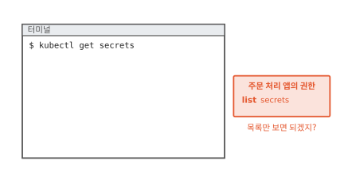

빵집 주문 앱의 주문 처리 서버는 주문 장부(데이터베이스)에 접속할 비밀번호가 필요해요. 그 비밀번호는 Secret `order-db`에 들어 있어요([17편](17-secret.md)). Secret은 비밀번호 같은 값을 담아 두는 쿠버네티스 물건이에요.

사람처럼 앱에도 쿠버네티스를 부를 때 쓰는 계정이 있어요. 주문 처리 앱의 계정에 권한을 줄 차례예요. Secret 이름을 하나하나 적기가 번거로워서 "Secret 목록 보기(list)"를 줬어요. 목록에서 이름을 보고 자기 것을 찾아 쓰면 될 것 같았어요.

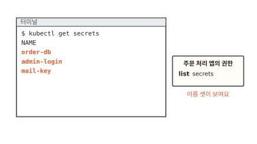

이 계정으로 목록을 꺼내니 Secret 이름 셋이 보여요. `order-db`는 주문 장부 비밀번호예요. `admin-login`은 가게 관리 화면 비밀번호, `mail-key`는 주문 알림 메일 열쇠예요. 여기까지는 예상대로예요.

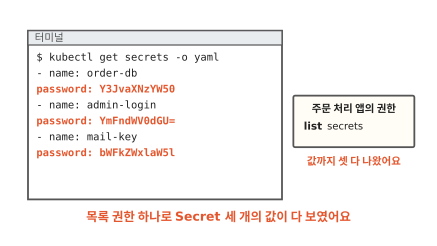

그런데 목록을 자세히(`-o yaml`) 꺼내 달라고 하자 값까지 셋 다 나왔어요. base64는 누구나 되돌리니(17편) 관리 화면 비밀번호와 메일 열쇠까지 손에 들어왔어요. 목록만 보라고 준 권한이 왜 값을 다 열었을까요?

이 물음에 답하려면 쿠버네티스가 요청을 받을 때 무엇을 확인하는지부터 봐야 해요.

## 쿠버네티스는 요청마다 무엇을 볼까요?

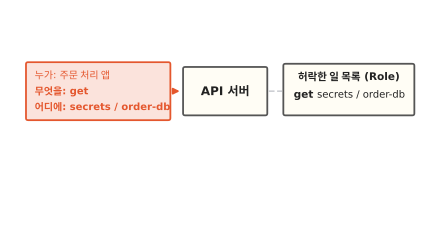

쿠버네티스에 오는 요청은 모두 API 서버를 거쳐요. API 서버는 쿠버네티스의 접수 창구예요. 그림의 요청 카드처럼 요청마다 세 가지가 적혀 있어요. 보낸 사람, 하려는 일, 그 일을 할 곳이에요. "무엇을"에는 `get`(하나 꺼내기) 같은 동사가 들어가요. "어디에"에는 Secret이나 파드 같은 물건 종류와 이름이 들어가요. 이것을 대상이라고 해요.

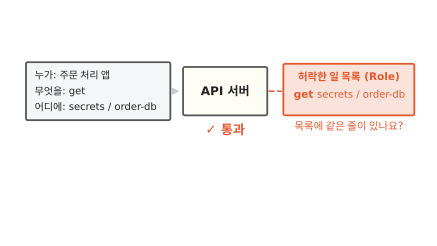

API 서버는 그 계정에 허락해 둔 일 목록을 펼쳐 봐요. 목록에 "get, secrets, order-db"가 적혀 있으니 이 요청은 통과해요. 허락한 일 목록을 쿠버네티스에서는 Role이라고 하고 Role을 어느 계정에 줄지는 RoleBinding으로 이어요.[^rbac]

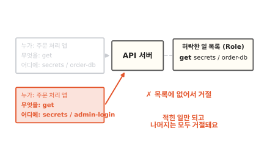

같은 앱이 `admin-login`을 꺼내 달라고 하면 목록에 같은 줄이 없어요. 그래서 거절돼요. 목록에는 허락만 적고 "이건 안 돼요" 같은 금지는 적지 않아요. 적히지 않은 일은 모두 안 되는 일이에요.[^rbac]

이렇게 "누가, 무엇을, 어디에"를 허락 목록으로 적어 두고 요청마다 맞춰 보는 방식을 **RBAC**(역할 기반 접근 제어)라고 해요. 그렇다면 여는 장면의 앱은 목록에 무엇이 적혀 있었기에 값을 다 봤을까요?

## list는 왜 값까지 보여 줄까요?

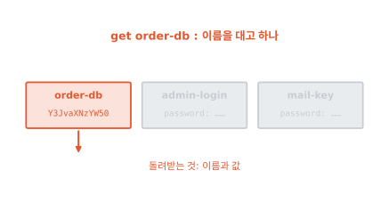

Secret에 쓰는 동사를 차례로 볼게요. `get`은 이름을 대고 하나를 꺼내요. 그림에서는 `order-db` 하나의 이름과 값을 돌려받아요.

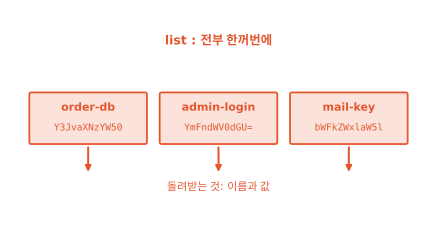

`list`는 그 종류를 전부 한꺼번에 꺼내요. 이름이 적힌 쪽지만 주지 않아요. 하나하나를 `get`으로 꺼낸 것과 똑같은 내용을 한 번에 몽땅 돌려줘요. 여는 장면에서 값이 다 나온 까닭이 여기 있어요.[^authz]

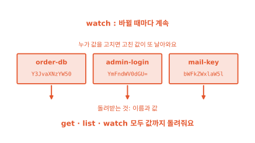

`watch`는 지켜보기예요. 처음에 꺼낸 뒤에도 무엇이 바뀔 때마다 바뀐 내용을 계속 보내 줘요. 누가 비밀번호를 바꾸면 새 비밀번호가 바로 날아와요.

공식 문서는 세 동사가 돌려주는 내용이 같다고 적어요.[^authz] 꺼내는 범위만 달라요. 그러니 Secret에 `list`나 `watch`를 주는 일은 그 종류의 값을 모두 보여 주는 일이에요. 문서도 `list`를 주면 Secret 내용까지 가져갈 수 있다고 따로 경고해요.[^good]

쓰기 동사도 있어요. 만들기는 `create`, 고치기는 `update`와 `patch`, 지우기는 `delete`예요. 이 동사들도 같은 목록에서 따로따로 허락해요. 그럼 주문 처리 앱에는 무엇을 적어 줘야 할까요?

## 방 열쇠는 어떻게 만들까요?

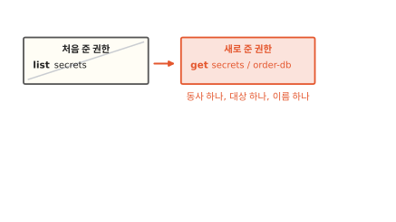

건물 열쇠로 생각해 봐요. 만능 열쇠 하나면 모든 방이 열려서 편해요. 하지만 그 열쇠를 잃어버리면 모든 방이 같이 열려요. 주문 처리 앱이 들어갈 방은 주문 장부 비밀번호 하나뿐이에요. 그 방 열쇠만 주면 돼요.

그래서 목록을 바꿔 적어요. 동사는 `get` 하나, 대상은 Secret 종류에 이름 `order-db` 하나예요.[^rbac]

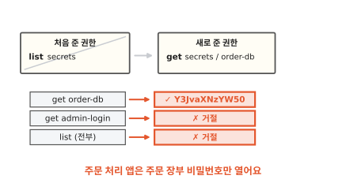

이제 주문 처리 앱은 `order-db`를 꺼낼 수 있어요. `admin-login`도, 목록 전체도 거절돼요. 이 계정을 누가 훔쳐 가도 열리는 방은 주문 장부 하나예요. 실제 열쇠와 다른 점도 있어요. 쿠버네티스는 요청이 올 때마다 목록을 다시 보니 목록에서 줄을 지우면 이미 준 열쇠도 그 자리에서 쓸모가 없어져요.

이렇게 일에 꼭 필요한 동사와 대상만 골라 주는 원칙을 **최소 권한**이라고 해요. 공식 문서도 계정마다 일에 꼭 필요한 권한만 주라고 권해요.[^rbacgood]

??? info "심화: 별표(*)로 다 주면 왜 위험할까요?"
    권한 목록을 적다가 동사나 대상 자리에 별표(`*`)를 넣고 싶어질 때 보는 칸이에요.

    별표는 "전부"라는 뜻이에요. 대상에 별표를 넣으면 Secret도 같이 열려요. 지금 있는 종류만 열리지도 않아요. 쿠버네티스는 새 물건 종류를 더할 수 있어서 나중에 생긴 종류까지 그 권한 안으로 들어와요.[^rbacgood]

    공식 문서도 되도록 별표를 쓰지 말라고 적어요. 모든 대상에 주는 별표는 특히 피하래요.

??? info "심화: Secret 권한이 없어도 Secret을 볼 수 있는 길"
    Secret 읽기는 막았는데 다른 권한이 넓을 때 무엇이 새는지 궁금하면 보는 칸이에요.

    파드는 함께 뜨는 컨테이너 묶음이에요. 파드를 만들 수 있는 계정은 그 파드에 Secret을 환경 변수나 파일로 넣어 띄울 수 있어요. 그 파드 안에서 값을 읽으면 Secret 읽기 권한이 없어도 값을 봐요. 파드를 직접 만들지 않고 파드를 대신 만들어 주는 Deployment 같은 물건을 만들 수 있어도 마찬가지예요.[^rbacgood]

    그래서 파드를 만드는 권한도 Secret 읽기 권한만큼 좁혀 줘요.

이 원칙은 쿠버네티스에만 있지 않아요. 주문 장부를 담은 데이터베이스에도 똑같이 들어맞아요.

## 데이터베이스에서도 똑같아요

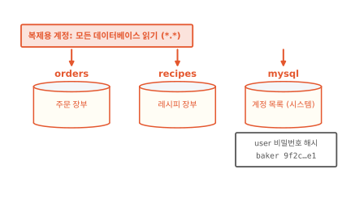

데이터베이스 서버 하나에는 데이터베이스가 여럿 들어 있어요. 그림에는 주문 장부 `orders`와 레시피 장부 `recipes`가 있어요. 그리고 데이터베이스 서버가 스스로 쓰는 시스템 데이터베이스(MySQL이라면 `mysql`)도 있어요. 여기에는 데이터베이스에 접속하는 계정 목록이 들어 있어요.[^mysqlgrant]

주문 장부를 다른 곳으로 옮겨 적는 복제 프로그램이 있다고 해 봐요. 이 프로그램이 쓸 계정을 만들면서 "모든 데이터베이스 읽기"를 줬어요. MySQL에서는 `*.*`로 적는 권한이에요. 이 권한은 서버 안의 모든 데이터베이스에 걸려요.[^mysqlpriv] 그림처럼 시스템 데이터베이스도 빠지지 않아요.

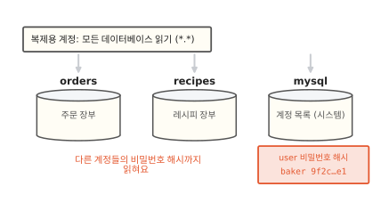

계정 목록에는 계정마다 비밀번호 해시가 적혀 있어요. 해시는 비밀번호를 거꾸로 되돌릴 수 없게 뒤섞은 값이에요. 되돌릴 수 없으니 안전해 보여요. 하지만 해시를 가져간 사람은 자기 컴퓨터에서 흔한 비밀번호를 하나씩 뒤섞어 같은 값이 나오는지 맞춰 볼 수 있어요.[^owasp] 맞춰 보는 동안 데이터베이스 쪽에는 아무 기록도 남지 않아요. 복제 프로그램은 이 표를 볼 일이 없었는데 권한이 열어 줬어요.

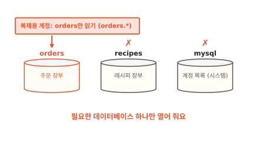

그래서 복제 계정에는 주문 장부 하나만 열어 줘요. MySQL에서는 `orders.*`처럼 데이터베이스 이름을 적어요. MySQL 문서도 시스템 데이터베이스 권한은 보통 계정에 주지 말라고 적어요.[^mysqlpriv] 쿠버네티스에서 `order-db` 하나만 열어 준 것과 같은 일이에요.

## 최소 권한은 언제 쓸모 있을까요

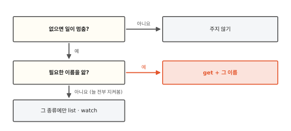

첫째 물음은 "이 권한이 없으면 일이 멈추나요?"예요. 멈추지 않으면 "혹시 몰라서" 주지 않아요. 나중에 필요해지면 그때 한 줄 더 적으면 돼요.

둘째 물음은 "어느 것이 필요한지 이름을 아나요?"예요. 주문 처리 앱은 `order-db` 하나만 알면 돼요. 이름과 함께 `get`만 줘요.

이름을 미리 알 수 없는 일도 있어요. 쿠버네티스 안에서 물건을 계속 비교해서 맞추는 일꾼(컨트롤러, [7편](07-reconcile-loop.md))은 맡은 종류를 늘 전부 지켜봐야 해요. 이때는 `list`와 `watch`를 주되 그 일꾼이 맡은 종류에만 줘요. 공식 문서도 Secret의 `list`·`watch`는 꼭 필요한 시스템 구성 요소에만 주라고 해요.[^good]

좁게 주는 데도 값이 있어요. 앱이 새 Secret을 쓰게 되면 그때마다 권한 목록에 한 줄을 더 적어야 해요. 그 한 줄을 적는 수고로 계정 하나를 잃었을 때 열리는 방을 하나로 줄여요.

## 다시 Secret 목록을 열어 볼게요

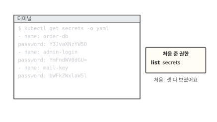

처음 장면으로 돌아왔어요. 그때 주문 처리 앱의 계정은 `list`로 Secret 세 개의 값을 다 봤어요.

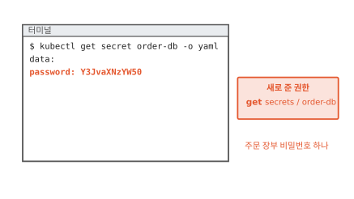

이번에는 `order-db` 하나에 `get`만 줬어요. 주문 처리 앱은 자기 비밀번호를 꺼내 주문 장부에 접속해요.

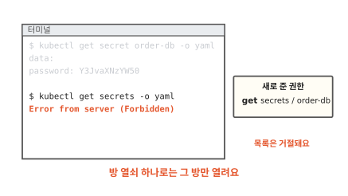

같은 계정으로 목록을 꺼내 달라고 하면 거절돼요. 관리 화면 비밀번호와 메일 열쇠는 이 계정으로는 열리지 않아요. Secret이든 데이터베이스든 권한은 동사와 대상을 좁힐수록 생각지 못한 것까지 열리는 일이 줄어요.

### 이 편에서 줄여 그린 것

그림을 쉽게 하려고 실제와 다르게 줄인 곳이 세 군데 있어요.

1. 허락한 일 목록(Role)을 줄 하나짜리 카드로 그렸어요. 실제 목록에는 물건이 속한 묶음(API 그룹)도 함께 적고 계정과 목록을 잇는 RoleBinding이 따로 있어요.
2. 요청 카드의 "누가"를 앱 이름으로 적었어요. 실제로는 앱이 쓰는 계정(서비스 어카운트)의 이름이 들어가요.
3. 데이터베이스의 계정 목록을 두 칸짜리 표로 그렸어요. 실제 표에는 계정이 어디서 접속할 수 있는지와 비밀번호를 어떤 방식으로 뒤섞었는지 같은 칸이 더 있어요.

### 이 편에서 새로 나온 말

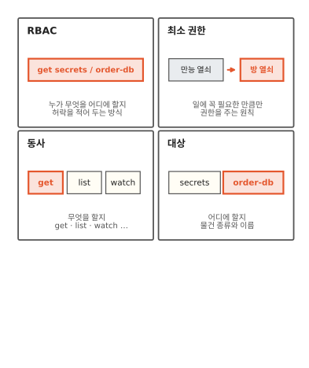

[^rbac]: RBAC 문서. Role은 허락만 더하는 목록이고 금지 규칙은 없어요. `resourceNames`로 이름을 정해 `get` 같은 요청을 그 하나로 좁힐 수 있어요. <https://kubernetes.io/docs/reference/access-authn-authz/rbac/>
[^authz]: 요청 동사 표와 경고. `get`, `list`, `watch`는 모두 물건의 내용 전체를 돌려줄 수 있어서 돌려받는 데이터로 보면 같아요. `list`를 Secret에 주면 돌려받는 Secret의 값이 드러나요. <https://kubernetes.io/docs/reference/access-authn-authz/authorization/>
[^good]: Secret 다루기 좋은 습관. `list` 권한은 Secret 내용을 가져가게 해 주고 `watch`·`list`는 가장 높은 권한이 필요한 시스템 구성 요소에만 주라고 해요. <https://kubernetes.io/docs/concepts/security/secrets-good-practices/>
[^rbacgood]: RBAC 좋은 습관. 최소 권한, 별표 권한을 피할 것, 파드를 만드는 권한이 Secret 접근을 함께 준다는 경고가 있어요. <https://kubernetes.io/docs/concepts/security/rbac-good-practices/>
[^mysqlgrant]: MySQL 권한 표. `mysql.user` 표의 `authentication_string` 칸에 계정의 인증 정보가 들어 있어요. <https://dev.mysql.com/doc/refman/8.0/en/grant-tables.html>
[^mysqlpriv]: MySQL이 주는 권한. 데이터베이스 권한은 데이터베이스 하나에 줄 수도 있고 전체(전역)에 줄 수도 있어요. 시스템 데이터베이스 권한은 보통 계정에 주지 말라고 해요. <https://dev.mysql.com/doc/refman/8.0/en/privileges-provided.html>
[^owasp]: OWASP 비밀번호 저장 안내. 해시는 되돌릴 수 없지만 해시를 가진 사람은 후보 비밀번호를 하나씩 해시해서 비교하는 방법으로 맞힐 수 있어요. <https://cheatsheetseries.owasp.org/cheatsheets/Password_Storage_Cheat_Sheet.html>
