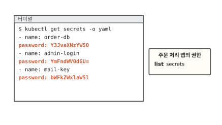
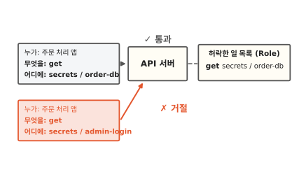
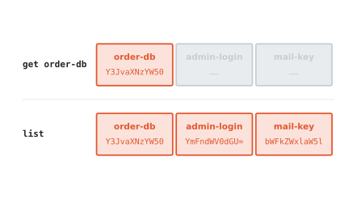
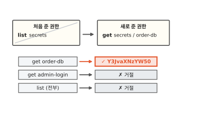
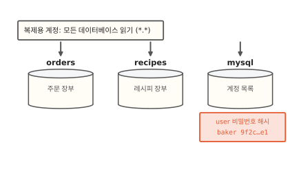
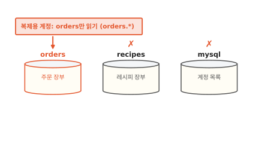

# 최소 권한: 들어갈 방의 열쇠만 주기

빵집 주문 앱의 주문 처리 서버에 Secret 하나를 읽을 권한을 줘야 해요. 이름을 하나하나 적기 번거로워서 "Secret 목록 보기"를 줬더니 다른 Secret의 비밀번호까지 모두 손에 들어왔어요. 이 글을 읽고 나면 쿠버네티스가 권한을 어떻게 확인하는지와 왜 목록 권한 하나가 값을 다 여는지 알게 돼요. 이걸 알아야 권한을 줄 때 생각지 못한 것까지 열어 주는 일을 막을 수 있어요.

!!! abstract "이 글에서 알게 되는 것"
    1. 쿠버네티스는 요청마다 누가, 무엇을(동사), 어디에(대상)를 허락 목록과 맞춰 봐요. 이 방식을 RBAC이라고 하고 목록에 적히지 않은 일은 모두 거절돼요.
    2. Secret에 준 `list`와 `watch`는 이름만 보여 주지 않아요. 값까지 모두 돌려줘서 넓게 준 권한은 생각지 못한 것까지 열어요.
    3. 그래서 동사와 대상을 일에 꼭 필요한 만큼만 좁혀 줘요. 이걸 최소 권한이라고 해요. 데이터베이스 계정도 같아서 "모든 데이터베이스 읽기"는 다른 계정의 비밀번호 해시까지 열어요.

## 1. 목록만 보라고 준 권한으로 Secret 값이 다 나왔어요

주문 처리 서버는 주문 장부(데이터베이스)에 접속할 비밀번호가 필요해요. 그 비밀번호는 Secret `order-db`에 들어 있어요([17편](17-secret.md)). Secret은 비밀번호 같은 값을 담아 두는 쿠버네티스 물건이에요.

사람처럼 앱에도 쿠버네티스를 부를 때 쓰는 계정이 있어요. 주문 처리 앱의 계정에 "Secret 목록 보기(`list`)"를 줬어요. 목록에서 이름을 보고 자기 것을 찾아 쓰면 될 것 같았거든요. 같은 곳에는 Secret이 셋 있어요. `order-db`는 주문 장부 비밀번호, `admin-login`은 가게 관리 화면 비밀번호, `mail-key`는 주문 알림 메일 열쇠예요.

이 계정으로 목록을 자세히(`-o yaml`) 꺼내 봤어요. 아래 그림에서 터미널의 빨간 줄을 보세요.

**그림 1.** `list` 권한 하나로 Secret 세 개의 이름과 값이 모두 나왔어요.
{ .fig-cap }

이름만 나올 줄 알았는데 값까지 셋 다 나왔어요. base64는 누구나 되돌리니까([17편](17-secret.md)) 관리 화면 비밀번호와 메일 열쇠까지 손에 들어온 거예요. 목록만 보라고 준 권한이 왜 값을 다 열었을까요? 먼저 쿠버네티스가 요청을 받을 때 무엇을 확인하는지 볼게요.

## 2. 쿠버네티스는 요청마다 누가, 무엇을, 어디에를 맞춰 봐요

쿠버네티스에 오는 요청은 모두 API 서버를 거쳐요. API 서버는 쿠버네티스의 접수 창구예요. 요청마다 세 가지가 적혀 있어요. 보낸 사람, 하려는 일, 그 일을 할 곳이에요. "무엇을"에는 `get`(하나 꺼내기) 같은 동사가 들어가요. "어디에"에는 Secret이나 파드 같은 물건 종류와 이름이 들어가요. 이것을 대상이라고 해요.

API 서버는 그 계정에 허락해 둔 일 목록을 펼쳐서 요청과 같은 줄이 있는지 봐요. 아래 그림에서 두 요청 카드의 "어디에" 줄이 어떻게 다른지 보세요.

**그림 2.** 목록에 있는 `get order-db`는 통과하고 목록에 없는 `get admin-login`은 거절돼요.
{ .fig-cap }

목록에 "get, secrets, order-db"가 적혀 있으니 첫 요청은 통과해요. `admin-login`을 꺼내 달라는 요청은 목록에 같은 줄이 없어서 거절돼요. 목록에는 허락만 적고 "이건 안 돼요" 같은 금지는 적지 않아요. 적히지 않은 일은 모두 안 되는 일이에요.[^rbac]

허락한 일 목록을 쿠버네티스에서는 Role이라고 해요. Role을 어느 계정에 줄지는 RoleBinding으로 이어요.[^rbac] 이렇게 "누가, 무엇을, 어디에"를 허락 목록으로 적어 두고 요청마다 맞춰 보는 방식을 **RBAC**(역할 기반 접근 제어)라고 해요.

그렇다면 1절의 앱 목록에는 `list secrets` 한 줄만 있었는데 왜 값까지 나왔을까요?

## 3. get, list, watch는 모두 값까지 돌려줘요

Secret에 쓰는 읽기 동사는 셋이에요. `get`은 이름을 대고 하나를 꺼내요. `list`는 그 종류를 전부 한꺼번에 꺼내요. 아래 그림에서 두 줄이 돌려받는 것을 나란히 보세요.

**그림 3.** `get`은 하나를, `list`는 셋 모두를 이름과 값까지 돌려줘요.
{ .fig-cap }

`list`는 이름이 적힌 쪽지만 주지 않아요. 하나하나를 `get`으로 꺼낸 것과 똑같은 내용을 한 번에 몽땅 돌려줘요. 1절에서 값이 다 나온 까닭이 이거예요.[^authz]

`watch`는 지켜보기예요. 처음에 꺼낸 뒤에도 무엇이 바뀔 때마다 바뀐 내용을 계속 보내 줘요. 누가 비밀번호를 바꾸면 새 비밀번호가 날아와요.

공식 문서는 세 동사가 돌려주는 내용이 같고 꺼내는 범위만 다르다고 적어요.[^authz] 그러니 Secret에 `list`나 `watch`를 주는 일은 그 종류의 값을 모두 보여 주는 일이에요. 문서도 `list`를 주면 Secret 내용까지 가져갈 수 있다고 따로 경고해요.[^good]

쓰기 동사도 있어요. 만들기는 `create`, 고치기는 `update`와 `patch`, 지우기는 `delete`예요. 이 동사들도 같은 목록에서 따로따로 허락해요.

## 4. 동사와 대상을 좁히면 그 방만 열려요

그럼 주문 처리 앱에는 무엇을 적어 줘야 할까요? 건물 열쇠로 생각해 봐요. 만능 열쇠 하나면 모든 방이 열려서 편해요. 하지만 그 열쇠를 잃어버리면 모든 방이 같이 열려요. 주문 처리 앱이 들어갈 방은 주문 장부 비밀번호 하나뿐이에요. 그 방 열쇠만 주면 돼요.

그래서 목록을 바꿔 적어요. 동사는 `get` 하나, 대상은 Secret 종류에 이름 `order-db` 하나예요.[^rbac] 아래 그림에서 바꾼 권한으로 세 요청이 어떻게 되는지 보세요.

**그림 4.** 권한을 `get order-db` 하나로 좁히니 `order-db`만 열리고 나머지는 거절돼요.
{ .fig-cap }

이제 주문 처리 앱은 `order-db`만 꺼낼 수 있어요. `admin-login`도, 목록 전체도 거절돼요. 이 계정을 누가 훔쳐 가도 열리는 방은 주문 장부 하나예요. 실제 열쇠와 다른 점도 있어요. 쿠버네티스는 요청이 올 때마다 목록을 다시 보니 목록에서 줄을 지우면 이미 준 열쇠도 그 자리에서 쓸모가 없어져요.

이렇게 일에 꼭 필요한 동사와 대상만 골라 주는 원칙을 **최소 권한**이라고 해요. 공식 문서도 계정마다 일에 꼭 필요한 권한만 주라고 권해요.[^rbacgood]

목록을 적다가 동사나 대상 자리에 별표(`*`)를 넣고 싶어질 수 있어요. 별표는 "전부"라는 뜻이라서 대상에 넣으면 Secret도 같이 열려요. 쿠버네티스는 새 물건 종류를 더할 수 있어서 나중에 생긴 종류까지 그 권한 안에 들어와요. 공식 문서도 되도록 별표를 쓰지 말라고 적어요.[^rbacgood]

Secret 읽기를 막아도 새는 길이 하나 더 있어요. 파드(함께 뜨는 컨테이너 묶음)를 만들 수 있는 계정은 그 파드에 Secret을 넣어 띄운 다음 안에서 값을 읽어요. 그래서 파드를 만드는 권한도 Secret 읽기 권한만큼 좁혀 줘요.[^rbacgood]

## 5. 데이터베이스도 넓게 주면 비밀번호 해시까지 열려요

이 원칙은 쿠버네티스에만 있지 않아요. 주문 장부를 담은 데이터베이스에도 똑같이 들어맞아요.

데이터베이스 서버 하나에는 데이터베이스가 여럿 들어 있어요. 주문 장부 `orders`와 레시피 장부 `recipes`가 있다고 해 볼게요. 데이터베이스 서버가 스스로 쓰는 시스템 데이터베이스(MySQL이라면 `mysql`)도 있어요. 여기에는 데이터베이스에 접속하는 계정 목록이 들어 있어요.[^mysqlgrant]

주문 장부를 다른 곳으로 옮겨 적는 복제 프로그램이 있어요. 이 프로그램이 쓸 계정을 만들면서 "모든 데이터베이스 읽기"를 줬어요. MySQL에서는 `*.*`로 적는 권한이에요. 이 권한은 서버 안의 모든 데이터베이스에 걸려요.[^mysqlpriv] 아래 그림에서 `mysql` 아래 빨간 표를 보세요.

**그림 5.** `*.*` 권한은 시스템 데이터베이스까지 열어서 계정들의 비밀번호 해시가 보여요.
{ .fig-cap }

계정 목록에는 계정마다 비밀번호 해시가 적혀 있어요. 해시는 비밀번호를 거꾸로 되돌릴 수 없게 뒤섞은 값이에요. 되돌릴 수 없으니 안전해 보여요. 하지만 해시를 가져간 사람은 자기 컴퓨터에서 흔한 비밀번호를 하나씩 뒤섞어 같은 값이 나오는지 맞춰 볼 수 있어요.[^owasp] 맞춰 보는 동안 데이터베이스 쪽에는 아무 기록도 남지 않아요. 복제 프로그램은 이 표를 볼 일이 없었는데 권한이 열어 줬어요.

그래서 복제 계정에는 주문 장부 하나만 열어 줘요. MySQL에서는 `orders.*`처럼 데이터베이스 이름을 적어요. 아래 그림에서 화살표가 어디로 가는지 보세요.

**그림 6.** `orders.*`로 좁히니 주문 장부만 열리고 레시피 장부와 계정 목록은 닫혀요.
{ .fig-cap }

MySQL 문서도 시스템 데이터베이스 권한은 보통 계정에 주지 말라고 적어요.[^mysqlpriv] 쿠버네티스에서 `order-db` 하나만 열어 준 것과 같은 일이에요.

## 6. 이름을 모를 때만 그 종류에 list와 watch를 줘요

권한을 줄 때마다 물어볼 것은 둘이에요. 아래 그림을 위에서부터 따라가 보세요.

**그림 7.** 이름을 알면 `get`과 그 이름만, 모르면 그 종류에만 `list`와 `watch`를 줘요.
{ .fig-cap }

첫째 물음은 "이 권한이 없으면 일이 멈추나요?"예요. 멈추지 않으면 혹시 몰라서 주지 않아요. 나중에 필요해지면 그때 한 줄 더 적으면 돼요.

둘째 물음은 "어느 것이 필요한지 이름을 아나요?"예요. 주문 처리 앱은 `order-db` 하나만 알면 돼요. 그래서 이름과 함께 `get`만 줘요.

이름을 미리 알 수 없는 일도 있어요. 쿠버네티스 안에서 물건을 계속 비교해서 맞추는 일꾼(컨트롤러, [7편](07-reconcile-loop.md))은 맡은 종류를 늘 전부 지켜봐야 해요. 이때는 `list`와 `watch`를 주되 그 일꾼이 맡은 종류에만 줘요. 공식 문서도 Secret의 `list`와 `watch`는 꼭 필요한 시스템 구성 요소에만 주라고 해요.[^good]

좁게 주는 데도 드는 품이 있어요. 앱이 새 Secret을 쓰게 되면 그때마다 권한 목록에 한 줄을 더 적어야 해요. 그 한 줄을 적는 수고로 계정 하나를 잃었을 때 열리는 방을 하나로 줄여요.

## 정리

쿠버네티스는 요청이 올 때마다 누가, 무엇을, 어디에를 허락 목록(Role)과 맞춰 봐요. 목록에 적힌 일만 통과하고 나머지는 모두 거절돼요. 이 방식이 RBAC이에요.

주문 처리 앱에 준 `list secrets`는 목록만 보여 줄 것 같았지만 `admin-login`과 `mail-key`의 값까지 돌려줬어요. `get`, `list`, `watch`는 꺼내는 범위만 다르고 돌려주는 내용은 같아서예요. 데이터베이스에서도 `*.*`로 준 읽기 권한이 다른 계정의 비밀번호 해시까지 열었어요.

그래서 권한은 동사와 대상을 좁혀서 줘요. 주문 처리 앱에는 `get`과 `order-db` 하나, 복제 계정에는 `orders.*` 하나만 줘요. 그러면 계정을 잃어도 열리는 방은 그 하나예요. 이렇게 일에 꼭 필요한 만큼만 주는 원칙을 최소 권한이라고 해요.

### 새로 나온 말

- **RBAC**: 누가 무엇을 어디에 할지 허락을 목록으로 적어 두고 요청마다 맞춰 보는 방식. 이 글에서는 `get secrets / order-db` 한 줄이었어요.
- **최소 권한**: 일에 꼭 필요한 동사와 대상만 골라 주는 원칙. 만능 열쇠 대신 방 열쇠를 주는 일이에요.
- **동사**: 요청이 무엇을 할지. `get`, `list`, `watch`, `create`, `delete` 같은 것이에요.
- **대상**: 요청이 어디에 할지. 물건 종류(`secrets`)와 이름(`order-db`)이에요.

[^rbac]: RBAC 문서. Role은 허락만 더하는 목록이고 금지 규칙은 없어요. `resourceNames`로 이름을 정해 `get` 같은 요청을 그 하나로 좁힐 수 있어요. <https://kubernetes.io/docs/reference/access-authn-authz/rbac/>
[^authz]: 요청 동사 표와 경고. `get`, `list`, `watch`는 모두 물건의 내용 전체를 돌려줄 수 있어서 돌려받는 데이터로 보면 같아요. `list`를 Secret에 주면 돌려받는 Secret의 값이 드러나요. <https://kubernetes.io/docs/reference/access-authn-authz/authorization/>
[^good]: Secret 다루기 좋은 습관. `list` 권한은 Secret 내용을 가져가게 해 주고 `watch`와 `list`는 가장 높은 권한이 필요한 시스템 구성 요소에만 주라고 해요. <https://kubernetes.io/docs/concepts/security/secrets-good-practices/>
[^rbacgood]: RBAC 좋은 습관. 최소 권한, 별표 권한을 피할 것, 파드를 만드는 권한이 Secret 접근을 함께 준다는 경고가 있어요. <https://kubernetes.io/docs/concepts/security/rbac-good-practices/>
[^mysqlgrant]: MySQL 권한 표. `mysql.user` 표의 `authentication_string` 칸에 계정의 인증 정보가 들어 있어요. <https://dev.mysql.com/doc/refman/8.0/en/grant-tables.html>
[^mysqlpriv]: MySQL이 주는 권한. 데이터베이스 권한은 데이터베이스 하나에 줄 수도 있고 전체(전역)에 줄 수도 있어요. 시스템 데이터베이스 권한은 보통 계정에 주지 말라고 해요. <https://dev.mysql.com/doc/refman/8.0/en/privileges-provided.html>
[^owasp]: OWASP 비밀번호 저장 안내. 해시는 되돌릴 수 없지만 해시를 가진 사람은 후보 비밀번호를 하나씩 해시해서 비교하는 방법으로 맞힐 수 있어요. <https://cheatsheetseries.owasp.org/cheatsheets/Password_Storage_Cheat_Sheet.html>
