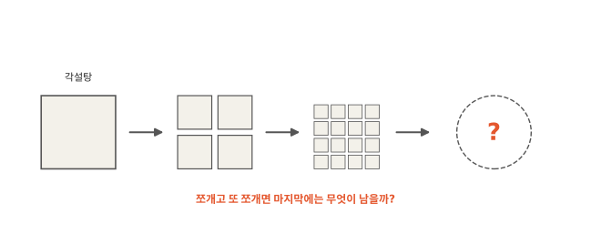
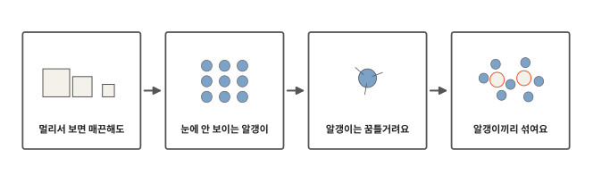
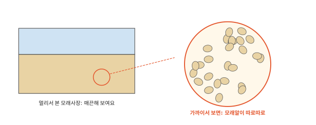
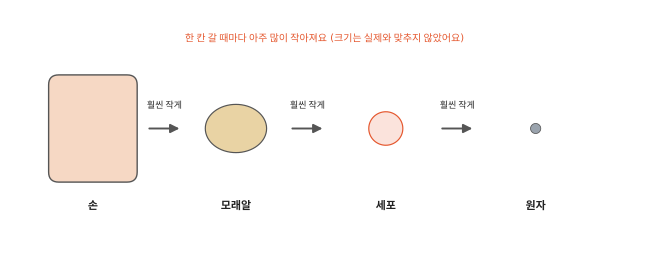
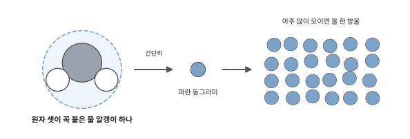
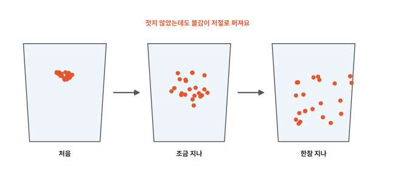
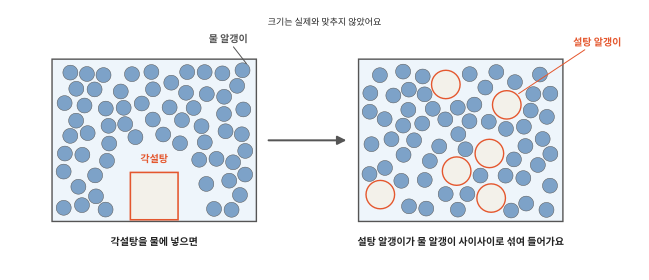

# 물, 돌, 공기는 무엇으로 되어 있을까요?

## 각설탕을 쪼개면

각설탕 하나를 숟가락으로 톡 쳐서 둘로 쪼개 봐요. 그 조각을 또 쪼개고 또 쪼개요. 조각은 점점 작아져서 나중에는 고운 가루가 돼요.

가루 한 알을 또 쪼개고 또 쪼갤 수 있다면 마지막에는 무엇이 남을까요?

## 이 편에서 볼 것

이제부터 물, 얼음, 불, 빛, 전기가 왜 그렇게 되는지 하나씩 알아봐요. 첫 편에서는 물, 설탕, 돌, 공기가 무엇으로 되어 있는지 봐요.

## 멀리서 보면 매끈해도

모래사장을 멀리서 보면 매끈한 판처럼 보여요. 가까이 가서 한 줌 쥐어 보면 작은 모래알이 따로따로 모여 있어요.

물이나 유리, 쇠는 아무리 가까이 봐도 매끈해요. 그런데 이것들도 모래사장처럼 아주 작은 알갱이가 모여 있어요. 알갱이가 너무너무 작아서 우리 눈에는 매끈하게 보여요.

각설탕도 그래요. 쪼개고 쪼개다 보면 더는 쪼갤 수 없는 설탕 알갱이 하나에 닿아요. 이 알갱이 하나도 설탕이에요.

## 눈에 안 보이는 알갱이

물, 설탕, 돌, 공기, 그리고 우리 몸도 모두 눈에 안 보이는 알갱이가 모여 있어요. 그런데 설탕 알갱이를 억지로 더 쪼개면 더 작은 조각들이 나와요. 이 조각은 더는 설탕이 아니에요. 단맛도 없어요. 알갱이를 이루는 이 기본 조각을 **원자**라고 해요.

원자는 얼마나 작을까요? [인체 1편](../body/01-cells.md)에서 우리 몸을 이루는 작은 방인 세포는 대부분 현미경이 있어야 보인다고 했어요. 원자는 그 세포보다도 훨씬 작아요. 세포 하나 안에도 원자가 셀 수 없이 많아요. 학교 현미경으로도 원자는 보이지 않아요.

물 알갱이 하나는 원자 세 개가 꼭 붙어 한 덩어리로 움직여요. 원자 하나가 그대로 알갱이인 것도 있어요. 앞으로 그림에서는 물 알갱이를 파란 동그라미 하나로 그릴게요. 물 한 방울에는 이런 물 알갱이가 어마어마하게 많이 들어 있어요.

## 알갱이는 꿈틀거려요

모래알은 가만히 놓아두면 그 자리에 있어요. 눈에 안 보이는 알갱이는 달라요. 한순간도 쉬지 않고 꿈틀거려요. 쇠나 얼음 속 알갱이는 제자리에서 떨어요. 물이나 공기 속 알갱이는 이리저리 돌아다녀요.

물이 든 컵에 물감을 한 방울 떨어뜨려 봐요. 처음에는 물감이 떨어진 힘과 물의 흐름에 실려 퍼져요. 물이 잔잔해진 뒤에도 물감은 아주 천천히 계속 퍼져요. 젓지 않아도 다음 날이면 물 전체가 물들어요. 물 알갱이와 물감 알갱이가 쉬지 않고 움직이다 서로 부딪히며 섞이기 때문이에요.

부엌에서 귤껍질을 까면 조금 뒤에 방 건너편에서도 귤 냄새가 나요. 방 안 공기의 흐름이 냄새를 실어 나르기도 하고 냄새 알갱이도 스스로 공기 알갱이 사이를 이리저리 움직여요.

## 알갱이끼리 섞여요

각설탕을 물에 넣고 저어 보세요. 각설탕은 점점 작아지다가 보이지 않게 돼요. 그래도 물을 맛보면 달아요. 설탕은 물속에 그대로 있어요. 설탕 알갱이가 하나하나 떨어져 나와 물 알갱이 사이사이로 섞여 들어갔어요. 알갱이 하나는 너무 작아서 눈에 보이지 않아요.

물 알갱이가 쉬지 않고 돌아다니며 설탕 알갱이를 사이사이로 데려가요. 모래와 물을 섞으면 모래알은 가라앉아 그대로 보여요. 설탕은 알갱이 하나하나로 흩어져서 안 보여요.

같은 물 알갱이로 된 얼음은 단단하고 물은 출렁여요. 왜 그럴까요? 다음 편에서 볼게요.

## 정리

- 물, 설탕, 돌, 공기는 모두 눈에 안 보이는 알갱이가 모여 있어요.
- 원자: 알갱이를 이루는 기본 조각이에요. 물 알갱이 하나는 원자 셋이 붙은 거예요. 세포보다도 훨씬 작아요.
- 알갱이는 늘 꿈틀거려요. 쇠 속에서는 제자리에서 떨고 물과 공기 속에서는 돌아다녀요.
- 설탕이 물에 녹으면 설탕 알갱이가 물 알갱이 사이사이로 섞여 들어가요.

## 해 보기: 알갱이가 움직이는 증거 찾기

1. 투명한 컵에 물을 담고 잔잔해질 때까지 기다려요. 물감을 한 방울 떨어뜨리고(옷에 묻지 않게 조심해요) 젓지 말고 지켜봐요. 1분 뒤, 10분 뒤에 어떻게 달라졌는지 그려 봐요. 컵을 그대로 두었다가 다음 날 아침에 한 번 더 그려 봐요.
2. 깨끗한 새 컵에 마시는 물을 담고 각설탕 하나를 넣어 저어요. 다 녹을 때까지 지켜봐요. 녹은 뒤 물을 조금 맛보세요. 물감을 넣은 1번 컵은 맛보지 않아요. 설탕은 어디로 갔을까요?
3. 가족 한 사람이 방 한쪽에서 귤껍질을 까요. 나는 방 반대쪽에서 기다려요. 냄새가 언제쯤 오는지 손을 들어 알려요.

## 확인 문제

??? question "1. 물 알갱이"
    물 알갱이 하나에는 원자가 몇 개 붙어 있을까요?

    **풀이**: 세 개예요. 원자는 알갱이를 이루는 기본 조각이에요. 세포보다도 훨씬 작아서 눈으로 볼 수 없어요.

??? question "2. 물감이 퍼지는 까닭"
    젓지 않았는데도 컵 속 물감이 저절로 퍼지는 것은 왜일까요?

    **풀이**: 물 알갱이와 물감 알갱이가 늘 움직이며 서로 부딪히고 섞여요. 그래서 물이 잔잔해진 뒤에도 천천히 계속 퍼져요.

??? question "3. 설탕은 어디로"
    각설탕을 물에 녹이면 보이지 않는데도 물이 단 것은 왜일까요?

    **풀이**: 설탕 알갱이가 하나하나 떨어져 물 알갱이 사이사이로 섞여 들어갔어요. 알갱이 하나는 너무 작아서 안 보여요. 설탕은 물속에 그대로 있어요.

!!! abstract "어른을 위한 정리 (건너뛰어도 돼요)"
    - 물질은 공간을 차지하고 질량이 있는 모든 것이에요. 원자는 원소의 성질을 지닌 가장 작은 입자예요. 분자는 원자 둘 이상이 화학 결합으로 단단히 묶인 것이에요.[^matter] 본문의 "알갱이"는 원자와 분자를 함께 가리켜요. 물 알갱이는 물 분자(수소 원자 둘, 산소 원자 하나)예요.
    - 모든 물질이 작고 한정된 입자로 되어 있다는 생각은 기원전 5세기 그리스의 레우키포스와 데모크리토스까지 거슬러 올라가요. 원자(atom)라는 말은 "나눌 수 없는"이라는 그리스어에서 왔어요. 1800년대 초 돌턴은 물질이 원자라는 아주 작은 입자로 되어 있다는 원자설을 내놓았어요. 1982년 이전 미국 구리 1센트 동전 하나에 구리 원자가 약 3×10²²개 들어 있다고 해요.[^atom]
    - 기체 분자는 끊임없이 움직이며 서로 부딪혀요. 상온에서 산소 분자의 평균 속력은 초속 수백 미터 정도예요. 분자의 평균 운동 에너지는 절대 온도에 비례해요.[^kmt] 냄새와 물감이 퍼지는 확산은 이 무작위 운동의 결과예요. 실제 컵과 방에서는 물과 공기의 흐름이 퍼짐을 크게 거들어요. 액체 속 분자는 서로 늘 맞닿은 채 지나가며 움직이고 고체 속 분자는 정해진 자리 둘레에서 진동해요.[^imf] 설탕이 녹을 때 설탕 분자(원자 약 45개)는 물 분자(원자 3개)보다 훨씬 커요. 그래서 설탕 분자가 물 분자 사이 빈틈에 끼어드는 것이 아니라 물 분자들 사이로 섞여 들어가며 자리를 나눠 가져요.
    - 원자는 빛을 쓰는 광학 현미경으로는 볼 수 없어요. 원자 하나하나의 모습은 전자 현미경이나 주사 터널링 현미경 같은 특수 장비로만 얻을 수 있어요.[^matter]

## 더 깊이

??? info "아주 옛날 사람도 알갱이를 생각했어요"
    2,400년쯤 전 그리스의 데모크리토스는 물건을 계속 쪼개면 더는 쪼갤 수 없는 알갱이가 남을 거라고 생각했어요. 그때는 눈으로 확인할 방법이 없었어요. 사람들이 원자가 정말 있다는 증거를 모은 건 그보다 아주 한참 뒤의 일이에요.

??? info "원자도 더 쪼갤 수 있을까"
    원자 안에는 더 작은 것들이 들어 있다는 사실이 나중에 밝혀졌어요. 금 덩이를 계속 쪼개다 보면 금 원자 하나에 닿아요. 금 원자를 쪼개면 더는 금이 아니에요.

[^matter]: OpenStax, *Chemistry 2e*, 1.2 ["Phases and Classification of Matter"](https://openstax.org/books/chemistry-2e/pages/1-2-phases-and-classification-of-matter).
[^atom]: OpenStax, *Chemistry 2e*, 2.1 ["Early Ideas in Atomic Theory"](https://openstax.org/books/chemistry-2e/pages/2-1-early-ideas-in-atomic-theory).
[^kmt]: OpenStax, *Chemistry 2e*, 9.5 ["The Kinetic-Molecular Theory"](https://openstax.org/books/chemistry-2e/pages/9-5-the-kinetic-molecular-theory).
[^imf]: OpenStax, *Chemistry 2e*, 10.1 ["Intermolecular Forces"](https://openstax.org/books/chemistry-2e/pages/10-1-intermolecular-forces).
