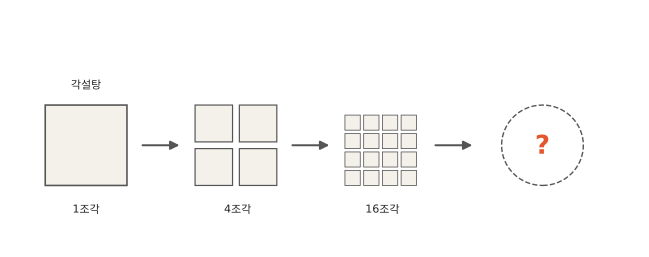
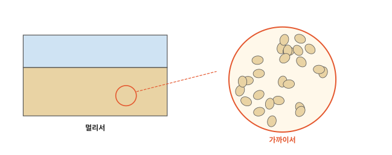
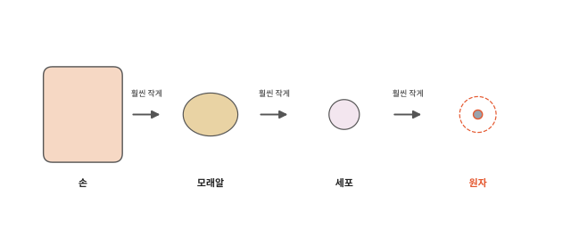
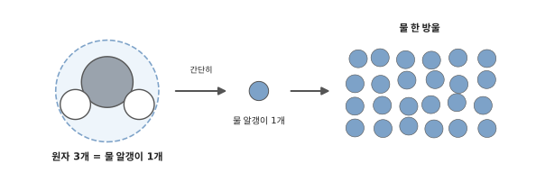
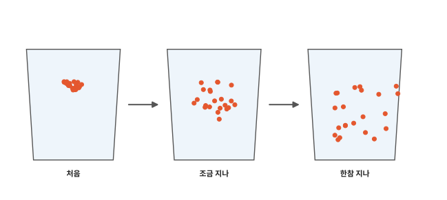
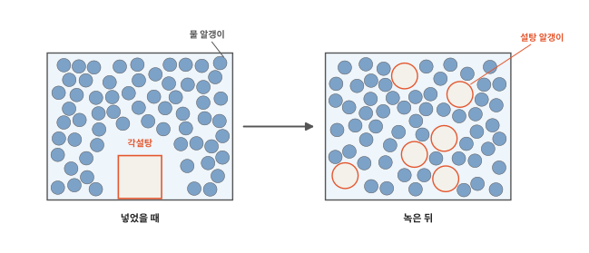

# 알갱이와 원자: 물, 돌, 공기를 이루는 조각

각설탕을 물에 넣고 저으면 점점 작아지다가 안 보이게 돼요. 그런데 물을 맛보면 달아요. 이 글을 읽고 나면 설탕이 어디로 갔는지 알게 돼요. 물, 설탕, 돌, 공기는 모두 눈에 안 보이는 작은 알갱이로 되어 있거든요. 이 이야기 모음에서 볼 얼음, 물방울, 소금 이야기도 모두 이 알갱이에서 출발해요.

!!! abstract "이 글에서 알게 되는 것"
    1. 물, 설탕, 돌, 공기는 모두 눈에 안 보이는 작은 알갱이가 모여 있어요. 알갱이가 너무 작아서 매끈해 보일 뿐이에요.
    2. 알갱이를 더 쪼개면 원자라는 기본 조각이 나와요. 물 알갱이 하나는 원자 셋이 붙은 거예요.
    3. 알갱이는 쉬지 않고 꿈틀거려요. 그래서 물감은 젓지 않아도 퍼지고 설탕은 물 알갱이 사이로 섞여 들어가요.

## 1. 매끈해 보이는 것도 알갱이가 모여 있어요

각설탕 하나를 숟가락으로 톡 쳐서 둘로 쪼개 봐요. 그 조각을 또 쪼개고 또 쪼개요. 조각은 점점 작아져서 나중에는 고운 가루가 돼요. 가루 한 알을 계속 쪼갤 수 있다면 마지막에는 무엇이 남을까요?

아래 그림에서 오른쪽 끝 물음표를 보세요.

**그림 1.** 각설탕은 쪼갤수록 조각이 작아지고 많아져요. 맨 끝에 남는 것은 눈으로 볼 수 없어요.
{ .fig-cap }

맨 끝에는 설탕 알갱이 하나가 남아요. 설탕인 채로는 더 쪼갤 수 없는 가장 작은 조각이에요. 이 알갱이 하나도 설탕이에요. 다만 너무 작아서 눈에 보이지 않아요.

여기서 이런 생각이 들 거예요. 각설탕은 겉이 매끈한 덩어리인데 정말 알갱이가 모여 있을까요? 모래사장을 떠올려 보세요. 아래 그림에서 왼쪽 모래사장과 오른쪽 빨간 동그라미 안을 비교해 보세요.

**그림 2.** 멀리서는 매끈한 판 같은 모래사장도 가까이서 보면 모래알이 따로따로 모여 있어요.
{ .fig-cap }

모래사장은 멀리서 보면 매끈한 판 같아요. 가까이 가서 한 줌 쥐어 보면 작은 모래알이 따로따로 모여 있죠. 물이나 유리, 쇠는 아무리 가까이 봐도 매끈해요. 그런데 이것들도 모래사장처럼 아주 작은 알갱이가 모여 있어요. 알갱이 하나가 너무너무 작아서 우리 눈에는 매끈하게 보여요.

물, 설탕, 돌, 공기도 그렇고 우리 몸도 그래요. 모두 눈에 안 보이는 알갱이가 모여 있어요.

## 2. 알갱이를 더 쪼개면 원자가 나와요

앞에서 각설탕을 끝까지 쪼개면 설탕 알갱이 하나가 남는다고 했어요. 이 알갱이를 억지로 한 번 더 쪼개면 어떻게 될까요?

더 작은 조각들이 나와요. 그런데 이 조각은 더는 설탕이 아니에요. 단맛도 없어요. 알갱이를 이루는 이 기본 조각을 **원자**라고 해요. 설탕 알갱이 하나는 원자 여러 개가 붙어서 된 거예요.

원자는 얼마나 작을까요? [인체 1편](../body/01-cells.md)에서 우리 몸을 이루는 작은 방인 세포는 대부분 현미경이 있어야 보인다고 했어요. 아래 그림에서 손부터 원자까지 차례로 작아지는 것을 보세요.

**그림 3.** 손에서 모래알, 세포, 원자로 한 칸 갈 때마다 훨씬 작아져요. 그림의 크기는 실제와 맞추지 않았어요.
{ .fig-cap }

원자는 세포보다도 훨씬 작아요. 세포 하나 안에도 원자가 셀 수 없이 많아요. 그래서 학교 현미경으로도 원자는 보이지 않아요.

## 3. 물 알갱이 하나는 원자 셋이 붙은 거예요

이번에는 각설탕을 녹일 물을 들여다볼게요. 물도 알갱이가 모여 있어요. 물 알갱이 하나는 원자 세 개가 꼭 붙어서 한 덩어리로 움직여요. 원자 하나가 그대로 알갱이인 것도 있어요.

원자를 하나하나 그리면 그림이 복잡해져요. 아래 그림에서 왼쪽 원자 셋이 가운데 파란 동그라미 하나로 바뀌는 것을 보세요.

**그림 4.** 원자 셋이 붙은 물 알갱이를 이제부터 파란 동그라미 하나로 그려요.
{ .fig-cap }

이제부터 그림에서는 물 알갱이를 파란 동그라미 하나로 그릴게요. 물 한 방울에는 이런 물 알갱이가 어마어마하게 많이 들어 있어요.

## 4. 알갱이는 쉬지 않고 꿈틀거려요

모래알은 가만히 놓아두면 그 자리에 있어요. 눈에 안 보이는 알갱이는 달라요. 한순간도 쉬지 않고 꿈틀거려요. 쇠나 얼음 속 알갱이는 제자리에서 꿈틀거려요. 물이나 공기 속 알갱이는 이리저리 돌아다녀요.

알갱이는 보이지 않는데 움직이는 걸 어떻게 알까요? 투명한 컵에 물을 담아 잔잔해질 때까지 두었다가 물감을 한 방울 떨어뜨려 보세요. 젓지 말고 지켜봐요. 아래 그림에서 컵 셋의 빨간 점이 어떻게 달라지는지 보세요.

**그림 5.** 젓지 않았는데도 한곳에 모여 있던 물감이 컵 곳곳으로 퍼져요.
{ .fig-cap }

처음에는 물감이 떨어진 힘과 물의 흐름에 실려 퍼져요. 물이 잔잔해진 뒤에도 물감은 아주 천천히 계속 퍼져요. 다음 날이면 물 전체가 물들어요. 물 알갱이와 물감 알갱이가 쉬지 않고 움직이다 서로 부딪히며 섞이기 때문이에요.

냄새도 그래요. 부엌에서 귤껍질을 까면 조금 있다가 방 건너편에서도 귤 냄새가 나요. 방 안 공기의 흐름이 냄새를 실어 나르기도 하고 냄새 알갱이가 스스로 공기 알갱이 사이를 이리저리 움직이기도 해요.

## 5. 설탕은 녹으면 물 알갱이 사이로 섞여 들어가요

이제 처음 물음으로 돌아갈게요. 각설탕을 물에 넣고 저으면 점점 작아지다가 보이지 않게 돼요. 그래도 물을 맛보면 달아요. 설탕이 물속에 그대로 있다는 뜻이에요.

아래 그림에서 왼쪽 각설탕과 오른쪽 빨간 테두리 동그라미를 보세요.

**그림 6.** 녹은 뒤에는 설탕 알갱이가 하나하나 떨어져서 물 알갱이 사이사이에 섞여 있어요.
{ .fig-cap }

설탕 알갱이가 각설탕에서 하나하나 떨어져 나와 물 알갱이 사이사이로 섞여 들어갔어요. 알갱이 하나는 너무 작아서 눈에 보이지 않아요. 그래서 설탕은 사라진 것처럼 보여도 단맛은 남아요. 그림에서는 알갱이를 크게 그렸어요. 설탕 알갱이가 물 알갱이보다 크다는 것만 실제와 같아요.

설탕 알갱이를 사이사이로 데려가는 건 쉬지 않고 돌아다니는 물 알갱이예요. 모래는 달라요. 모래와 물을 섞으면 모래알은 가라앉아 그대로 보여요. 설탕은 알갱이 하나하나로 흩어져서 안 보여요.

## 정리

물, 설탕, 돌, 공기는 모두 눈에 안 보이는 알갱이가 모여 있어요. 모래사장처럼 알갱이가 따로따로 있는데 하나하나가 너무 작아서 매끈해 보여요.

알갱이를 더 쪼개면 더는 그 물질이 아닌 기본 조각이 나와요. 이 조각이 원자예요. 원자는 세포보다도 훨씬 작고 물 알갱이 하나는 원자 셋이 붙은 거예요.

알갱이는 쉬지 않고 꿈틀거려요. 쇠와 얼음 속에서는 제자리에서 꿈틀거리고 물과 공기 속에서는 돌아다녀요. 그래서 물감은 젓지 않아도 퍼지고 물에 넣은 각설탕은 설탕 알갱이가 되어 물 알갱이 사이로 섞여 들어가요.

같은 물 알갱이로 된 얼음은 단단하고 물은 출렁여요. 왜 그런지는 [2편](02-states.md)에서 볼게요.

### 새로 나온 말

- **알갱이**: 물, 설탕, 공기 같은 것을 이루는 눈에 안 보이는 작은 덩어리. 각설탕을 끝까지 쪼개면 설탕 알갱이 하나가 남아요.
- **원자**: 알갱이를 이루는 기본 조각. 물 알갱이 하나는 원자 셋이 붙어 있어요.
