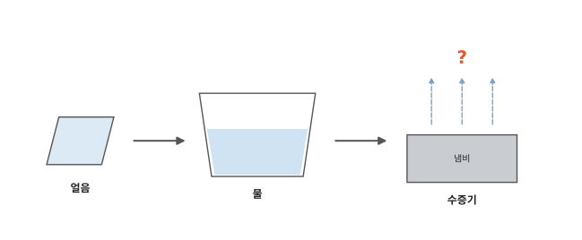
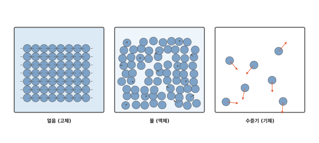
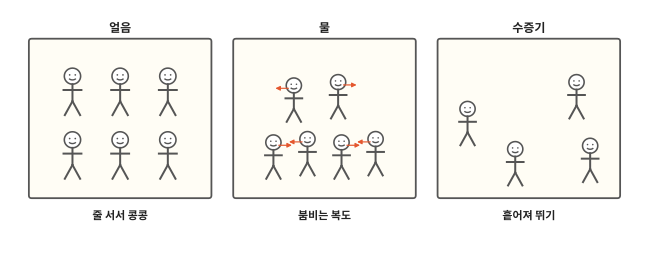
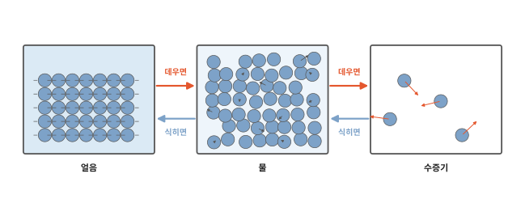
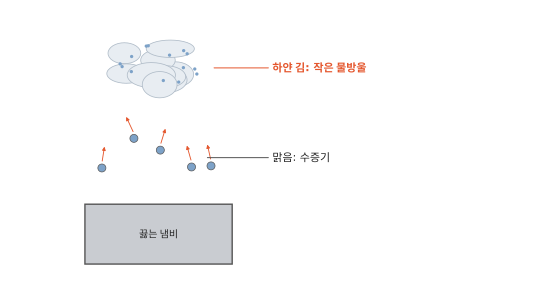
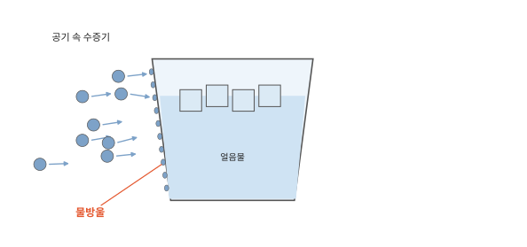

# 얼음, 물, 수증기: 같은 알갱이의 세 모습

냉동실에서 꺼낸 얼음은 손에 쥐어도 모양이 그대로예요. 컵에 두면 녹아서 물이 되고 컵을 기울이면 쏟아져요. 냄비에 물을 오래 끓이면 물이 줄어들고요. 이 글을 읽고 나면 셋 다 같은 물인데 왜 모양이 이렇게 다른지 알게 돼요. 이 까닭을 알면 냄비 위 하얀 김과 얼음물 컵 바깥에 맺히는 물방울이 어디서 왔는지도 설명할 수 있어요.

!!! abstract "이 글에서 알게 되는 것"
    1. 얼음, 물, 수증기는 모두 같은 물 알갱이로 되어 있어요. 알갱이끼리 붙잡는 힘과 알갱이가 꿈틀거리는 세기가 모양을 정해요.
    2. 알갱이가 꼭 붙어 제자리에서 꿈틀거리면 고체, 붙은 채 스치며 지나가면 액체, 멀리 떨어져 날아다니면 기체예요.
    3. 데우면 알갱이가 세게 꿈틀거려 풀려나고 식히면 다시 붙어요. 하얀 김과 컵 바깥 물방울은 수증기가 식어서 모인 물이에요.

## 1. 얼음, 물, 수증기는 모두 같은 물 알갱이예요

얼음이 물이 되고 물이 수증기가 되는 길을 먼저 따라가 볼게요. 아래 그림에서 냄비 위 물음표를 보세요.

**그림 1.** 얼음이 녹으면 물이 되고 물을 끓이면 눈에 안 보이는 수증기가 되어 공기 속으로 흩어져요.
{ .fig-cap }

냄비의 물이 줄어드는 건 물이 수증기가 되어 공기 속으로 흩어졌기 때문이에요. 수증기는 눈에 보이지 않아요. 그래서 물이 그냥 사라진 것처럼 보여요.

[1편](01-particles.md)에서 물은 늘 꿈틀거리는 작은 물 알갱이가 모여 있다고 했어요. 얼음과 수증기도 들여다보면 같은 물 알갱이가 보여요. 아래 그림에서 세 칸의 파란 동그라미가 어떻게 놓여 있는지 비교해 보세요.

**그림 2.** 세 칸 모두 같은 물 알갱이인데 얼음은 줄 맞춰 붙어 있고 물은 줄 없이 붙어 있고 수증기는 멀리 흩어져 있어요.
{ .fig-cap }

알갱이는 같아요. 알갱이가 얼마나 꼭 붙어 있고 얼마나 세게 꿈틀거리는지가 달라요. 그림에서는 알갱이 크기와 사이 거리를 실제와 맞추지 않았어요. 물도 얼음만큼 빽빽하게 그렸는데 사실 물은 얼면 알갱이 사이가 오히려 벌어져요. 이 이야기는 [6편](06-density.md)에서 봐요.

## 2. 붙잡는 힘과 꿈틀거림이 모양을 정해요

알갱이끼리는 서로 붙잡는 힘이 있어요. 그런데 알갱이는 늘 꿈틀거려요. 세게 꿈틀거릴수록 붙잡은 손을 놓치기 쉬워요.

그래서 두 힘 가운데 어느 쪽이 센지가 모양을 정해요. 붙잡는 힘이 세면 알갱이는 꼭 붙어 있어요. 꿈틀거림이 세면 알갱이는 흩어져요. 둘이 비슷하면 그 중간이에요.

운동장 아이들로 떠올려 보면 쉬워요. 아래 그림에서 세 칸의 아이들이 움직이는 모습을 보세요.

**그림 3.** 줄 서서 콩콩 뛰는 아이들, 붐비는 복도의 아이들, 흩어져 뛰는 아이들이 얼음, 물, 수증기의 알갱이와 닮았어요.
{ .fig-cap }

다만 아이들과 알갱이는 두 가지가 달라요. 아이들끼리는 붙잡는 힘이 없어요. 그리고 아이들은 줄을 설지 뛰어다닐지 스스로 정하지만 알갱이는 데우고 식히는 데 따라 저절로 바뀌어요. 이제 세 모습을 하나씩 볼게요.

## 3. 얼음 속 알갱이는 꼭 붙어 제자리에서 꿈틀거려요

얼음 속 물 알갱이는 약하게 꿈틀거려요. 붙잡는 힘이 훨씬 세서 알갱이들은 줄을 맞춰 꼭 붙은 채 제자리에서 꿈틀거리기만 해요. 그림 3에서 줄 서서 콩콩 뛰는 아이들처럼 몸은 들썩여도 줄 밖으로 나가지 않아요. 서로 자리를 바꾸지 못하니까 얼음은 모양이 그대로예요.

얼음처럼 모양이 정해져 있고 단단한 것을 **고체**라고 해요. 돌, 나무, 숟가락도 고체예요. 설탕 가루나 모래는 쏟으면 흐르지만 한 알 한 알은 단단한 고체예요.

## 4. 물속 알갱이는 붙은 채 스치며 지나가요

얼음을 따뜻한 곳에 두면 알갱이가 더 세게 꿈틀거려요. 그러다 줄에서 풀려나요. 물에서는 붙잡는 힘과 꿈틀거림이 비슷해요. 그래서 알갱이들은 여전히 붙어 있으면서도 서로 스치며 자리를 바꿔요. 쉬는 시간에 붐비는 복도에서 아이들이 어깨를 스치며 지나가는 모습과 닮았어요.

알갱이가 자리를 바꿀 수 있으니까 물은 그릇 모양을 따라가고 기울이면 흘러요. 물처럼 흐르고 그릇 모양을 따르는 것을 **액체**라고 해요. 우유, 주스, 기름도 액체예요.

## 5. 수증기 속 알갱이는 흩어져 날아다녀요

물을 데우면 알갱이가 더욱 세게 꿈틀거려요. 아주 세게 꿈틀거리는 알갱이는 붙잡는 손을 놓치고 혼자 날아가요. 그렇게 풀려난 알갱이들은 서로 멀리 떨어져 아무렇게나 날아다녀요.

알갱이가 흩어져 날아다니며 퍼지는 것을 **기체**라고 해요. 우리가 숨 쉬는 공기도 기체예요. 물이 기체가 된 것을 **수증기**라고 불러요. 알갱이가 멀리 흩어져 있어서 수증기는 눈에 보이지 않아요.

물은 끓지 않아도 조금씩 수증기가 돼요. 젖은 빨래가 마르는 것도 그래서예요. 이 이야기는 [4편](04-evaporation.md)에서 자세히 봐요.

## 6. 식히면 알갱이가 다시 모여요

지금까지는 데우는 쪽으로 갔어요. 거꾸로 식히면 어떻게 될까요? 아래 그림에서 아래쪽 파란 화살표를 따라가 보세요.

**그림 4.** 데우면 얼음에서 물, 수증기로 가고 식히면 수증기에서 물, 얼음으로 거꾸로 가요.
{ .fig-cap }

식히면 알갱이의 꿈틀거림이 약해져요. 그러면 붙잡는 힘이 다시 이겨요. 수증기는 물이 되고 물은 아주 추운 곳에서 얼음이 돼요.

냄비 위에 하얗게 피어오르는 김도 식어서 생긴 거예요. 아래 그림에서 냄비 바로 위와 조금 더 위를 비교해 보세요.

**그림 5.** 냄비 바로 위는 수증기라서 맑고 조금 더 위에서 수증기가 식어 하얀 김이 돼요.
{ .fig-cap }

수증기가 냄비 위로 올라가다 찬 공기를 만나 식으면 알갱이들이 다시 모여 아주 작은 물방울이 돼요. 이 물방울이 수없이 모이면 하얗게 보여요. 그래서 하얀 김은 수증기가 아니에요. 아주 작은 물방울이에요. 수증기는 김 아래 맑은 곳에 있어요. 추운 날 하얗게 보이는 입김도 같은 일이에요.

얼음물이 든 컵 바깥에 맺히는 물방울도 그래요. 아래 그림에서 컵 쪽으로 오는 파란 알갱이를 보세요.

**그림 6.** 공기 속 수증기가 차가운 컵에 닿아 식으면 모여서 컵 바깥에 물방울로 맺혀요.
{ .fig-cap }

우리 둘레 공기에는 보이지 않는 수증기가 섞여 있어요. 공기 속 물 알갱이가 차가운 컵에 닿아 식으면 서로 붙어 물방울이 돼요. 컵 바깥의 물방울은 컵 속에서 새어 나온 물이 아니에요. 공기에서 온 물이에요. 추운 밖에 있다가 따뜻한 방에 들어오면 안경이 뿌옇게 되는 것도 같은 일이에요. 차가워진 안경에 방 공기 속 수증기가 닿아 물방울이 맺혀요.

## 정리

얼음, 물, 수증기는 모두 같은 물 알갱이로 되어 있어요. 알갱이끼리 붙잡는 힘과 알갱이가 꿈틀거리는 세기 가운데 어느 쪽이 센지가 모양을 정해요.

얼음 속 알갱이는 꼭 붙어 제자리에서 꿈틀거려서 모양이 그대로예요. 이런 것을 고체라고 해요. 물속 알갱이는 붙은 채 스치며 자리를 바꿔서 그릇 모양을 따라 흘러요. 이런 것을 액체라고 해요. 수증기 속 알갱이는 멀리 떨어져 날아다녀요. 이런 것을 기체라고 해요. 물이 기체가 된 수증기는 눈에 보이지 않아요.

데우면 알갱이가 세게 꿈틀거려 풀려나고 식히면 다시 붙어요. 냄비 위 하얀 김과 얼음물 컵 바깥 물방울은 수증기가 식어서 다시 모인 물이에요.

그런데 데운다는 건 알갱이에게 무엇을 해 주는 걸까요? [3편](03-heat.md)에서 볼게요.

### 새로 나온 말

- **고체**: 알갱이가 꼭 붙어 제자리에서 꿈틀거려서 모양이 정해져 있고 단단한 것. 얼음, 돌, 숟가락이 고체예요.
- **액체**: 알갱이가 붙은 채 스치며 자리를 바꿔서 흐르고 그릇 모양을 따르는 것. 물, 우유, 기름이 액체예요.
- **기체**: 알갱이가 멀리 떨어져 날아다니며 퍼지는 것. 공기와 수증기가 기체예요.
- **수증기**: 물이 기체가 된 것. 눈에 보이지 않아요. 냄비 위 하얀 김은 수증기가 식어서 생긴 작은 물방울이에요.
