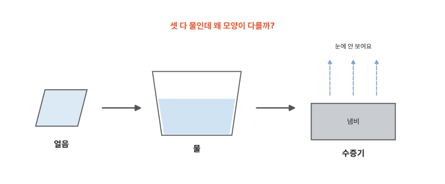
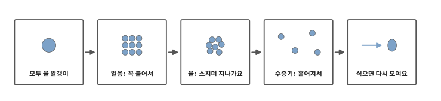
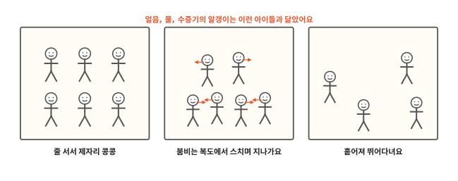
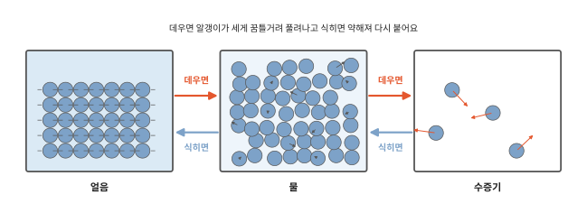
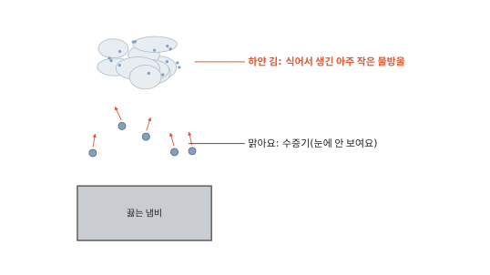
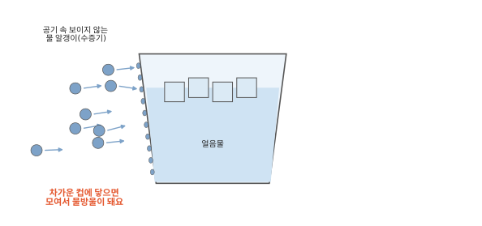

# 얼음, 물, 수증기는 왜 모양이 다를까요?

## 얼음이 녹고 물이 줄어요

냉동실에서 꺼낸 얼음은 손에 쥐어도 모양이 그대로예요. 컵에 두면 녹아서 물이 되고 컵을 기울이면 쏟아져요. 냄비에 물을 오래 끓이면 물이 줄어들어요. 물이 눈에 안 보이는 수증기가 되어 공기 속으로 흩어졌거든요.

셋 다 물인데 왜 이렇게 모양이 다를까요?

## 이 편에서 볼 것

[1편](01-particles.md)에서 물, 돌, 공기는 늘 꿈틀거리는 아주 작은 알갱이가 모여 있다고 했어요. 이번에는 같은 물 알갱이가 어떻게 얼음도 되고 물도 되고 수증기도 되는지 봐요.

## 모두 물 알갱이

얼음, 물, 수증기를 아주아주 크게 들여다보면 모두 같은 물 알갱이가 보여요. 다른 건 알갱이가 얼마나 꼭 붙어 있는지, 얼마나 세게 꿈틀거리는지예요.

알갱이끼리는 서로 붙잡는 힘이 있어요. 그런데 알갱이는 늘 꿈틀거려요. 세게 꿈틀거릴수록 붙잡은 손을 놓치기 쉬워요. 붙잡는 힘이 세면 알갱이는 꼭 붙어 있고 꿈틀거림이 세면 흩어져요.

## 얼음: 꼭 붙어서

얼음 속 물 알갱이는 약하게 꿈틀거려요. 붙잡는 힘이 훨씬 세서 알갱이들은 줄을 맞춰 꼭 붙은 채 제자리에서 떨기만 해요. 서로 자리를 바꾸지 못하니까 얼음은 모양이 그대로예요.

얼음처럼 모양이 정해져 있고 단단한 것을 **고체**라고 해요. 돌, 나무, 숟가락도 고체예요. 설탕 가루나 모래는 쏟으면 흐르지만 한 알 한 알은 단단한 고체예요.

운동장에서 아이들이 줄을 서서 제자리에서 콩콩 뛰는 모습을 떠올려 보세요. 몸은 들썩여도 줄 밖으로 나가지 않아요. 얼음 속 알갱이가 꼭 그래요. 다만 아이들과 알갱이는 두 가지가 달라요. 아이들끼리는 붙잡는 힘이 없어요. 그리고 아이들은 줄을 설지 뛰어다닐지 스스로 정하지만 알갱이는 데우고 식히는 데 따라 저절로 바뀌어요.

## 물: 스치며 지나가요

얼음을 따뜻한 곳에 두면 알갱이가 더 세게 꿈틀거리게 돼요. 그러다 줄에서 풀려나요. 물에서는 붙잡는 힘과 꿈틀거림이 비슷해요. 그래서 알갱이들은 여전히 붙어 있으면서도 서로 스치며 자리를 바꿔요. 물이 그릇 모양을 따라가고 기울이면 흐르는 까닭이에요.

물처럼 흐르고 그릇 모양을 따르는 것을 **액체**라고 해요. 우유, 주스, 기름도 액체예요. 쉬는 시간 붐비는 복도에서 아이들이 어깨를 스치며 지나가는 모습과 닮았어요.

## 수증기: 흩어져서

물을 데우면 알갱이가 더욱 세게 꿈틀거려요. 아주 세게 꿈틀거리는 알갱이는 붙잡는 손을 놓치고 혼자 날아가요. 알갱이끼리 멀리 떨어져 아무렇게나 날아다녀요.

알갱이가 흩어져 날아다니며 퍼지는 것을 **기체**라고 해요. 우리가 숨 쉬는 공기도 기체예요. 물이 기체가 된 것을 수증기라고 불러요. 수증기는 눈에 보이지 않아요.

물은 끓지 않아도 조금씩 수증기가 돼요. 젖은 빨래가 마르는 것도 그래서예요. 이 이야기는 4편에서 자세히 봐요.

## 식으면 다시 모여요

거꾸로 식히면 알갱이의 꿈틀거림이 약해져요. 그러면 붙잡는 힘이 다시 세져요. 수증기는 물이 되고 물은 아주 추운 곳에서 얼음이 돼요.

냄비 위에 하얗게 피어오르는 김도 식어서 생긴 거예요. 수증기가 냄비 위로 올라가다 찬 공기를 만나 식으면 알갱이들이 다시 모여 아주 작은 물방울이 돼요. 이 물방울이 수없이 모이면 하얗게 보여요. 냄비 바로 위가 맑고 조금 위에서 하얀 김이 생기는 것도 이 때문이에요. 추운 날 하얗게 보이는 입김도 같은 일이에요.

얼음물이 든 컵 바깥에도 물방울이 맺혀요. 우리 둘레 공기에는 보이지 않는 수증기가 섞여 있어요. 공기 속 물 알갱이가 차가운 컵에 닿아 식으면 서로 붙어 물방울이 돼요. 컵 바깥의 물방울은 공기에서 온 물이에요.

그런데 데운다는 건 알갱이에게 무엇을 해 주는 걸까요? 다음 편에서 볼게요.

## 정리

- 고체: 알갱이가 꼭 붙어 제자리에서 떨어요. 모양이 그대로예요(얼음).
- 액체: 알갱이가 붙은 채 스치며 자리를 바꿔요. 그릇 모양을 따라 흘러요(물).
- 기체: 알갱이가 멀리 떨어져 날아다녀요. 물이 기체가 된 수증기는 눈에 안 보여요.
- 데우면 알갱이가 세게 꿈틀거려 풀려나고 식히면 다시 붙어요. 하얀 김과 컵 바깥 물방울은 식어서 모인 물이에요.

## 해 보기: 물의 세 모습 관찰하기

1. 접시에 얼음 한 조각을 두고 10분마다 들여다봐요. 언제부터 물이 생기나요? 다 녹는 데 얼마나 걸리나요?
2. 컵에 얼음과 물을 넣고 바깥을 마른 휴지로 닦은 뒤 5분쯤 기다려요. 컵 바깥에 물방울이 생기나요? 그 물은 어디서 왔을까요?
3. 차가운 유리창에 "하-" 하고 입김을 불어 보세요. 유리가 뿌옇게 되는 까닭을 2번 컵과 같이 생각해 봐요.

## 확인 문제

??? question "1. 이름 붙이기"
    우유, 숟가락, 공기는 각각 고체, 액체, 기체 가운데 무엇일까요?

    **풀이**: 우유는 액체, 숟가락은 고체, 공기는 기체예요. 숟가락 속 알갱이는 꼭 붙어 제자리에서 떨고 우유 속 알갱이는 붙은 채 스치며 지나가요. 공기 속 알갱이는 멀리 떨어져 날아다녀요.

??? question "2. 하얀 김"
    냄비 위에 하얗게 보이는 김은 수증기일까요?

    **풀이**: 김은 아주 작은 물방울이에요. 수증기는 눈에 안 보여요. 수증기가 찬 공기에 식어서 다시 모이면 하얀 김이 돼요.

??? question "3. 뿌예진 안경"
    추운 밖에 있다가 따뜻한 방에 들어오면 안경이 뿌옇게 돼요. 왜일까요?

    **풀이**: 안경이 밖에서 차가워졌어요. 방 공기 속의 보이지 않는 물 알갱이가 차가운 안경에 닿아 식으면 모여서 아주 작은 물방울이 돼요. 얼음물 컵 바깥에 물방울이 맺히는 것과 같아요.

!!! abstract "어른을 위한 정리 (건너뛰어도 돼요)"
    - 고체는 단단하고 일정한 모양이 있어요. 액체는 흐르고 그릇 모양을 따르지만 부피는 거의 일정해요. 기체는 그릇의 모양과 부피를 모두 따라요.[^phases]
    - 고체의 입자는 빽빽하고 흔히 규칙적으로 배열되며 고정된 자리 둘레에서 진동해요. 액체의 입자는 가깝지만 규칙이 없고 서로 맞닿은 채 지나가요. 기체의 입자는 멀리 떨어져 서로 부딪칠 때 말고는 따로 움직여요. 입자 사이의 끌림(분자 사이 힘)은 입자를 붙잡으려 하고 입자의 운동 에너지는 그 끌림을 이겨 내려 해요. 둘의 크기에 따라 상태가 정해져요.[^imf]
    - 온도를 올리면 평균 운동 에너지가 커져요. 녹거나 끓는 동안에는 받은 열이 끌림을 끊는 데 쓰여서 온도가 그대로 머물러요. 물의 정상 녹는점은 0 °C, 정상 끓는점은 1기압에서 100 °C예요. 기체가 액체로 바뀌는 것을 응결이라 하고, 액체는 끓는점보다 낮은 온도에서도 증발해요.[^trans]
    - 수증기(기체 상태의 물)는 무색투명해요. 흔히 "김"이라 부르는 하얀 것은 수증기가 식어 응결한 미세한 물방울이에요.
    - 그림은 물을 얼음만큼 빽빽하게 그렸어요. 실제로 물은 얼면 오히려 간격이 벌어져 부피가 늘어요. 6편에서 다뤄요.

## 더 깊이

??? info "고체에서 바로 기체가 되기도 해요"
    드라이아이스는 녹아서 물처럼 되지 않고 바로 기체가 되어 사라져요. 눈과 얼음도 아주 추운 날 녹지 않고 조금씩 기체로 날아가기도 해요.

??? info "높은 산에서는 물이 더 낮은 온도에서 끓어요"
    물이 끓는 온도는 위에서 누르는 공기의 힘에 따라 달라져요. 공기가 옅은 높은 산에서는 100도보다 낮은 온도에서 끓어요.

[^phases]: OpenStax, *Chemistry 2e*, 1.2 ["Phases and Classification of Matter"](https://openstax.org/books/chemistry-2e/pages/1-2-phases-and-classification-of-matter).
[^imf]: OpenStax, *Chemistry 2e*, 10.1 ["Intermolecular Forces"](https://openstax.org/books/chemistry-2e/pages/10-1-intermolecular-forces).
[^trans]: OpenStax, *Chemistry 2e*, 10.3 ["Phase Transitions"](https://openstax.org/books/chemistry-2e/pages/10-3-phase-transitions).
