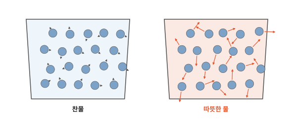
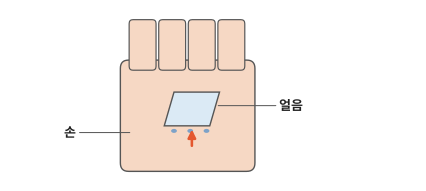
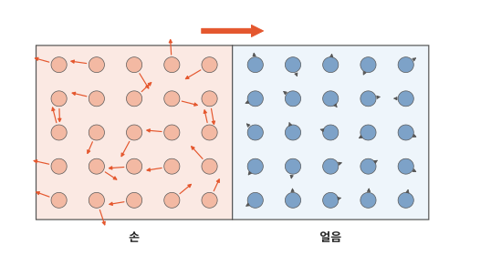
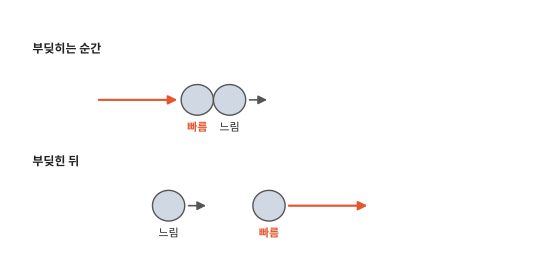
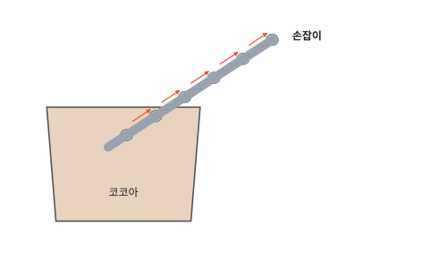
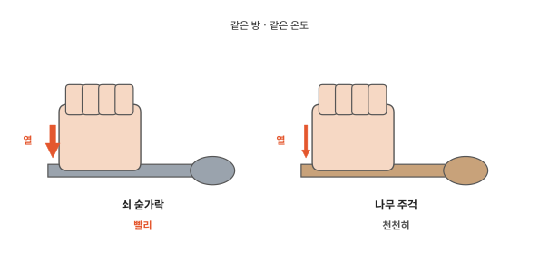
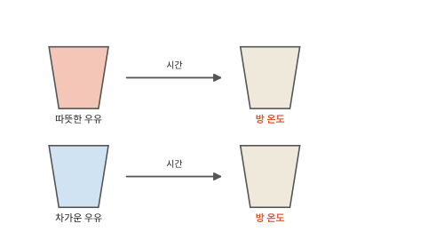

# 온도와 열: 알갱이의 꿈틀거림이 옮겨 가는 일

얼음 한 조각을 손바닥에 올려 두면 조금 지나 손이 시려요. 얼음은 녹기 시작하고요. 이 글을 읽고 나면 온도와 열이 무엇이고 그동안 손과 얼음 사이에서 무엇이 옮겨 갔는지 알게 돼요. 이걸 알면 같은 방에 둔 쇠 숟가락이 나무 주걱보다 차갑게 느껴지는 까닭도 설명할 수 있어요.

!!! abstract "이 글에서 알게 되는 것"
    1. 온도는 알갱이가 얼마나 세게 꿈틀거리는지를 말해요. 뜨거울수록 세게 꿈틀거려요.
    2. 온도가 다른 두 물건이 닿으면 알갱이끼리 부딪혀 꿈틀거림을 넘겨줘요. 이렇게 뜨거운 쪽에서 차가운 쪽으로 옮겨 가는 것을 열이라고 해요.
    3. 열은 닿은 곳부터 차례로 건너가고 두 물건의 온도가 같아지면 한쪽으로 옮겨 가기를 멈춰요. 쇠는 열을 빨리 전하고 나무는 천천히 전해요.

## 1. 뜨거운 물일수록 알갱이가 세게 꿈틀거려요

[1~2편](01-particles.md)에서 물은 늘 꿈틀거리는 아주 작은 알갱이로 되어 있다고 했어요. 데우면 알갱이가 세게 꿈틀거려서 얼음이 녹고 물이 끓는다고도 했고요. 이번에는 그 꿈틀거림에서 출발해 볼게요.

찬물 한 컵과 따뜻한 물 한 컵을 아주아주 크게 들여다본다고 생각해 보세요. 아래 그림에서 알갱이마다 달린 화살표 길이를 보세요. 화살표가 길수록 세게 꿈틀거리는 거예요. 알갱이 크기와 사이 거리는 실제와 맞추지 않았어요.

**그림 1.** 찬물과 따뜻한 물은 같은 물 알갱이인데 따뜻한 물 쪽 화살표가 더 길어요.
{ .fig-cap }

둘 다 같은 물 알갱이예요. 다른 건 꿈틀거리는 세기 하나예요. 찬물 속 알갱이는 약하게, 따뜻한 물 속 알갱이는 세게 꿈틀거려요. 만져서 뜨겁다고 느끼는 물은 알갱이가 세게 꿈틀거리는 물이에요.

이 세기를 **온도**라고 해요. 알갱이가 세게 꿈틀거릴수록 온도가 높아요. 온도계는 이 세기를 숫자로 보여 줘요. 숫자가 클수록 알갱이가 세게 꿈틀거려요.

손바닥과 얼음도 같아요. 손이 얼음보다 온도가 높으니까 손바닥 알갱이는 세게, 얼음 알갱이는 약하게 꿈틀거려요. 그럼 둘이 닿으면 무슨 일이 생길까요?

## 2. 부딪힌 알갱이는 꿈틀거림을 넘겨줘요

손바닥에 얼음을 올린 장면부터 볼게요. 아래 그림의 빨간 화살표는 손에서 얼음으로 옮겨 가는 무언가예요. 그 정체를 이 절에서 밝혀 볼게요.

**그림 2.** 얼음을 올린 손에서 얼음 쪽으로 무언가 옮겨 가요.
{ .fig-cap }

손과 얼음이 닿은 곳을 아주아주 크게 들여다보면 아래 그림처럼 돼요. 왼쪽 손 알갱이와 오른쪽 얼음 알갱이의 화살표 길이를 비교해 보세요.

**그림 3.** 닿은 곳에서 세게 꿈틀거리는 손 알갱이와 약하게 꿈틀거리는 얼음 알갱이가 맞붙어 있어요.
{ .fig-cap }

맞붙은 알갱이는 서로 부딪혀요. 부딪히면 무슨 일이 생기는지는 구슬치기로 볼 수 있어요. 빠르게 굴러온 구슬이 천천히 가는 구슬을 딱 쳐요. 아래 그림에서 빨간 화살표가 어느 구슬로 옮겨 가는지 보세요.

**그림 4.** 부딪히고 나면 빠르던 구슬은 느려지고 느리던 구슬은 빨라져요.
{ .fig-cap }

빠른 구슬이 제 빠르기를 느린 구슬에게 넘겨준 거예요. 알갱이끼리 부딪힐 때도 그래요. 세게 꿈틀거리는 알갱이가 약하게 꿈틀거리는 알갱이를 치면 꿈틀거림을 조금 넘겨줘요.

그림 3으로 돌아가 볼게요. 손 알갱이는 닿은 곳에서 얼음 알갱이를 쉬지 않고 쳐요. 칠 때마다 꿈틀거림을 조금씩 넘겨주니까 손 알갱이는 약해져요. 손의 온도가 내려가서 손이 시린 거예요. 얼음 알갱이는 점점 세게 꿈틀거리다 서로 붙잡은 손을 놓쳐요. 그래서 얼음이 녹아요.

이렇게 온도가 다른 두 물건이 닿으면 뜨거운 쪽에서 차가운 쪽으로 무언가 옮겨 가요. 이것을 **열**이라고 해요. 알갱이끼리 부딪혀 꿈틀거림을 넘겨주는 일이 열이 옮겨 가는 길이에요. 열은 저절로는 늘 뜨거운 쪽에서 차가운 쪽으로 가요.

구슬과 알갱이는 두 가지가 달라요. 구슬은 한 번 부딪히고 끝나지만 알갱이는 쉬지 않고 수없이 부딪혀요. 그래서 뜨거운 쪽은 서서히 약해지고 차가운 쪽은 서서히 세져요. 또 구슬은 한참 구르다 멈추지만 알갱이의 꿈틀거림은 멈추지 않아요.

## 3. 열은 닿은 곳부터 차례로 건너가요

앞에서 열은 손과 얼음이 닿은 곳에서 옮겨 갔어요. 그럼 닿지 않은 곳까지는 어떻게 갈까요? 따뜻한 코코아에 쇠 숟가락을 꽂아 두면 조금 지나 손잡이까지 따뜻해져요. 손잡이는 코코아에 닿지도 않았는데요.

아래 그림에서 숟가락을 따라 이어지는 빨간 화살표를 보세요.

**그림 5.** 코코아에 닿은 알갱이부터 옆 알갱이로 꿈틀거림이 건너가 손잡이까지 이어져요.
{ .fig-cap }

코코아에 닿은 숟가락 알갱이가 먼저 세게 꿈틀거려요. 그 알갱이가 옆 알갱이를 치고 옆 알갱이가 또 그 옆을 쳐요. 2절에서 본 부딪힘이 줄줄이 이어지는 거예요. 그래서 열은 닿은 곳부터 한 칸씩 건너가요.

??? info "열이 옮겨 가는 다른 길"
    열은 닿아서 건너가기도 하지만 다른 길도 있어요. 데워진 물이나 공기가 통째로 움직이며 열을 나르기도 해요. 난로 위 따뜻한 공기가 올라가는 게 그 예예요. 햇볕처럼 아무것도 닿지 않아도 건너오기도 해요.

## 4. 쇠는 열을 빨리 전하고 나무는 천천히 전해요

숟가락 손잡이까지 열이 오는 빠르기는 물건마다 달라요. 쇠는 열을 빨리 전하고 나무나 플라스틱은 천천히 전해요. 그래서 냄비 손잡이는 나무나 플라스틱으로 만들어요.

이 차이는 손으로도 느낄 수 있어요. 같은 방에 하루 동안 둔 쇠 숟가락과 나무 주걱은 온도가 같아요. 그런데 만져 보면 쇠 숟가락이 더 차갑게 느껴져요. 아래 그림에서 손에서 나가는 빨간 화살표의 굵기를 보세요.

**그림 6.** 온도가 같아도 손에서 쇠로는 열이 빨리, 나무로는 천천히 옮겨 가요.
{ .fig-cap }

방에 둔 숟가락과 주걱은 손보다 차가워서 열은 손에서 두 물건으로 가요. 쇠로는 열이 빨리 빠져나가서 손 피부가 빨리 차가워져요. 나무로는 천천히 빠져나가서 손이 덜 차가워져요. 손은 물건의 온도보다 내 피부가 얼마나 빨리 차가워지는지를 느껴요.

거꾸로 여름 햇볕에 달궈진 쇠 미끄럼틀은 같은 온도의 플라스틱 미끄럼틀보다 더 뜨겁게 느껴져요. 이번에는 쇠에서 손으로 열이 빨리 오니까요.

## 5. 두 물건의 온도가 같아지면 열은 멈춰요

열이 뜨거운 쪽에서 차가운 쪽으로 계속 가면 어떻게 될까요? 식탁에 둔 우유 두 컵으로 볼게요. 하나는 데운 우유, 하나는 냉장고에서 꺼낸 우유예요. 아래 그림에서 시간이 지난 뒤 두 컵의 색을 보세요.

**그림 7.** 따뜻한 우유도 차가운 우유도 시간이 지나면 방과 같은 온도가 돼요.
{ .fig-cap }

따뜻한 우유는 방 공기보다 뜨거워서 우유에서 공기로 열이 가요. 그래서 점점 식어요. 차가운 우유는 방 공기보다 차가워서 공기에서 우유로 열이 와요. 그래서 점점 덜 차가워져요. 그러다 둘 다 방과 같은 온도가 되면 열은 더 한쪽으로 옮겨 가지 않아요.

그렇다고 알갱이가 멈추지는 않아요. 우유 알갱이도 공기 알갱이도 계속 꿈틀거리고 부딪혀요. 양쪽 세기가 같으니 한쪽으로만 넘어가는 꿈틀거림이 없을 뿐이에요. 멈추는 건 한쪽으로 옮겨 가는 열이에요.

??? question "해 보기: 열이 옮겨 가는 것 느끼기"
    1. 냉동실에서 꺼내 조금 둔 얼음 한 조각을 손바닥에 잠깐 올려요. 손이 시려지면 접시에 내려놓아요. 얼음은 어떻게 됐나요?
    2. 같은 방에 둔 쇠 숟가락과 나무 주걱(또는 플라스틱 숟가락)을 양손으로 동시에 만져 보세요. 어느 쪽이 더 차갑게 느껴지나요?
    3. 냉장고에서 꺼낸 찬물 컵을 두 손으로 감싸 쥐고 천천히 열까지 세어요. 손과 컵은 각각 어떻게 됐나요?

??? info "어른을 위한 정리"
    - 온도는 물체를 이루는 원자·분자의 평균 운동 에너지와 관계가 있어요. 이상기체에서는 평균 운동 에너지가 켈빈 온도에 정확히 비례해요. 본문의 "꿈틀거리는 세기"는 이 평균 운동 에너지를 가리켜요.[^temp][^kin]
    - 열은 온도 차이 때문에 옮겨 가는 에너지예요. 저절로는 늘 높은 온도에서 낮은 온도로 흘러요. 물리학에서는 물체가 "열을 가지고 있다"고 하지 않고 "열이 옮겨 간다"고 말해요. 본문도 열을 옮겨 가는 것으로만 썼어요.[^heat]
    - 두 물체가 맞닿아 온도가 같아지면 알짜 열 흐름이 멈춘 열평형 상태가 돼요. 이때도 분자들은 계속 부딪히며 에너지를 주고받지만 양쪽으로 오가는 양이 같아요.[^temp]
    - 전도는 분자 충돌로 에너지가 이웃에 전해지는 방식이에요. 금속은 자유 전자 덕분에 열전도율이 높고 나무·플라스틱·공기는 낮아요. 같은 이유로 같은 온도의 타일 바닥이 카펫보다 차갑게 느껴져요. 피부는 열이 빠져나가 피부 자신의 온도가 바뀌는 것을 느껴요.[^cond]
    - 같은 크기 구슬의 탄성 충돌에서는 두 구슬의 속도가 거의 맞바뀌어요. 수많은 분자 충돌이 쌓이면 평균적으로 에너지가 높은 쪽에서 낮은 쪽으로 옮겨 가요.

## 정리

손바닥에 얼음을 올리면 손은 시리고 얼음은 녹아요. 손 알갱이가 얼음 알갱이보다 세게 꿈틀거리기 때문이에요. 이 꿈틀거리는 세기가 온도예요.

닿은 곳에서 손 알갱이는 얼음 알갱이를 쳐서 꿈틀거림을 넘겨줘요. 이렇게 뜨거운 쪽에서 차가운 쪽으로 옮겨 가는 것이 열이에요.

열은 코코아에 꽂은 숟가락처럼 닿은 곳부터 차례로 건너가요. 쇠는 열을 빨리 전하고 나무는 천천히 전해요. 그래서 같은 온도여도 쇠 숟가락이 더 차갑게 느껴져요. 두 물건의 온도가 같아지면 열은 한쪽으로 옮겨 가기를 멈춰요.

[4편](04-evaporation.md)에서는 젖은 손을 바람에 말리면 왜 시원한지 볼게요.

### 새로 나온 말

- **온도**: 알갱이가 얼마나 세게 꿈틀거리는지를 나타내는 말. 따뜻한 물이 찬물보다 온도가 높아요.
- **열**: 온도가 다른 두 물건이 닿았을 때 뜨거운 쪽에서 차가운 쪽으로 옮겨 가는 것. 얼음을 쥐면 열이 손에서 얼음으로 가요.

[^temp]: OpenStax, *College Physics 2e*, 13.1 ["Temperature"](https://openstax.org/books/college-physics-2e/pages/13-1-temperature).
[^kin]: OpenStax, *College Physics 2e*, 13.4 ["Kinetic Theory: Atomic and Molecular Explanation of Pressure and Temperature"](https://openstax.org/books/college-physics-2e/pages/13-4-kinetic-theory-atomic-and-molecular-explanation-of-pressure-and-temperature).
[^heat]: OpenStax, *College Physics 2e*, 14.1 ["Heat"](https://openstax.org/books/college-physics-2e/pages/14-1-heat).
[^cond]: OpenStax, *College Physics 2e*, 14.5 ["Conduction"](https://openstax.org/books/college-physics-2e/pages/14-5-conduction).
