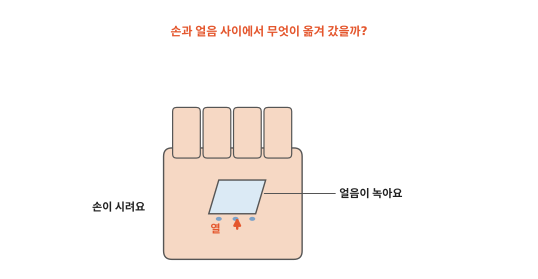
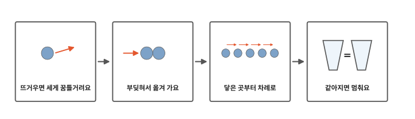
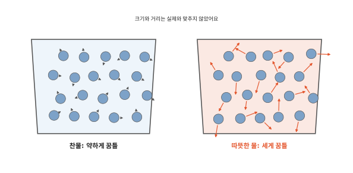
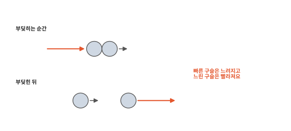
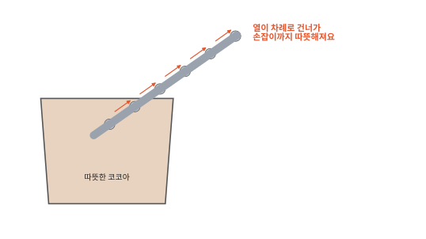
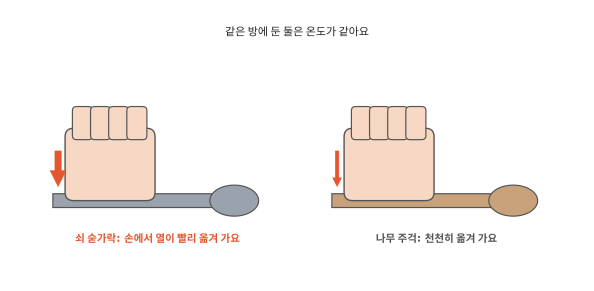
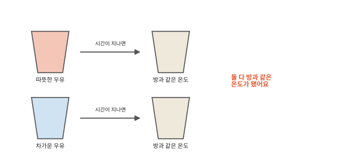

# 열은 무엇일까요?

## 얼음을 손에 쥐면

얼음 한 조각을 손바닥에 올려 보세요. 조금 지나면 손이 시려요. 얼음은 녹기 시작해요. 손과 얼음 사이에서 무엇이 옮겨 갔을까요?

## 이 편에서 볼 것

[2편](02-states.md)에서 데우면 알갱이가 세게 꿈틀거려 얼음이 녹고 물이 끓는다고 했어요. 이번에는 데우면 알갱이가 어떻게 되는지, 뜨거움이 어떻게 옮겨 가는지 봐요.

## 뜨거우면 세게 꿈틀거려요

찬물과 따뜻한 물을 아주아주 크게 들여다보면 둘 다 물 알갱이예요. 다른 건 꿈틀거리는 세기예요. 찬물 속 알갱이는 약하게, 따뜻한 물 속 알갱이는 세게 꿈틀거려요. 뜨겁다는 건 알갱이가 세게 꿈틀거린다는 뜻이에요.

알갱이가 세게 꿈틀거릴수록 온도가 높아요. 이 세기를 **온도**라고 해요. 온도계는 온도를 숫자로 보여 줘요. 숫자가 클수록 알갱이가 세게 꿈틀거려요.

## 부딪혀서 옮겨 가요

구슬치기를 떠올려 보세요. 빠르게 굴러온 구슬이 천천히 가는 구슬을 딱 치면 빠른 구슬은 느려지고 느린 구슬은 빨라져요. 알갱이끼리 부딪힐 때도 그래요. 세게 꿈틀거리는 알갱이가 약하게 꿈틀거리는 알갱이를 치면 꿈틀거림을 조금 넘겨줘요.

손바닥 알갱이는 얼음 알갱이보다 세게 꿈틀거려요. 손과 얼음이 닿으면 손 알갱이가 얼음 알갱이를 쉬지 않고 부딪쳐요. 손 알갱이는 꿈틀거림을 넘겨주고 약해져요. 손이 차가워지니까 시린 거예요. 얼음 알갱이는 점점 세게 꿈틀거리다 서로 붙잡은 손을 놓쳐요. 얼음이 녹는 거예요.

이렇게 온도가 다른 두 물건이 닿으면 뜨거운 쪽에서 차가운 쪽으로 무언가 옮겨 가요. 이것을 **열**이라고 해요. 알갱이끼리 부딪치며 꿈틀거림을 넘겨주는 것이 열이 옮겨 가는 길이에요. 열은 저절로는 늘 뜨거운 쪽에서 차가운 쪽으로 가요.

구슬과 알갱이는 두 가지가 달라요. 구슬은 한 번 부딪히고 끝나지만 알갱이는 쉬지 않고 수없이 부딪혀요. 그래서 뜨거운 쪽은 서서히 약해지고 차가운 쪽은 서서히 세져요. 그리고 구슬은 한참 구르다 멈추지만 알갱이의 꿈틀거림은 절대 멈추지 않아요.

## 닿은 곳부터 차례로

따뜻한 코코아에 쇠 숟가락을 꽂아 두면 조금 뒤에 손잡이까지 따뜻해져요. 코코아에 닿은 숟가락 알갱이가 먼저 세게 꿈틀거려요. 그 알갱이가 옆 알갱이를 치고 옆 알갱이가 또 그 옆을 쳐서 손잡이까지 이어져요.

열이 건너가는 빠르기는 물건마다 달라요. 쇠는 열을 빨리 전하고 나무나 플라스틱은 천천히 전해요. 그래서 냄비 손잡이는 나무나 플라스틱으로 만들어요.

같은 방에 하루 동안 둔 쇠 숟가락과 나무 주걱은 온도가 같아요. 그런데 만져 보면 쇠 숟가락이 더 차갑게 느껴져요. 손에서 쇠로 열이 빨리 옮겨 가서 손 피부가 빨리 차가워지기 때문이에요. 나무로는 열이 천천히 옮겨 가서 손이 덜 차가워져요. 거꾸로 여름 햇볕에 달궈진 쇠 미끄럼틀은 같은 온도의 플라스틱 미끄럼틀보다 더 뜨겁게 느껴져요. 쇠에서 손으로 열이 빨리 오니까요.

## 같아지면 멈춰요

식탁에 둔 따뜻한 우유는 점점 식어요. 우유에서 방 공기로 열이 옮겨 가요. 냉장고에서 꺼낸 우유는 점점 덜 차가워져요. 방 공기에서 우유로 열이 옮겨 가요. 그러다 둘 다 방과 같은 온도가 되면 열은 더 한쪽으로 옮겨 가지 않아요. 그때도 알갱이는 꿈틀거려요. 멈추는 건 한쪽으로 옮겨 가는 열이에요.

그럼 젖은 손을 바람에 말리면 왜 시원할까요? 다음 편에서 볼게요.

## 정리

- 온도: 알갱이가 얼마나 세게 꿈틀거리는지예요. 뜨거울수록 세게 꿈틀거려요.
- 열: 온도가 다른 두 물건 사이에서 뜨거운 쪽에서 차가운 쪽으로 옮겨 가는 거예요. 알갱이끼리 부딪쳐 꿈틀거림을 넘겨줘요.
- 열은 닿은 곳부터 차례로 건너가요. 쇠는 빨리, 나무와 플라스틱은 천천히 전해요.
- 두 물건의 온도가 같아지면 열은 더 한쪽으로 옮겨 가지 않아요.

## 해 보기: 열이 옮겨 가는 것 느끼기

1. 냉동실에서 꺼내 조금 둔 얼음 한 조각을 손바닥에 잠깐 올려요. 손이 시려지면 접시에 내려놓아요. 얼음은 어떻게 됐나요?
2. 같은 방에 둔 쇠 숟가락과 나무 주걱(또는 플라스틱 숟가락)을 양손으로 동시에 만져 보세요. 어느 쪽이 더 차갑게 느껴지나요?
3. 냉장고에서 꺼낸 찬물 컵을 두 손으로 감싸 쥐고 천천히 열까지 세어요. 손과 컵은 각각 어떻게 됐나요?

## 확인 문제

??? question "1. 온도"
    찬물과 따뜻한 물에서 알갱이는 무엇이 다를까요?

    **풀이**: 꿈틀거리는 세기가 달라요. 따뜻한 물 속 알갱이가 더 세게 꿈틀거려요. 이 세기가 온도예요.

??? question "2. 열이 가는 쪽"
    차가운 손으로 따뜻한 컵을 감싸 쥐면 열은 어느 쪽에서 어느 쪽으로 갈까요?

    **풀이**: 따뜻한 컵에서 차가운 손으로 가요. 컵 알갱이가 손 알갱이보다 세게 꿈틀거려서 부딪힐 때 꿈틀거림이 손으로 넘어가요. 그래서 손이 따뜻해져요.

??? question "3. 여름 미끄럼틀"
    여름 햇볕 아래 놀이터에 쇠 손잡이와 플라스틱 손잡이가 있어요. 둘은 온도가 같아요. 맨손으로 잡으면 어느 쪽이 더 뜨겁게 느껴질까요?

    **풀이**: 쇠 손잡이예요. 쇠는 열을 빨리 전해서 쇠에서 손으로 열이 빨리 옮겨 와요. 손 피부가 빨리 뜨거워지니까 더 뜨겁게 느껴져요.

!!! abstract "어른을 위한 정리 (건너뛰어도 돼요)"
    - 온도는 물체를 이루는 원자·분자의 평균 운동 에너지와 관계가 있어요. 이상기체에서는 평균 운동 에너지가 켈빈 온도에 정확히 비례해요. 본문의 "꿈틀거리는 세기"는 이 평균 운동 에너지를 가리켜요.[^temp][^kin]
    - 열은 온도 차이 때문에 옮겨 가는 에너지예요. 저절로는 늘 높은 온도에서 낮은 온도로 흘러요. 물리학에서는 물체가 "열을 가지고 있다"고 하지 않고 "열이 옮겨 간다"고 말해요. 본문도 열을 옮겨 가는 것으로만 썼어요.[^heat]
    - 두 물체가 맞닿아 온도가 같아지면 알짜 열 흐름이 멈춘 열평형 상태가 돼요. 이때도 분자들은 계속 부딪치며 에너지를 주고받지만 양쪽으로 오가는 양이 같아요.[^temp]
    - 전도는 분자 충돌로 에너지가 이웃에 전해지는 방식이에요. 금속은 자유 전자 덕분에 열전도율이 높고 나무·플라스틱·공기는 낮아요. 같은 온도에서 타일 바닥이 카펫보다 차갑게 느껴지는 것처럼, 피부는 물체의 온도가 아니라 열이 빠져나가 피부 자신의 온도가 바뀌는 것을 느껴요.[^cond]
    - 같은 크기 구슬의 탄성 충돌에서는 두 구슬의 속도가 거의 맞바뀌어요. 수많은 분자 충돌이 쌓이면 평균적으로 에너지가 높은 쪽에서 낮은 쪽으로 옮겨 가요.

## 더 깊이

??? info "옷과 이불은 열을 만들까요"
    [인체 7편](../body/07-sweat.md)에서 세포가 일할 때 열이 생겨서 몸이 늘 따뜻하다고 했어요. 옷과 이불은 열을 만들지 않아요. 몸 둘레에 공기를 가둬 몸에서 차가운 바깥으로 열이 옮겨 가는 것을 늦춰 줘요. 가만히 갇힌 공기는 열을 아주 천천히 전해요.

??? info "열이 옮겨 가는 다른 길"
    열은 닿아서 건너가기도 하지만 다른 길도 있어요. 데워진 물이나 공기가 통째로 움직이며 열을 나르기도 하고(난로 위 따뜻한 공기가 올라가요) 햇볕처럼 아무것도 닿지 않아도 건너오기도 해요.

??? info "가장 낮은 온도"
    아무리 식혀도 더 내려갈 수 없는 가장 낮은 온도가 있어요. 영하 273도쯤이에요. 이 온도에 가까워질수록 알갱이의 꿈틀거림은 아주아주 약해져요.

[^temp]: OpenStax, *College Physics 2e*, 13.1 ["Temperature"](https://openstax.org/books/college-physics-2e/pages/13-1-temperature).
[^kin]: OpenStax, *College Physics 2e*, 13.4 ["Kinetic Theory: Atomic and Molecular Explanation of Pressure and Temperature"](https://openstax.org/books/college-physics-2e/pages/13-4-kinetic-theory-atomic-and-molecular-explanation-of-pressure-and-temperature).
[^heat]: OpenStax, *College Physics 2e*, 14.1 ["Heat"](https://openstax.org/books/college-physics-2e/pages/14-1-heat).
[^cond]: OpenStax, *College Physics 2e*, 14.5 ["Conduction"](https://openstax.org/books/college-physics-2e/pages/14-5-conduction).
