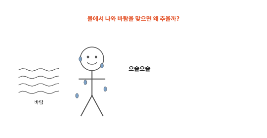
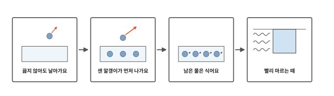
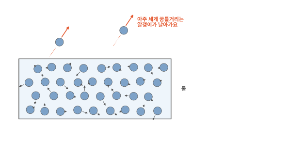
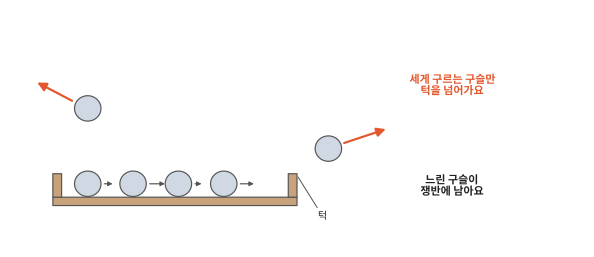
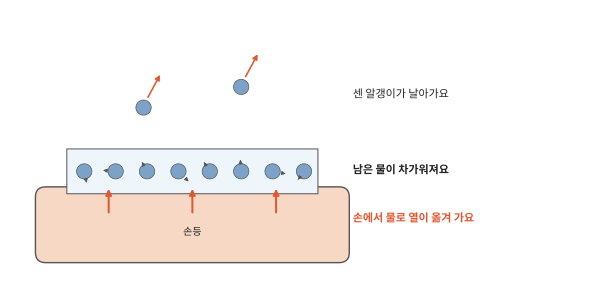
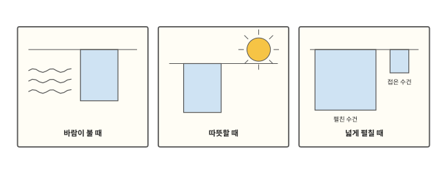

# 물은 왜 마르면 시원할까요?

## 수영장에서 나오면

여름에 수영장에서 나와 바람을 맞으면 몸이 으슬으슬 추워요. 여름에는 물속보다 바깥 공기가 더 따뜻한데도 그래요. 젖은 손을 흔들어도 시원해져요. 몸에 묻은 물이 마르면서 무슨 일이 생기는 걸까요?

## 이 편에서 볼 것

[2편](02-states.md)에서 물은 끓지 않아도 조금씩 수증기가 된다고 했어요. [3편](03-heat.md)에서는 뜨거울수록 알갱이가 세게 꿈틀거리고 열은 뜨거운 쪽에서 차가운 쪽으로 간다고 했어요. 오늘은 이 두 이야기를 이어 붙여요.

## 끓지 않아도 날아가요

물 한 컵에 든 알갱이들은 모두 똑같이 꿈틀거리지 않아요. 약하게 꿈틀거리는 알갱이도 있고 아주 세게 꿈틀거리는 알갱이도 있어요. 따뜻한 물에는 세게 꿈틀거리는 알갱이가 많고 찬물에는 적어요.

물 알갱이끼리는 서로 붙잡고 있어요. 그런데 물의 맨 위, 공기와 닿는 곳(표면)에서 아주 세게 꿈틀거리는 알갱이는 붙잡는 손을 이기고 공기 속으로 날아가요. 그래서 물은 끓지 않아도 표면부터 조금씩 수증기가 돼요. 이렇게 물이 표면에서 조금씩 수증기가 되어 날아가는 것을 **증발**이라고 해요. 젖은 빨래가 마르고 비 온 뒤 웅덩이가 사라지는 것도 증발이에요.

## 센 알갱이가 먼저 나가요

낮은 턱이 있는 쟁반에 구슬을 담고 흔드는 모습을 떠올려 보세요. 세게 구르는 구슬은 턱을 넘어 밖으로 튀어 나가요. 천천히 구르는 구슬은 턱을 못 넘고 쟁반에 남아요. 턱은 물 알갱이를 붙잡는 손과 같아요.

물을 떠나는 것도 붙잡는 손을 이길 만큼 세게 꿈틀거리는 알갱이예요. 센 알갱이가 자꾸 빠져나가면 남은 물 알갱이들은 꿈틀거리는 세기가 대체로 조금 약해져요. 다만 구슬과 다른 점이 있어요. 쟁반에 남은 구슬은 계속 느리지만 물에 남은 알갱이는 둘레에서 열을 받으면 다시 세게 꿈틀거려요.

## 남은 물은 식어요

손등에 묻은 물에서 일어나는 일을 차례로 보면 이래요. 먼저 센 알갱이가 날아가요. 그러면 남은 물이 손보다 조금 차가워져요. 3편에서 열은 뜨거운 쪽에서 차가운 쪽으로 간다고 했지요. 그래서 손에서 물로 열이 옮겨 가요. 손이 시원해지는 거예요.

물은 손에서 열을 받아도 오래 따뜻하지 않아요. 다 마를 때까지 센 알갱이가 계속 날아가서 물은 손보다 늘 조금 차가워요. 그래서 손에서 물로 열이 계속 옮겨 가요.

땀도 이렇게 몸을 식혀요. [인체 7편](../body/07-sweat.md)에서 더우면 땀이 난다고 했지요. 피부에 난 땀이 마르는 동안 몸에서 땀으로 열이 옮겨 가요.

## 빨리 마르는 때

물이 빨리 마를수록 더 시원해요. 날아간 알갱이 가운데 몇몇은 물 가까이 떠돌다 다시 물로 돌아와요. 바람은 이 알갱이들을 멀리 데려가서 빨래를 빨리 말려요. 햇볕이 들어 따뜻하면 세게 꿈틀거리는 알갱이가 많아지니 이때도 빨리 말라요.

알갱이가 날아갈 수 있는 곳은 표면뿐이에요. 그래서 빨래를 넓게 펼치면 한꺼번에 많이 날아가요. 비 오는 날은 사정이 반대예요. 공기에 이미 수증기가 많아서 물로 돌아오는 알갱이도 많으니 빨래가 잘 안 말라요.

물에 녹은 소금은 물이 마를 때 함께 날아갈까요? 다음 편에서 볼게요.

## 정리

- 증발: 물 표면에서 아주 세게 꿈틀거리는 알갱이가 공기로 날아가는 거예요. 끓지 않아도 일어나요.
- 센 알갱이가 빠져나가면 남은 물은 조금 차가워져요.
- 손이나 몸에서 차가워진 물로 열이 옮겨 가서 시원해요. 땀도 이렇게 몸을 식혀요.
- 바람, 햇볕, 넓게 펼치기는 마르는 것을 돕고 축축한 공기는 방해해요.

## 해 보기: 마르면 시원한지 느끼기

1. 한쪽 손등에만 물을 조금 바르고 두 손등을 나란히 부채질해 보세요. 어느 쪽이 더 시원한가요? 물이 다 마르면 어떻게 되나요?
2. 같은 크기의 손수건 두 장을 물에 적셔 꼭 짜요. 하나는 활짝 펴서 널고 하나는 작게 접어서 널어요. 어느 쪽이 먼저 마르나요?
3. 접시 두 개에 물을 한 숟가락씩 담아요. 하나는 햇볕 드는 창가에, 하나는 그늘에 두고 몇 시간 뒤에 어느 쪽 물이 더 줄었는지 봐요.

## 확인 문제

??? question "1. 이름 붙이기"
    끓이지 않았는데 웅덩이 물이 조금씩 사라지는 일을 무엇이라고 할까요?

    **풀이**: 증발이에요. 물 표면에서 세게 꿈틀거리는 알갱이가 공기 속으로 날아가 수증기가 돼요.

??? question "2. 으슬으슬"
    수영장에서 나와 바람을 맞으면 왜 추울까요?

    **풀이**: 몸에 묻은 물에서 아주 세게 꿈틀거리는 알갱이가 날아가요. 남은 물이 조금 차가워지고 몸에서 그 물로 열이 옮겨 가요. 바람이 불면 더 빨리 마르니까 더 추워요.

??? question "3. 맑은 날 웅덩이"
    비 온 다음 날, 바람 불고 햇볕 드는 날의 웅덩이와 흐리고 축축한 날의 웅덩이 가운데 어느 쪽이 먼저 사라질까요?

    **풀이**: 바람 불고 햇볕 드는 날이에요. 햇볕이 데워 세게 꿈틀거리는 알갱이가 많아지고 바람이 날아간 알갱이를 데려가요. 축축한 날에는 공기에 수증기가 많아 물로 돌아오는 알갱이도 많아요.

!!! abstract "어른을 위한 정리 (건너뛰어도 돼요)"
    - 같은 온도의 액체 속 분자들도 운동 에너지가 고르게 같지 않고 넓게 퍼져 있어요. 온도는 그 평균에 해당해요. 표면에서 분자 사이 끌림을 이길 만큼 운동 에너지가 큰 분자가 빠져나가는 것이 증발이에요.[^vap][^hum]
    - 에너지가 큰 분자가 빠져나가면 남은 액체의 평균 운동 에너지가 낮아져 온도가 내려가요(증발 냉각). 물이 증발하려면 1 kg당 약 2,400 kJ(체온 근처)의 열이 필요하고 피부에 묻은 물은 이 열을 주로 피부에서 받아요. 더울 때나 운동할 때 땀의 증발은 몸을 식히는 주요 방법이에요.[^latent]
    - 증발 속도는 온도가 높을수록 커지고 공기 중 수증기가 많을수록(습도가 높을수록) 작아져요. 액체 표면에서는 증발과 함께 공기 중 분자가 다시 액체로 돌아오는 응결이 늘 일어나요.[^hum] 표면적이 넓거나 바람이 수증기 많은 공기를 치워 주면 더 빨리 마르는 것은 생활에서 쉽게 확인할 수 있어요.

## 더 깊이

??? info "옛날 냉장고, 질그릇 물병"
    유약(그릇에 바르는 반들반들한 막)을 바르지 않은 질그릇에 물을 담아 두면 물이 그릇 벽으로 조금씩 스며 나와 바깥에서 증발해요. 그러면서 그릇 속 물이 바깥 공기보다 시원해져요. 냉장고가 없던 시절 덥고 공기가 건조한 곳에서 이렇게 물을 시원하게 했어요.

??? info "알코올 솜은 왜 더 차가울까"
    주사를 맞기 전에 알코올 솜으로 팔을 닦으면 물을 바를 때보다 훨씬 차가워요. 알코올은 알갱이끼리 붙잡는 힘이 물보다 약해서 더 빨리 증발해요. 그만큼 피부에서 알코올로 열이 빨리 옮겨 가요.

[^vap]: OpenStax, *Chemistry 2e*, 10.3 ["Phase Transitions"](https://openstax.org/books/chemistry-2e/pages/10-3-phase-transitions).
[^hum]: OpenStax, *College Physics 2e*, 13.6 ["Humidity, Evaporation, and Boiling"](https://openstax.org/books/college-physics-2e/pages/13-6-humidity-evaporation-and-boiling).
[^latent]: OpenStax, *College Physics 2e*, 14.3 ["Phase Change and Latent Heat"](https://openstax.org/books/college-physics-2e/pages/14-3-phase-change-and-latent-heat).
