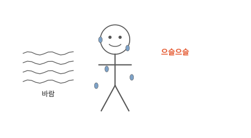
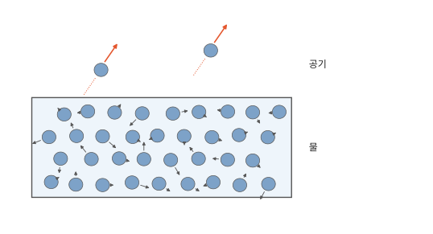
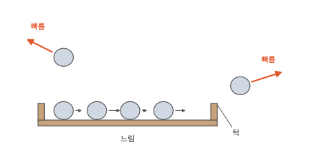
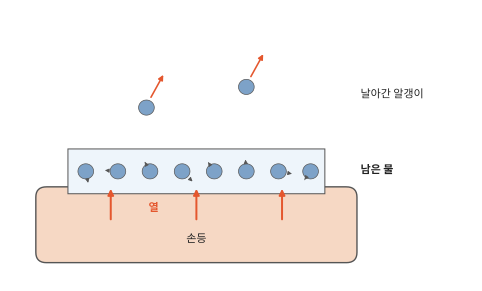
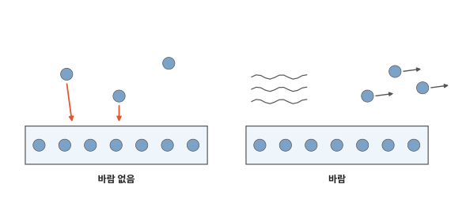
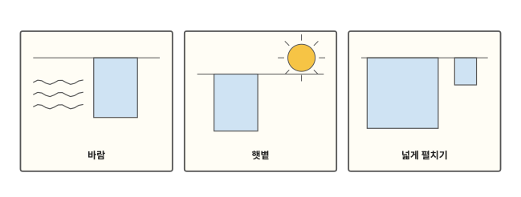

# 증발: 물이 마를 때 시원해지는 일

여름에 수영장에서 나와 바람을 맞으면 몸이 으슬으슬 추워요. 물속보다 바깥 공기가 더 따뜻한데도 그래요. 이 글을 읽고 나면 물이 끓지 않아도 마르는 까닭과 마를 때 시원해지는 까닭을 알게 돼요. 이걸 알면 땀이 몸을 식히는 방법과 빨래가 잘 마르는 날도 설명할 수 있어요.

!!! abstract "이 글에서 알게 되는 것"
    1. 물 표면에서 아주 세게 꿈틀거리는 알갱이는 붙잡는 힘을 이기고 공기로 날아가요. 끓지 않아도 일어나는 이 일을 증발이라고 해요.
    2. 센 알갱이가 빠져나가면 남은 물이 조금 차가워져서 몸에서 그 물로 열이 옮겨 가요. 그래서 젖은 몸이 마를 때 시원해요.
    3. 바람과 햇볕과 넓게 펼치기는 물을 빨리 마르게 하고 축축한 공기는 더디게 해요.

## 1. 물은 끓지 않아도 표면부터 날아가요

수영장에서 막 나온 몸에는 물방울이 맺혀 있어요. 아래 그림처럼 바람이 불면 그 물이 조금씩 말라요. 끓인 것도 아닌데 물은 어디로 갈까요?

**그림 1.** 젖은 몸으로 바람을 맞으면 물이 마르면서 으슬으슬 추워요.
{ .fig-cap }

[2편](02-states.md)에서 물은 끓지 않아도 조금씩 수증기가 된다고 했어요. [3편](03-heat.md)에서는 뜨거울수록 알갱이가 세게 꿈틀거린다고 했고요. 이 두 이야기를 이어 붙이면 답이 나와요.

먼저 물 한 컵에 든 알갱이들이 모두 똑같이 꿈틀거리지는 않는다는 걸 알아 둬야 해요. 약하게 꿈틀거리는 알갱이도 있고 아주 세게 꿈틀거리는 알갱이도 있어요. 따뜻한 물에는 세게 꿈틀거리는 알갱이가 많고 찬물에는 적어요.

물 알갱이끼리는 서로 붙잡고 있어요. 그런데 물의 맨 위에서 공기와 닿는 곳을 보면 사정이 달라요. 이곳을 **표면**이라고 해요. 아래 그림에서 표면 위로 날아오른 빨간 화살표 알갱이를 보세요.

**그림 2.** 표면에서 아주 세게 꿈틀거리던 알갱이 둘이 물을 떠나 공기로 날아가요.
{ .fig-cap }

표면에 있는 알갱이 가운데 아주 세게 꿈틀거리는 것은 붙잡는 손을 이기고 공기 속으로 날아가요. 날아간 알갱이는 수증기예요. 그래서 물은 끓지 않아도 표면부터 조금씩 수증기가 돼요.

이렇게 물이 표면에서 조금씩 수증기가 되어 날아가는 것을 **증발**이라고 해요. 몸에 묻은 물이 마르는 것도 증발이에요. 젖은 빨래가 마르고 비 온 뒤 웅덩이가 사라지는 것도 그래요.

## 2. 센 알갱이가 먼저 빠져나가요

앞에서 물을 떠나는 알갱이는 아주 세게 꿈틀거리는 알갱이라고 했어요. 그럼 물에는 어떤 알갱이가 남을까요? 구슬로 바꿔서 생각해 볼게요.

낮은 턱이 있는 쟁반에 구슬을 담고 흔든다고 해 봐요. 아래 그림에서 쟁반 밖으로 나간 구슬과 쟁반에 남은 구슬의 화살표를 비교해 보세요.

**그림 3.** 세게 구르는 구슬만 턱을 넘어 나가고 천천히 구르는 구슬은 쟁반에 남아요.
{ .fig-cap }

세게 구르는 구슬은 턱을 넘어 밖으로 튀어 나가요. 천천히 구르는 구슬은 턱을 못 넘고 쟁반에 남아요. 물에서는 알갱이를 붙잡는 힘이 이 턱 노릇을 해요.

물을 떠나는 것도 붙잡는 힘을 이길 만큼 세게 꿈틀거리는 알갱이예요. 센 알갱이가 자꾸 빠져나가면 남은 물 알갱이들은 꿈틀거리는 세기가 대체로 조금 약해져요. 3편에서 꿈틀거리는 세기가 온도라고 했죠. 남은 물의 온도가 조금 내려가는 거예요.

구슬과 다른 점도 하나 있어요. 쟁반에 남은 구슬은 계속 느리지만 물에 남은 알갱이는 둘레에서 열을 받으면 다시 세게 꿈틀거려요. 이 열이 어디서 오는지가 다음 절의 이야기예요.

## 3. 차가워진 물이 손에서 열을 가져가요

젖은 손등 하나로 따라가 볼게요. 아래 그림에서 빨간 화살표 두 묶음을 보세요. 위로 날아가는 알갱이와 손등에서 물로 올라가는 열이에요.

**그림 4.** 센 알갱이가 날아가 남은 물이 차가워지고 손등에서 물로 열이 올라가요.
{ .fig-cap }

일은 이 차례로 일어나요. 먼저 센 알갱이가 날아가요. 그러면 남은 물이 손보다 조금 차가워져요. 3편에서 열은 뜨거운 쪽에서 차가운 쪽으로 간다고 했어요. 그래서 손에서 물로 열이 옮겨 가요. 손이 시원해지는 거예요.

물은 손에서 열을 받아도 오래 따뜻하지 않아요. 다 마를 때까지 센 알갱이가 계속 날아가서 물은 손보다 늘 조금 차가워요. 그래서 물이 다 마를 때까지 손에서 물로 열이 계속 옮겨 가요.

수영장에서 나와 으슬으슬한 것도 같은 일이에요. 바깥 공기가 따뜻해도 몸에 묻은 물은 마르면서 몸보다 차가워져요. 몸에서 그 물로 열이 계속 빠져나가니까 추워요.

땀도 이렇게 몸을 식혀요. [인체 7편](../body/07-sweat.md)에서 더우면 땀이 난다고 했지요. 피부에 난 땀이 마르는 동안 몸에서 땀으로 열이 옮겨 가요.

??? info "알코올 솜은 왜 더 차가울까요"
    주사를 맞기 전에 알코올 솜으로 팔을 닦으면 물을 바를 때보다 훨씬 차가워요. 알코올은 알갱이끼리 붙잡는 힘이 물보다 약해서 더 빨리 증발해요. 그만큼 피부에서 알코올로 열이 빨리 옮겨 가요.

## 4. 바람과 햇볕과 넓은 표면이 물을 빨리 말려요

물이 빨리 마를수록 열도 빨리 빠져나가서 더 시원해요. 그럼 무엇이 물을 빨리 마르게 할까요?

날아간 알갱이가 모두 멀리 가지는 않아요. 몇몇은 물 가까이 떠돌다 다시 물로 돌아와요. 아래 그림에서 바람이 없을 때와 바람이 불 때 날아간 알갱이가 어디로 가는지 보세요.

**그림 5.** 바람이 없으면 날아간 알갱이 몇몇이 물로 돌아오고 바람이 불면 멀리 밀려가요.
{ .fig-cap }

바람은 물 가까이 떠도는 알갱이를 멀리 데려가요. 돌아오는 알갱이가 줄어드니까 빨래가 빨리 말라요.

비 오는 날은 사정이 반대예요. 공기에 이미 수증기가 많아서 물로 돌아오는 알갱이도 많아요. 그래서 빨래가 잘 안 말라요.

바람 말고도 물을 빨리 말리는 것이 둘 더 있어요. 아래 그림에서 세 칸을 차례로 보세요.

**그림 6.** 바람이 불 때, 햇볕이 들 때, 넓게 펼쳤을 때 빨래가 빨리 말라요.
{ .fig-cap }

햇볕이 들어 따뜻하면 세게 꿈틀거리는 알갱이가 많아져요. 날아갈 만큼 센 알갱이가 늘어나니까 빨리 말라요.

알갱이가 날아갈 수 있는 곳은 표면뿐이에요. 빨래를 넓게 펼치면 표면이 넓어져서 한꺼번에 많이 날아가요. 같은 수건이라도 작게 접어 널면 표면이 좁아서 더디게 말라요.

??? question "해 보기: 마르면 시원한지 느끼기"
    1. 한쪽 손등에만 물을 조금 바르고 두 손등을 나란히 부채질해 보세요. 어느 쪽이 더 시원한가요? 물이 다 마르면 어떻게 되나요?
    2. 같은 크기의 손수건 두 장을 물에 적셔 꼭 짜요. 하나는 활짝 펴서 널고 하나는 작게 접어서 널어요. 어느 쪽이 먼저 마르나요?
    3. 접시 두 개에 물을 한 숟가락씩 담아요. 하나는 햇볕 드는 창가에, 하나는 그늘에 두고 몇 시간 지나 어느 쪽 물이 더 줄었는지 봐요.

??? info "어른을 위한 정리"
    - 같은 온도의 액체 속 분자들도 운동 에너지가 고르게 같지 않고 넓게 퍼져 있어요. 온도는 그 평균에 해당해요. 표면에서 분자 사이 끌림을 이길 만큼 운동 에너지가 큰 분자가 빠져나가는 것이 증발이에요.[^vap][^hum]
    - 에너지가 큰 분자가 빠져나가면 남은 액체의 평균 운동 에너지가 낮아져 온도가 내려가요(증발 냉각). 물이 증발하려면 1 kg당 약 2,400 kJ(체온 근처)의 열이 필요하고 피부에 묻은 물은 이 열을 주로 피부에서 받아요. 더울 때나 운동할 때 땀의 증발은 몸을 식히는 주요 방법이에요.[^latent]
    - 증발 속도는 온도가 높을수록 커지고 공기 중 수증기가 많을수록(습도가 높을수록) 작아져요. 액체 표면에서는 증발과 함께 공기 중 분자가 다시 액체로 돌아오는 응결이 늘 일어나요.[^hum] 표면적이 넓거나 바람이 수증기 많은 공기를 치워 주면 더 빨리 마르는 것은 생활에서 쉽게 확인할 수 있어요.

## 정리

물 알갱이는 저마다 꿈틀거리는 세기가 달라요. 표면에 있는 알갱이 가운데 아주 세게 꿈틀거리는 것은 붙잡는 힘을 이기고 공기로 날아가요. 그래서 물은 끓지 않아도 조금씩 말라요. 이 일이 증발이에요.

센 알갱이가 빠져나가면 남은 물은 조금 차가워져요. 그러면 손이나 몸에서 그 물로 열이 옮겨 가요. 수영장에서 나와 으슬으슬하고 땀이 마를 때 몸이 식는 것도 이 때문이에요.

바람은 날아간 알갱이를 멀리 데려가요. 햇볕은 센 알갱이를 늘려요. 넓게 펼치면 날아갈 표면이 넓어져요. 셋 다 물을 빨리 말려요. 축축한 공기에서는 물로 돌아오는 알갱이가 많아서 더디게 말라요.

[5편](05-dissolving.md)에서는 소금이 물에 녹을 때 소금 알갱이에게 무슨 일이 생기는지 볼게요.

### 새로 나온 말

- **표면**: 물의 맨 위에서 공기와 닿는 곳. 알갱이는 이곳에서만 날아갈 수 있어요.
- **증발**: 물이 끓지 않고도 표면에서 조금씩 수증기가 되어 날아가는 것. 젖은 빨래가 마르는 것도 증발이에요.

[^vap]: OpenStax, *Chemistry 2e*, 10.3 ["Phase Transitions"](https://openstax.org/books/chemistry-2e/pages/10-3-phase-transitions).
[^hum]: OpenStax, *College Physics 2e*, 13.6 ["Humidity, Evaporation, and Boiling"](https://openstax.org/books/college-physics-2e/pages/13-6-humidity-evaporation-and-boiling).
[^latent]: OpenStax, *College Physics 2e*, 14.3 ["Phase Change and Latent Heat"](https://openstax.org/books/college-physics-2e/pages/14-3-phase-change-and-latent-heat).
