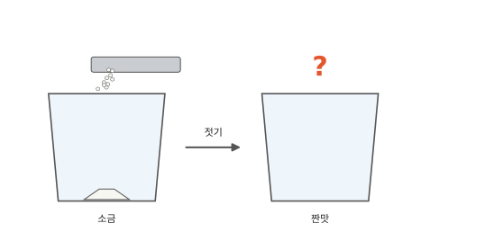
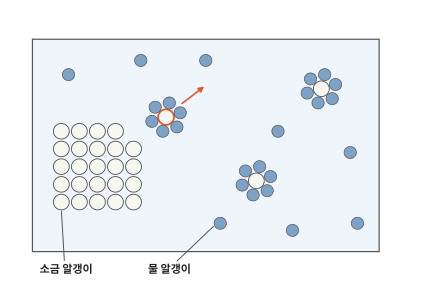
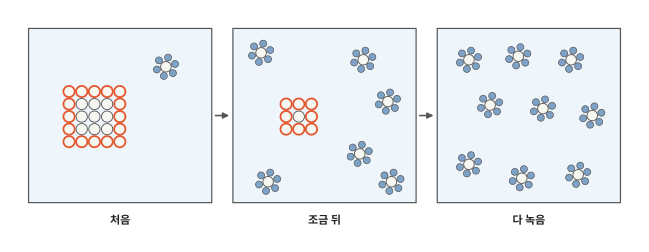
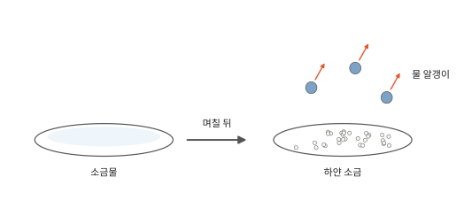
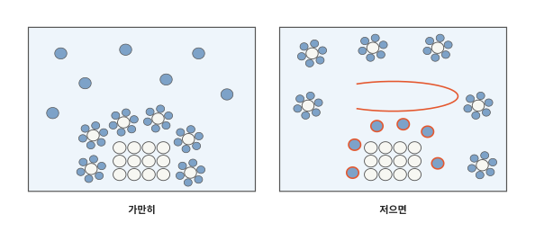
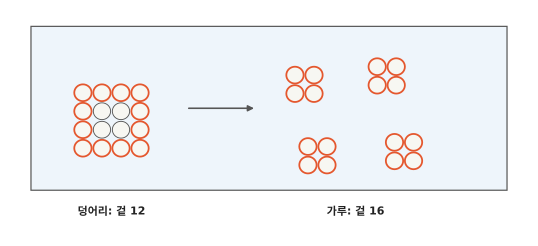
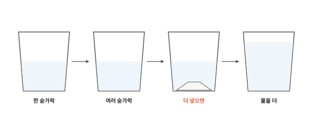

# 소금이 물에 녹는 일: 알갱이가 하나씩 떨어져 나가요

물 한 컵에 소금 한 숟가락을 넣고 저으면 하얀 소금이 점점 줄다가 안 보이게 돼요. 그런데 물을 살짝 맛보면 짜요. 이 글을 읽고 나면 소금이 물에 녹을 때 소금 알갱이에게 무슨 일이 생기는지 알게 돼요. 녹은 소금이 어디에 있는지도요. 이걸 알면 설탕을 빨리 녹이는 법과 아무리 저어도 더 안 녹는 까닭을 설명할 수 있어요.

!!! abstract "이 글에서 알게 되는 것"
    1. 소금을 물에 넣으면 물 알갱이가 소금 겉의 알갱이를 하나씩 끌어내 빙 둘러싸요. 그래서 소금 덩어리는 겉부터 작아지다가 다 녹아요.
    2. 녹은 소금은 사라지지 않고 물속에 있어요. 물을 말리면 물 알갱이만 날아가고 소금이 남아요.
    3. 젓거나 따뜻한 물을 쓰거나 가루로 만들면 빨리 녹아요. 하지만 정해진 양의 물에 녹일 수 있는 소금의 양에는 끝이 있어요.

## 1. 소금이 안 보여도 물은 짜요

[1편](01-particles.md)에서 설탕을 물에 넣으면 설탕 알갱이가 하나하나 떨어져 물 알갱이 사이로 섞여 든다고 했어요. 이번에는 소금으로 같은 일을 해 보고 알갱이가 어떻게 떨어져 나오는지 들여다볼게요.

아래 그림에서 왼쪽 컵 바닥의 소금과 오른쪽 컵을 보세요.

**그림 1.** 저은 다음에는 소금이 안 보이지만 물에서 짠맛이 나요.
{ .fig-cap }

눈에 안 보이는데 맛은 남아 있어요. 소금이 물 어딘가에 있다는 뜻이에요. 그 자리를 찾으려면 소금 한 톨 속을 아주 크게 들여다봐야 해요.

## 2. 물 알갱이가 소금 알갱이를 하나씩 끌어내요

눈에 보이는 소금 한 톨은 아주 작은 소금 알갱이가 줄을 맞춰 꼭 붙어 있는 고체예요. 이 덩어리를 물에 넣으면 쉬지 않고 꿈틀거리는 물 알갱이들이 소금 겉에 와서 부딪혀요.

물 알갱이는 소금 알갱이를 세게 끌어당겨요. 여러 물 알갱이가 한꺼번에 끌어당기면 소금 알갱이 하나가 덩어리에서 떨어져 나와요. 아래 그림에서 빨간 테두리의 소금 알갱이를 보세요. 알갱이 크기와 사이 거리는 실제와 맞추지 않았어요.

**그림 2.** 덩어리 모서리에 있던 소금 알갱이를 물 알갱이 여섯이 둘러싸 끌어내요.
{ .fig-cap }

떨어져 나온 소금 알갱이는 물 알갱이들에게 빙 둘러싸인 채로 물속을 돌아다녀요. 그림 오른쪽의 두 알갱이가 먼저 떨어져 나온 거예요.

## 3. 소금 덩어리는 겉부터 작아져요

알갱이 하나가 떨어져 나가면 그 안쪽에 있던 알갱이가 겉으로 드러나요. 물 알갱이는 그 알갱이를 또 끌어내요. 아래 그림에서 빨간 테두리가 어디에 있는지 보세요.

**그림 3.** 물 알갱이는 늘 겉에 있는 소금 알갱이부터 끌어내서 덩어리가 바깥부터 줄어요.
{ .fig-cap }

빨간 테두리는 늘 덩어리의 바깥 줄에 있어요. 물 알갱이가 닿을 수 있는 건 겉에 있는 소금 알갱이뿐이거든요. 바깥 줄이 떨어져 나가면 안쪽 줄이 새 바깥 줄이 돼요. 이걸 되풀이해서 덩어리가 다 없어지는 것을 **녹는다**고 해요. 어려운 말로는 **용해**라고 해요.

얼음이 녹을 때도 "녹는다"라는 말을 쓰지만 일어나는 일은 달라요. 얼음은 열을 받아 알갱이가 세게 꿈틀거리다 줄에서 풀려나요. 소금은 차가운 물에서도 물 알갱이가 하나씩 끌어내요.

## 4. 녹은 소금은 물속에 그대로 있어요

[4편](04-evaporation.md) 끝에서 물이 마를 때 녹은 소금도 함께 날아갈지 물었어요. 먼저 소금물이 짜다는 것부터 떠올려 보세요. 소금 알갱이가 물속에 그대로 있다는 뜻이에요. 알갱이 하나하나가 너무 작아서 안 보일 뿐이에요.

더 확실하게 볼 수도 있어요. 소금물을 접시에 조금 담아 햇볕 드는 창가에 며칠 두어요. 아래 그림에서 접시 위로 날아가는 것과 접시에 남은 것을 보세요.

**그림 4.** 물 알갱이만 날아가고 접시 바닥에 하얀 소금이 남아요.
{ .fig-cap }

4편에서 물 표면의 물 알갱이가 날아가는 것을 증발이라고 했어요. 날아가는 건 물 알갱이뿐이에요. 소금 알갱이끼리는 서로 아주 세게 붙잡아서 날아가지 못하고 접시에 다시 모여요. 바닷가에서 바닷물을 넓은 밭에 모아 햇볕과 바람에 말려 소금을 얻는 것도 이 일이에요.

## 5. 젓기, 따뜻한 물, 고운 가루가 소금을 빨리 녹여요

소금이 물속에 있다는 건 알았어요. 이제 어떻게 하면 빨리 녹는지 볼게요. 물 알갱이가 겉에서 하나씩 끌어낸다는 것만 기억하면 세 가지가 다 풀려요.

먼저 젓기예요. 아래 그림에서 두 장면의 소금 덩어리 바로 옆에 무엇이 있는지 보세요.

**그림 5.** 저으면 북적이던 물이 밀려나고 소금이 없는 새 물 알갱이가 덩어리에 와 닿아요.
{ .fig-cap }

가만히 두면 소금 바로 옆의 물은 이미 끌어낸 소금 알갱이로 북적여요. 그 자리에서는 소금을 더 끌어내기 어려워요. 저으면 그 물이 밀려나고 새 물이 와 닿아요. 그래서 빨리 녹아요.

다음은 따뜻한 물이에요. [3편](03-heat.md)에서 따뜻할수록 알갱이가 세게 꿈틀거린다고 했어요. 따뜻한 물에서는 물 알갱이가 소금에 더 세게 부딪혀 더 빨리 끌어내요.

마지막은 가루예요. 굵은 소금 덩어리보다 고운 가루가 빨리 녹아요. 아래 그림에서 빨간 테두리 알갱이 수를 세어 보세요.

**그림 6.** 알갱이 16개가 덩어리일 때는 12개가 겉에 있고 넷으로 나누면 16개 모두 겉에 있어요.
{ .fig-cap }

덩어리일 때 가운데 네 알갱이는 물에 닿지 않아요. 넷으로 나누면 모든 알갱이가 물에 닿아요. 물 알갱이가 끌어낼 수 있는 건 겉에 있는 알갱이뿐이니까 잘게 부술수록 한꺼번에 많이 끌어내요.

## 6. 물 반 컵에 녹는 소금의 양에는 끝이 있어요

그럼 소금은 얼마든지 녹을까요? 물 반 컵에 소금을 한 숟가락씩 넣고 저어 봐요. 아래 그림에서 셋째 컵 바닥을 보세요.

**그림 7.** 소금을 계속 넣으면 바닥에 쌓이고 물을 더 부으면 다시 녹아요.
{ .fig-cap }

처음 몇 숟가락은 잘 녹아요. 그런데 계속 넣으면 어느 순간부터 아무리 저어도 소금이 바닥에 쌓여요. 물 반 컵에 든 물 알갱이가 둘러쌀 수 있는 소금 알갱이의 수는 정해져 있거든요. 물을 더 부으면 둘러쌀 물 알갱이가 늘어나서 남은 소금이 다시 녹아요. 소금이 더 녹지 않을 만큼 꽉 찬 상태를 **포화**라고 해요.

물에 아예 녹지 않는 것도 있어요. 모래 알갱이끼리 붙잡는 힘은 물 알갱이가 끌어당기는 힘보다 훨씬 세요. 그래서 물 알갱이가 모래 알갱이를 끌어내지 못하고 모래는 아무리 저어도 바닥에 가라앉아요.

??? question "해 보기: 녹은 소금 찾기"
    1. 소금을 조금 녹인 물을 접시에 얇게 붓고 햇볕 드는 창가에 두어요. 날마다 들여다보고 물이 다 마르면 무엇이 남았는지 돋보기로 봐요. 돋보기로 해를 보면 안 돼요.
    2. 같은 물을 담은 컵 두 개에 각설탕을 하나씩 넣어요. 한 컵만 숟가락으로 저어요. 어느 쪽이 먼저 다 녹나요?
    3. 물 반 컵에 소금을 작은 숟가락으로 하나씩 넣고 저어요. 몇 숟가락째부터 바닥에 소금이 남나요? 그다음 물을 조금 더 부으면 어떻게 되나요? 소금물은 마시지 않아요.

??? info "어른을 위한 정리"
    - 한 물질(용질)이 다른 물질(용매) 속에 분자나 이온 수준으로 고르게 퍼져 용액이 되는 것을 용해라고 해요. 소금(염화 나트륨)은 물에 녹으면 나트륨 이온과 염화 이온으로 갈라지고 각 이온을 물 분자가 둘러싸요(수화). 본문의 "소금 알갱이"는 이 이온을 가리켜요. 실제로는 나트륨 이온과 염화 이온 두 종류가 번갈아 쌓여 있지만 그림은 한 종류로 그렸어요.[^diss]
    - 용해는 용질 입자끼리의 끌림과 용매 분자끼리의 끌림을 끊고 용질과 용매 사이의 끌림을 새로 만드는 과정이에요.[^diss] 모래(이산화 규소)는 원자들이 공유 결합으로 그물처럼 단단히 이어져 있어 물에 거의 녹지 않아요.
    - 주어진 온도에서 일정한 양의 용매에 녹을 수 있는 용질의 최대량을 용해도라 하고 그만큼 녹은 용액을 포화 용액이라고 해요. 포화 용액에서도 바닥의 고체는 계속 녹고 녹은 입자는 다시 붙어요. 두 빠르기가 같아서 겉보기 양이 변하지 않아요.[^sol] 염화 나트륨은 상온에서 물 100 g에 약 36 g 녹고 온도가 올라가도 녹는 양은 조금밖에 늘지 않아요. 따뜻한 물은 녹는 양보다 녹는 빠르기를 크게 바꿔요.
    - 젓기, 온도 올리기, 입자를 잘게 하기는 용해 속도를 높여요. 녹을 수 있는 최대량(용해도)은 젓기나 입자 크기로는 바뀌지 않아요.

## 정리

소금을 물에 넣으면 물 알갱이가 소금 겉의 알갱이를 하나씩 끌어내 빙 둘러싸요. 안쪽 알갱이가 겉으로 드러나면 또 끌어내서 덩어리는 바깥부터 줄다가 다 없어져요. 이것이 소금이 물에 녹는 일이에요.

녹은 소금은 너무 작아 안 보일 뿐 물속에 그대로 있어요. 그래서 소금물은 짜고 물을 말리면 물 알갱이만 날아가 접시에 소금이 남아요.

저으면 북적이던 물이 밀려나고 새 물이 와 닿아요. 따뜻하면 물 알갱이가 세게 부딪혀요. 가루로 만들면 물에 닿는 겉 알갱이가 늘어요. 셋 다 소금을 빨리 녹여요. 그래도 물 반 컵이 둘러쌀 수 있는 소금 알갱이 수는 정해져 있어서 녹는 양에는 끝이 있어요.

물에 넣은 얼음 조각은 둥둥 떠요. 같은 물 알갱이인데 왜 얼음이 물 위에 뜨는지는 [6편](06-density.md)에서 볼게요.

### 새로 나온 말

- **용해**: 한 물질의 알갱이가 다른 물질 속으로 하나씩 떨어져 나가 고르게 섞이는 일. 소금이 물에 녹는 게 용해예요.
- **포화**: 더 녹을 수 없을 만큼 꽉 찬 상태. 물 반 컵에 소금을 계속 넣으면 포화가 되어 바닥에 소금이 쌓여요.

[^diss]: OpenStax, *Chemistry 2e*, 11.1 ["The Dissolution Process"](https://openstax.org/books/chemistry-2e/pages/11-1-the-dissolution-process).
[^sol]: OpenStax, *Chemistry 2e*, 11.3 ["Solubility"](https://openstax.org/books/chemistry-2e/pages/11-3-solubility).
