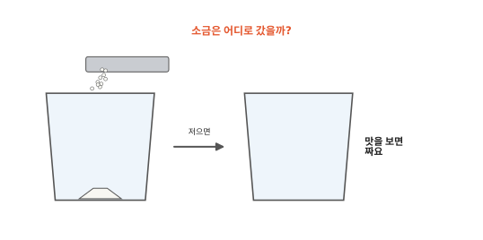
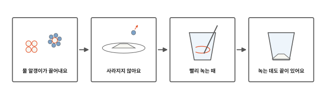
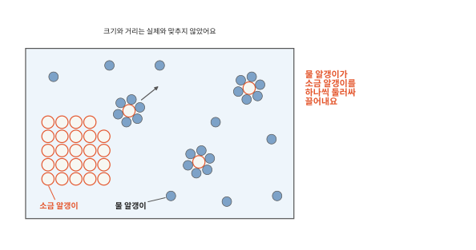
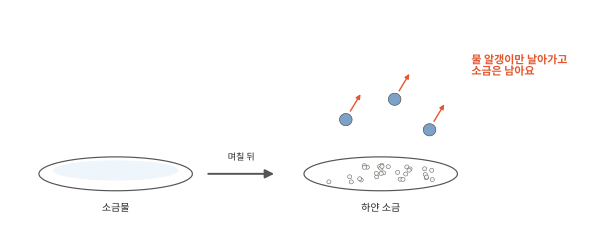
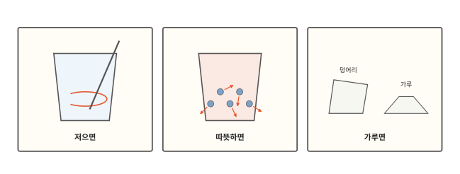
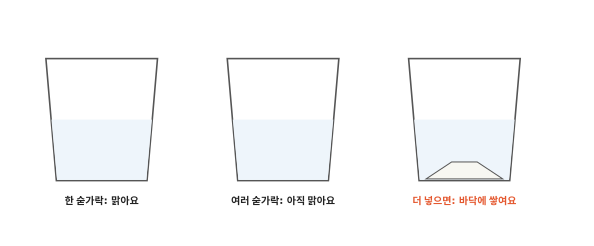

# 소금은 물에 녹아 어디로 갈까요?

## 소금이 사라졌어요

물 한 컵에 소금 한 숟가락을 넣고 저어 보세요. 하얀 소금이 점점 줄어들다 보이지 않게 돼요. 그래도 물을 살짝 맛보면 짜요. 소금은 어디로 간 걸까요?

## 이 편에서 볼 것

[1편](01-particles.md)에서 설탕을 물에 넣으면 설탕 알갱이가 하나하나 떨어져 물 알갱이 사이사이로 섞여 들어간다고 했어요. 이번에는 소금 알갱이가 어떻게 떨어져 나오는지, 그리고 정말 물속에 그대로 있는지 확인해 봐요.

## 물 알갱이가 끌어내요

소금 한 알도 아주 작은 소금 알갱이가 줄을 맞춰 꼭 붙어 있는 고체예요. 소금을 물에 넣으면 쉬지 않고 꿈틀거리는 물 알갱이들이 소금 겉에 와서 부딪혀요. 물 알갱이는 소금 알갱이를 세게 끌어당겨요. 여러 물 알갱이가 한꺼번에 끌어당기면 소금 알갱이는 덩어리에서 떨어져 나와요.

떨어져 나온 소금 알갱이는 물 알갱이들에게 빙 둘러싸인 채로 물속을 돌아다녀요. 그러면 안쪽에 있던 소금 알갱이가 바깥으로 나오고 물 알갱이가 또 끌어내요. 그래서 소금 덩어리는 겉에서부터 조금씩 작아지다가 다 없어져요.

얼음이 녹는 것과 같은 "녹는다"라는 말을 쓰지만 일어나는 일은 달라요. 얼음은 열을 받아 알갱이가 세게 꿈틀거리다 줄에서 풀려나요. 소금은 차가운 물에서도 물 알갱이가 하나씩 끌어내요.

## 사라지지 않아요

4편 끝에서 물이 마를 때 소금도 함께 날아갈지 물어봤지요. 먼저 소금물은 짜요. 소금 알갱이가 물속에 그대로 있다는 뜻이에요. 알갱이 하나하나가 너무 작아서 눈에 안 보여요.

더 확실하게 볼 수도 있어요. 소금물을 접시에 조금 담아 햇볕 드는 창가에 며칠 두면 물은 다 마르고 접시 바닥에 하얀 소금이 남아요. [4편](04-evaporation.md)에서 물 표면의 물 알갱이가 날아가는 것을 증발이라고 했지요. 날아가는 건 물 알갱이뿐이에요. 소금 알갱이끼리는 서로 아주 세게 붙잡아서 날아가지 못하고 접시에 다시 모여요. 바닷가에서는 바닷물을 넓은 밭에 모아 햇볕과 바람에 말려서 소금을 얻기도 해요.

## 빨리 녹는 때

소금을 넣고 가만히 두면 소금 바로 옆의 물은 이미 끌어낸 소금 알갱이로 북적여요. 그 자리에서는 소금을 더 끌어내기 어려워요. 저어 주면 북적이는 물이 밀려나고 소금이 없는 새 물이 와 닿아서 빨리 녹아요.

[3편](03-heat.md)에서 따뜻할수록 알갱이가 세게 꿈틀거린다고 했지요. 따뜻한 물에서는 물 알갱이가 소금에 더 세게 부딪혀 더 빨리 끌어내요.

굵은 소금 덩어리보다 고운 가루도 빨리 녹아요. 물 알갱이가 끌어낼 수 있는 건 겉에 있는 소금 알갱이뿐이에요. 잘게 부술수록 겉이 넓어져서 한꺼번에 많이 끌어내요.

## 녹는 데도 끝이 있어요

물 반 컵에 소금을 한 숟가락씩 넣고 저어 보면 처음 몇 숟가락은 잘 녹아요. 그런데 계속 넣으면 어느 순간부터 아무리 저어도 소금이 바닥에 쌓여요. 물 반 컵의 물 알갱이가 둘러쌀 수 있는 소금 알갱이의 수는 정해져 있어요. 물을 더 부으면 둘러쌀 물 알갱이가 늘어나서 남은 소금이 다시 녹아요.

물에 녹지 않는 것도 있어요. 모래 알갱이끼리 붙잡는 힘은 물 알갱이가 끌어당기는 힘보다 훨씬 세요. 그래서 물 알갱이가 모래 알갱이를 끌어내지 못하고 모래는 아무리 저어도 바닥에 가라앉아요.

물에 넣은 얼음 조각은 둥둥 떠요. 같은 물 알갱이인데 같은 크기로 보면 왜 얼음이 물보다 가벼울까요? 다음 편에서 볼게요.

## 정리

- 물 알갱이가 소금 겉에서 소금 알갱이를 하나씩 끌어내 빙 둘러싸요. 소금이 물에 녹을 때 일어나는 일이에요.
- 소금은 물속에 그대로 있어요. 물을 말리면 물 알갱이만 날아가고 소금이 남아요.
- 소금은 저으면, 따뜻한 물이면, 고운 가루면 빨리 녹아요.
- 물에 녹는 양에는 끝이 있어요. 모래처럼 물에 녹지 않는 것도 있어요.

## 해 보기: 녹은 소금 찾기

1. 소금을 조금 녹인 물을 접시에 얇게 붓고 햇볕 드는 창가에 두어요. 날마다 들여다보고 물이 다 마르면 무엇이 남았는지 돋보기로 봐요. 돋보기로 해를 보면 안 돼요.
2. 같은 물을 담은 컵 두 개에 각설탕을 하나씩 넣어요. 한 컵만 숟가락으로 저어요. 어느 쪽이 먼저 다 녹나요?
3. 물 반 컵에 소금을 작은 숟가락으로 하나씩 넣고 저어요. 몇 숟가락째부터 바닥에 소금이 남나요? 그다음 물을 조금 더 부으면 어떻게 되나요? 소금물은 마시지 않아요.

## 확인 문제

??? question "1. 소금은 어디로"
    소금을 물에 넣고 저으면 보이지 않게 돼요. 소금 알갱이는 어떻게 된 걸까요?

    **풀이**: 물 알갱이가 소금 겉에서 소금 알갱이를 하나씩 끌어내 빙 둘러쌌어요. 둘러싸인 소금 알갱이는 너무 작아 안 보이지만 물속을 돌아다니고 있어요.

??? question "2. 빨리 녹이기"
    레모네이드를 만들려고 물에 설탕을 넣었어요. 설탕을 빨리 녹이려면 어떻게 하면 될까요?

    **풀이**: 숟가락으로 저어요. 그러면 설탕이 없는 새 물이 설탕에 계속 닿아요. 각설탕보다 고운 설탕을 쓰면 겉이 넓어서 빨리 녹아요. 미지근한 물을 쓰면 물 알갱이가 세게 부딪혀 더 빨리 녹아요.

??? question "3. 바다 수영"
    바다에서 수영하고 나와 햇볕에 몸이 마르자 팔이 하얗고 짰어요. 왜일까요?

    **풀이**: 바닷물에는 소금이 녹아 있어요. 햇볕에 물 알갱이만 날아가고 소금 알갱이는 날아가지 못해 피부에 남았어요.

!!! abstract "어른을 위한 정리 (건너뛰어도 돼요)"
    - 한 물질(용질)이 다른 물질(용매) 속에 분자나 이온 수준으로 고르게 퍼져 용액이 되는 것을 용해라고 해요. 소금(염화 나트륨)은 물에 녹으면 나트륨 이온과 염화 이온으로 갈라지고, 각 이온을 물 분자가 둘러싸요(수화). 본문의 "소금 알갱이"는 이 이온을 가리켜요. 실제로는 나트륨 이온과 염화 이온 두 종류가 번갈아 쌓여 있지만 그림은 한 종류로 그렸어요.[^diss]
    - 용해는 용질 입자끼리의 끌림과 용매 분자끼리의 끌림을 끊고 용질과 용매 사이의 끌림을 새로 만드는 과정이에요.[^diss] 모래(이산화 규소)는 원자들이 공유 결합으로 그물처럼 단단히 이어져 있어 물에 거의 녹지 않아요.
    - 주어진 온도에서 일정한 양의 용매에 녹을 수 있는 용질의 최대량을 용해도라 하고, 그만큼 녹은 용액을 포화 용액이라고 해요. 포화 용액에서도 바닥의 고체는 계속 녹고 녹은 입자는 다시 붙어서, 두 빠르기가 같아 겉보기 양이 변하지 않아요.[^sol] 염화 나트륨은 물 100 g에 약 36 g(상온) 녹고 온도가 올라가도 녹는 양은 조금밖에 늘지 않아요. 따뜻한 물은 녹는 양보다 녹는 빠르기를 크게 바꿔요.
    - 젓기, 온도 올리기, 입자를 잘게 하기는 용해 속도를 높여요. 녹을 수 있는 최대량(용해도)은 젓기나 입자 크기로는 바뀌지 않아요.

## 더 깊이

??? info "물과 기름은 왜 안 섞일까"
    물에 식용유를 부으면 아무리 저어도 잠시 뒤 기름이 위로 떠올라 따로 모여요. 물 알갱이는 소금 알갱이는 세게 끌어당기지만 기름 알갱이는 거의 끌어당기지 않아요. 물 알갱이끼리 서로 꼭 붙잡고 있으니 기름 알갱이는 그 사이에 끼어들지 못하고 따로 모여요.

??? info "공기도 물에 녹아요"
    어항 물고기가 물속에서 숨을 쉴 수 있는 것은 물에 공기가 조금 녹아 있어서예요. 탄산음료의 거품은 일부러 많이 녹여 둔 기체가 빠져나오는 거예요. 기체는 소금과 달리 차가운 물에 더 잘 녹아요. 그래서 미지근한 탄산음료는 김이 빨리 빠져요.

[^diss]: OpenStax, *Chemistry 2e*, 11.1 ["The Dissolution Process"](https://openstax.org/books/chemistry-2e/pages/11-1-the-dissolution-process).
[^sol]: OpenStax, *Chemistry 2e*, 11.3 ["Solubility"](https://openstax.org/books/chemistry-2e/pages/11-3-solubility).
