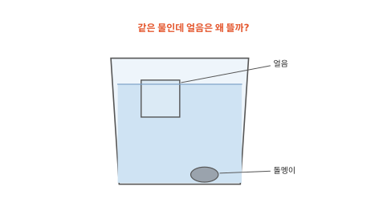
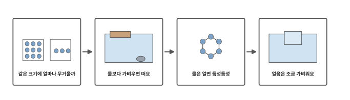
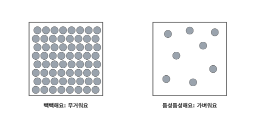
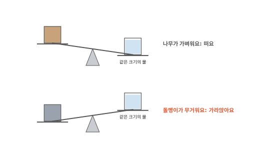
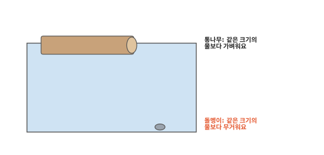
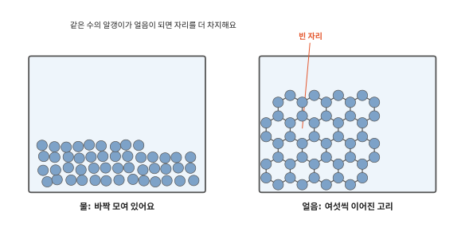
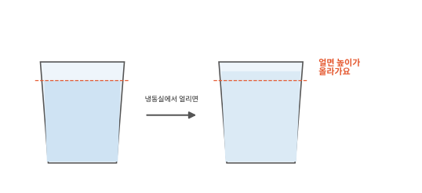

# 얼음은 왜 물에 뜰까요?

## 얼음은 뜨고 돌멩이는 가라앉고

물컵에 얼음을 넣으면 둥둥 떠요. 작은 돌멩이를 넣으면 바닥으로 가라앉아요. 얼음은 물이 언 거예요. 물로 만든 얼음이 물 위에 떠 있다니 신기하지요.

## 이 편에서 볼 것

[5편](05-dissolving.md) 끝에서 같은 물 알갱이인데 왜 얼음이 물보다 가벼운지 물어봤지요. [2편](02-states.md)에서는 얼음, 물, 수증기가 알갱이가 얼마나 붙어 있고 얼마나 세게 꿈틀거리는지가 다르다고 했어요. 이번에는 알갱이가 얼마나 빽빽하게 들어차 있는지 봐요.

## 같은 크기에 얼마나 무거울까

똑같은 크기의 상자 두 개를 떠올려 보세요. 하나에는 구슬을 꽉 채우고 하나에는 같은 구슬을 몇 개만 넣어요. 들어 보면 꽉 채운 상자가 무거워요.

돌멩이와 나무를 같은 크기로 잘라서 들어 보면 돌멩이가 훨씬 무거워요. 돌멩이 속에는 무거운 알갱이가 빽빽하게 들어차 있거든요. 이렇게 같은 크기일 때 얼마나 무거운지를 **밀도**라고 해요. 알갱이 하나가 무거울수록, 알갱이가 빽빽할수록 밀도가 커요. 구슬 상자와 달리 돌멩이나 나무 속은 눈에 보이게 비어 있지는 않아요. 알갱이가 너무 작아서 빈 곳이 안 보일 뿐이에요.

## 물보다 가벼우면 떠요

물에 뜰지 가라앉을지는 같은 크기만큼 담은 물과 무게를 대어 보면 알아요. 같은 크기의 물보다 가벼우면 떠요. 물보다 밀도가 작다는 뜻이에요. 같은 크기의 물보다 무거우면 가라앉아요.

그래서 덩치만 보고는 알 수 없어요. 커다란 통나무는 사람이 들기 힘들 만큼 무거워도 같은 크기의 물보다 가벼워서 떠요. 손톱만 한 돌멩이는 작아도 같은 크기의 물보다 무거워서 가라앉아요.

쇠는 물보다 훨씬 무거운데 쇠로 만든 큰 배는 떠요. 배 속이 공기로 텅 비어 있어서예요. 쇠와 그 안의 공기를 한꺼번에 보면 같은 크기의 물보다 가벼워요.

## 물은 얼면 듬성듬성해져요

대부분의 물질은 굳어서 고체가 되면 알갱이가 더 빽빽해져요. 물은 거꾸로예요.

물에서도 알갱이끼리 서로 붙잡지만 짝이 쉴 새 없이 바뀌어요. 얼 때는 알갱이마다 정해진 방향으로 이웃과 손을 잡고 그 자리에 머물러요. 그러면 여섯 알갱이가 둥근 고리 하나를 만들고 이웃 고리들이 알갱이를 함께 쓰면서 벌집처럼 이어져요. 고리 가운데에는 빈 자리가 생겨서 같은 수의 알갱이가 자리를 더 넓게 차지해요.

[2편](02-states.md) 그림에서는 얼음을 반듯한 줄로 단순하게 그렸어요. 더 가까이 보면 이런 고리 모양이에요.

## 얼음은 조금 가벼워요

얼음 속 알갱이는 고리를 이루느라 자리를 더 차지해요. 그래서 얼음을 물과 같은 크기로 잘라 보면 그 안에 든 알갱이가 물보다 적어요. 얼음의 밀도가 물보다 작아지니 얼음은 물 위에 떠요. 다만 아주 조금 가벼울 뿐이라 거의 다 물속에 잠긴 채 떠요. 컵 속 얼음도 윗부분만 살짝 물 위로 나와 있지요.

컵에 물을 담아 얼리면 얼음 높이가 물 높이보다 올라와요. 물을 가득 채운 유리병을 냉동실에 넣으면 병이 깨질 수 있어요. 한겨울에 수도관이 터지는 것도 관 속의 물이 얼면서 부풀어서예요.

2편부터 이번 편까지는 알갱이가 모이고 흩어지고 자리를 바꿔도 알갱이 하나하나는 그대로였어요. 그런데 종이는 불에 타면 재가 되고 다시 종이로 돌아오지 않아요. 다음 편은 불 이야기예요.

## 정리

- 밀도: 같은 크기일 때 얼마나 무거운지예요. 알갱이가 무겁고 빽빽할수록 커요.
- 같은 크기의 물보다 가벼우면 뜨고 무거우면 가라앉아요. 덩치가 커도 뜰 수 있고 작아도 가라앉을 수 있어요.
- 물 알갱이는 얼 때 여섯씩 고리를 이루며 벌집처럼 이어져요. 고리 가운데가 비어서 얼음은 물보다 듬성듬성해요.
- 얼음은 물보다 밀도가 조금 작아서 거의 다 잠긴 채 떠요.

## 해 보기: 뜨는 것과 가라앉는 것

1. 물을 담은 큰 그릇에 얼음, 쇠 숟가락, 나무젓가락 조각, 동전, 플라스틱 뚜껑을 하나씩 넣어 보세요. 넣기 전에 뜰지 가라앉을지 먼저 맞혀 봐요. 동전 같은 작은 물건은 어른과 함께 다뤄요.
2. 플라스틱 컵에 물을 가장자리에서 손가락 한 마디쯤 아래까지 담고 물 높이에 펜으로 줄을 그어요. 냉동실에 넣었다가 내일 아침에 꺼내 얼음 높이를 줄과 비교해 봐요. 유리컵은 깨질 수 있으니 쓰지 않아요.
3. 투명한 컵에 물을 반쯤 담고 식용유를 한 숟가락 부어요. 저은 뒤 잠깐 기다리면 기름은 어디로 가나요? 다 본 물은 마시지 말고 어른과 함께 버려요.

## 확인 문제

??? question "1. 밀도"
    같은 크기로 잘랐을 때 얼마나 무거운지를 무엇이라고 할까요?

    **풀이**: 밀도예요. 같은 크기에 무거운 알갱이가 빽빽하게 들어찰수록 밀도가 커요.

??? question "2. 통나무와 돌멩이"
    커다란 통나무는 물에 뜨는데 작은 돌멩이는 가라앉아요. 왜일까요?

    **풀이**: 뜰지 가라앉을지는 같은 크기만큼의 물과 무게를 대어 보면 정해져요. 통나무는 같은 크기의 물보다 가볍고 돌멩이는 같은 크기의 물보다 무거워요.

??? question "3. 부푼 페트병"
    한겨울 베란다에 물을 가득 채운 페트병을 두었더니 꽁꽁 얼면서 병이 빵빵하게 부풀었어요. 왜일까요?

    **풀이**: 물이 얼 때 알갱이들이 고리를 이루며 가운데에 빈 자리를 만들어요. 알갱이 수는 그대로인데 더 넓은 자리가 필요해서 병이 부풀어요.

!!! abstract "어른을 위한 정리 (건너뛰어도 돼요)"
    - 밀도는 단위 부피당 질량이에요(ρ = m/V). 물의 밀도는 약 1.00 g/cm³이고 얼음은 약 0.917 g/cm³예요.[^dens]
    - 물체에 작용하는 부력은 물체가 밀어낸 유체의 무게와 같아요(아르키메데스의 원리). 물체의 평균 밀도가 유체보다 작으면 뜨고, 뜬 물체가 잠기는 비율은 유체에 대한 밀도 비와 같아요. 얼음은 민물에서 부피의 약 92%가 잠겨요. 속이 빈 쇠 배가 뜨는 것도 배 전체의 평균 밀도가 물보다 작기 때문이에요.[^arch]
    - 대부분의 물질은 고체가 액체보다 밀도가 크지만 물은 대표적인 예외예요. 물 분자 사이에는 수소 결합이 있어요.[^hbond] 얼음에서는 분자 하나가 이웃 네 개와 수소 결합으로 이어져 육각형 고리가 반복되는 열린 구조를 이루고, 그 사이 빈 공간 때문에 액체 물보다 밀도가 작아요. 본문의 "손잡기"는 수소 결합, "여섯 개 고리"는 이 육각형 구조를 단순하게 나타낸 거예요. 실제 고리는 평면이 아니라 주름진 입체예요. 2편 그림은 얼음과 물을 비슷한 빽빽함으로 그렸어요.
    - 액체 물은 약 4 °C에서 밀도가 가장 커요. 그래서 겨울 호수는 표면부터 얼고, 뜬 얼음 층이 아래 물을 덮어 바닥 쪽 물은 4 °C 가까이 남아요.[^exp]

## 더 깊이

??? info "겨울 연못의 물고기"
    겨울에 연못은 찬 공기에 닿는 위쪽부터 얼어요. 얼음은 물에 뜨니까 그대로 위에 남아 뚜껑처럼 덮어요. 그 뚜껑이 차가운 바람을 막아 줘서 깊은 연못이면 아래 물은 다 얼지 않아요. 물고기는 얼음 아래 물속에서 겨울을 나요.

??? info "빙산은 대부분 물속에 있어요"
    바다에 떠 있는 커다란 얼음덩어리를 빙산이라고 해요. 얼음은 물보다 조금만 가벼워서 빙산은 대부분 물속에 잠기고 일부만 물 위로 보여요.

[^dens]: OpenStax, *College Physics 2e*, 11.2 ["Density"](https://openstax.org/books/college-physics-2e/pages/11-2-density).
[^arch]: OpenStax, *College Physics 2e*, 11.7 ["Archimedes' Principle"](https://openstax.org/books/college-physics-2e/pages/11-7-archimedes-principle).
[^hbond]: OpenStax, *Chemistry 2e*, 10.1 ["Intermolecular Forces"](https://openstax.org/books/chemistry-2e/pages/10-1-intermolecular-forces).
[^exp]: OpenStax, *College Physics 2e*, 13.2 ["Thermal Expansion of Solids and Liquids"](https://openstax.org/books/college-physics-2e/pages/13-2-thermal-expansion-of-solids-and-liquids).
