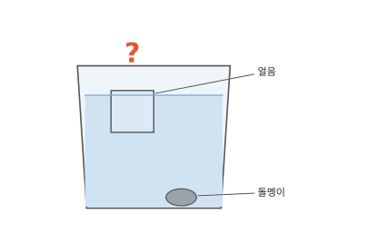
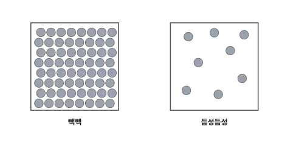
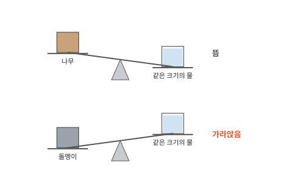
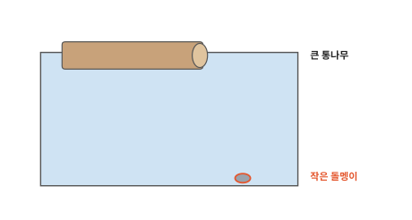
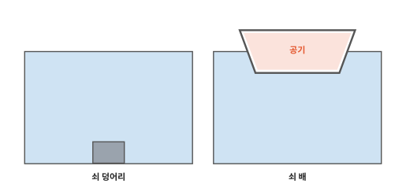
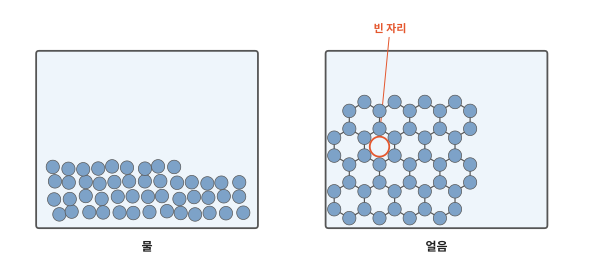
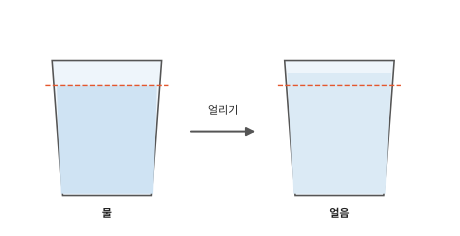

# 밀도: 얼음이 물에 뜨는 까닭

물컵에 얼음을 넣으면 둥둥 떠요. 작은 돌멩이를 넣으면 바닥으로 가라앉고요. 얼음은 물이 언 건데도 물 위에 떠요. 이 글을 읽고 나면 물건이 물에 뜰지 가라앉을지 무엇이 정하는지 알게 돼요. 이걸 알면 커다란 통나무와 쇠로 만든 배가 뜨는 까닭과 얼음이 물보다 가벼운 까닭을 설명할 수 있어요.

!!! abstract "이 글에서 알게 되는 것"
    1. 같은 크기일 때 얼마나 무거운지를 밀도라고 해요. 알갱이가 무겁고 빽빽할수록 밀도가 커요.
    2. 같은 크기의 물보다 가벼우면 뜨고 무거우면 가라앉아요. 그래서 덩치만 보고는 뜰지 알 수 없어요.
    3. 물 알갱이는 얼 때 여섯씩 고리를 이루고 고리 가운데가 비어요. 그래서 얼음은 물보다 조금 가볍고 거의 다 잠긴 채 떠요.

## 1. 얼음은 물이 언 것인데도 물에 떠요

[5편](05-dissolving.md) 끝에서 같은 물 알갱이인데 왜 얼음이 물 위에 뜨는지 물었어요. 먼저 컵 하나에 얼음과 돌멩이를 함께 넣어 볼게요. 아래 그림에서 얼음이 물에 얼마나 잠겼는지 보세요.

**그림 1.** 얼음은 윗부분만 살짝 내놓고 떠 있고 돌멩이는 바닥에 가라앉아 있어요.
{ .fig-cap }

얼음은 둥둥 뜨지만 거의 다 물속에 잠겨 있어요. 물 위로 나온 건 윗부분 조금이에요. [2편](02-states.md)에서 얼음, 물, 수증기는 알갱이가 얼마나 붙어 있고 얼마나 세게 꿈틀거리는지가 다르다고 했어요. 이번에는 알갱이가 얼마나 빽빽하게 들어차 있는지를 볼게요.

## 2. 같은 크기일 때 얼마나 무거운지가 밀도예요

똑같은 크기의 상자 두 개를 떠올려 보세요. 하나에는 구슬을 꽉 채우고 하나에는 같은 구슬을 몇 개만 넣어요. 아래 그림에서 두 상자에 든 구슬 수를 보세요.

**그림 2.** 상자 크기는 같은데 왼쪽에는 구슬이 꽉 차 있고 오른쪽에는 여덟 개뿐이에요.
{ .fig-cap }

들어 보면 꽉 채운 상자가 무거워요. 크기가 같아도 안에 든 게 많으면 무거워요.

돌멩이와 나무를 같은 크기로 잘라서 들어 봐도 돌멩이가 훨씬 무거워요. 돌멩이 속에는 무거운 알갱이가 빽빽하게 들어차 있거든요. 이렇게 같은 크기일 때 얼마나 무거운지를 **밀도**라고 해요. 알갱이가 무겁고 빽빽할수록 밀도가 커요.

구슬 상자와 달리 돌멩이나 나무 속은 눈에 보이게 비어 있지는 않아요. 알갱이가 너무 작아서 빈 곳이 안 보일 뿐이에요.

## 3. 같은 크기의 물보다 가벼우면 떠요

밀도를 알았으니 이제 뜨고 가라앉는 걸 따져 볼게요. 물에 뜰지 가라앉을지는 같은 크기만큼 담은 물과 무게를 대어 보면 알아요. 아래 그림에서 저울이 어느 쪽으로 기울었는지 보세요.

**그림 3.** 나무는 같은 크기의 물보다 가벼워서 뜨고 돌멩이는 무거워서 가라앉아요.
{ .fig-cap }

위 저울은 물 쪽으로 기울었어요. 나무가 같은 크기의 물보다 가볍다는 뜻이에요. 그래서 나무는 떠요. 물보다 밀도가 작은 거예요. 아래 저울은 돌멩이 쪽으로 기울었어요. 돌멩이는 같은 크기의 물보다 무거워서 가라앉아요.

## 4. 덩치로는 뜰지 가라앉을지 알 수 없어요

저울에 올린 건 크기가 같은 토막이었어요. 크기가 아주 다른 두 물건이라면 어떨까요? 아래 그림에서 물 위와 바닥에 있는 것을 보세요.

**그림 4.** 큰 통나무는 뜨고 손톱만 한 돌멩이는 가라앉아요.
{ .fig-cap }

커다란 통나무는 사람이 들기 힘들 만큼 무거워요. 그래도 같은 크기의 물보다 가벼워서 떠요. 손톱만 한 돌멩이는 작아도 같은 크기의 물보다 무거워서 가라앉아요. 뜰지 가라앉을지는 같은 크기의 물과 대어 본 무게가 정해요.

쇠는 물보다 훨씬 무거워요. 그런데 쇠로 만든 큰 배는 떠요. 아래 그림에서 쇠 배 안에 든 것을 보세요.

**그림 5.** 쇠 덩어리는 가라앉고 속이 공기로 빈 쇠 배는 떠요.
{ .fig-cap }

배 속은 공기로 텅 비어 있어요. 쇠와 그 안의 공기를 한꺼번에 보면 같은 크기의 물보다 가벼워요. 그래서 배는 떠요.

## 5. 물은 얼 때 알갱이가 고리를 이뤄 자리를 더 차지해요

이제 얼음으로 돌아와 볼게요. 대부분의 물질은 굳어서 고체가 되면 알갱이가 더 빽빽해져요. 물은 거꾸로예요. 아래 그림에서 같은 수의 물 알갱이가 물일 때와 얼음일 때 차지하는 자리를 보세요. 알갱이 크기와 사이 거리는 실제와 맞추지 않았어요.

**그림 6.** 같은 48개 알갱이가 얼음이 되면 고리 가운데가 비어서 자리를 더 넓게 차지해요.
{ .fig-cap }

물에서도 알갱이끼리 서로 붙잡지만 붙잡는 짝이 쉴 새 없이 바뀌어요. 얼 때는 알갱이마다 정해진 방향으로 이웃과 손을 잡고 그 자리에 머물러요. 그러면 여섯 알갱이가 둥근 고리 하나를 만들어요. 이웃 고리들은 알갱이를 함께 쓰면서 벌집처럼 이어져요. 고리 가운데에는 빈 자리가 생겨서 같은 수의 알갱이가 자리를 더 넓게 차지해요.

[2편](02-states.md) 그림에서는 얼음을 반듯한 줄로 단순하게 그렸어요. 더 가까이 보면 이런 고리 모양이에요.

## 6. 얼음은 물보다 조금 가벼워서 거의 잠긴 채 떠요

얼음 속 알갱이는 고리를 이루느라 자리를 더 차지해요. 그래서 얼음을 물과 같은 크기로 잘라 보면 그 안에 든 알갱이가 물보다 적어요. 얼음의 밀도가 물보다 작으니 얼음은 물 위에 떠요. 다만 아주 조금 가벼워서 그림 1처럼 거의 다 물속에 잠긴 채 떠요. 바다에 떠 있는 커다란 얼음덩어리인 빙산도 대부분 물속에 잠겨 있어요.

같은 일을 컵 하나로 볼 수 있어요. 컵에 물을 담고 물 높이에 줄을 그은 다음 냉동실에서 얼려요. 아래 그림에서 빨간 점선과 얼음 높이를 보세요.

**그림 7.** 물을 얼리면 얼음 높이가 처음 물 높이보다 올라와요.
{ .fig-cap }

알갱이 수는 그대로인데 자리를 더 차지하니까 높이가 올라와요. 물을 가득 채운 유리병을 냉동실에 넣으면 병이 깨질 수 있어요. 한겨울에 수도관이 터지는 것도 관 속의 물이 얼면서 부풀어서예요.

??? question "해 보기: 뜨는 것과 가라앉는 것"
    1. 물을 담은 큰 그릇에 얼음, 쇠 숟가락, 나무젓가락 조각, 동전, 플라스틱 뚜껑을 하나씩 넣어 보세요. 넣기 전에 뜰지 가라앉을지 먼저 맞혀 봐요. 동전 같은 작은 물건은 어른과 함께 다뤄요.
    2. 플라스틱 컵에 물을 가장자리에서 손가락 한 마디쯤 아래까지 담고 물 높이에 펜으로 줄을 그어요. 냉동실에 넣었다가 다음 날 아침에 꺼내 얼음 높이를 줄과 대어 봐요. 유리컵은 깨질 수 있으니 쓰지 않아요.
    3. 투명한 컵에 물을 반쯤 담고 식용유를 한 숟가락 부어요. 저은 다음 잠깐 기다리면 기름은 어디로 가나요? 다 본 물은 마시지 말고 어른과 함께 버려요.

??? info "어른을 위한 정리"
    - 밀도는 단위 부피당 질량이에요(ρ = m/V). 물의 밀도는 약 1.00 g/cm³이고 얼음은 약 0.917 g/cm³예요.[^dens]
    - 물체에 작용하는 부력은 물체가 밀어낸 유체의 무게와 같아요(아르키메데스의 원리). 물체의 평균 밀도가 유체보다 작으면 뜨고 뜬 물체가 잠기는 비율은 유체에 대한 밀도 비와 같아요. 얼음은 민물에서 부피의 약 92%가 잠겨요. 속이 빈 쇠 배가 뜨는 것도 배 전체의 평균 밀도가 물보다 작기 때문이에요.[^arch]
    - 대부분의 물질은 고체가 액체보다 밀도가 크지만 물은 대표적인 예외예요. 물 분자 사이에는 수소 결합이 있어요.[^hbond] 얼음에서는 분자 하나가 이웃 네 개와 수소 결합으로 이어져 육각형 고리가 반복되는 열린 구조를 이뤄요. 그 사이 빈 공간 때문에 액체 물보다 밀도가 작아요. 본문의 "손잡기"는 수소 결합을, "여섯 개 고리"는 이 육각형 구조를 단순하게 나타낸 거예요. 실제 고리는 주름진 입체인데 그림은 평면으로 그렸어요.
    - 액체 물은 약 4 °C에서 밀도가 가장 커요. 그래서 겨울 호수는 표면부터 얼고 뜬 얼음 층이 아래 물을 덮어 바닥 쪽 물은 4 °C 가까이 남아요.[^exp]

## 정리

같은 크기일 때 얼마나 무거운지를 밀도라고 해요. 같은 크기 상자라도 구슬이 꽉 찬 상자가 무겁듯이 무거운 알갱이가 빽빽하게 들어찰수록 밀도가 커요.

물에 뜰지 가라앉을지는 같은 크기의 물과 무게를 대어 보면 알아요. 물보다 가벼우면 뜨고 무거우면 가라앉아요. 그래서 큰 통나무는 뜨고 작은 돌멩이는 가라앉아요. 쇠 배는 속의 공기까지 한꺼번에 보면 물보다 가벼워서 떠요.

물 알갱이는 얼 때 여섯씩 고리를 이루고 고리 가운데가 비어요. 같은 수의 알갱이가 자리를 더 차지하니까 얼음은 물보다 밀도가 조금 작아요. 그래서 얼음은 거의 다 잠긴 채 물에 뜨고 물을 얼리면 높이가 올라와요.

[2편](02-states.md)부터 이번 편까지는 알갱이가 모이고 흩어지고 자리를 바꿔도 알갱이 하나하나는 그대로였어요. 그런데 초는 불에 타면 짧아지고 줄어든 초는 다시 돌아오지 않아요. 초가 탈 때 무슨 일이 생기는지는 [7편](07-burning.md)에서 볼게요.

### 새로 나온 말

- **밀도**: 같은 크기일 때 얼마나 무거운지를 나타내는 말. 같은 크기로 자르면 돌멩이가 나무보다 무거우니 돌멩이의 밀도가 더 커요.

[^dens]: OpenStax, *College Physics 2e*, 11.2 ["Density"](https://openstax.org/books/college-physics-2e/pages/11-2-density).
[^arch]: OpenStax, *College Physics 2e*, 11.7 ["Archimedes' Principle"](https://openstax.org/books/college-physics-2e/pages/11-7-archimedes-principle).
[^hbond]: OpenStax, *Chemistry 2e*, 10.1 ["Intermolecular Forces"](https://openstax.org/books/chemistry-2e/pages/10-1-intermolecular-forces).
[^exp]: OpenStax, *College Physics 2e*, 13.2 ["Thermal Expansion of Solids and Liquids"](https://openstax.org/books/college-physics-2e/pages/13-2-thermal-expansion-of-solids-and-liquids).
