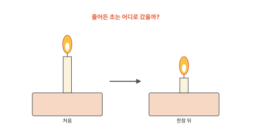
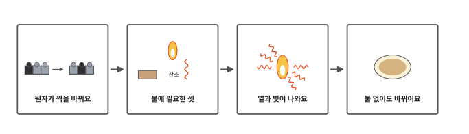
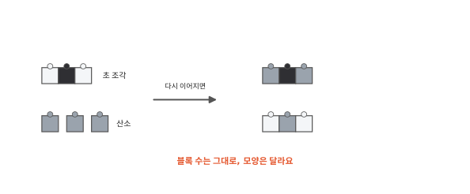
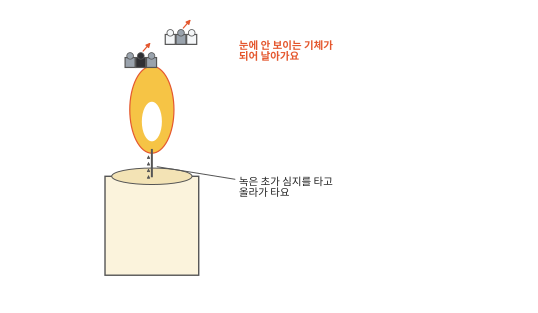
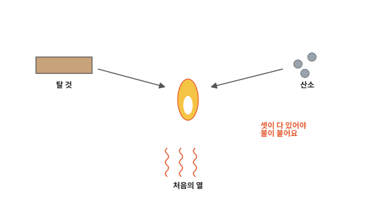
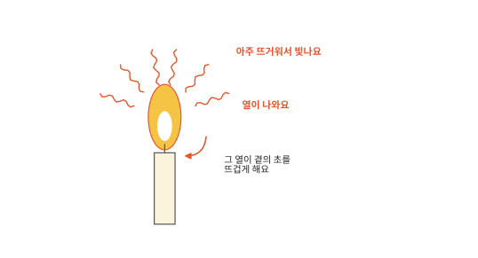
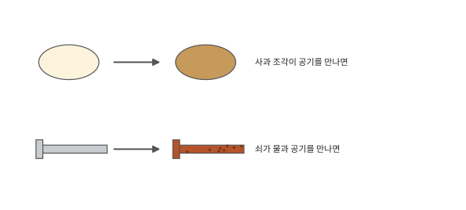

# 불은 왜 탈까요?

## 촛불이 타면

생일 케이크에 꽂은 초에 불을 붙이면 초가 조금씩 짧아져요. 종이는 타고 나면 까맣거나 회색인 재만 조금 남고요. 재를 모아 아무리 기다려도 다시 종이가 되지는 않아요. 줄어든 초와 종이는 어디로 갔을까요?

## 이 편에서 볼 것

[2편](02-states.md)부터 [6편](06-density.md)까지는 물이 얼고 녹고 마르고, 소금이 녹아 섞이는 이야기였어요. 그때마다 알갱이가 모이고 흩어져도 물 알갱이는 물 알갱이, 소금 알갱이는 소금 알갱이 그대로였어요. 불에 탈 때는 달라요. 알갱이 자체가 다른 알갱이로 바뀌어요.

## 원자가 짝을 바꿔요

[1편](01-particles.md)에서 알갱이는 원자라는 기본 조각이 붙어서 된 거라고 했어요. 물 알갱이 하나는 원자 세 개가 꼭 붙은 거였지요.

블록 장난감을 떠올려 보세요. 블록 몇 개로 자동차를 만들었다가 떼어서 같은 블록으로 집을 만들 수 있어요. 블록은 그대로인데 모양이 완전히 달라져요. 불에 탈 때 알갱이에서 일어나는 일이 이와 닮았어요. 초를 이루던 알갱이가 떨어져 나뉘고 그 원자들이 공기 속 산소 원자와 새로 붙어요. 이렇게 원자가 다른 원자와 새로 붙는 것을 이 편에서는 짝을 바꾼다고 할게요. 짝을 바꾸고 나면 초와 전혀 다른 알갱이가 생겨요.

그림의 블록을 세어 보세요. 바뀌기 전과 뒤에 블록 수가 똑같아요. 원자는 없어지지 않고 짝만 바뀌어요. 블록과 다른 점도 있어요. 블록은 손으로 다시 맞추면 자동차로 돌아가지만 탄 초나 종이는 아무리 기다려도 저절로 돌아오지 않아요.

## 초는 기체가 되어 날아가요

불꽃의 열로 초 윗부분이 녹아요. 녹은 초는 심지를 타고 올라가 뜨거워지면서 기체가 되고 그 기체가 불꽃 속에서 타요. 이때 초의 원자들이 산소와 짝을 바꿔 생긴 새 알갱이는 대부분 눈에 보이지 않는 기체예요. 그래서 공기 속으로 흩어져요. 흘러내려 굳은 초는 타지 않고 남아요.

종이도 그래요. 종이를 이루던 원자 대부분은 산소와 짝을 바꿔 기체가 되어 날아가요. 재에는 종이의 원자가 조금밖에 남지 않아요. 그러니 재를 모아도 종이로 돌아갈 수 없어요.

## 불에 필요한 셋

불이 붙으려면 세 가지가 있어야 해요. 나무, 종이, 초처럼 탈 것이 있어야 하고 공기 속 산소가 있어야 해요. [인체 2편](../body/02-breathing.md)에서 숨을 쉬면 공기 속 산소가 피를 타고 세포까지 간다고 했지요. 불도 그 산소가 필요해요. 그리고 처음에 열을 주어 뜨겁게 해야 해요. 성냥을 그어 불씨를 대 주는 게 그 일이에요.

셋 가운데 하나만 빠져도 불은 꺼져요. 촛불 위에 유리컵을 덮으면 컵 속 산소가 점점 줄어들어 모자라지면서 꺼져요. 모닥불에 물을 부으면 물이 열을 가져가 식으니까 꺼져요.

## 열과 빛이 나와요

원자가 산소와 짝을 바꿀 때는 열이 나와요. 이 열이 곁에 있는 초나 나무를 다시 뜨겁게 해요. 뜨거워진 곳의 원자들이 또 산소와 짝을 바꾸고 또 열을 내요. 그래서 한번 붙은 불은 탈 것이 다 떨어질 때까지 이어져요.

그 열로 아주 뜨거워진 것은 빛도 내요. 숯불이 빨갛게 빛나고 촛불 불꽃이 노랗게 빛나는 것은 아주 뜨거워서예요. 블록은 다시 맞춰도 따뜻해지지 않으니 이 점도 블록과 달라요.

## 불 없이도 바뀌어요

산소와 짝을 바꾸는 일은 불 없이도 일어나요. 사과를 잘라 두면 자른 면이 조금씩 갈색이 돼요. 사과 속 알갱이가 공기 속 산소와 만나 갈색 알갱이로 바뀌었어요. 쇠못을 물기 있는 곳에 오래 두면 붉은 녹이 슬어요. 쇠 원자가 산소와 짝을 바꿔 녹이라는 다른 물질이 됐어요.

이런 일은 아주 천천히 일어나서 열이 나와도 조금씩이라 느끼기 어려워요. 바뀐 물질은 저절로 돌아오지 않아서 갈색 사과는 다시 하얘지지 않고 녹은 저절로 쇠가 되지 않아요.

불이 낸 열과 빛은 어디서 온 걸까요? 다음 편에서 볼게요.

## 정리

- 탈 때는 원자들이 산소 원자와 짝을 바꿔 다른 물질이 돼요. 원자는 없어지지 않아요.
- 초는 녹아 심지를 타고 올라가 기체가 되어 타고 눈에 안 보이는 기체가 되어 날아가요.
- 불이 붙으려면 탈 것, 산소, 처음의 열이 모두 있어야 해요.
- 원자가 짝을 바꿀 때 열이 나오고 그 열로 뜨거워진 것이 빛을 내요. 그 열이 곁을 뜨겁게 해 불이 이어져요.
- 사과가 갈색이 되고 쇠가 녹스는 것도 산소와 짝을 바꾸는 일이에요. 바뀐 물질은 저절로 돌아오지 않아요.

## 해 보기: 불 없이 바뀌는 것 지켜보기

1. 어른에게 사과를 두 조각으로 잘라 달라고 해요. 한 조각은 그대로 접시에 두고 한 조각은 자른 면에 비닐 랩을 꼭 붙여 공기가 닿지 않게 해요. 30분 뒤 두 조각의 색을 비교해 봐요.
2. 접시에 소금물을 적신 휴지를 깔고 칠하지 않은 쇠못(또는 철 수세미 한 조각)을 올려 두어요. 휴지가 마르지 않게 날마다 물을 조금씩 주면서 며칠 동안 지켜봐요. 날마다 사진을 찍어 두면 비교하기 좋아요. 녹슨 쇠를 만진 뒤에는 손을 씻어요.
3. 집에서 본 변화를 두 가지로 나눠 봐요. 얼음 녹기, 버터 녹기, 빵 굽기, 사과 갈변, 소금 녹이기 가운데 다시 되돌릴 수 있는 것과 되돌릴 수 없는 것은 무엇일까요?

## 확인 문제

??? question "1. 꺼진 촛불"
    촛불 위에 유리컵을 덮으면 조금 뒤 불이 꺼져요. 왜일까요?

    **풀이**: 불이 붙어 있으려면 산소가 있어야 해요. 컵 속 산소가 점점 줄어서 불이 붙어 있을 만큼 남지 않으면 꺼져요.

??? question "2. 짧아진 초"
    초가 타면서 점점 짧아져요. 줄어든 초는 어디로 갔을까요?

    **풀이**: 녹은 초가 심지를 타고 올라가 기체가 되어 탔어요. 초의 원자들이 산소와 짝을 바꿔 눈에 안 보이는 기체 알갱이가 되어 공기 속으로 흩어졌어요. 원자는 없어지지 않았어요.

??? question "3. 녹슨 그네 사슬"
    놀이터 그네의 쇠사슬이 붉게 녹슬었어요. 녹을 털어 내면 그 부분이 원래 쇠로 돌아올까요?

    **풀이**: 돌아오지 않아요. 녹은 쇠 원자가 산소와 짝을 바꿔 생긴 다른 물질이에요. 녹을 털어 내면 쇠가 녹으로 바뀐 만큼 사슬이 가늘어진 채로 남아요.

!!! abstract "어른을 위한 정리 (건너뛰어도 돼요)"
    - 물질의 조성이 바뀌어 새로운 물질이 생기는 변화를 화학 변화라 하고, 물질의 종류는 그대로인 녹기·얼기·증발·용해는 물리 변화로 구분해요. 나무가 타는 것과 쇠가 녹스는 것은 대표적인 화학 변화예요.[^change]
    - 연소는 물질이 산소와 빠르게 반응해 열과 빛을 내는 반응이에요. 초(파라핀, 탄화수소)는 녹은 뒤 심지에서 기화해 타고, 완전히 타면 이산화탄소와 물(수증기)이 생겨요. 불완전 연소에서는 그을음(탄소)도 생겨요. 연소는 산화 환원 반응에 속해요.[^react]
    - 본문의 "짝을 바꾼다"는 화학 결합이 끊기고 새로 생기는 것을 가리켜요. 그림은 원자를 블록으로 단순하게 그렸어요(검정 탄소, 흰색 수소, 회색 산소). 공기 속 산소는 실제로 원자 둘이 붙은 분자예요. 화학 반응에서 원자는 생기거나 없어지지 않고 재배열될 뿐이라, 반응 전후 질량의 합이 같아요.
    - 연소는 열을 내놓는 발열 반응이에요.[^heat] 연소에는 연료, 산소, 발화에 필요한 열 세 가지가 필요하다는 것을 흔히 "불의 삼요소"라고 하고, 소화는 이 가운데 하나를 없애는 일이에요. 덮은 컵 속 촛불은 산소가 다 없어지기 전, 농도가 일정 수준 아래로 떨어지면 꺼져요.
    - 사과 자른 면의 갈변은 사과 속 효소가 폴리페놀을 산소와 반응시켜 갈색 색소를 만드는 반응이에요. 랩으로 공기를 막거나 레몬즙을 바르면 늦출 수 있어요.

## 더 깊이

??? info "몸속에서도 천천히 타요"
    우리 몸의 세포는 먹은 영양을 산소와 반응시켜 일할 힘과 열을 얻어요. 불처럼 확 타지 않고 여러 단계로 아주 천천히 일어나서 불꽃은 없지만 원자가 산소와 짝을 바꾸는 점은 같아요. [인체 2편](../body/02-breathing.md)에서 내쉰다고 한 다 쓴 숨의 이산화탄소가 그 결과예요.

??? info "타도 무게는 그대로"
    옛날 사람들은 불에 타면 무언가가 빠져나가 사라진다고 생각했어요. 그런데 단단히 막은 그릇 안에서 태우고 무게를 재 보니 타기 전과 같았어요. 날아간 기체까지 모두 모으면 물질은 하나도 사라지지 않았다는 걸 알게 됐어요.

[^change]: OpenStax, *Chemistry 2e*, 1.3 ["Physical and Chemical Properties"](https://openstax.org/books/chemistry-2e/pages/1-3-physical-and-chemical-properties).
[^react]: OpenStax, *Chemistry 2e*, 4.2 ["Classifying Chemical Reactions"](https://openstax.org/books/chemistry-2e/pages/4-2-classifying-chemical-reactions).
[^heat]: OpenStax, *Chemistry 2e*, 5.3 ["Enthalpy"](https://openstax.org/books/chemistry-2e/pages/5-3-enthalpy).
