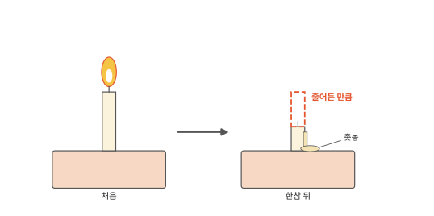
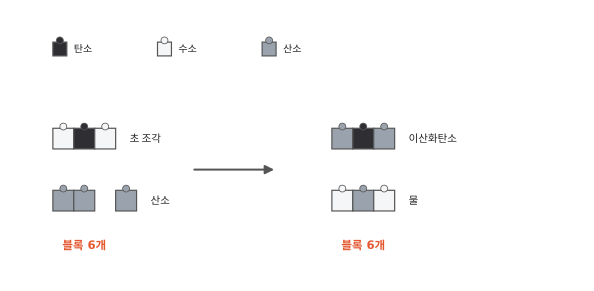
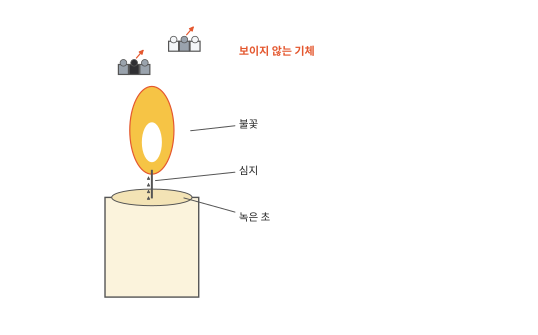
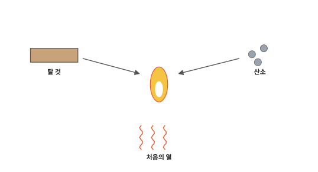
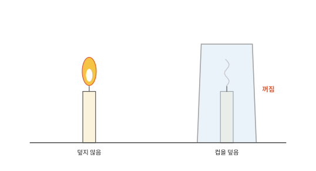
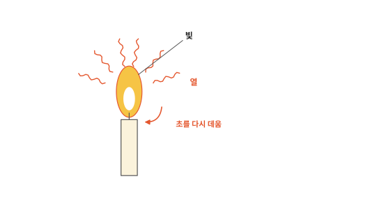
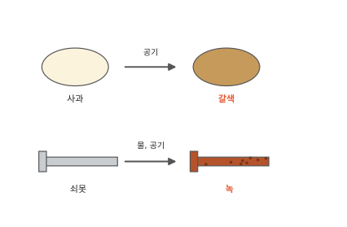

# 불과 녹: 원자가 산소와 짝을 바꾸는 일

생일 케이크에 꽂은 초에 불을 붙이면 초가 조금씩 짧아져요. 다 타고 나면 줄어든 만큼의 초는 어디에서도 찾을 수 없어요. 이 글을 읽고 나면 줄어든 초가 어디로 갔는지 알게 돼요. 불이 붙고 이어지려면 무엇이 있어야 하는지도 알게 돼요. 이걸 알면 유리컵을 덮은 촛불이 꺼지는 까닭과 잘라 둔 사과가 갈색이 되는 까닭도 설명할 수 있어요.

!!! abstract "이 글에서 알게 되는 것"
    1. 초가 탈 때는 초를 이루던 원자가 공기 속 산소와 짝을 바꿔 다른 알갱이가 돼요. 원자는 없어지지 않고 대부분 눈에 안 보이는 기체가 되어 날아가요.
    2. 불이 붙으려면 탈 것, 산소, 처음의 열 셋이 다 있어야 해요. 하나만 빠져도 불은 꺼져요.
    3. 짝을 바꿀 때 나온 열이 곁의 초를 데워서 불이 이어지고 아주 뜨거운 불꽃은 빛을 내요. 사과가 갈색이 되고 쇠가 녹스는 것도 산소와 짝을 바꾸는 일이에요.

## 1. 녹은 초는 다시 굳지만 타 버린 초는 돌아오지 않아요

[2편](02-states.md)부터 [6편](06-density.md)까지 물이 얼고 녹고 마르는 것과 소금이 물에 녹아 섞이는 것을 봤어요. 그때마다 알갱이가 모이거나 흩어졌지만 물 알갱이는 물 알갱이로, 소금 알갱이는 소금 알갱이로 남았어요. 초가 탈 때도 그런지 촛불을 지켜볼게요.

케이크에 꽂은 초에 불을 붙여요. 불꽃 바로 아래 초가 녹아서 작은 웅덩이가 생겨요. 웅덩이가 넘치면 녹은 초가 옆으로 흘러내리다가 식어서 다시 굳어요. 이렇게 굳은 것을 촛농이라고 해요. 촛농은 녹기 전과 같은 초예요. 물이 얼음으로 다시 어는 것과 같아요.

그런데 한참 태우고 불을 끄면 초가 짧아져 있어요. 아래 그림에서 오른쪽 초 위의 빨간 점선 칸을 보세요.

**그림 1.** 흘러내린 촛농을 빼고도 초가 빨간 점선 칸만큼 줄었어요.
{ .fig-cap }

빨간 점선 칸만큼의 초는 케이크 위에도 접시 위에도 없어요. 종이를 태워도 그래요. 까맣거나 회색인 재만 조금 남고 재를 아무리 모아 두어도 다시 종이가 되지 않아요. 녹을 때와는 다른 일이 일어난 거예요. 무슨 일인지 보려면 알갱이보다 더 작은 원자까지 들여다봐야 해요.

## 2. 탈 때는 원자가 산소와 짝을 바꿔요

[1편](01-particles.md)에서 알갱이를 더 쪼개면 원자라는 기본 조각이 나온다고 했어요. 물 알갱이 하나는 원자 셋이 붙은 거였죠. 초 알갱이도 원자 여러 개가 붙어 있어요.

블록 장난감을 떠올려 보세요. 블록 여섯 개로 자동차를 만들었다가 떼어서 같은 블록으로 집을 만들 수 있어요. 블록은 그대로인데 모양이 달라져요. 초가 탈 때도 비슷한 일이 일어나요. 초 알갱이가 떨어져 나뉘고 그 원자들이 공기 속 산소 원자와 새로 붙어요. 이렇게 원자가 다른 원자와 새로 붙는 것을 이 글에서는 원자가 **짝을 바꾼다**고 할게요.

아래 그림은 원자 하나를 블록 하나로 그린 거예요. 화살표 왼쪽과 오른쪽의 블록 수를 세어 보세요.

**그림 2.** 초 조각과 산소가 짝을 바꿔 이산화탄소와 물이 됐어요. 블록은 앞뒤 모두 6개예요.
{ .fig-cap }

왼쪽에는 탄소 하나와 수소 둘이 붙은 초 조각이 있고 산소가 셋 있어요. 산소 둘은 붙어 있고 하나는 따로 있어요. 공기 속 산소는 둘씩 붙어 다니는데 따로 있는 하나는 다른 산소 짝에서 떨어져 나온 거예요. 오른쪽에서는 탄소 하나가 산소 둘과 붙었어요. 이 알갱이를 **이산화탄소**라고 해요. 수소 둘은 남은 산소 하나와 붙어서 물 알갱이가 됐어요. 블록은 왼쪽도 6개, 오른쪽도 6개예요. 원자는 하나도 없어지지 않고 짝만 바뀌었어요. 그런데 짝이 바뀌니 초와는 전혀 다른 알갱이가 됐어요.

블록과 다른 점도 있어요. 블록은 손으로 다시 맞추면 자동차로 돌아가요. 이산화탄소와 물은 아무리 기다려도 저절로 초로 돌아오지 않아요.

## 3. 짝을 바꾼 원자는 기체가 되어 날아가요

원자가 없어지지 않았다면 빨간 점선 칸만큼의 초를 이루던 원자는 지금 어디 있을까요? 촛불을 가까이 들여다볼게요.

아래 그림에서 녹은 초가 어디로 올라가는지 따라가 보세요.

**그림 3.** 녹은 초가 심지를 타고 올라가 불꽃 속에서 타고 짝을 바꾼 알갱이는 보이지 않는 기체가 되어 날아가요.
{ .fig-cap }

불꽃의 열로 초 윗부분이 녹아요. 녹은 초는 심지를 타고 올라가요. 심지 끝에서 더 뜨거워지면 기체가 되고 그 기체가 불꽃 속에서 산소와 짝을 바꿔요. 이때 생긴 이산화탄소와 물은 눈에 보이지 않는 기체예요. 물도 아주 뜨거워서 수증기로 나와요. 그래서 둘 다 보이지 않게 공기 속으로 흩어져요. 빨간 점선 칸만큼의 초는 이렇게 공기 속으로 날아갔어요. 심지까지 가지 못하고 흘러내린 초는 타지 않아서 촛농으로 남았고요.

종이도 같아요. 종이를 이루던 원자 대부분은 산소와 짝을 바꿔 기체가 되어 날아가요. 재에는 종이의 원자가 조금밖에 남지 않아요. 그래서 재를 모아도 종이로 돌아갈 수 없어요.

옛날 사람들은 불에 타면 무언가가 빠져나가 사라진다고 생각했어요. 그런데 꼭 막은 그릇 안에서 태우고 무게를 재 보니 타기 전과 같았어요. 날아간 기체까지 모두 모으면 사라진 것은 하나도 없었던 거예요.

## 4. 불이 붙으려면 탈 것, 산소, 처음의 열이 다 있어야 해요

초가 타려면 공기 속 산소가 있어야 해요. 그런데 초를 케이크에 꽂아만 두면 둘레에 산소가 있어도 불이 붙지 않아요. 하나가 더 필요해요.

아래 그림에서 불꽃을 둘러싼 세 가지를 보세요.

**그림 4.** 탈 것, 산소, 처음의 열이 모두 있어야 불이 붙어요.
{ .fig-cap }

먼저 초나 나무, 종이처럼 탈 것이 있어야 해요. 다음은 공기 속 산소예요. [인체 2편](../body/02-breathing.md)에서 숨을 쉬면 공기 속 산소가 피를 타고 세포까지 간다고 했죠. 불에도 그 산소가 필요해요. 마지막으로 처음에 열을 주어 뜨겁게 해야 해요. 성냥을 그어 심지에 대는 게 그 일이에요.

셋 가운데 하나만 빠져도 불은 꺼져요. 아래 그림에서 유리컵을 덮은 오른쪽 초를 보세요.

**그림 5.** 유리컵을 덮은 초는 조금 지나 꺼지고 덮지 않은 초는 계속 타요.
{ .fig-cap }

컵을 덮으면 새 공기가 들어오지 못해요. 컵 속 산소는 불에 쓰여서 점점 줄어들고 모자라지면 불이 꺼져요. 모닥불에 물을 붓는 것은 셋 가운데 열을 빼는 일이에요. 물이 열을 가져가 식히니까 불이 꺼져요.

## 5. 짝을 바꿀 때 나온 열이 불을 이어 가요

성냥불은 처음에 한 번만 댔어요. 그런데 촛불은 성냥을 치워도 계속 타요. 처음의 열이 계속 있어야 한다면 그 열은 어디서 올까요?

원자가 산소와 짝을 바꿀 때 열이 나와요. 아래 그림에서 불꽃에서 초 쪽으로 휘어 내려가는 빨간 화살표를 보세요.

**그림 6.** 불꽃에서 나온 열 일부가 초를 다시 데우고 아주 뜨거운 불꽃은 빛을 내요.
{ .fig-cap }

불꽃에서 나온 열이 곁에 있는 초를 다시 데워요. 데워진 초가 녹고 기체가 되어 또 산소와 짝을 바꿔요. 그때 또 열이 나와요. 짝을 바꿀 때 나온 열이 다음 짝 바꾸기에 필요한 처음의 열이 되는 거예요. 그래서 한 번 붙은 불은 탈 것이 다 떨어질 때까지 이어져요. 성냥은 처음 한 번이면 돼요.

그 열로 아주 뜨거워진 것은 빛도 내요. 촛불 불꽃이 노랗게 빛나고 숯불이 빨갛게 빛나는 것은 아주 뜨거워서예요. 이 점도 블록과 달라요. 블록은 떼었다 다시 맞춰도 따뜻해지지 않아요.

## 6. 사과와 쇠못은 불 없이 천천히 산소와 짝을 바꿔요

산소와 짝을 바꾸는 일은 불이 없어도 일어나요. 아주 천천히 일어날 뿐이에요.

아래 그림에서 사과 조각과 쇠못이 어떻게 바뀌는지 보세요.

**그림 7.** 공기를 만난 사과는 갈색이 되고 물과 공기를 만난 쇠못에는 붉은 녹이 슬어요.
{ .fig-cap }

사과를 잘라 두면 자른 면이 조금씩 갈색이 돼요. 사과 속 알갱이가 공기 속 산소와 만나 갈색 알갱이로 바뀐 거예요. 쇠못을 물기 있는 곳에 오래 두면 붉은 녹이 슬어요. 쇠 원자가 산소와 짝을 바꿔 **녹**이라는 다른 물질이 된 거예요.

이때도 열이 나와요. 하지만 아주 천천히 조금씩 나와서 느끼기 어려워요. 바뀐 물질이 저절로 돌아오지 않는 것은 초와 같아요. 갈색 사과는 다시 하얘지지 않고 녹은 저절로 쇠가 되지 않아요.

우리 몸속에서도 비슷한 일이 일어나요. 세포 안에서는 먹은 음식 속 원자가 산소와 짝을 바꿔요. 불꽃 없이 여러 단계로 아주 천천히 일어나요. 이때 나온 힘과 열로 우리가 움직이고 몸이 따뜻해요. [인체 2편](../body/02-breathing.md)에서 내쉬는 숨에 든다고 한 이산화탄소가 이렇게 생긴 거예요.

??? question "해 보기: 불 없이 바뀌는 것 지켜보기"
    1. 어른에게 사과를 두 조각으로 잘라 달라고 해요. 한 조각은 접시에 두고 다른 조각은 자른 면에 비닐 랩을 꼭 붙여 공기가 닿지 않게 해요. 30분 지나서 두 조각의 색을 비교해 봐요.
    2. 접시에 소금물을 적신 휴지를 깔고 칠하지 않은 쇠못(또는 철 수세미 한 조각)을 올려 두어요. 휴지가 마르지 않게 날마다 물을 조금씩 주면서 며칠 동안 지켜봐요. 날마다 사진을 찍어 두면 비교하기 좋아요. 녹슨 쇠를 만진 다음에는 손을 씻어요.
    3. 얼음 녹기, 버터 녹기, 빵 굽기, 사과 갈변, 소금 녹이기를 두 무리로 나눠 봐요. 다시 되돌릴 수 있는 것과 되돌릴 수 없는 것은 무엇일까요?

??? info "어른을 위한 정리"
    - 물질의 조성이 바뀌어 새로운 물질이 생기는 변화를 화학 변화라고 해요. 녹기·얼기·증발·용해처럼 물질의 종류가 바뀌지 않는 변화는 물리 변화예요. 나무가 타는 것과 쇠가 녹스는 것은 대표적인 화학 변화예요.[^change]
    - 연소는 물질이 산소와 빠르게 반응해 열과 빛을 내는 반응이에요. 초(파라핀, 탄화수소)는 녹은 다음 심지에서 기화해 타요. 완전히 타면 이산화탄소와 물(수증기)이 생겨요. 불완전 연소에서는 그을음(탄소)도 생겨요. 연소는 산화 환원 반응에 속해요.[^react]
    - 본문의 "짝을 바꾼다"는 화학 결합이 끊기고 새로 생기는 것을 가리켜요. 그림은 원자를 블록으로 단순하게 그렸어요(검정 탄소, 흰색 수소, 회색 산소). 공기 속 산소는 실제로 원자 둘이 붙은 분자예요. 화학 반응에서 원자는 생기거나 없어지지 않고 재배열될 뿐이라 반응 전후 질량의 합이 같아요.
    - 연소는 열을 내놓는 발열 반응이에요.[^heat] 연료, 산소, 발화에 필요한 열 세 가지를 흔히 "불의 삼요소"라고 해요. 소화는 이 가운데 하나를 없애는 일이에요. 덮은 컵 속 촛불은 산소가 다 없어지기 전에 농도가 일정 수준 아래로 떨어지면 꺼져요.
    - 사과 자른 면의 갈변은 사과 속 효소가 폴리페놀을 산소와 반응시켜 갈색 색소를 만드는 반응이에요. 랩으로 공기를 막거나 레몬즙을 바르면 늦출 수 있어요.

## 정리

녹아 흘러내린 촛농은 다시 굳어 초로 남아요. 하지만 탄 초는 돌아오지 않아요. 탈 때는 초를 이루던 원자가 공기 속 산소와 짝을 바꿔 이산화탄소와 물처럼 전혀 다른 알갱이가 되기 때문이에요. 원자는 하나도 없어지지 않아요. 새로 생긴 알갱이가 눈에 안 보이는 기체가 되어 공기 속으로 날아가서 초가 줄어든 것처럼 보여요.

불이 붙으려면 탈 것, 산소, 처음의 열이 다 있어야 해요. 유리컵을 덮으면 산소가 모자라서 꺼지고 물을 부으면 열을 빼앗겨서 꺼져요. 짝을 바꿀 때 나온 열이 곁의 초를 다시 데워서 불은 탈 것이 다 떨어질 때까지 이어지고 아주 뜨거운 불꽃은 빛을 내요.

자른 사과가 갈색이 되고 쇠못에 녹이 스는 것도 산소와 짝을 바꾸는 일이에요. 불꽃 없이 천천히 일어날 뿐이에요.

불이 낸 열과 빛은 처음에 어디서 왔을까요? [8편](08-energy.md)에서 볼게요.

### 새로 나온 말

- **짝을 바꾸다**: 원자가 붙어 있던 원자와 떨어지고 다른 원자와 새로 붙는 것. 초 조각의 탄소는 산소 둘과 새로 붙었어요.
- **이산화탄소**: 탄소 원자 하나에 산소 원자 둘이 붙은 알갱이. 초가 타면 생겨서 눈에 안 보이는 기체로 날아가요.
- **녹**: 쇠 원자가 산소와 짝을 바꿔 생긴 붉은 갈색 물질. 물기 있는 곳에 둔 쇠못에 슬어요.

[^change]: OpenStax, *Chemistry 2e*, 1.3 ["Physical and Chemical Properties"](https://openstax.org/books/chemistry-2e/pages/1-3-physical-and-chemical-properties).
[^react]: OpenStax, *Chemistry 2e*, 4.2 ["Classifying Chemical Reactions"](https://openstax.org/books/chemistry-2e/pages/4-2-classifying-chemical-reactions).
[^heat]: OpenStax, *Chemistry 2e*, 5.3 ["Enthalpy"](https://openstax.org/books/chemistry-2e/pages/5-3-enthalpy).
