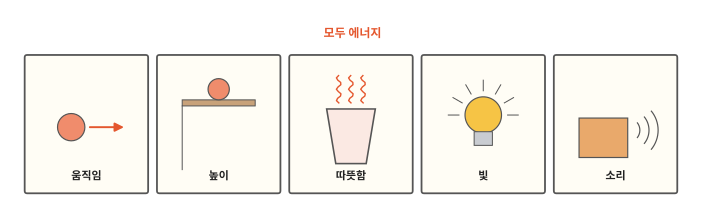
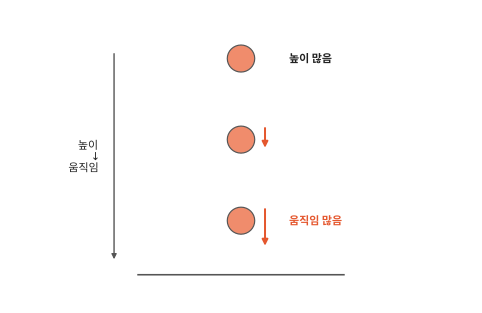
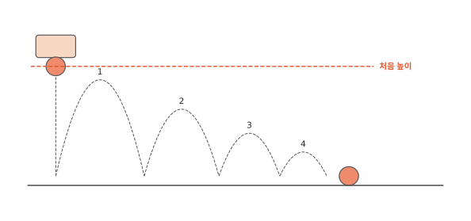
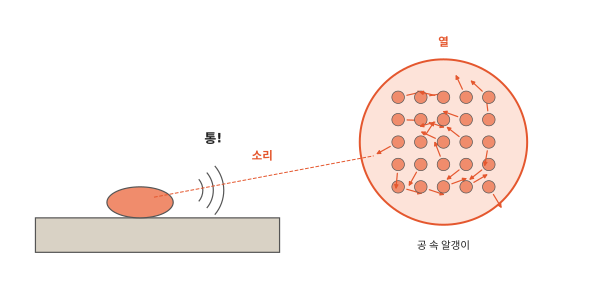
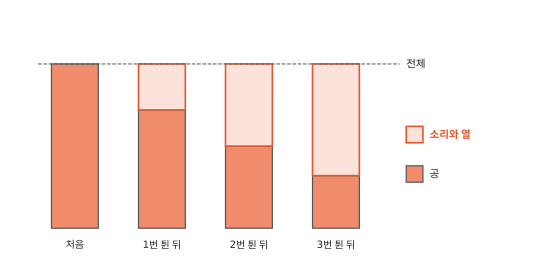
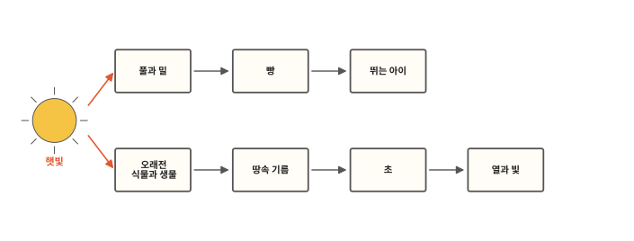

# 에너지: 모습은 바뀌어도 없어지지 않는 것

탱탱볼을 손에서 놓으면 바닥에 닿았다가 튀어 올라요. 그런데 처음 높이까지는 못 올라가요. 튈 때마다 조금씩 낮아지다가 결국 바닥에 멈춰요. 이 글을 읽고 나면 공을 튀게 하던 것이 무엇이고 어디로 갔는지 알게 돼요. 이걸 알면 [7편](07-burning.md)의 촛불이 낸 열과 빛이 처음에 어디서 왔는지도 따라가 볼 수 있어요.

!!! abstract "이 글에서 알게 되는 것"
    1. 무언가를 움직이게 하거나 데우거나 빛나게 하는 데 드는 것을 에너지라고 해요. 움직임, 높이, 따뜻함, 빛, 소리처럼 여러 모습으로 있어요.
    2. 에너지는 모습이 바뀌어요. 떨어지는 공에서는 높이의 에너지가 움직임의 에너지로 바뀌고 튀어 오를 때는 거꾸로 바뀌어요.
    3. 에너지는 생기지도 없어지지도 않아요. 공이 튈 때마다 일부가 소리와 열로 흩어져서 다시 모아 쓰기 어려울 뿐이에요.

## 1. 움직이게 하고 데우고 빛나게 하는 데 드는 것이 에너지예요

공을 튀게 하려면 먼저 공을 들어 올렸다가 놓아야 해요. 공을 굴리려면 공을 차야 하고요. 물을 데우려면 불이나 햇볕이 있어야 하고 전등을 켜려면 전기가 있어야 해요. 무언가를 움직이게 하거나 데우거나 빛나게 하는 데에는 늘 무언가가 들어요. 그것을 **에너지**라고 해요.

에너지는 여러 모습으로 있어요. 아래 그림의 다섯 칸을 하나씩 보세요.

**그림 1.** 굴러가는 공, 선반 위의 공, 따뜻한 물, 켜진 전구, 소리 내는 북에 모두 에너지가 있어요.
{ .fig-cap }

굴러가는 공처럼 움직이는 것에 에너지가 있어요. 높은 선반 위에 가만히 놓인 공에도 있어요. 떨어지면서 빨라질 수 있거든요. 따뜻한 물, 빛나는 전구, 소리를 내는 북에도 에너지가 있어요. 음식과 초 속에도 에너지가 들어 있어요. 음식을 먹으면 몸을 움직일 수 있고 초를 태우면 열과 빛이 나와요.

전기도 에너지예요. 전등은 전기를 빛으로 바꾸고 선풍기는 날개를 돌리는 움직임으로 바꿔요. 전기가 무엇인지는 [11편](11-electricity.md)에서 봐요.

## 2. 떨어지는 공은 높이의 에너지가 움직임의 에너지로 바뀌어요

그림 1의 둘째 칸처럼 높은 곳에 있는 공에는 높이의 에너지가 있어요. 이 공을 떨어뜨려 볼게요.

아래 그림에서 공이 내려올수록 빨간 화살표가 어떻게 되는지 보세요.

**그림 2.** 공이 내려올수록 빨라져서 아래로 가는 화살표가 길어져요.
{ .fig-cap }

공은 떨어지며 점점 빨라져요. 높이는 줄고 빠르기는 늘어요. 높이의 에너지가 움직임의 에너지로 바뀌는 거예요. 바닥에 닿은 공은 잠깐 찌그러졌다가 펴지면서 위로 튀어요. 올라가는 동안에는 점점 느려지고 그만큼 다시 높아져요. 이번에는 움직임의 에너지가 높이의 에너지로 바뀌었어요.

미끄럼틀도 그래요. 꼭대기에 올라가 있으면 높이의 에너지가 있어요. 내려오면서 그 에너지가 빠르게 미끄러지는 움직임으로 바뀌어요.

## 3. 공은 튈 때마다 에너지 일부를 소리와 열로 내보내요

높이가 움직임으로 바뀌고 움직임이 다시 높이로 바뀌기만 한다면 공은 처음 높이까지 다시 올라가야 해요. 정말 그런지 공을 여러 번 튀게 해 볼게요.

아래 그림에서 빨간 점선과 1번부터 4번까지의 꼭대기를 비교해 보세요.

**그림 3.** 튈 때마다 꼭대기가 낮아지고 1번부터 한 번도 처음 높이에 닿지 못해요.
{ .fig-cap }

1번 꼭대기부터 처음 높이보다 낮아요. 2번은 그보다 낮고 4번 다음에는 공이 바닥에 멈춰요. 튈 때마다 공의 에너지 일부가 어딘가로 빠져나간 거예요. 빠져나가는 곳은 공이 바닥에 닿는 순간에 있어요.

아래 그림은 바닥에 닿은 공과 그 공 속을 크게 그린 거예요. 소리와 열을 찾아보세요.

**그림 4.** 바닥에 닿은 공은 "통" 소리를 내고 공 속 알갱이는 조금 더 세게 꿈틀거려요. 크기는 실제와 맞추지 않았어요.
{ .fig-cap }

공이 바닥에 닿으면 "통" 소리가 나요. 소리도 에너지예요. 공이 찌그러졌다 펴지는 동안에는 공 속 알갱이들이 조금 더 세게 꿈틀거려요. [3편](03-heat.md)에서 알갱이가 세게 꿈틀거릴수록 온도가 높다고 했죠. 공이 아주 조금 따뜻해진 거예요. 말랑한 공일수록 더 많이 찌그러져서 이렇게 빠져나가는 에너지가 많아요.

## 4. 에너지는 없어지지 않고 흩어져요

빠져나간 에너지는 없어진 걸까요? 그렇지 않아요. 에너지는 생기지도 없어지지도 않고 모습만 바뀌어요.

아래 그림은 공이 튈 때마다 에너지가 어디에 있는지 막대로 그린 거예요. 막대 전체 높이와 빨간 칸을 보세요.

**그림 5.** 튈 때마다 공의 몫은 줄고 소리와 열의 몫은 늘어요. 막대 전체 높이는 늘 같아요.
{ .fig-cap }

처음에는 에너지가 모두 공에 있어요. 한 번 튈 때마다 공의 몫이 줄고 그만큼 소리와 열의 몫이 늘어요. 두 몫을 더한 막대 전체는 늘 같아요. 공의 에너지는 없어지지 않고 소리와 열이 되어 둘레로 흩어졌어요.

그런데 흩어진 에너지로 공을 다시 튀게 하지는 못해요. 공이 따뜻해진 정도는 손으로 느끼지도 못할 만큼 아주 작고 그 열마저 금세 공기와 바닥으로 퍼져요. 흩어진 에너지는 저절로 다시 모여 공을 튀게 하지 않아요. 그래서 공을 계속 튀게 하려면 손으로 다시 쳐서 에너지를 넣어 줘야 해요.

물 한 컵을 모래밭에 쏟는 것과 닮았어요. 물은 없어지지 않고 모래 사이에 남아 있지만 다시 컵에 모으기는 어려워요. 다른 점도 있어요. 물은 젖은 모래로 눈에 보이지만 흩어진 에너지는 눈에 보이지 않아요.

## 5. 거슬러 올라가면 에너지는 대부분 햇빛에서 와요

에너지는 없어지지 않고 모습만 바뀐다고 했어요. 그럼 거꾸로 따라가면 처음 모습도 찾을 수 있겠죠. [7편](07-burning.md)의 촛불과 뛰어노는 아이의 에너지를 따라가 볼게요.

촛불의 열은 초 속에 들어 있던 에너지예요. 초의 원자가 산소와 짝을 바꿀 때 열로 나오고 그 열로 뜨거워진 불꽃이 빛을 내요. 우리가 뛰고 노는 에너지는 먹은 음식에서 와요. [인체 1편](../body/01-cells.md)에서 세포가 밥에서 받은 영양으로 일할 힘을 만든다고 했죠.

그럼 음식과 초 속의 에너지는 어디서 왔을까요? 아래 그림에서 화살표를 거꾸로 따라가 보세요.

**그림 6.** 뛰는 아이의 에너지도 초가 낸 열과 빛도 거슬러 올라가면 햇빛에 닿아요.
{ .fig-cap }

빵은 밀로 만들고 밀은 햇빛을 받아 자라요. 식물은 햇빛의 에너지를 받아 자기 몸속에 담아 둬요. 요즘 많은 초는 아주 오래전 식물과 작은 생물이 땅속에서 변한 기름으로 만들어요. 그 식물도 햇빛을 받고 자랐어요. 그래서 따라 올라가 보면 우리 둘레의 에너지는 대부분 햇빛에서 왔어요.

??? question "해 보기: 에너지가 어디로 가는지 찾기"
    1. 마룻바닥이나 타일 바닥처럼 딱딱한 바닥이 있는 넓은 곳에서 해요. 벽에서 한 뼘 떨어진 곳에서 탱탱볼을 어른 허리 높이에서 놓아요. 가족이 공 아랫면이 처음 튀어 오른 높이를 벽에 붙임 쪽지로 표시해요. 두 번째, 세 번째 높이도 표시하고 몇 번 튀고 멈추는지 세어 봐요.
    2. 두 손바닥을 마주 대고 따뜻해질 때까지 빠르게 비벼 보세요. 손의 움직임은 어떤 모습의 에너지로 바뀌었을까요?
    3. 탱탱볼과 말랑한 공(또는 바람이 조금 빠진 공)을 같은 높이에서 놓아 보세요. 어느 쪽이 덜 튀나요? 말랑한 공이 없으면 건너뛰어도 돼요.

??? info "어른을 위한 정리"
    - 에너지는 일을 하거나 열을 낼 수 있는 능력이에요. 본문은 "움직이게 하거나 데우거나 빛나게 하는 데 드는 것"으로 풀었어요. 운동 에너지, 위치 에너지, 열에너지(물질 속 입자의 무질서한 운동), 화학 에너지, 빛과 소리 등 여러 형태가 있어요.[^energy]
    - 본문의 "높이의 에너지"는 중력 위치 에너지(mgh), "움직임의 에너지"는 운동 에너지예요. 떨어지는 물체는 공기 저항을 무시하면 두 에너지의 합이 일정하게 유지되며 서로 바뀌어요.[^pe]
    - 고립계의 전체 에너지는 보존돼요. 튀는 공이 매번 덜 튀는 것은 공이 변형되었다 돌아오는 동안 에너지 일부가 공 속 열로 바뀌고 소리로도 빠져나가기 때문이에요. 이렇게 흩어진 열에너지는 덜 쓸모 있는 형태라 다시 공의 운동으로 모으기 어려워요. 흩어진 에너지가 저절로 다시 모이지 않는 성질은 열역학 제2법칙으로 정리돼 있어요.[^cons]
    - 그림 5의 막대 높이는 실제 비율을 잰 값이 아니에요. 전체가 같다는 것만 보여 주려고 어림으로 그렸어요.
    - 촛불의 열과 빛은 초(파라핀 같은 탄화수소) 속 화학 에너지가 산소와 반응하며 열로 나온 거예요. 그 열로 뜨거워진 불꽃이 빛을 내요. 음식의 화학 에너지는 광합성으로 식물이 햇빛 에너지를 담아 둔 거예요. 화석 연료는 오래전 생물이 변한 것이라 저장된 태양 에너지예요. 지구에서 쓰는 에너지의 대부분이 이렇게 태양에서 와요(지열·핵에너지 등은 예외).[^energy][^cons]

## 정리

무언가를 움직이게 하거나 데우거나 빛나게 하는 데 드는 것이 에너지예요. 굴러가는 공, 선반 위의 공, 따뜻한 물, 켜진 전구, 소리 내는 북에 모두 에너지가 있어요.

에너지는 모습이 바뀌어요. 떨어지는 공에서는 높이의 에너지가 움직임의 에너지로 바뀌고 튀어 오를 때는 움직임의 에너지가 높이의 에너지로 바뀌어요.

공이 처음 높이까지 못 올라가는 것은 바닥에 닿을 때마다 에너지 일부가 "통" 소리와 공 속 열로 바뀌어 흩어지기 때문이에요. 에너지는 생기지도 없어지지도 않아요. 흩어진 에너지는 다시 모아 공을 튀게 하기 어려울 뿐이에요. 그리고 우리 둘레의 에너지를 거슬러 올라가면 대부분 햇빛에 닿아요.

공이 바닥에 닿을 때 난 "통" 소리는 어떻게 귀까지 올까요? [9편](09-sound.md)에서 볼게요.

### 새로 나온 말

- **에너지**: 무언가를 움직이게 하거나 데우거나 빛나게 하는 데 드는 것. 굴러가는 공에도 선반 위의 공에도 있어요.
- **높이의 에너지**: 높은 곳에 있어서 가진 에너지. 떨어지면 빨라질 수 있어서 선반 위의 공에도 있어요.
- **움직임의 에너지**: 움직이는 것이 가진 에너지. 떨어지는 공은 바닥에 가까울수록 빨라서 움직임의 에너지가 많아요.

[^energy]: OpenStax, *Chemistry 2e*, 5.1 ["Energy Basics"](https://openstax.org/books/chemistry-2e/pages/5-1-energy-basics).
[^pe]: OpenStax, *College Physics 2e*, 7.3 ["Gravitational Potential Energy"](https://openstax.org/books/college-physics-2e/pages/7-3-gravitational-potential-energy).
[^cons]: OpenStax, *College Physics 2e*, 7.6 ["Conservation of Energy"](https://openstax.org/books/college-physics-2e/pages/7-6-conservation-of-energy).
