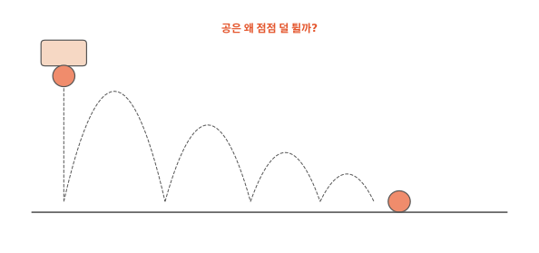
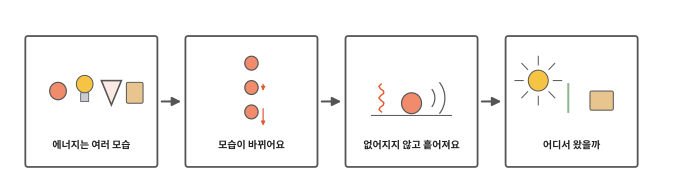
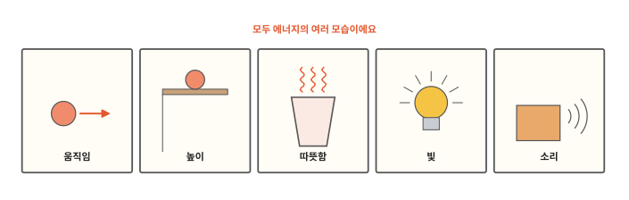
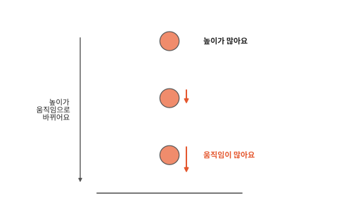
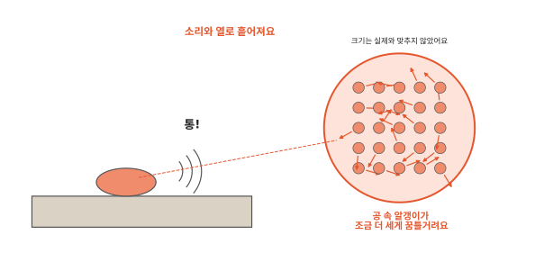
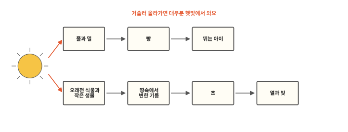

# 에너지는 어디서 와서 어디로 갈까요?

## 공을 떨어뜨리면

탱탱볼을 손에서 놓으면 바닥에 닿았다가 튀어 올라요. 그런데 처음 높이까지는 못 올라가요. 튈 때마다 조금씩 낮아지다가 결국 바닥에 멈춰요. 공을 튀게 하던 무언가는 어디로 갔을까요?

## 이 편에서 볼 것

[7편](07-burning.md) 끝에서 불이 낸 열과 빛은 어디서 왔는지 물어봤지요. 튀는 공과 타는 촛불은 달라 보이지만 둘 다 이 편의 한 낱말로 풀려요.

## 움직이게 하고 데우고 빛나게 하는 것

공을 굴리려면 공을 차야 해요. 물을 데우려면 불이나 햇볕이 있어야 하고 전등을 켜려면 전기가 있어야 해요. 무언가를 움직이게 하거나 데우거나 빛나게 하는 데에는 늘 무언가가 들어요. 그것을 **에너지**라고 해요.

에너지는 여러 모습으로 있어요. 굴러가는 공처럼 움직이는 것에도, 높은 선반 위의 공처럼 높은 곳에 있는 것에도 에너지가 있어요. 높은 곳의 공은 떨어지면서 빨라질 수 있거든요. 따뜻한 물, 빛나는 전등, 소리를 내는 북에도 에너지가 있어요. 음식과 초 속에도 에너지가 들어 있어서 먹으면 몸을 움직이고 태우면 열과 빛으로 나와요.

## 모습이 바뀌어요

높은 곳에서 공을 놓으면 공은 아래로 떨어지며 점점 빨라져요. 높이의 에너지가 움직임의 에너지로 바뀌는 거예요. 바닥에 닿은 공은 잠깐 찌그러졌다가 펴지며 위로 튀어요. 올라가는 동안 점점 느려지고 그만큼 다시 높아져요. 이번에는 움직임의 에너지가 높이의 에너지로 바뀌었어요.

미끄럼틀도 그래요. 꼭대기에 올라가 있으면 높이의 에너지가 있어요. 내려오면서 그 에너지가 빠르게 미끄러지는 움직임으로 바뀌어요.

## 없어지지 않고 흩어져요

그런데 공이 처음 높이까지 못 올라가는 건 왜일까요? 바닥에 닿을 때마다 에너지 일부가 다른 모습으로 빠져나가서예요. 공이 바닥에 닿으면 "통" 소리가 나요. 소리도 에너지예요. 그리고 공이 찌그러졌다 펴지는 동안 공 속 알갱이들이 조금 더 세게 꿈틀거려요. [3편](03-heat.md)에서 알갱이가 세게 꿈틀거리면 뜨거워진다고 했지요. 공이 아주 조금 따뜻해진 거예요. 말랑한 공일수록 더 많이 찌그러져서 이렇게 빠져나가는 에너지가 많아요.

에너지는 생기지도 없어지지도 않고 모습만 바뀌어요. 공의 에너지도 소리와 열이 되어 둘레로 흩어졌어요. 다만 공이 따뜻해진 건 손으로 느끼지도 못할 만큼 아주 조금이고 그 열마저 금세 공기와 바닥으로 퍼져요. 이렇게 흩어진 에너지를 다시 모아 공을 튀게 하기는 어려워요.

물 한 컵을 모래밭에 쏟는 것과 닮았어요. 물은 없어지지 않고 모래 사이에 남아 있지만 다시 컵에 모으기는 어려워요. 다른 점은 물은 젖은 모래로 눈에 보이지만 에너지는 물건과 달라서 눈에 보이지 않는다는 거예요.

## 어디서 왔을까

그럼 이렇게 흩어지는 에너지는 처음에 어디서 왔을까요? 촛불부터 보면 초 속에 들어 있던 에너지가 원자가 짝을 바꿀 때 열로 나오고 그 열로 뜨거워진 불꽃이 빛을 내요. 우리가 뛰고 노는 에너지는 먹은 음식에서 와요. [인체 1편](../body/01-cells.md)에서 세포가 밥에서 받은 영양으로 일할 힘을 만든다고 했지요.

빵은 밀로 만들고 밀은 햇빛을 받아 자라요. 식물은 햇빛의 에너지를 받아 자기 몸속에 담아 둬요. 요즘 많은 초는 아주 오래전 식물과 작은 생물이 땅속에서 변한 기름으로 만들어요. 그 식물도 햇빛을 받고 자랐어요. 그래서 따라 올라가 보면 우리 둘레의 에너지는 대부분 햇빛에서 왔어요.

공이 바닥에 닿을 때 난 "통" 소리는 어떻게 우리 귀까지 올까요? 다음 편에서 볼게요.

## 정리

- 에너지: 무언가를 움직이게 하거나 데우거나 빛나게 하는 데 드는 것이에요. 움직임, 높이, 따뜻함, 빛, 소리, 음식 속 에너지처럼 여러 모습이 있어요.
- 에너지는 모습이 바뀌어요. 떨어지는 공은 높이의 에너지가 움직임의 에너지로 바뀌어요.
- 에너지는 생기지도 없어지지도 않아요. 다만 소리와 열로 흩어지면 다시 모아 쓰기 어려워요.
- 우리 둘레의 에너지는 거슬러 올라가면 대부분 햇빛에서 와요.

## 해 보기: 에너지가 어디로 가는지 찾기

1. 마룻바닥이나 타일 바닥처럼 딱딱한 바닥이 있는 넓은 곳에서 해요. 벽에서 한 뼘 떨어진 곳에서 탱탱볼을 어른 허리 높이에서 놓아요. 가족이 공 아랫면이 처음 튀어 오른 높이를 벽에 붙임 쪽지로 표시해요. 두 번째, 세 번째 높이도 표시하고 몇 번 튀고 멈추는지 세어 봐요.
2. 두 손바닥을 마주 대고 따뜻해질 때까지 빠르게 비벼 보세요. 손의 움직임은 어떤 모습의 에너지로 바뀌었을까요?
3. 탱탱볼과 말랑한 공(또는 바람이 조금 빠진 공)을 같은 높이에서 놓아 보세요. 어느 쪽이 덜 튀나요? 말랑한 공이 없으면 건너뛰어도 돼요.

## 확인 문제

??? question "1. 에너지"
    무언가를 움직이게 하거나 데우거나 빛나게 하는 데 드는 것을 무엇이라고 할까요?

    **풀이**: 에너지예요. 움직임, 높이, 따뜻함, 빛, 소리처럼 여러 모습이 있어요.

??? question "2. 점점 낮게 튀는 공"
    공이 튈 때마다 점점 낮게 튀다가 멈춰요. 공의 에너지는 없어진 걸까요?

    **풀이**: 없어지지 않았어요. 바닥에 닿을 때마다 에너지 일부가 "통" 소리와 공 속 알갱이의 꿈틀거림(열)으로 바뀌어 흩어졌어요. 흩어진 에너지는 다시 모아 공을 튀게 하기 어려워서 공이 멈춰요.

??? question "3. 썰매"
    눈 덮인 언덕 꼭대기에서 썰매를 타고 내려오다가 평평한 곳에서 멈췄어요. 꼭대기에 있던 에너지는 어떻게 됐을까요?

    **풀이**: 꼭대기의 높이 에너지가 내려오며 움직임의 에너지로 바뀌었어요. 평평한 곳에서는 썰매 바닥이 눈과 쓸리면서 움직임이 소리와 열로 바뀌어 흩어졌어요. 손바닥을 비비면 따뜻해지는 것과 같아요. 그래서 썰매가 멈췄어요.

!!! abstract "어른을 위한 정리 (건너뛰어도 돼요)"
    - 에너지는 일을 하거나 열을 낼 수 있는 능력이에요. 본문은 저학년 눈높이에 맞춰 "움직이게, 데우게, 빛나게 하는 데 드는 것"으로 풀었어요. 운동 에너지, 위치 에너지, 열에너지(물질 속 입자의 무질서한 운동), 화학 에너지, 빛과 소리 등 여러 형태가 있어요.[^energy]
    - 본문의 "높이의 에너지"는 중력 위치 에너지(mgh), "움직임의 에너지"는 운동 에너지예요. 떨어지는 물체는 공기 저항을 무시하면 두 에너지의 합이 일정하게 유지되며 서로 바뀌어요.[^pe]
    - 고립계의 전체 에너지는 보존돼요. 튀는 공이 매번 덜 튀는 것은 공이 변형되었다 돌아오는 동안 에너지 일부가 공 속 열로 바뀌고 소리로도 빠져나가기 때문이에요. 이렇게 흩어진 열에너지는 덜 쓸모 있는 형태라 다시 공의 운동으로 모으기 어려워요.[^cons]
    - 촛불의 열과 빛은 초(파라핀 같은 탄화수소) 속 화학 에너지가 산소와 반응하며 열로 나오고, 그 열로 뜨거워진 불꽃이 빛을 내는 거예요. 음식의 화학 에너지는 광합성으로 식물이 햇빛 에너지를 담아 둔 것이고, 화석 연료는 오래전 생물이 변한 것이라 저장된 태양 에너지예요. 지구에서 쓰는 에너지의 대부분이 이렇게 태양에서 와요(지열·핵에너지 등은 예외).[^energy][^cons]

## 더 깊이

??? info "왜 저절로 영원히 튀는 공은 없을까"
    공이 튈 때마다 에너지 일부가 열과 소리로 흩어지고, 흩어진 에너지가 저절로 다시 모여 공을 튀게 하는 일은 일어나지 않아요. 그래서 계속 튀게 하려면 손으로 다시 쳐서 에너지를 넣어 줘야 해요. 과학자들은 흩어진 에너지가 저절로 다시 모이지 않는 이 성질을 따로 법칙으로 정리했어요.

??? info "전기도 에너지예요"
    전등을 켜면 빛이 나고 선풍기는 날개를 돌려요. 전기가 빛과 움직임으로 모습을 바꾼 거예요. 전기가 무엇인지는 11편에서 봐요.

[^energy]: OpenStax, *Chemistry 2e*, 5.1 ["Energy Basics"](https://openstax.org/books/chemistry-2e/pages/5-1-energy-basics).
[^pe]: OpenStax, *College Physics 2e*, 7.3 ["Gravitational Potential Energy"](https://openstax.org/books/college-physics-2e/pages/7-3-gravitational-potential-energy).
[^cons]: OpenStax, *College Physics 2e*, 7.6 ["Conservation of Energy"](https://openstax.org/books/college-physics-2e/pages/7-6-conservation-of-energy).
