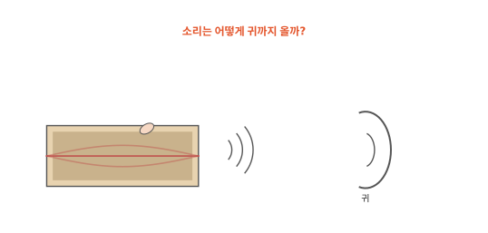
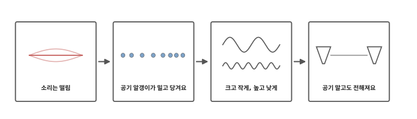
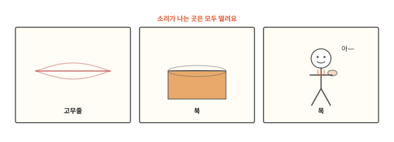
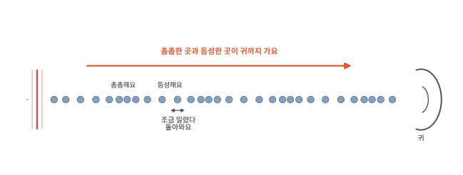
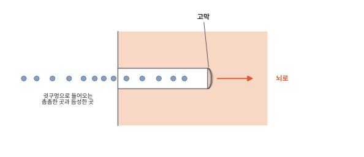
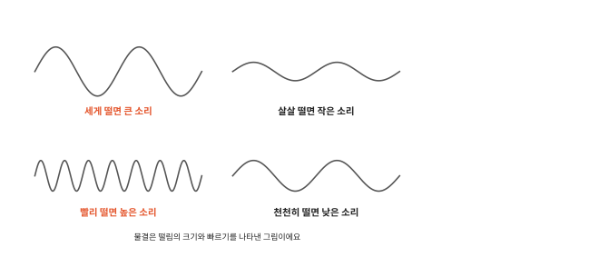
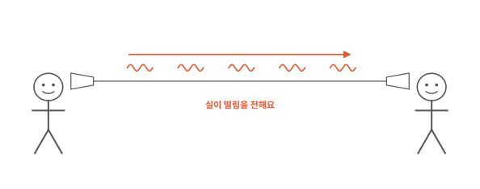

# 소리는 어떻게 귀까지 올까요?

## 고무줄을 튕기면

뚜껑 없는 상자에 고무줄을 걸고 손가락으로 튕겨 보세요. "띵" 소리가 나요. 자세히 보면 고무줄이 부르르 떨려서 흐릿하게 보여요. 고무줄을 손가락으로 잡으면 떨림이 멈추고 소리도 멈춰요. 고무줄과 내 귀는 떨어져 있는데 소리는 어떻게 귀까지 왔을까요?

## 이 편에서 볼 것

[8편](08-energy.md)에서 공이 바닥에 닿을 때 에너지 일부가 "통" 소리가 되어 흩어진다고 했어요. 그 소리가 어떻게 귀까지 오는지 따라가 봐요.

## 소리는 떨림이에요

소리가 나는 것은 모두 떨리고 있어요. 이 떨림을 진동이라고도 해요. 튕긴 고무줄이 떨리고 두드린 북은 가죽이 떨려요. 목에 손을 대고 "아—" 하고 소리를 내 보면 손끝에 목이 떨리는 게 느껴져요. 목 속에서 소리를 내는 부분이 빠르게 떨리고 있어요.

떨림이 멈추면 소리도 멈춰요. 울리는 종을 손으로 꼭 잡으면 종이 떨지 못해서 소리가 뚝 그쳐요.

## 공기 알갱이가 밀고 당겨요

[1편](01-particles.md)에서 공기도 아주 작은 알갱이가 모여 있다고 했어요. 고무줄이 앞으로 떨리면 곁의 공기 알갱이를 밀어서 그 자리가 촘촘해져요. 고무줄이 뒤로 떨리면 그 자리는 듬성해져요. 촘촘하게 밀린 알갱이는 옆 알갱이를 밀고 그 알갱이는 또 그 옆을 밀어요. 그래서 촘촘한 곳과 듬성한 곳이 번갈아 줄지어 귀까지 와요. 고무줄은 1초에도 수백 번 떨어서 촘촘한 곳과 듬성한 곳이 쉬지 않고 생겨나요.

줄 서 있는 아이들을 떠올려 보세요. 맨 뒤 아이 어깨를 톡 밀면 그 아이가 앞 아이를 밀고 제자리로 돌아와요. 앞 아이도 또 앞 아이를 밀어요. 아이들은 그 자리에 있는데 밀리는 움직임만 줄 맨 앞까지 가요. 다만 진짜 공기 알갱이는 줄을 서 있지 않아요. [2편](02-states.md)의 운동장 아이들처럼 늘 이리저리 돌아다녀요. 그래도 소리가 지나갈 때 알갱이는 조금 밀렸다 돌아올 뿐이고 고무줄 곁의 공기 알갱이가 귀까지 날아가지는 않아요.

## 귀가 떨림을 받아요

귓구멍 안쪽 끝에는 북의 가죽처럼 얇은 막이 있어요. 이 막을 **고막**이라고 해요. 촘촘한 곳과 듬성한 곳이 차례로 고막에 닿으면 고막이 똑같은 박자로 떨려요. 그 떨림은 귀 더 안쪽으로 이어져 알림(뇌에 보내는 신호)이 되고 알림은 뇌까지 가요. [인체 11편](../body/11-brain.md)에서 귀의 알림은 척수를 거치지 않고 바로 뇌로 간다고 했지요.

## 크고 작게, 높고 낮게

고무줄을 세게 튕기면 크게 떨면서 공기를 세게 밀어 큰 소리가 나요. 살살 튕기면 작게 떨어서 작은 소리가 나요.

고무줄을 팽팽하게 당겨 놓고 튕기면 더 빨리 떨면서 높은 소리가 나요. 느슨하게 걸면 천천히 떨어서 낮은 소리가 나요. 기타 줄을 조이면 줄이 더 빨리 떨어서 소리가 높아져요.

## 공기 말고도 전해져요

떨림은 공기 말고도 실, 물, 벽, 땅을 타고 전해져요. 종이컵 두 개를 실로 잇고 실을 팽팽하게 당긴 채 한쪽 컵에 말하면 목소리가 컵 바닥을 떨게 해요. 그 떨림이 실을 타고 건너가 다른 컵을 떨게 해서 말소리가 들려요. 실이 축 늘어지면 떨림이 실을 따라가지 못해요. 물속에서 친구가 돌 두 개를 부딪치면 그 소리도 들려요. 나무나 쇠처럼 알갱이가 서로 꼭 붙은 것은 떨림을 공기보다 더 잘 전해요.

밀어 줄 알갱이가 없으면 소리는 전해지지 않아요. 공기가 거의 없는 우주에서는 커다란 폭발이 일어나도 소리가 들리지 않아요.

천둥 번개가 칠 때 번쩍하는 빛은 먼저 보이고 우르릉 소리는 조금 뒤에 들려요. 소리도 아주 빠르지만 빛은 그보다 훨씬 빨라요. 다음 편은 빛 이야기예요.

## 정리

- 소리가 나는 것은 모두 떨려요. 떨림이 멈추면 소리도 멈춰요.
- 떨리는 물체가 공기 알갱이를 밀고 당기면 촘촘한 곳과 듬성한 곳이 번갈아 생겨 귀까지 와요. 알갱이는 조금 밀렸다 돌아올 뿐이에요.
- 고막: 귓구멍 안쪽 끝의 얇은 막이에요. 소리에 맞춰 떨리고 그 떨림이 알림이 되어 뇌로 가요.
- 세게 떨면 큰 소리, 빨리 떨면 높은 소리가 나요.
- 소리는 실, 물, 벽으로도 전해지고 알갱이가 없는 곳에서는 전해지지 않아요.

## 해 보기: 떨림 느끼고 전하기

1. 뚜껑 없는 휴지 상자나 반찬통에 고무줄 두세 개를 걸어 고무줄 기타를 만들어요. 세게 튕겼을 때와 살살 튕겼을 때, 고무줄을 더 당겨서 튕겼을 때 소리를 들어 봐요. 고무줄을 튕길 때는 얼굴을 가까이 대지 않아요.
2. 목에 손을 대고 "아—" 하고 작은 소리와 큰 소리, 높은 소리와 낮은 소리를 내 보세요. 손끝의 떨림이 어떻게 달라지는지 느껴 봐요.
3. 종이컵 두 개 바닥에 구멍을 뚫어(구멍은 어른이 뚫어 줘요) 긴 실을 꿰고 매듭을 지어요. 실을 팽팽하게 당긴 채 한 사람은 말하고 한 사람은 들어요. 실을 느슨하게 늘어뜨리면 소리가 어떻게 되는지도 해 봐요.

## 확인 문제

??? question "1. 소리의 시작"
    소리가 나는 것은 모두 어떤 상태일까요?

    **풀이**: 떨리고 있어요. 고무줄, 북 가죽, 목 속이 떨려요. 떨림이 멈추면 소리도 멈춰요.

??? question "2. 느슨한 실 전화기"
    실 전화기의 실을 느슨하게 늘어뜨리면 소리가 잘 안 들려요. 왜일까요?

    **풀이**: 실 전화기는 컵의 떨림이 실을 타고 건너가서 들려요. 실이 축 늘어지면 떨림이 실을 따라가지 못해서 다른 컵까지 잘 전해지지 않아요.

??? question "3. 책상에 귀 대기"
    한쪽 귀를 책상에 대고 친구가 책상 반대쪽 끝을 손가락으로 톡톡 두드려요. 귀를 떼고 들을 때보다 소리가 더 또렷하게 들려요. 왜일까요?

    **풀이**: 두드린 떨림이 책상 나무를 타고 귀까지 바로 와요. 나무처럼 알갱이가 서로 꼭 붙은 것은 떨림을 공기보다 잘 전해요.

!!! abstract "어른을 위한 정리 (건너뛰어도 돼요)"
    - 소리는 매질 속 압력의 변동(압축과 팽창)이 퍼지는 파동이에요. 공기 같은 기체와 액체 속의 소리는 종파예요. 매질의 입자는 열운동으로 늘 무작위로 움직이고 있고, 소리는 그 위에 얹힌 훨씬 질서 있는 작은 앞뒤 운동이에요. 입자가 소리와 함께 멀리 이동하지는 않아요. 진공에서는 전달되지 않아요.[^sound]
    - 상온 공기에서 소리의 속력은 약 초속 340 m이고 물에서는 약 1,500 m/s, 강철에서는 약 6,000 m/s예요. 대체로 기체보다 액체와 고체에서 더 빨라요.[^speed]
    - 소리의 높낮이는 진동수, 크기는 진폭에 대응해요(세기는 진폭의 제곱에 비례). 사람은 대략 20~20,000 Hz를 들을 수 있어요.[^int][^hear] 팽팽한 줄은 장력이 클수록 빨리 진동해 높은 소리를 내요.
    - 고막은 소리의 압력 변동에 맞춰 진동하고, 그 진동이 가운데귀의 작은 뼈 셋을 거쳐 달팽이관에 전달되어 털세포에서 신경 신호로 바뀌어요.[^hear]

## 더 깊이

??? info "박쥐와 돌고래는 소리로 봐요"
    박쥐는 사람에게 들리지 않을 만큼 높은 소리를 내고 그 소리가 벌레나 벽에 부딪혀 돌아오는 것을 들어요. 돌아오는 데 걸린 시간으로 앞에 무엇이 얼마나 멀리 있는지 알아내요. 돌고래도 물속에서 같은 방법을 써요.

??? info "메아리"
    산에서 "야호" 하고 외치면 조금 뒤 같은 소리가 돌아와요. 소리가 건너편 산에 부딪혀 되돌아온 거예요. 산이 멀수록 메아리가 늦게 돌아와요.

[^sound]: OpenStax, *College Physics 2e*, 17.1 ["Sound"](https://openstax.org/books/college-physics-2e/pages/17-1-sound).
[^speed]: OpenStax, *College Physics 2e*, 17.2 ["Speed of Sound, Frequency, and Wavelength"](https://openstax.org/books/college-physics-2e/pages/17-2-speed-of-sound-frequency-and-wavelength).
[^int]: OpenStax, *College Physics 2e*, 17.3 ["Sound Intensity and Sound Level"](https://openstax.org/books/college-physics-2e/pages/17-3-sound-intensity-and-sound-level).
[^hear]: OpenStax, *College Physics 2e*, 17.6 ["Hearing"](https://openstax.org/books/college-physics-2e/pages/17-6-hearing).
