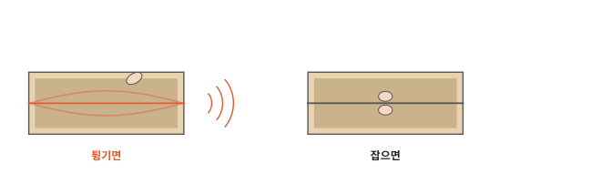
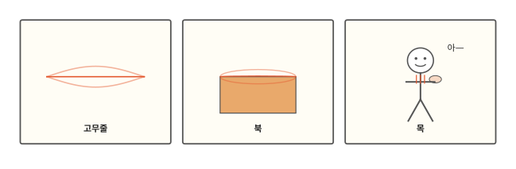
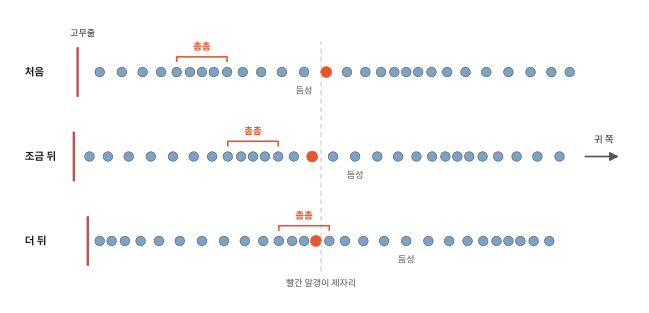
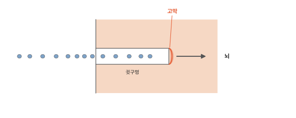
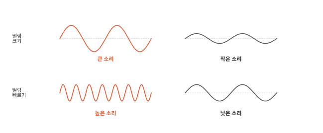
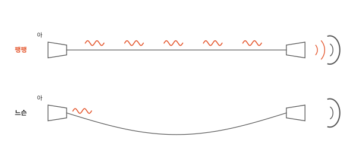
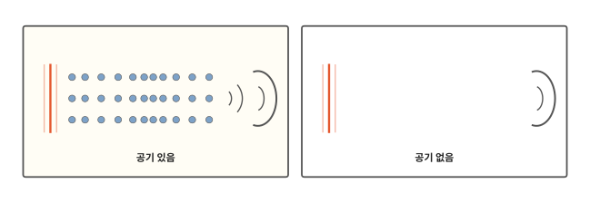

# 소리: 떨림이 공기를 타고 귀까지 가는 길

뚜껑 없는 상자에 고무줄을 걸고 손가락으로 튕기면 "띵" 소리가 나요. 고무줄과 내 귀는 떨어져 있는데도 소리는 귀까지 와요. 이 글을 읽고 나면 고무줄에서 귀까지 무엇이 건너오는지 알게 돼요. 이걸 알면 큰 소리와 높은 소리의 차이도, 실 전화기가 들리는 까닭도 함께 풀려요.

!!! abstract "이 글에서 알게 되는 것"
    1. 소리가 나는 것은 모두 떨리고 있어요. 떨림이 멈추면 소리도 멈춰요.
    2. 떨리는 고무줄이 공기 알갱이를 밀고 당기면 촘촘한 곳과 듬성한 곳이 차례로 귀까지 가요. 알갱이는 제자리 근처에서 조금 밀렸다 돌아올 뿐이고 귓속 고막이 같은 박자로 떨려서 소리가 들려요.
    3. 세게 떨면 큰 소리, 빨리 떨면 높은 소리가 나요. 떨림은 실, 물, 나무로도 건너가고 밀어 줄 알갱이가 없는 곳에서는 끊겨요.

## 1. 소리가 나는 것은 모두 떨려요

고무줄을 튕긴 다음 자세히 보세요. 고무줄이 부르르 떨려서 흐릿하게 보여요. 이번에는 떨리는 고무줄을 손가락으로 잡아 보세요. 소리가 뚝 그쳐요.

아래 그림에서 두 상자의 고무줄을 비교해 보세요.

**그림 1.** 튕긴 고무줄은 떨면서 소리를 내고 손가락으로 잡으면 떨림과 소리가 함께 멈춰요.
{ .fig-cap }

고무줄만 그런 게 아니에요. 북을 두드리면 북 가죽이 떨려요. 목에 손을 대고 "아—" 하고 소리를 내 보세요. 손끝에 목이 떨리는 게 느껴져요. 목 속에서 소리를 내는 부분이 빠르게 떨고 있어서예요.

아래 그림에서 세 칸의 빨간 곳을 보세요.

**그림 2.** 고무줄, 북 가죽, 목처럼 소리가 나는 곳은 모두 떨려요.
{ .fig-cap }

소리가 나는 것은 모두 떨리고 있어요. 이 떨림을 **진동**이라고도 해요. 울리는 종을 손으로 꼭 잡으면 종이 떨지 못해서 소리가 그쳐요. 떨림이 멈추면 소리도 멈춰요. [8편](08-energy.md)에서 공이 바닥에 닿을 때 "통" 소리가 났지요. 이 소리도 떨림에서 시작했어요.

[3편](03-heat.md)의 꿈틀거림은 알갱이가 저마다 제멋대로 떠는 것이에요. 소리의 떨림은 물건 전체가 한 박자로 떠는 것이에요.

## 2. 떨림은 공기 알갱이를 차례로 밀며 퍼져요

앞에서 소리는 떨림이라고 했어요. 그런데 고무줄은 상자에 걸려 있고 귀는 멀리 있어요. 떨림은 무엇을 타고 귀까지 갈까요?

[1편](01-particles.md)에서 공기도 아주 작은 알갱이가 모여 있다고 했어요. 고무줄은 이 공기 알갱이 사이에서 떨어요. 고무줄이 앞으로 떨리면 바로 앞의 공기 알갱이를 밀어서 그 자리가 촘촘해져요. 고무줄이 뒤로 떨리면 그 자리는 듬성해져요. 촘촘하게 밀린 알갱이는 옆 알갱이를 밀고 그 알갱이는 또 그 옆을 밀어요.

아래 그림은 같은 공기 알갱이 한 줄을 시간 차례대로 세 번 그린 거예요. 줄마다 빨간 괄호 "촘촘"의 자리와 빨간 알갱이의 자리를 보세요.

**그림 3.** 촘촘한 곳은 줄을 따라 귀 쪽으로 옮겨 가는데 빨간 알갱이는 점선 근처에서 조금 밀렸다 돌아와요.
{ .fig-cap }

"처음"에서 "더 뒤"로 갈수록 촘촘한 곳이 오른쪽으로 가요. 그런데 빨간 알갱이는 점선에서 멀리 가지 않아요. 촘촘한 곳이 다가오면 조금 밀렸다가 지나가면 돌아와요. 알갱이가 귀까지 날아가는 게 아니에요. 밀리는 움직임만 옆으로 옆으로 전해져서 귀까지 가요.

줄 서 있는 아이들을 떠올려 보세요. 맨 뒤 아이 어깨를 톡 밀면 그 아이가 앞 아이를 밀고 제자리로 돌아와요. 앞 아이도 또 앞 아이를 밀어요. 아이들은 그 자리에 있는데 밀리는 움직임만 줄 맨 앞까지 가요.

다만 진짜 공기 알갱이는 줄을 서 있지 않아요. [2편](02-states.md)의 운동장 아이들처럼 늘 이리저리 돌아다녀요. 그래도 소리가 지나갈 때 하는 일은 같아요. 조금 밀렸다 돌아올 뿐이고 고무줄 곁의 알갱이가 귀까지 날아가지는 않아요.

고무줄은 1초에도 수백 번 떨어요. 그래서 촘촘한 곳과 듬성한 곳이 쉬지 않고 새로 생겨서 줄지어 귀로 가요.

## 3. 고막이 같은 박자로 떨려서 소리가 들려요

촘촘한 곳과 듬성한 곳이 귀에 닿았어요. 귀는 이걸 어떻게 받을까요?

아래 그림은 귀를 옆에서 자른 모습이에요. 귓구멍 안쪽 끝의 빨간 막을 보세요.

**그림 4.** 귓구멍으로 들어온 촘촘한 곳과 듬성한 곳이 안쪽 끝의 고막을 떨게 해요.
{ .fig-cap }

귓구멍 안쪽 끝에는 북 가죽처럼 얇은 막이 있어요. 이 막을 **고막**이라고 해요. 촘촘한 곳이 오면 고막이 안으로 밀리고 듬성한 곳이 오면 밖으로 돌아와요. 그래서 고막은 고무줄과 똑같은 박자로 떨려요.

고막의 떨림은 귀 더 안쪽으로 이어져 알림이 돼요. 알림은 뇌에 보내는 신호예요. [인체 11편](../body/11-brain.md)에서 귀의 알림은 척수를 거치지 않고 뇌로 곧장 간다고 했어요. 뇌가 이 알림을 받으면 우리는 "띵" 소리를 들어요.

## 4. 세게 떨면 큰 소리, 빨리 떨면 높은 소리가 나요

고무줄을 세게 튕길 때와 살살 튕길 때 소리가 달라요. 팽팽하게 걸 때와 느슨하게 걸 때도 달라요. 무엇이 달라졌을까요?

떨림의 차이를 보려고 물결 그림을 쓸게요. 고무줄 한 곳이 위아래로 오가는 모습을 시간 순서대로 옆으로 늘어놓으면 물결이 돼요. 물결이 높으면 크게 떤 거예요. 물결이 촘촘하면 같은 시간에 더 여러 번 떤 거예요.

아래 그림에서 윗줄은 물결 높이를, 아랫줄은 물결 촘촘함을 비교해 보세요.

**그림 5.** 크게 떨면 큰 소리가 나고 빨리 떨면 높은 소리가 나요.
{ .fig-cap }

고무줄을 세게 튕기면 크게 떨면서 공기를 세게 밀어요. 그래서 큰 소리가 나요. 살살 튕기면 작게 떨어서 작은 소리가 나요.

팽팽하게 당긴 고무줄은 튕기면 더 빨리 떨어서 높은 소리가 나요. 느슨하게 걸면 천천히 떨어서 낮은 소리가 나요. 기타 줄을 조이면 소리가 높아지는 것도 줄이 더 빨리 떨어서예요.

## 5. 떨림은 실과 물로도 건너가고 빈 곳에서는 끊겨요

지금까지는 공기 알갱이가 떨림을 날랐어요. 알갱이라면 공기가 아니어도 될까요?

종이컵 두 개를 실로 이어 실 전화기를 만들어요. 한쪽 컵에 대고 말하면 목소리가 컵 바닥을 떨게 해요. 그 떨림이 실을 타고 건너가 다른 컵을 떨게 해서 말소리가 들려요. 아래 그림에서 두 줄의 실을 비교해 보세요.

**그림 6.** 팽팽한 실은 떨림을 건너편 컵까지 전하고 축 처진 실은 떨림을 전하지 못해요.
{ .fig-cap }

실을 팽팽하게 당기면 떨림이 끝까지 가요. 실이 축 늘어지면 떨림이 실을 따라가지 못해서 잘 안 들려요.

떨림은 물, 벽, 땅으로도 건너가요. 물속에서 친구가 돌 두 개를 부딪치면 그 소리가 들려요. 한쪽 귀를 책상에 대고 친구에게 책상 반대쪽 끝을 톡톡 두드려 달라고 해 보세요. 귀를 뗐을 때보다 소리가 더 또렷해요. 나무나 쇠처럼 알갱이가 서로 꼭 붙은 것은 떨림을 공기보다 더 잘 전하거든요.

그럼 알갱이가 아예 없으면 어떻게 될까요? 아래 그림에서 두 칸의 귀를 보세요.

**그림 7.** 고무줄이 똑같이 떨어도 밀어 줄 알갱이가 없으면 떨림이 귀까지 가지 못해요.
{ .fig-cap }

밀어 줄 알갱이가 없으면 떨림을 전할 수 없어요. 공기가 거의 없는 우주에서는 커다란 폭발이 일어나도 소리가 들리지 않아요.

천둥 번개가 칠 때는 번쩍하는 빛이 먼저 보이고 우르릉 소리는 조금 늦게 들려요. 소리도 아주 빠르지만 빛은 그보다 훨씬 빨라요.

## 정리

소리가 나는 것은 모두 떨리고 있어요. 튕긴 고무줄, 두드린 북 가죽, "아—" 하는 목이 모두 떨려요. 떨림이 멈추면 소리도 멈춰요.

떨리는 고무줄은 곁의 공기 알갱이를 밀고 당겨요. 그러면 촘촘한 곳과 듬성한 곳이 생겨서 옆으로 옆으로 귀까지 가요. 알갱이는 제자리 근처에서 조금 밀렸다 돌아올 뿐이에요. 귀에 닿으면 고막이 같은 박자로 떨리고 그 떨림이 알림이 되어 뇌로 가요.

세게 떨면 큰 소리가 나고 빨리 떨면 높은 소리가 나요. 떨림은 실, 물, 나무로도 건너가요. 밀어 줄 알갱이가 없는 우주에서는 소리가 전해지지 않아요.

번개의 빛은 소리보다 훨씬 먼저 와요. 빛이 어떻게 나아가는지는 [10편](10-light.md)에서 볼게요.

### 새로 나온 말

- **진동**: 물체가 빠르게 왔다 갔다 떠는 것. 튕긴 고무줄이 부르르 떠는 것이 진동이에요.
- **고막**: 귓구멍 안쪽 끝에 있는 얇은 막. 촘촘한 곳과 듬성한 곳이 닿으면 고무줄과 같은 박자로 떨려요.
