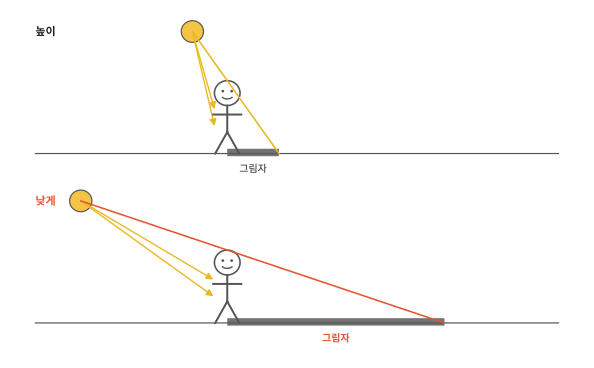
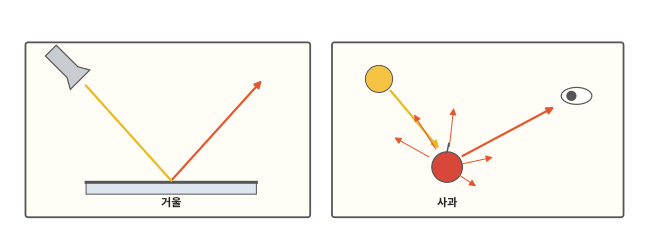
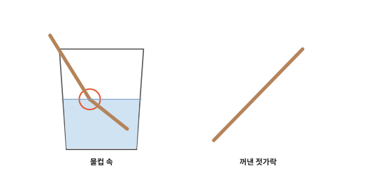
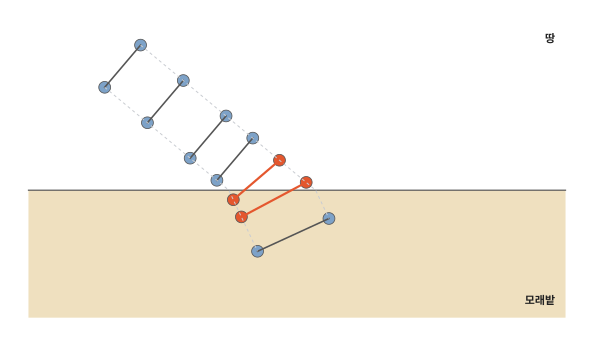
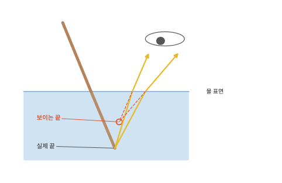
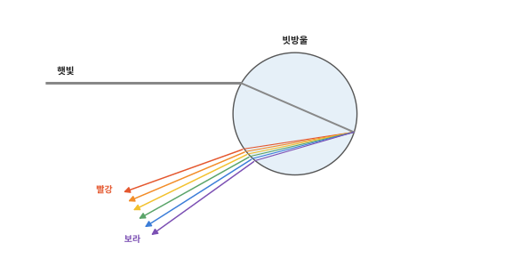
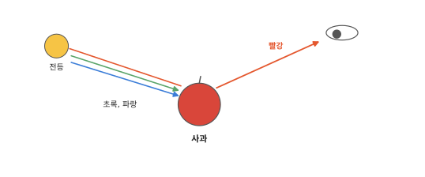

# 빛: 곧게 가다가 튕기고 꺾이는 길

물이 담긴 투명한 컵에 젓가락을 기울여 꽂고 옆에서 보면 물 높이에서 젓가락이 툭 꺾인 것처럼 보여요. 꺼내 보면 곧은데 말이에요. 이 글을 읽고 나면 빛이 나아가는 길과 그 길이 튕기고 꺾이는 곳을 알게 돼요. 이걸 알면 그림자가 생기는 까닭, 물건이 보이는 까닭, 무지개가 뜨는 까닭이 한 줄로 이어져요.

!!! abstract "이 글에서 알게 되는 것"
    1. 빛은 해나 전등에서 나와 곧게 아주 빠르게 나아가요. 그래서 빛이 막힌 자리에 그림자가 생겨요.
    2. 빛은 물건에 부딪히면 튕겨 나와요. 튕겨 나온 빛이 눈에 들어와서 물건이 보이고 물건은 튕겨 낸 빛의 색으로 보여요.
    3. 빛은 공기와 물 사이를 비스듬히 넘어갈 때 꺾여요. 그래서 물속 젓가락이 꺾여 보이고 흰 햇빛이 빗방울 속에서 여러 색으로 나뉘어요.

## 1. 빛은 곧게 가서 그림자를 만들어요

[9편](09-sound.md) 끝에서 번개는 번쩍 먼저 보이고 천둥소리는 나중에 들린다고 했어요. 빛은 소리보다 훨씬 빨라요. 전등을 켜면 빛은 켜자마자 방 끝까지 닿아요.

소리는 밀어 줄 알갱이가 있어야 전해졌어요. 빛은 달라요. 거의 아무것도 없는 우주도 건너와요. 그래서 먼 해의 빛이 우리에게 닿아요. [8편](08-energy.md)에서 무언가를 움직이게 하거나 데우거나 빛나게 하는 데 드는 것을 에너지라고 했는데 빛도 에너지의 한 모습이에요.

빛은 해나 전등처럼 빛나는 것에서 나와 여러 방향으로 곧게 나아가요. 곧게 가니까 그림자가 생겨요. 전등 앞에 사람이 서면 몸에 막힌 빛은 몸 뒤로 돌아가지 못해요. 그 자리가 그림자예요.

아래 그림에서 머리 꼭대기를 스쳐 지나가는 빛줄기가 바닥 어디에 닿는지 보세요.

**그림 1.** 머리를 스친 빛이 바닥에 닿는 곳까지가 그림자예요. 전등이 낮을수록 그 빛이 멀리 닿아서 그림자가 길어요.
{ .fig-cap }

전등을 높이 들어 위에서 비추면 머리를 스친 빛이 발 가까이에 닿아서 그림자가 짧아요. 바닥 가까이 낮게 비추면 그 빛이 멀리 가서야 바닥에 닿아요. 그래서 그림자가 길게 늘어져요. 해가 낮게 뜨는 아침과 저녁에도 그림자가 길게 늘어져요.

## 2. 빛은 부딪히면 튕겨 나와요

빛은 곧게 가다가 물건에 부딪히면 튕겨 나와요. 빛이 튕겨 나오는 것을 **반사**라고 해요. 그런데 튕기는 모습은 물건마다 달라요.

아래 그림에서 거울과 사과가 빛을 튕기는 모습을 비교해 보세요.

**그림 2.** 거울은 빛을 한 방향으로 가지런히 튕기고 사과는 여러 방향으로 흩어 튕겨요.
{ .fig-cap }

거울은 아주 매끈해서 들어온 빛을 한 방향으로 가지런히 튕겨요. 그래서 거울을 보면 내 모습이 또렷하게 비쳐요. 사과는 겉이 거울보다 거칠어서 빛을 여러 방향으로 흩어 튕겨요. 그래서 어느 쪽에서 봐도 사과가 보여요.

우리가 물건을 보는 것도 이 튕긴 빛 덕분이에요. [인체 10편](../body/10-eyes.md)에서 해나 전등의 빛이 사과에 닿아 튕기고 그 빛이 눈으로 들어온다고 했어요. 불을 끈 깜깜한 방에서는 사과에 닿을 빛이 거의 없어요. 튕겨 나와 눈에 들어올 빛도 없으니 사과가 보이지 않아요.

## 3. 빛은 물로 비스듬히 들어가면 꺾여요

이제 처음의 젓가락으로 돌아가 볼게요. 아래 그림에서 빨간 동그라미 자리를 보세요.

**그림 3.** 물컵 속 젓가락은 물 높이에서 꺾여 보이지만 꺼내면 곧아요.
{ .fig-cap }

젓가락은 곧은데 왜 꺾여 보일까요? 꺾인 건 젓가락에서 눈으로 오는 빛이에요. 빛은 공기보다 물이나 유리 속에서 느리게 가요. 빠르기가 바뀌면 왜 길이 꺾이는지 손잡은 두 친구로 생각해 볼게요.

손잡고 나란히 달리던 두 친구가 단단한 땅에서 모래밭으로 비스듬히 들어가요. 모래밭에서는 발이 빠져서 느려져요. 아래 그림에서 빨간 두 친구를 보세요.

**그림 4.** 먼저 모래밭에 들어간 친구가 먼저 느려지는 동안 두 친구의 방향이 모래밭 안쪽으로 틀어져요.
{ .fig-cap }

먼저 모래밭에 들어간 친구가 먼저 느려져요. 그동안 땅을 달리는 친구는 여전히 빨라요. 그래서 둘이 함께 가는 방향이 모래밭 쪽으로 더 가파르게 꺾여요. 거꾸로 모래밭에서 땅으로 나올 때는 먼저 나온 친구가 먼저 빨라져서 반대쪽으로 틀어져요.

빛도 공기와 물 사이를 비스듬히 넘어갈 때 이렇게 방향이 꺾여요. 빛이 이렇게 꺾이는 것을 **굴절**이라고 해요. 친구들과 다른 점도 있어요. 친구는 모래밭을 나와도 지쳐 있지만 빛은 물을 나오면 곧바로 원래 빠르기로 돌아가요.

## 4. 꺾인 빛 때문에 물속 젓가락이 떠 보여요

빛이 꺾인다는 걸 알았어요. 그런데 꺾인 빛이 왜 젓가락을 꺾여 보이게 할까요?

물속 젓가락 끝에서 튕겨 나온 빛은 물 밖으로 나오면서 꺾인 다음 눈에 들어와요. 그런데 우리 눈과 뇌는 빛이 늘 곧게 왔다고 여겨요. 아래 그림에서 빨간 점선이 어디서 만나는지 보세요.

**그림 5.** 눈은 꺾인 빛을 곧게 거꾸로 따라가서 젓가락 끝이 실제보다 위에 있다고 봐요. 꺾이는 각도는 실제보다 크게 그렸어요.
{ .fig-cap }

빨간 점선은 눈이 빛을 곧게 거꾸로 따라간 길이에요. 두 점선은 젓가락의 실제 끝보다 위에서 만나요. 그래서 물속 젓가락은 실제보다 위에 떠 있는 것처럼 보여요. 물 위로 나온 부분은 제자리에 보이니 둘의 높이가 어긋나요. 그 어긋난 곳이 물 높이라서 젓가락이 거기서 꺾여 보여요.

수영장 바닥도 그래요. 바닥에서 나온 빛이 물 밖으로 나오며 꺾여서 바닥이 실제보다 얕아 보여요.

## 5. 흰 햇빛 속에는 여러 색 빛이 섞여 있어요

햇빛은 하얗게 보여요. 그런데 그 속에는 빨강, 주황, 노랑, 초록, 파랑, 보라 같은 여러 색 빛이 섞여 있어요. 이 색들은 꺾일 때 조금씩 다르게 꺾여요.

비가 그친 뒤 해를 등지고 서면 무지개가 보일 때가 있어요. 공중에 떠 있는 빗방울 하나에서 무슨 일이 일어나는지 아래 그림에서 보세요.

**그림 6.** 햇빛이 빗방울에 들어갈 때와 나올 때 꺾이는데 색마다 꺾이는 정도가 달라서 색이 나뉘어요.
{ .fig-cap }

햇빛은 빗방울에 들어갈 때 한 번 꺾이고 안쪽 벽에서 튕겨 되돌아 나오면서 또 꺾여요. 색마다 꺾이는 정도가 조금씩 달라서 나올 때는 색이 나뉘어 있어요. 이렇게 나뉜 빛이 수많은 빗방울에서 우리 눈으로 와서 무지개로 보여요.

물건마다 색이 다른 까닭도 여기 있어요. 아래 그림에서 사과에 닿은 세 빛 가운데 무엇이 눈까지 가는지 보세요.

**그림 7.** 사과는 빨간빛을 튕기고 초록빛과 파란빛은 삼켜요. 그래서 눈에는 빨간빛만 들어와요.
{ .fig-cap }

사과는 여러 색 빛 가운데 빨간빛을 많이 튕기고 다른 색 빛은 대부분 삼켜요. 삼킨 빛은 사과를 아주 조금 데우는 데 쓰여요. 튕겨 나온 빨간빛이 눈에 들어와서 사과가 빨갛게 보여요. 나뭇잎이 초록색으로 보이는 것도 햇빛 가운데 초록빛을 많이 튕겨서예요.

## 정리

빛은 해나 전등에서 나와 곧게 아주 빠르게 나아가요. 알갱이가 없는 우주도 건너와요. 곧게 가니까 빛이 막힌 자리에 그림자가 생기고 낮게 비출수록 그림자가 길어요.

빛은 물건에 부딪히면 튕겨 나와요. 이걸 반사라고 해요. 거울은 한 방향으로, 사과는 여러 방향으로 튕겨요. 튕겨 나온 빛이 눈에 들어와야 물건이 보이고 물건은 튕겨 낸 빛의 색으로 보여요.

빛은 공기와 물 사이를 비스듬히 넘어갈 때 꺾여요. 이걸 굴절이라고 해요. 눈은 꺾인 빛을 곧게 왔다고 여겨서 물속 젓가락이 꺾여 보여요. 흰 햇빛 속 여러 색은 꺾이는 정도가 조금씩 달라서 빗방울을 지나면 무지개로 나뉘어요.

전등은 전기로 빛을 내요. 전기가 무엇인지는 [11편](11-electricity.md)에서 볼게요.

### 새로 나온 말

- **그림자**: 빛이 물건에 막혀서 닿지 못한 자리. 전등 앞에 선 사람 뒤 바닥이 그림자예요.
- **반사**: 빛이 물건에 부딪혀 튕겨 나오는 것. 거울에 내 모습이 비치는 것이 반사예요.
- **굴절**: 빛이 공기와 물처럼 빠르기가 다른 곳 사이를 비스듬히 넘어가며 꺾이는 것. 물컵 속 젓가락이 꺾여 보이는 것도 굴절 때문이에요.
