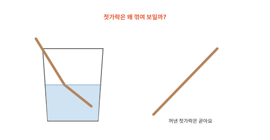
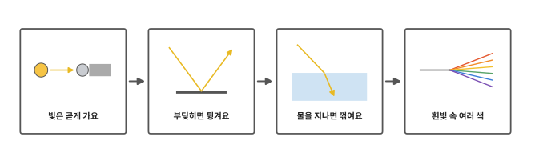
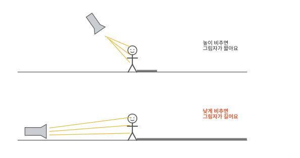
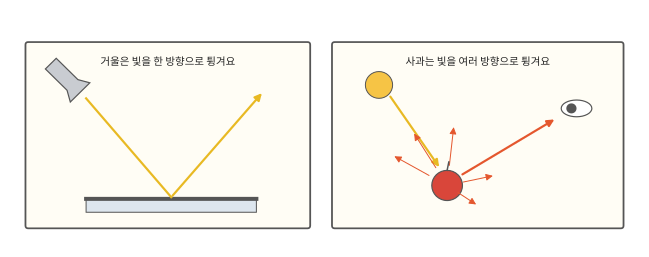
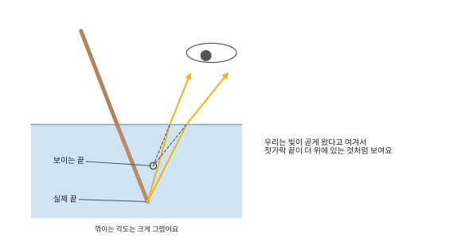
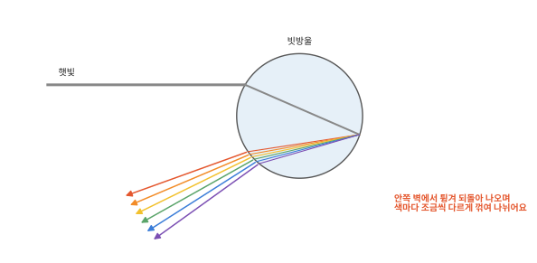
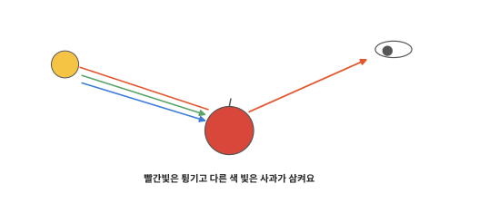

# 빛은 무엇일까요?

## 물컵 속 젓가락

물이 담긴 투명한 컵에 젓가락을 기울여 꽂고 옆에서 보세요. 물 높이에서 젓가락이 툭 꺾인 것처럼 보여요. 그런데 꺼내 보면 곧아요. 젓가락이 꺾인 게 아니면 무엇이 꺾인 걸까요?

## 이 편에서 볼 것

[9편](09-sound.md) 끝에서 번개는 번쩍 먼저 보이고 천둥소리는 나중에 들린다고 했어요. 빛은 소리보다 훨씬 빨라요. [8편](08-energy.md)에서 무언가를 움직이게 하거나 데우거나 빛나게 하는 데 드는 것을 에너지라고 했는데 빛도 에너지의 한 모습이에요. 그 빛이 어떻게 나아가고 어떻게 우리 눈에 들어오는지 봐요.

## 빛은 곧게 가요

빛은 해나 전등처럼 빛나는 것에서 나와 여러 방향으로 곧게 나아가요. 아주아주 빨라서 켜자마자 방 끝까지 닿아요. 소리는 밀어 줄 공기 알갱이가 있어야 전해지지만 빛은 거의 아무것도 없는 우주도 건너와요. 그래서 먼 해의 빛이 우리에게 닿아요.

빛이 곧게 가니까 그림자가 생겨요. 손전등 앞에 사람이 서면 몸에 막힌 빛은 몸 뒤로 돌아가지 못해요. 그 자리가 그림자예요. 손전등을 바닥 가까이 낮게 놓고 비추면 그림자가 길게 늘어지고 높이 들어 위에서 내려 비추면 짧아져요. 해가 낮게 뜬 아침과 저녁에는 그림자가 길게 늘어져요.

## 부딪히면 튕겨요

그런데 빛이 곧게 가다가 물건에 부딪히면 튕겨 나와요. 빛이 튕겨 나오는 것을 **반사**라고 해요. 거울은 아주 매끈해서 들어온 빛을 한 방향으로 가지런히 튕겨요. 그래서 거울을 보면 내 모습이 또렷하게 비쳐요.

사과는 겉이 거울보다 거칠어서 빛을 여러 방향으로 흩어 튕겨요. 그래서 어느 쪽에서 봐도 사과가 보여요. [인체 10편](../body/10-eyes.md)에서 해나 전등에서 나온 빛이 사과에 닿아 튕겨 나오고 그 빛이 눈으로 들어온다고 했지요. 불을 끈 방에서는 튕겨 나올 빛이 거의 없어서 물건이 잘 안 보여요.

## 물을 지나면 꺾여요

손잡고 나란히 달리던 두 친구가 땅에서 모래밭으로 기울어 들어가는 모습을 떠올려 보세요. 먼저 모래밭에 들어간 친구가 먼저 느려져요. 그동안 땅을 달리는 친구는 여전히 빠르니까 둘은 모래밭 안쪽으로 더 곧장 달리게 방향이 틀어져요. 거꾸로 모래밭에서 땅으로 나올 때는 먼저 나온 친구가 먼저 빨라져서 반대쪽으로 틀어져요.

빛도 공기보다 물이나 유리 속에서 느려요. 그래서 빛이 공기와 물 사이를 기울어 넘어갈 때 방향이 꺾여요. 빛이 이렇게 꺾이는 것을 **굴절**이라고 해요. 친구들과 다른 점도 있어요. 친구는 모래밭을 나와도 지쳐 있지만 빛은 물을 나오면 곧바로 원래 빠르기로 돌아가요.

물속 젓가락에서 튕겨 나온 빛은 물 밖으로 나올 때 꺾여서 눈에 들어와요. 그런데 우리는 빛이 곧게 왔다고 여겨요. 그래서 물속 젓가락 전체가 실제보다 위에 있는 것처럼 보여요. 물 위쪽 젓가락과는 높이가 어긋나니 물 높이에서 꺾인 것처럼 보이는 거예요. 수영장 바닥도 바닥에서 나온 빛이 물 밖으로 나오며 꺾여서 실제보다 얕아 보여요.

## 흰빛 속 여러 색

햇빛은 하얗게 보이지만 그 속에는 빨강, 주황, 노랑, 초록, 파랑, 보라 같은 여러 색 빛이 섞여 있어요. 비가 그친 뒤 해를 등지고 서면 무지개가 보일 때가 있어요. 햇빛이 공중의 빗방울에 들어가 안쪽 벽에서 튕겨 되돌아 나오면서 두 번 꺾여요. 그런데 색마다 꺾이는 정도가 조금씩 달라서 색이 나뉘어 보여요.

물건마다 색이 다른 까닭도 여기 있어요. 사과는 여러 색 빛 가운데 빨간빛을 많이 튕기고 다른 색 빛은 대부분 삼켜요. 삼킨 빛은 사과를 아주 조금 데우는 데 쓰여요. 튕겨 나온 빨간빛이 눈에 들어와서 사과가 빨갛게 보여요.

전등은 전기로 빛을 내요. 다음 편은 전기 이야기예요.

## 정리

- 빛은 빛나는 것에서 나와 여러 방향으로 곧게 아주 빠르게 나아가요. 거의 아무것도 없는 우주도 건너와요.
- 빛이 곧게 가서 물체 뒤에 그림자가 생겨요. 낮게 비출수록 그림자가 길어요.
- 반사: 빛이 물건에 부딪혀 튕겨 나오는 거예요. 튕겨 나온 빛이 눈에 들어와 우리가 물건을 봐요.
- 굴절: 빛이 공기와 물 사이를 기울어 넘어갈 때 꺾이는 거예요. 그래서 물속 젓가락이 꺾여 보여요.
- 흰 햇빛에는 여러 색 빛이 섞여 있어요. 물체는 튕기는 빛의 색으로 보여요.

## 해 보기: 빛 따라가기

1. 투명한 컵에 물을 반쯤 담고 젓가락을 기울여 넣어요. 옆에서 볼 때와 위에서 내려다볼 때 젓가락이 어떻게 보이나요?
2. 어두운 방의 탁자 위에 인형을 세우고 휴대폰 손전등으로 비춰 탁자 위 그림자를 봐요. 손전등을 탁자 가까이 낮게 두었을 때와 높이 들었을 때 그림자 길이를 비교해 봐요. 손전등 빛을 사람 눈에 비추지 않아요.
3. 벽에 붙임 쪽지를 하나 붙여요. 손전등 빛을 거울에 비춰서 튕겨 나온 빛으로 쪽지를 맞혀 보세요. 튕겨 나온 빛도 사람 눈에 비추지 않아요.

해는 눈이 다칠 수 있으니 절대 똑바로 쳐다보지 않아요.

## 확인 문제

??? question "1. 그림자"
    손전등 앞에 손을 대면 벽에 손 모양 그림자가 생겨요. 왜일까요?

    **풀이**: 빛은 곧게 나아가요. 손에 막힌 빛은 손 뒤쪽으로 돌아가지 못해서 그 자리만 어두워져요.

??? question "2. 깜깜한 방의 공"
    불을 끈 깜깜한 방에서는 빨간 공이 보이지 않아요. 왜일까요?

    **풀이**: 공을 보려면 빛이 공에 닿아 튕겨 나와 눈에 들어와야 해요. 깜깜한 방에는 공에 닿을 빛이 거의 없어서 눈에 들어오는 빛도 없어요.

??? question "3. 초록 잎"
    나뭇잎은 왜 초록색으로 보일까요?

    **풀이**: 나뭇잎은 햇빛 속 여러 색 빛 가운데 초록빛을 많이 튕기고 다른 색 빛은 대부분 삼켜요. 튕겨 나온 초록빛이 눈에 들어와서 초록색으로 보여요.

!!! abstract "어른을 위한 정리 (건너뛰어도 돼요)"
    - 균일한 매질에서 빛은 직진하며, 빛의 진행을 광선으로 다루는 것을 광선 모형(기하 광학)이라고 해요.[^ray] 진공에서 빛의 속력은 약 3.00×10⁸ m/s예요.[^refr]
    - 반사에서는 입사각과 반사각이 같아요. 거울처럼 매끈한 면은 정반사, 종이나 사과처럼 거친 면은 빛을 여러 방향으로 흩는 난반사를 해요. 우리가 대부분의 물체를 여러 방향에서 볼 수 있는 것은 난반사 덕분이에요.[^refl]
    - 빛은 매질에 따라 속력이 달라서(굴절률 n = c/v, c는 진공에서의 빛의 속력, v는 그 물질 속 속력, 물은 약 1.33) 경계를 비스듬히 지날 때 진행 방향이 바뀌어요(굴절). 느린 매질로 들어가면 법선 쪽으로, 빠른 매질로 나오면 법선에서 멀어지는 쪽으로 꺾여요. 물속 물체가 실제보다 얕아 보이는 것도 굴절 때문이에요.[^refr] 본문 그림은 꺾이는 각도를 과장했어요.
    - 굴절률은 빛의 파장에 따라 조금씩 달라서 흰빛이 색별로 나뉘어요(분산). 보라가 가장 많이, 빨강이 가장 적게 꺾여요. 무지개는 빗방울에 들어갈 때 굴절, 안쪽 면에서 반사, 나올 때 다시 굴절하며 생겨서 해를 등져야 보여요.[^disp]
    - 물체의 색은 물체가 어떤 파장의 빛을 반사하고 어떤 파장을 흡수하는지에 따라 정해져요. 흡수된 빛 에너지는 대부분 열로 바뀌어요.

## 더 깊이

??? info "해의 빛은 얼마나 걸려 올까"
    빛은 아주 빠르지만 해는 아주 멀어서 해에서 떠난 빛이 우리에게 닿기까지 8분쯤 걸려요. 지금 보는 해의 빛은 8분 전에 해를 떠난 빛이에요. 그래도 해는 눈이 다치니까 쳐다보지 않아요.

??? info "프리즘"
    삼각기둥 모양의 유리를 프리즘이라고 해요. 햇빛을 프리즘에 비추면 빛이 꺾이면서 색이 나뉘어 벽에 작은 무지개가 생겨요.

[^ray]: OpenStax, *College Physics 2e*, 25.1 ["The Ray Aspect of Light"](https://openstax.org/books/college-physics-2e/pages/25-1-the-ray-aspect-of-light).
[^refl]: OpenStax, *College Physics 2e*, 25.2 ["The Law of Reflection"](https://openstax.org/books/college-physics-2e/pages/25-2-the-law-of-reflection).
[^refr]: OpenStax, *College Physics 2e*, 25.3 ["The Law of Refraction"](https://openstax.org/books/college-physics-2e/pages/25-3-the-law-of-refraction).
[^disp]: OpenStax, *College Physics 2e*, 25.5 ["Dispersion: The Rainbow and Prisms"](https://openstax.org/books/college-physics-2e/pages/25-5-dispersion-the-rainbow-and-prisms).
