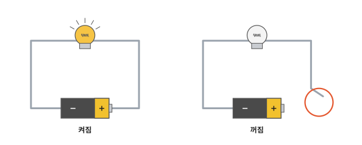
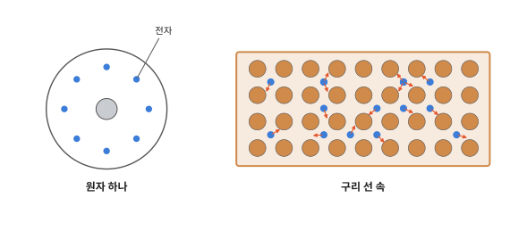
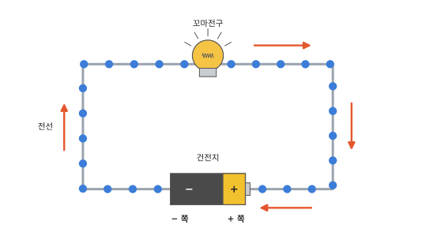
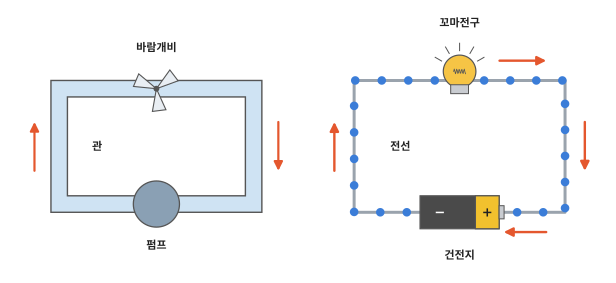
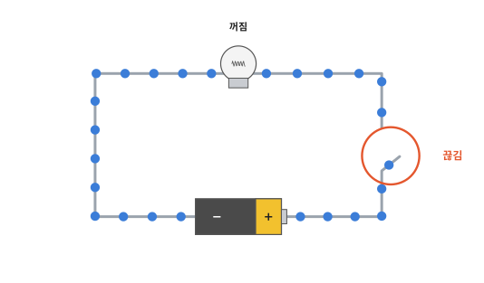
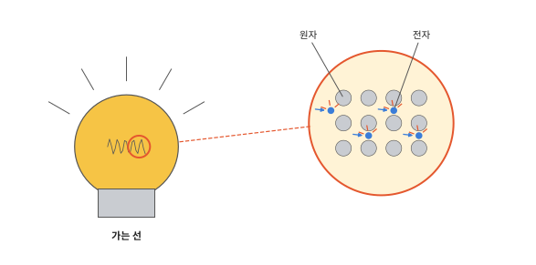
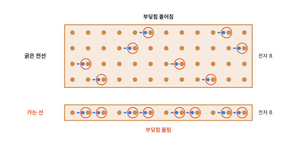
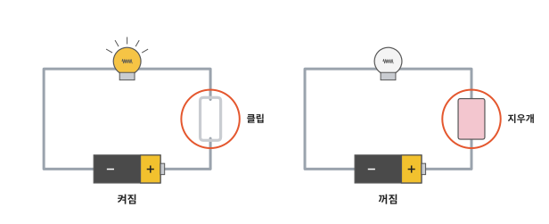
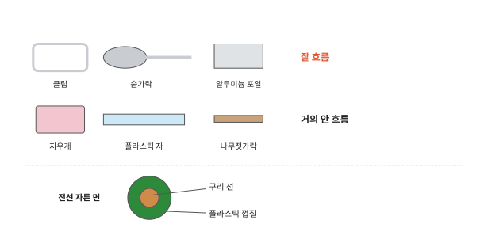

# 전기와 회로: 꼬마전구에 불이 켜지는 길

건전지 하나와 전선 두 가닥, 꼬마전구 하나가 있어요. 건전지 양 끝에 전선을 하나씩 대고 전구에 이으면 불이 켜져요. 그런데 한 가닥만 떼어도 불이 꺼져요. 이 글을 읽고 나면 왜 두 가닥이 다 이어져야 하는지 알게 돼요. 방의 전등도 이와 같은 길로 켜지고 꺼져요. 그래서 이 길을 알면 집 안의 전기 물건이 어떻게 돌아가는지도 알 수 있어요.

!!! abstract "이 글에서 알게 되는 것"
    1. 전선 속 구리에는 원자 사이를 돌아다니는 전자가 처음부터 가득 들어 있어요. 전자는 원자 속에 든 아주 작은 조각으로 전기를 날라요.
    2. 건전지와 전선과 전구가 한 바퀴로 이어지면 건전지가 전자를 밀어서 다 함께 돌게 해요. 이 길을 회로라고 하고 한 곳만 끊겨도 전자가 모두 멈춰요.
    3. 전구 속 가는 선을 지나는 전자가 원자와 부딪혀 선을 뜨겁게 달구면 빛이 나요. 금속은 전기가 잘 흐르고 고무나 플라스틱은 거의 안 흘러요.

## 1. 전선 속에는 돌아다니는 전자가 들어 있어요

건전지 양 끝에 전선을 하나씩 대고 두 전선의 다른 끝을 꼬마전구에 이어요. 불이 켜져요. 이제 전선 한 가닥을 건전지에서 떼어 보세요.

아래 그림에서 오른쪽 회로의 빨간 동그라미를 보세요.

**그림 1.** 전선 두 가닥이 다 이어지면 전구가 켜지고 한 가닥이 떨어지면 꺼져요.
{ .fig-cap }

전선이 한 가닥 떨어졌을 뿐인데 왜 꺼질까요? 답하려면 전선 속에서 무슨 일이 일어나는지 알아야 해요. 그런데 전기는 눈에 보이지 않아요. 그래서 전선 속을 아주 크게 키워서 들여다볼게요.

[1편](01-particles.md)에서 물질은 원자라는 아주 작은 조각으로 되어 있다고 했어요. 원자 속에는 원자보다 훨씬 작은 조각이 또 들어 있어요. 그 가운데 하나가 **전자**예요. 전자는 전기를 나르는 아주 작은 조각이에요. 전자는 1편의 알갱이와 다른 것이에요. 알갱이는 원자가 붙어서 된 것이고 전자는 그 원자 속에 든 조각이에요.

대부분의 물질에서는 전자가 제 원자에 꽉 붙어 있어요. 그런데 구리나 쇠 같은 금속에서는 전자 일부가 원자에 묶이지 않아서 원자 사이사이를 돌아다녀요. 전선 가운데 든 구리 선에도 이렇게 돌아다니는 전자가 가득해요.

아래 그림에서 왼쪽 원자에 붙은 파란 점과 오른쪽 구리 선 속 파란 점을 비교해 보세요.

**그림 2.** 구리 선 속에서는 전자가 원자 사이에 흩어져 이리저리 돌아다녀요.
{ .fig-cap }

그림은 크기를 실제와 맞추지 않았어요. 전자는 원자보다 훨씬훨씬 작아요. 여기서 하나만 기억해 두세요. 건전지를 잇기 전에도 전선 속에는 전자가 가득 들어 있어요.

## 2. 한 바퀴 이어지면 건전지가 전자를 밀어 돌려요

전선 속 전자는 이리저리 돌아다니기만 해요. 한쪽으로 미는 것이 없으니 전구는 켜지지 않아요. 미는 일은 건전지가 해요.

건전지 두 끝에는 − 표시와 + 표시가 있어요. 건전지는 − 쪽 끝에서 전자를 밀어내고 + 쪽 끝으로 받아들여요. 건전지 두 끝을 전선과 전구로 한 바퀴 이어 보세요. 건전지가 전선 속 전자를 줄줄이 밀어서 전자들이 길을 따라 한꺼번에 돌아요.

아래 그림에서 빨간 화살표를 따라가 보세요.

**그림 3.** 전자가 건전지 − 쪽에서 나와 전선과 전구를 지나 + 쪽으로 돌아와요.
{ .fig-cap }

이렇게 전자가 한쪽으로 흐르는 것을 **전기가 흐른다**고 해요. 그리고 전자가 지나갈 수 있게 한 바퀴 이어진 길을 **회로**라고 해요.

여기서 이런 생각이 들 거예요. 전자가 건전지에서 전구까지 가려면 시간이 걸릴 텐데 전구는 왜 이으자마자 켜질까요? 펌프로 물을 돌리는 둥근 물길을 떠올려 보세요.

아래 그림에서 왼쪽 물길과 오른쪽 회로의 같은 자리를 짝지어 보세요.

**그림 4.** 펌프는 건전지, 관은 전선, 바람개비는 꼬마전구와 같은 자리에 있어요.
{ .fig-cap }

펌프가 물을 밀면 관을 따라 물이 돌고 관 위쪽의 바람개비가 돌아가요. 관이 처음부터 물로 가득 차 있으면 펌프를 켜자마자 바람개비가 돌아요. 펌프 옆의 물이 바람개비까지 오기를 기다릴 필요가 없거든요. 바람개비 옆에 있던 물이 함께 밀려요. 전선도 처음부터 전자로 가득 차 있어요. 그래서 이으자마자 전구 속 전자도 함께 움직이고 불이 켜져요.

## 3. 길이 한 곳만 끊겨도 전자가 모두 멈춰요

이제 처음 질문에 답할 수 있어요. 전선 한 가닥을 떼면 회로가 한 곳 끊겨요. 끊긴 길로는 전자가 한 바퀴를 돌 수 없어요.

아래 그림에서 끊긴 곳과 전구를 함께 보세요.

**그림 5.** 회로가 한 곳 끊기면 전선 속 전자는 그대로 있지만 흐르지 않아서 전구가 꺼져요.
{ .fig-cap }

끊긴 곳 근처만 멈추지 않아요. 회로 속 전자가 모두 멈춰요. 전자들은 줄줄이 밀려서 돌았으니까 한 곳이 막히면 미는 힘이 이어지지 않아요. 전구 속 전자도 멈추고 불이 꺼져요.

물길과 다른 점도 있어요. 관이 끊기면 물은 바닥으로 쏟아져요. 전선이 끊기면 전자는 쏟아지지 않아요. 건전지가 미는 힘이 약해서 전자가 끊긴 틈의 공기를 건너가지 못하거든요. 그래서 그냥 멈춰요.

방 벽에 있는 전등 스위치가 이 일을 해요. 스위치를 끄면 회로 한 곳이 벌어져 길이 끊겨요. 켜면 다시 붙어서 이어져요. 처음 장면에서 전선 한 가닥을 뗐다 붙였다 한 것과 같아요.

??? info "번개는 공기를 건너는 전기예요"
    구름 속에서 얼음 알갱이들이 부딪히며 전기가 쌓여요. 쌓인 전기가 한꺼번에 땅이나 다른 구름으로 흐르는 것이 번개예요. 공기는 원래 전기가 잘 안 흐르지만 쌓인 전기가 아주 크면 공기를 뚫고 흘러요. 건전지의 약한 힘으로는 손톱만 한 틈도 건너지 못하니까 번개가 얼마나 센지 짐작할 수 있어요.

## 4. 가는 선에서 부딪힌 전자가 선을 달궈 빛을 내요

회로가 이어지면 전자가 돌아요. 그런데 전자가 돈다고 왜 전구가 빛날까요? 꼬마전구를 가까이 보면 유리 속에 머리카락보다 가는 선이 들어 있어요. 회로를 도는 전자는 이 가는 선도 지나가요.

아래 그림에서 오른쪽 동그라미 안을 보세요. 가는 선 속을 크게 키운 모습이에요.

**그림 6.** 가는 선 속에서 전자가 원자와 자꾸 부딪혀요.
{ .fig-cap }

전자는 선을 지나가면서 선의 원자들과 자꾸 부딪혀요. 부딪힌 원자는 제자리에서 더 세게 꿈틀거려요. 금속 선에서는 원자 하나가 그대로 [1편](01-particles.md)의 알갱이예요. [3편](03-heat.md)에서 알갱이가 세게 꿈틀거릴수록 온도가 높다고 했죠. 그래서 선이 뜨거워져요. 손바닥을 빠르게 비비면 따뜻해지는 것과 닮았어요. 그리고 [7편](07-burning.md)의 숯불처럼 아주 뜨거워진 선은 빛을 내요.

그럼 같은 회로에 있는 전선은 왜 뜨거워지지 않을까요? 아래 그림에서 위의 굵은 전선과 아래의 가는 선을 비교해 보세요.

**그림 7.** 원자 배치는 같아요. 같은 수의 전자가 가는 선에서는 좁은 길로 몰려 지나가서 부딪힘이 한곳에 몰려요.
{ .fig-cap }

두 선 속 원자의 간격은 똑같아요. 다른 것은 길의 너비예요. 한 바퀴 회로에서는 굵은 전선에도 가는 선에도 같은 수의 전자가 지나가요. 굵은 전선에서는 전자들이 넓은 길에 퍼져 지나가서 부딪힘도 넓게 흩어져요. 그래서 거의 뜨거워지지 않아요. 가는 선은 같은 수의 전자가 좁은 길로 몰려 지나가서 부딪힘이 한곳에 몰려 달궈져요. 또 전구 속 가는 선은 구리보다 전기가 잘 안 흐르는 금속으로 만들어요. 그래서 한 회로 안에서도 가는 선만 달궈지고 빛나요.

여기서 궁금한 게 하나 더 생겨요. 전구가 빛을 내는 동안 전자는 닳아 없어질까요? 그렇지 않아요. 전자는 전구를 지나도 줄지 않고 한 바퀴를 계속 돌아요. 줄어드는 것은 건전지 속 에너지예요. [8편](08-energy.md)에서 본 것처럼 에너지는 모습을 바꿔요. 건전지 속 에너지가 전구에서 열과 빛으로 바뀌어요.

## 5. 금속은 전기가 잘 흐르고 고무와 플라스틱은 거의 안 흘러요

1절에서 금속 속에는 돌아다니는 전자가 있다고 했어요. 금속이 아닌 물건을 회로에 끼우면 어떻게 될까요? 회로 한 곳을 떼고 그 틈에 물건을 하나씩 끼워 볼게요.

아래 그림에서 틈에 끼운 물건과 전구를 함께 보세요.

**그림 8.** 틈에 쇠 클립을 끼우면 전구가 켜지고 지우개를 끼우면 꺼진 채로 있어요.
{ .fig-cap }

쇠 클립 속에도 돌아다니는 전자가 있어서 클립을 끼우면 회로가 다시 이어져요. 지우개는 고무라서 전자가 원자에 꽉 묶여 있어요. 틈은 메워졌지만 전자가 지나가지 못해서 전구가 켜지지 않아요.

여러 물건을 끼워 보면 두 무리로 나뉘어요. 아래 그림에서 위 줄과 아래 줄을 비교해 보세요.

**그림 9.** 금속 물건은 전기가 잘 흐르고 고무, 플라스틱, 나무 물건은 거의 안 흘러요. 전선은 구리 선을 플라스틱 껍질로 감싸요.
{ .fig-cap }

쇠, 구리, 알루미늄 같은 금속은 돌아다니는 전자가 많아서 전기가 잘 흘러요. 고무, 플라스틱, 마른 나무, 유리는 전자가 원자에 꽉 묶여 있어서 전기가 거의 흐르지 않아요. 전선은 이 두 무리를 함께 써요. 그림 9 아래처럼 가운데 구리 선을 플라스틱 껍질로 감싸요. 전기는 구리 선을 따라 흐르고 껍질 밖으로 새어 나오지 않아요.

물에도 전기가 흘러요. 소금기가 든 물이나 땀이 그래요. 우리 몸도 대부분 물이라서 전기가 흐를 수 있어요. 벽의 콘센트에는 건전지보다 훨씬 센 전기가 와 있어서 몸으로 흐르면 크게 다쳐요. 그래서 콘센트에는 손가락이나 물건을 절대 넣지 않아요. 젖은 손으로 플러그를 만지지도 않아요.

??? question "해 보기: 꼬마전구 켜기"
    준비물: AA 건전지 1개, 1.5 V용 꼬마전구와 전구 받침(소켓), 양 끝에 집게가 달린 전선 2개(악어 집게 전선). 문구점이나 과학 준비물 가게에서 살 수 있어요.

    1. 건전지 두 끝에 전선을 하나씩 물리고 두 전선의 다른 끝을 전구 받침의 두 나사에 물려요. 불이 켜지나요? 전선 한 가닥을 떼면 어떻게 되나요?
    2. 회로 한 곳을 떼고 그 사이에 칠하지 않은 쇠 클립, 지우개, 숟가락, 마른 나무젓가락, 알루미늄 포일을 하나씩 끼워 봐요. 어느 것을 끼웠을 때 불이 켜지나요?
    3. 집 안에서 전등 스위치를 찾아보세요. 스위치를 끄면 회로의 어디가 끊길까요? 콘센트와 플러그는 만지지 않고 눈으로만 찾아요.

    안전 약속: 건전지는 한 개만 써요. 건전지 두 끝을 전선 하나로 바로 잇지 않고 두 집게가 서로 닿지 않게 해요. 전구 없이 바로 이으면 전기가 한꺼번에 세게 흘러 전선과 건전지가 뜨거워져요. 콘센트는 절대 쓰지 않아요.

??? info "어른을 위한 정리"
    - 원자는 양전하를 띤 원자핵과 음전하를 띤 전자로 이루어져 있어요. 전하는 생기거나 없어지지 않아요(전하 보존).[^charge]
    - 금속 같은 도체에서는 바깥쪽 전자 일부가 원자에 묶이지 않고 자유롭게 움직여 전류가 흐를 수 있어요. 고무·유리·플라스틱 같은 절연체는 전자가 단단히 묶여 있어 전류가 거의 흐르지 않아요. 물은 녹아 있는 이온 때문에 전류가 흘러요.[^cond]
    - 전류는 전하의 흐름이에요. 건전지는 두 극 사이에 전위차(AA 건전지는 1.5 V)를 만들어 닫힌 회로에 전류를 흐르게 해요. 관례상 전류의 방향은 + 극에서 − 극 쪽이고 금속 속 전자는 그 반대 방향으로 움직여요. 본문 그림의 화살표는 전자가 움직이는 방향이에요. 전자 하나하나의 평균 이동(유동) 속도는 아주 느려요. 하지만 도선 전체에 전기장이 거의 즉시 퍼져 모든 전자가 함께 움직이기 시작해서 스위치를 켜면 전구가 바로 켜져요.[^curr]
    - 전구 필라멘트는 가늘고 저항이 커서 전류가 흐를 때 전기 에너지가 열로 바뀌고(줄열) 아주 뜨거워진 필라멘트가 빛을 내요(백열). 굵은 도선은 저항이 작아 거의 뜨거워지지 않아요. 소비 전력은 전압과 전류의 곱이에요.[^ohm][^power]
    - 요즘 많이 쓰는 엘이디(LED) 전구는 필라멘트를 달구지 않고 특별한 물질 속에서 전자가 자리를 옮길 때 빛이 나오게 해요. 같은 밝기에서 덜 뜨겁고 전기를 덜 써요.
    - 우리나라 가정용 전기는 220 V로 건전지보다 훨씬 높아서 인체에 위험한 전류가 흐를 수 있어요.

## 정리

건전지와 전선, 꼬마전구를 한 바퀴로 이으면 불이 켜져요. 전선 속 구리에는 원자 사이를 돌아다니는 전자가 처음부터 가득 들어 있어요. 건전지는 − 쪽에서 이 전자를 밀어내고 + 쪽으로 받아들여서 회로 속 전자를 다 함께 돌게 해요. 전자가 이렇게 흐르는 것을 전기가 흐른다고 해요.

전자가 지나는 한 바퀴 길이 회로예요. 회로가 한 곳만 끊겨도 전자가 모두 멈춰요. 그래서 전선 한 가닥만 떼어도 전구가 꺼지고 스위치로 전등을 켜고 끌 수 있어요.

전구 속 가는 선에서는 전자가 원자와 자꾸 부딪혀서 선이 아주 뜨거워지고 빛이 나요. 전자는 닳지 않고 건전지 속 에너지가 열과 빛으로 바뀌어요. 금속은 돌아다니는 전자가 많아서 전기가 잘 흐르고 고무, 플라스틱, 마른 나무는 거의 안 흘러요.

전기와 자석은 사이가 아주 가까워요. [12편](12-magnets.md)에서는 자석이 쇠를 끌어당기는 까닭을 볼게요.

### 새로 나온 말

- **전자**: 원자 속에 든 아주 작은 조각으로 전기를 날라요. 1편의 알갱이와 다른 것이고 구리 선 속에서는 원자 사이를 돌아다녀요.
- **전기가 흐른다**: 전자가 한쪽으로 줄줄이 움직이는 것. 건전지가 − 쪽에서 밀어내면 전선 속 전자가 + 쪽으로 돌아요.
- **회로**: 전자가 지나갈 수 있게 한 바퀴 이어진 길. 건전지에서 나와 전구를 지나 건전지로 돌아오는 길이에요.

[^charge]: OpenStax, *College Physics 2e*, 18.1 ["Static Electricity and Charge: Conservation of Charge"](https://openstax.org/books/college-physics-2e/pages/18-1-static-electricity-and-charge-conservation-of-charge).
[^cond]: OpenStax, *College Physics 2e*, 18.2 ["Conductors and Insulators"](https://openstax.org/books/college-physics-2e/pages/18-2-conductors-and-insulators).
[^curr]: OpenStax, *College Physics 2e*, 20.1 ["Current"](https://openstax.org/books/college-physics-2e/pages/20-1-current).
[^ohm]: OpenStax, *College Physics 2e*, 20.2 ["Ohm's Law: Resistance and Simple Circuits"](https://openstax.org/books/college-physics-2e/pages/20-2-ohms-law-resistance-and-simple-circuits).
[^power]: OpenStax, *College Physics 2e*, 20.4 ["Electric Power and Energy"](https://openstax.org/books/college-physics-2e/pages/20-4-electric-power-and-energy).
