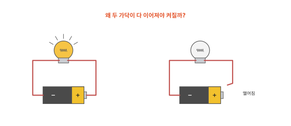
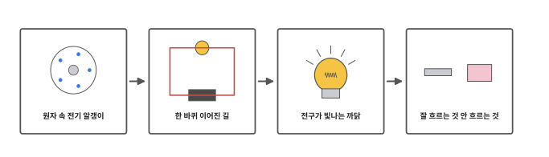
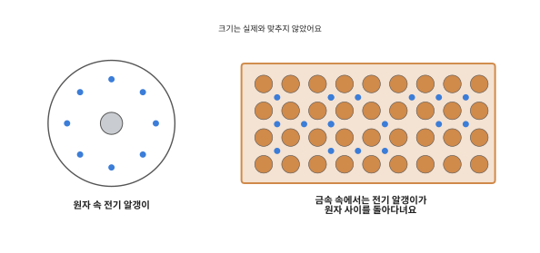
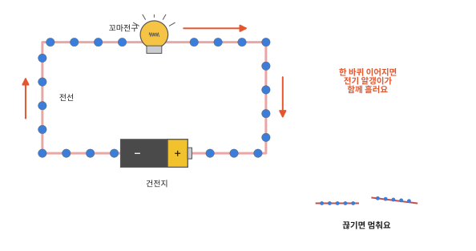
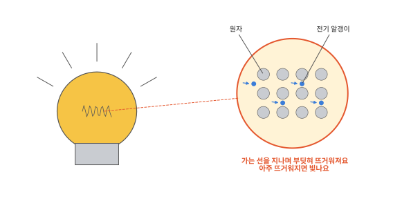
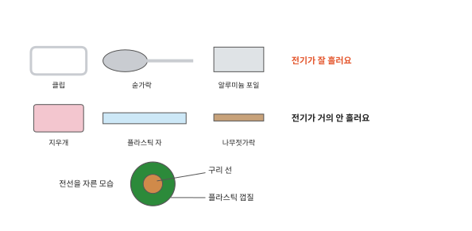

# 전기는 무엇일까요?

## 꼬마전구에 불 켜기

건전지와 전선 두 가닥, 꼬마전구를 준비해요. 건전지 양 끝에 전선을 하나씩 대고 전구에 이으면 불이 켜져요. 그런데 한 가닥만 떼어도 꺼져요. 왜 두 가닥이 다 이어져야 할까요?

## 이 편에서 볼 것

[10편](10-light.md) 끝에서 전등은 전기로 빛을 낸다고 했어요. 전기는 눈에 보이지 않아요. 그래서 원자 속을 들여다보는 데서 시작해요.

## 원자 속 전기 알갱이

[1편](01-particles.md)에서 물질은 원자라는 아주 작은 조각으로 되어 있다고 했어요. 그런데 원자 속에도 원자보다 훨씬 작은 조각들이 들어 있어요. 그 가운데 하나를 이 편에서는 전기 알갱이라고 부를게요. 과학자들은 전자라고 해요.

대부분의 물질에서는 전기 알갱이가 제 원자에 꽉 붙어 있어요. 그런데 쇠나 구리 같은 금속에서는 전기 알갱이 일부가 원자에 묶이지 않아서 원자 사이사이를 돌아다닐 수 있어요. 전선 속 구리 선에도 이렇게 돌아다니는 전기 알갱이가 가득 들어 있어요.

## 한 바퀴 이어진 길

전기 알갱이는 처음부터 전선 속에 가득 들어 있어요. 건전지는 이 알갱이를 밀어서 돌려 줘요. 건전지의 − 쪽 끝에서 알갱이를 밀어내고 + 쪽 끝으로 받아들여요. 건전지 두 끝을 전선과 전구로 한 바퀴 이어 보세요. 건전지가 전선 속 전기 알갱이를 줄줄이 밀어요. 알갱이들은 길을 따라 한꺼번에 돌아요. 이렇게 전기 알갱이가 흐르는 것을 전기가 흐른다고 해요. 전기 알갱이가 지나갈 수 있게 한 바퀴 이어진 길을 **회로**라고 해요.

펌프와 둥근 물길을 떠올려 보세요. 펌프가 물을 밀면 둥근 관을 따라 물이 돌고 관 중간의 작은 바람개비 날개가 돌아가요. 건전지는 펌프, 전선은 관, 꼬마전구는 날개와 닮았어요. 관이 처음부터 물로 가득 차 있으면 펌프를 켜자마자 날개가 돌아요. 전선 속에도 처음부터 전기 알갱이가 가득해서 이으자마자 전구가 켜져요.

길이 한 곳이라도 끊기면 알갱이는 모두 멈추고 전구가 꺼져요. 그래서 처음 장면에서 전선 한 가닥만 떼어도 불이 꺼졌어요. 물길과 다른 점도 있어요. 관이 끊기면 물은 바닥으로 쏟아지지만 건전지의 약한 힘으로는 전기 알갱이가 끊긴 틈의 공기를 건너가지 못하고 그냥 멈춰요. 벽에 있는 켜고 끄는 단추는 이 길을 끊었다 이었다 하는 장치예요.

## 전구가 빛나는 까닭

그럼 전구는 왜 빛날까요? 꼬마전구 속에는 머리카락보다 가는 선이 들어 있어요. 전기 알갱이가 이 좁은 길을 지나면서 선의 원자들과 자꾸 부딪혀요. 부딪힐수록 선의 원자들이 세게 꿈틀거려요. [3편](03-heat.md)의 꿈틀거림을 떠올려 보세요. 선이 뜨거워지는 거예요. 손바닥을 빠르게 비비면 따뜻해지는 것과 닮았어요. [7편](07-burning.md)의 숯불처럼 아주 뜨거워진 선은 빛을 내요.

굵은 전선은 길이 넓어서 부딪히는 일이 적고 거의 뜨거워지지 않아요. 전기 알갱이는 전구를 지나도 줄지 않고 한 바퀴를 계속 돌아요. 바뀌는 것은 건전지 속 에너지예요. 8편에서 본 것처럼 그 에너지가 전구에서 열과 빛으로 모습을 바꿔요.

## 잘 흐르는 것과 안 흐르는 것

그런데 구리 선은 왜 전기가 잘 흐르고 지우개는 안 흐를까요? 쇠, 구리, 알루미늄 같은 금속은 돌아다니는 전기 알갱이가 많아서 전기가 잘 흘러요. 고무, 플라스틱, 마른 나무, 유리는 전기 알갱이가 원자에 꽉 묶여 있어서 전기가 거의 흐르지 않아요. 그래서 전선은 가운데 구리 선을 플라스틱 껍질로 감싸서 만들어요. 전기는 구리 선을 따라 흐르고 껍질 밖으로 새어 나오지 않아요.

소금기가 든 물이나 땀에도 전기가 흘러요. 우리 몸도 대부분 물이라 전기가 흐를 수 있어요. 벽의 콘센트에는 건전지보다 훨씬 센 전기가 와 있어서 몸으로 흐르면 크게 다쳐요. 콘센트에는 손가락이나 물건을 절대 넣지 않아요. 젖은 손으로 플러그도 만지지 않아요.

전기와 자석은 사이가 아주 가까워요. 다음 편은 자석 이야기예요.

## 정리

- 원자 속에는 아주 작은 전기 알갱이(전자)가 있어요. 금속에서는 전기 알갱이가 원자 사이를 돌아다닐 수 있어요.
- 회로: 전기 알갱이가 지나갈 수 있게 한 바퀴 이어진 길이에요. 건전지가 밀면 회로 속 전기 알갱이가 함께 흘러요. 한 곳이라도 끊기면 멈춰요.
- 전구 속 가는 선은 전기 알갱이가 부딪히며 지나가 뜨거워지고 아주 뜨거워지면 빛나요.
- 금속은 전기가 잘 흐르고 고무, 플라스틱, 마른 나무는 거의 안 흘러요.

## 해 보기: 꼬마전구 켜기

준비물: AA 건전지 1개, 1.5 V용 꼬마전구와 전구 받침(소켓), 양 끝에 집게가 달린 전선 2개(악어 집게 전선). 문구점이나 과학 준비물 가게에서 살 수 있어요.

1. 건전지 두 끝에 전선을 하나씩 물리고 두 전선의 다른 끝을 전구 받침의 두 나사에 물려요. 불이 켜지나요? 전선 한 가닥을 떼면 어떻게 되나요?
2. 회로 한 곳을 떼고 그 사이에 칠하지 않은 쇠 클립, 지우개, 숟가락, 마른 나무젓가락, 알루미늄 포일을 하나씩 끼워 봐요. 어느 것을 끼웠을 때 불이 켜지나요?
3. 집 안에서 켜고 끄는 단추를 찾아보세요. 단추를 끄면 회로의 어디가 끊길까요? 콘센트와 플러그는 만지지 않고 눈으로만 찾아요.

안전 약속: 건전지는 한 개만 써요. 건전지 두 끝을 전선 하나로 바로 잇지 않고 두 집게가 서로 닿지 않게 해요. 전구 없이 바로 이으면 전기가 한꺼번에 세게 흘러 전선과 건전지가 뜨거워져요. 콘센트는 절대 쓰지 않아요.

## 확인 문제

??? question "1. 회로"
    전기 알갱이가 지나갈 수 있게 한 바퀴 이어진 길을 무엇이라고 할까요?

    **풀이**: 회로예요. 건전지에서 나와 전구를 지나 다시 건전지로 돌아오는 길이 끊김 없이 이어져야 전기가 흘러요.

??? question "2. 꺼진 꼬마전구"
    꼬마전구에 불을 켜 두었다가 전선 한 가닥을 건전지에서 떼었더니 불이 꺼졌어요. 왜일까요?

    **풀이**: 회로가 한 곳 끊겼어요. 길이 끊기면 전선 속 전기 알갱이가 모두 멈춰서 전구 속 선으로도 흐르지 않아요.

??? question "3. 전선의 껍질"
    전선 겉은 왜 플라스틱으로 싸여 있을까요?

    **풀이**: 플라스틱은 전기가 거의 흐르지 않아요. 전기가 가운데 구리 선을 따라서만 흐르고 바깥으로 새어 나와 사람이나 다른 물건으로 흐르지 않게 감싼 거예요.

!!! abstract "어른을 위한 정리 (건너뛰어도 돼요)"
    - 원자는 양전하를 띤 원자핵과 음전하를 띤 전자로 이루어져 있어요. 전하는 생기거나 없어지지 않아요(전하 보존). 본문의 "전기 알갱이"는 전자예요.[^charge]
    - 금속 같은 도체에서는 바깥쪽 전자 일부가 원자에 묶이지 않고 자유롭게 움직여 전류가 흐를 수 있어요. 고무·유리·플라스틱 같은 절연체는 전자가 단단히 묶여 있어 전류가 거의 흐르지 않아요. 물은 녹아 있는 이온 때문에 전류가 흘러요.[^cond]
    - 전류는 전하의 흐름이에요. 건전지는 두 극 사이에 전위차(AA 건전지는 1.5 V)를 만들어 닫힌 회로에 전류를 흐르게 해요. 관례상 전류의 방향은 + 극에서 − 극 쪽이고, 금속 속 전자는 그 반대 방향으로 움직여요. 본문 그림의 화살표는 전자가 움직이는 방향이에요. 전자 하나하나의 평균 이동(유동) 속도는 아주 느리지만, 도선 전체에 전기장이 거의 즉시 퍼져 모든 전자가 함께 움직이기 시작하므로 스위치를 켜면 전구가 바로 켜져요.[^curr]
    - 전구 필라멘트는 가늘고 저항이 커서 전류가 흐를 때 전기 에너지가 열로 바뀌고(줄열), 아주 뜨거워진 필라멘트가 빛을 내요(백열). 굵은 도선은 저항이 작아 거의 뜨거워지지 않아요. 소비 전력은 전압과 전류의 곱이에요.[^ohm][^power]
    - 우리나라 가정용 전기는 220 V로 건전지보다 훨씬 높아서 인체에 위험한 전류가 흐를 수 있어요.

## 더 깊이

??? info "엘이디 전구는 다르게 빛나요"
    요즘 많이 쓰는 엘이디(LED) 전구는 가는 선을 뜨겁게 달구지 않고 특별한 물질 속에서 전기 알갱이가 자리를 옮길 때 빛이 바로 나오게 만들어요. 그래서 같은 밝기라도 훨씬 덜 뜨겁고 전기를 덜 써요.

??? info "번개도 전기예요"
    구름 속에서 얼음 알갱이들이 부딪히며 전기가 쌓이다가 한꺼번에 땅이나 다른 구름으로 흐르는 것이 번개예요. 공기는 원래 전기가 잘 안 흐르지만 쌓인 전기가 아주 크면 공기를 뚫고 흘러요. 건전지의 약한 힘으로는 손톱만 한 틈도 건너지 못하니 번개가 얼마나 센지 짐작할 수 있어요.

[^charge]: OpenStax, *College Physics 2e*, 18.1 ["Static Electricity and Charge: Conservation of Charge"](https://openstax.org/books/college-physics-2e/pages/18-1-static-electricity-and-charge-conservation-of-charge).
[^cond]: OpenStax, *College Physics 2e*, 18.2 ["Conductors and Insulators"](https://openstax.org/books/college-physics-2e/pages/18-2-conductors-and-insulators).
[^curr]: OpenStax, *College Physics 2e*, 20.1 ["Current"](https://openstax.org/books/college-physics-2e/pages/20-1-current).
[^ohm]: OpenStax, *College Physics 2e*, 20.2 ["Ohm's Law: Resistance and Simple Circuits"](https://openstax.org/books/college-physics-2e/pages/20-2-ohms-law-resistance-and-simple-circuits).
[^power]: OpenStax, *College Physics 2e*, 20.4 ["Electric Power and Energy"](https://openstax.org/books/college-physics-2e/pages/20-4-electric-power-and-energy).
