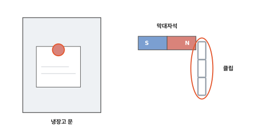
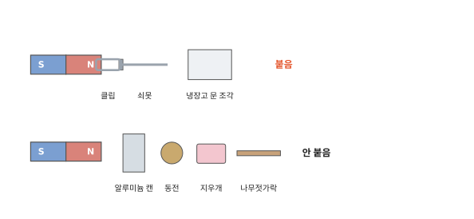
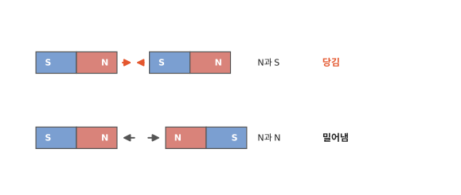
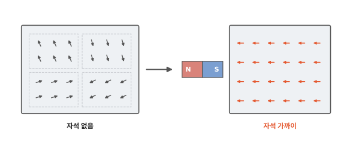
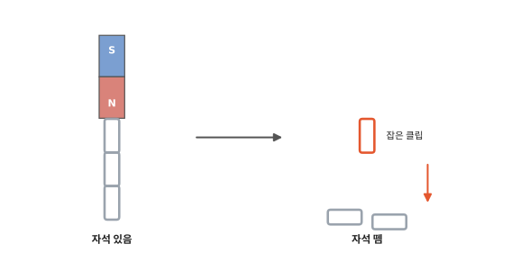
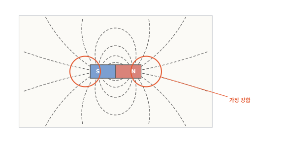
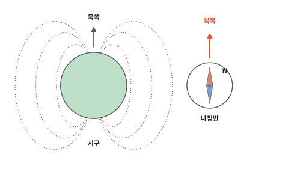
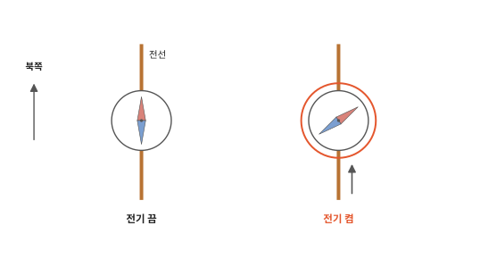
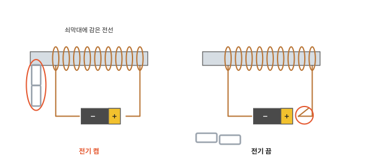

# 자석: 쇠를 끌어당기는 보이지 않는 힘

냉장고 문에 자석을 대면 딱 붙어요. 막대자석을 쇠 클립에 가까이 가져가면 클립이 저절로 끌려와 달라붙고요. 손을 대지 않았는데 어떻게 끌어당길까요? 이 글을 읽고 나면 자석이 클립을 끌어당기는 까닭을 알게 돼요. 나침반이 늘 북쪽을 가리키는 것도 전기로 자석을 만드는 것도 이 까닭에서 이어져요.

!!! abstract "이 글에서 알게 되는 것"
    1. 자석은 쇠(철)로 만든 물건을 끌어당겨요. 알루미늄 캔이나 동전처럼 반짝이는 금속이어도 철이 아니면 거의 붙지 않아요.
    2. 막대자석의 양 끝을 극이라고 해요. N극과 S극이 있고 같은 극끼리는 밀고 다른 극끼리는 당겨요.
    3. 자석이 다가오면 쇠 클립 속 작은 자석 무리들이 모두 한쪽을 봐서 클립도 잠깐 자석이 돼요. 지구도 커다란 자석이고 전기가 흐르는 전선 둘레에도 자석의 힘이 생겨요.

## 1. 자석은 쇠로 만든 물건을 끌어당겨요

냉장고 문에 그림 한 장을 대고 동그란 자석으로 눌러 두면 그림이 떨어지지 않아요. 막대자석 끝에 쇠 클립을 대면 클립이 붙고 그 클립 끝에 다른 클립이 또 매달려요.

아래 그림에서 냉장고 문의 빨간 동그라미와 막대자석 끝에 매달린 클립을 보세요.

**그림 1.** 자석은 그림 한 장을 사이에 두고도 냉장고 문에 붙고 클립 셋을 줄줄이 매달아요.
{ .fig-cap }

자석은 무엇이든 끌어당길까요? 집 안 물건에 막대자석을 하나씩 대 보면 붙는 것과 안 붙는 것이 나뉘어요.

아래 그림에서 위 줄과 아래 줄을 비교해 보세요.

**그림 2.** 쇠로 만든 클립, 못, 냉장고 문은 붙고 알루미늄 캔, 동전, 지우개, 나무젓가락은 안 붙어요.
{ .fig-cap }

쇠는 다른 말로 철이에요. 철로 만든 클립, 못, 냉장고 문은 자석에 붙어요. 종이, 플라스틱, 나무, 지우개는 붙지 않아요.

반짝이는 금속이라고 다 붙지는 않아요. 음료수 알루미늄 캔이나 동전은 자석을 대도 그대로 있어요. 숟가락이나 열쇠처럼 쇠처럼 보여도 철이 아닌 금속으로 만든 것은 안 붙기도 해요. 자석은 철 말고는 거의 끌어당기지 않아요.

자석은 종이나 얇은 플라스틱을 사이에 두어도 끌어당겨요. 그래서 그림 한 장을 사이에 끼우고도 냉장고 문에 붙어 있어요.

## 2. 같은 극끼리는 밀고 다른 극끼리는 당겨요

막대자석은 어디로나 똑같이 끌어당기지 않아요. 클립을 막대자석 가운데에 대면 잘 안 붙고 양 끝에 대면 딱 붙어요. 끌어당기는 힘이 가장 센 이 양 끝을 **극**이라고 해요. 한쪽 끝은 **N극**, 다른 쪽 끝은 **S극**이에요. 흔히 N극은 붉은색, S극은 파란색으로 칠해요.

자석 두 개를 들고 극끼리 마주 대 보세요. 아래 그림에서 위 줄과 아래 줄의 화살표 방향을 보세요.

**그림 3.** N극과 S극은 서로 당기고 N극과 N극은 서로 밀어내요.
{ .fig-cap }

N극과 S극처럼 다른 극끼리는 서로 끌어당겨서 딱 붙어요. N극과 N극처럼 같은 극끼리는 서로 밀어내요. 손으로 아무리 눌러도 잘 붙지 않고 손을 놓으면 튕겨 나가요. S극과 S극도 마찬가지예요.

## 3. 자석이 다가오면 클립 속 작은 자석들이 한쪽을 봐요

1절에서 자석은 철만 끌어당긴다고 했어요. 왜 철만 그럴까요? 답은 철 속에 있어요.

[11편](11-electricity.md)에서 원자 속에는 전기를 나르는 아주 작은 조각인 전자가 있다고 했지요. 전자는 하나하나가 아주아주 작은 자석처럼 굴어요. 그런데 대부분의 물질에서는 이 작은 자석들이 제각각이거나 서로 힘을 지워요. 그래서 자석의 힘이 거의 드러나지 않아요. 알루미늄도 그래요.

철은 달라요. 철 속 작은 자석들은 이웃끼리 같은 쪽을 보려는 성질이 있어서 작은 무리마다 같은 쪽을 봐요. 하지만 무리마다 보는 쪽이 제각각이에요. 그래서 클립 하나 전체로 보면 힘이 드러나지 않아요.

아래 그림에서 왼쪽과 오른쪽 네모 속 화살표가 어느 쪽을 보는지 비교해 보세요. 쇠 클립 속을 크게 키운 모습이에요.

**그림 4.** 자석이 없을 때는 무리마다 보는 쪽이 다르고 자석이 가까이 오면 모두 같은 쪽을 봐요.
{ .fig-cap }

그림은 크기를 실제와 맞추지 않았어요. 자석을 가까이 가져가면 무리들이 자석의 힘에 끌려 모두 같은 쪽으로 돌아서요. 그러면 클립이 잠깐 자석이 되어 자석 쪽으로 끌려와요.

교실에서 아이들이 제각각 다른 쪽을 보고 있다가 선생님이 앞에서 부르면 모두 앞을 보는 모습과 닮았어요. 자리는 그대로이고 보는 쪽만 바뀌어요. 다만 아이들은 스스로 돌아보지만 작은 자석은 자석의 힘에 돌려져요.

그림 1에서 클립 끝에 다른 클립이 또 매달린 것도 이 때문이에요. 자석에 붙은 클립이 잠깐 자석이 되어 다음 클립을 끌어당겼어요. 그럼 자석을 치우면 어떻게 될까요? 아래 그림에서 맨 위 클립만 손으로 잡고 자석을 뗀 모습을 보세요.

**그림 5.** 맨 위 클립을 잡고 자석만 떼면 아래 클립들이 떨어져요.
{ .fig-cap }

자석을 치우면 클립 속 무리들은 대부분 다시 제각각이 돼요. 클립이 자석 노릇을 그만두니 아래 클립들이 떨어져요. 그래도 조금은 같은 쪽을 본 채 남아요. 그래서 자석에 오래 붙여 둔 쇠못은 약한 자석이 되기도 해요.

## 4. 자석 둘레에는 보이지 않는 힘이 퍼져 있어요

처음에 본 것처럼 자석은 클립에 닿기 전부터 끌어당겼어요. 자석 둘레에 눈에 보이지 않는 힘이 퍼져 있기 때문이에요. 이 힘은 자석에 가까울수록 세고 멀어질수록 약해져요.

이 힘이 퍼진 모양을 볼 수도 있어요. 막대자석 위에 종이를 덮고 쇠를 아주 곱게 간 철가루를 뿌린 다음 종이를 톡톡 두드려요. 철가루 하나하나가 잠깐 작은 자석이 되어 자석의 힘을 따라 줄지어 서요.

아래 그림에서 줄무늬가 어디에 가장 빽빽한지 보세요.

**그림 6.** 철가루 줄무늬는 한쪽 극에서 다른 쪽 극으로 둥글게 이어지고 양 끝 극 가까이에 가장 빽빽해요.
{ .fig-cap }

한쪽 극에서 다른 쪽 극으로 둥글게 이어지는 줄무늬가 생겼어요. 양 끝 극 가까이에 철가루가 가장 빽빽하게 모여요. 2절에서 끌어당기는 힘이 가장 세다고 한 곳이 여기예요.

## 5. 지구도 큰 자석이라서 나침반이 북쪽을 가리켜요

나침반 바늘은 가볍게 돌 수 있게 만든 작은 자석이에요. 근처에 쇠나 다른 자석이 없으면 바늘의 한쪽 끝은 늘 북쪽을 가리켜요. 왜 그럴까요?

아래 그림에서 지구 둘레의 점선과 나침반 바늘을 보세요.

**그림 7.** 지구 둘레에도 막대자석처럼 힘이 퍼져 있어서 나침반 바늘이 북쪽을 가리켜요.
{ .fig-cap }

지구 전체가 커다란 자석처럼 둘레에 보이지 않는 힘을 퍼뜨리고 있어요. 나침반 바늘은 그 힘을 따라 돌아서요. 4절에서 철가루가 막대자석의 힘을 따라 줄지어 선 것과 같아요. 바늘에서 북쪽을 가리키는 끝이 N극이에요. N은 북쪽을 뜻하는 영어 낱말(North)의 첫 글자예요.

## 6. 전기가 흐르는 전선 둘레에도 자석의 힘이 생겨요

[11편](11-electricity.md) 끝에서 전기와 자석은 사이가 아주 가깝다고 했어요. 전자가 한쪽으로 흐르면 그 둘레에 자석의 힘이 생겨요.

아래 그림은 전선을 바늘과 같은 방향으로 놓고 그 바로 위에 나침반을 올려 둔 모습이에요. 왼쪽과 오른쪽 바늘 방향을 비교해 보세요.

**그림 8.** 바늘과 나란한 전선에 센 전기가 흐르면 그 위에 둔 나침반 바늘이 옆으로 돌아가요.
{ .fig-cap }

전기가 흐르지 않을 때 바늘은 북쪽을 가리키고 전선도 같은 쪽으로 놓여 있어요. 센 전기를 흘리면 바늘이 전선을 벗어나 옆으로 돌아가요. 전선 둘레에 생긴 자석의 힘이 바늘을 돌린 거예요. 이 힘은 전선을 빙 둘러싸는 방향으로 생겨요. 그래서 전선과 나란히 놓인 바늘을 옆으로 돌려요. 이 실험은 센 전기를 쓰니까 집에서 따라 하지 말고 학교에서 선생님과 함께 해요.

이 힘을 키우는 방법도 있어요. 쇠막대에 전선을 여러 번 감고 전기를 흘리면 쇠막대가 센 자석이 돼요. 이렇게 전기로 만든 자석을 **전자석**이라고 해요.

아래 그림에서 전기를 켰을 때와 껐을 때 클립이 어디 있는지 보세요.

**그림 9.** 전기를 켜면 쇠막대가 자석이 되어 클립을 붙들고 끄면 클립이 떨어져요.
{ .fig-cap }

[11편](11-electricity.md)에서 회로가 끊기면 전자가 멈췄어요. 전자석도 회로를 끊어 전기를 멈추면 자석의 힘이 사라져요. 3절에서 자석을 치우자 클립 속 무리들이 다시 제각각이 된 것과 닮았어요. 고철 처리장의 크레인은 이 성질을 써요. 전기를 켜서 무거운 쇠를 들어 올리고 원하는 곳에서 전기를 꺼서 내려놓아요.

??? question "해 보기: 자석으로 놀기"
    1. 집 안 물건 열 가지를 골라 자석에 붙을지 먼저 맞혀 보고 대 봐요. 숟가락, 알루미늄 포일, 동전, 클립, 열쇠, 식은 냄비, 참치 캔 같은 것이 좋아요. 쇠처럼 보이는데 안 붙는 것이 있었나요?
    2. 막대자석 끝에 클립 하나를 붙이고 그 클립 끝에 다른 클립을 대 보세요. 클립을 몇 개까지 줄줄이 매달 수 있는지 세어 봐요. 맨 위 클립을 손으로 잡고 자석만 떼면 아래 클립들은 어떻게 되나요?
    3. 막대자석 가운데를 실로 묶어 매달고 흔들림이 멈출 때까지 기다려요. N극 끝이 어느 쪽을 가리키나요? 몇 번 해 봐도 같은 쪽인지 봐요.

    안전 약속: 작은 자석은 어린 동생이 삼키지 않게 손 닿지 않는 곳에 둬요. 아주 센 자석은 손가락이 끼일 수 있으니 쓰지 않아요. 자석은 휴대폰, 카드, 시계 가까이 가져가지 않아요.

??? info "어른을 위한 정리"
    - 모든 자석에는 N극과 S극이 있고 같은 극끼리 밀어내고 다른 극끼리 끌어당겨요. 막대자석을 반으로 잘라도 조각마다 다시 N극과 S극이 생겨서 극이 하나만 있는 조각은 생기지 않아요.[^mag]
    - 철, 니켈, 코발트 같은 강자성체는 원자들의 자기 모멘트가 이웃끼리 같은 방향으로 정렬하는 성질이 있어 작은 자기 구역을 이뤄요. 자기 모멘트는 주로 전자의 스핀에서 나와요. 외부 자기장이 걸리면 구역들이 정렬되어 물체가 자화되고 자석에 끌려요. 자기장을 치운 뒤에도 일부 정렬이 남으면 약한 자석이 돼요. 본문의 "작은 자석"은 이 자기 모멘트를, "무리"는 자기 구역을 가리켜요.[^ferro]
    - 알루미늄(상자성)이나 구리(반자성) 같은 물질은 자기장에 아주 약하게만 반응해서 일상에서는 자석에 붙지 않는 것으로 보여요. 스테인리스강도 종류에 따라 붙지 않는 것이 있어요.
    - 자석 둘레의 자기장은 자기력선으로 나타내며 자석 밖에서는 N극에서 나와 S극으로 들어가요. 자기력선이 빽빽할수록 자기장이 세요. 지구도 자기장이 있어서 나침반의 N극이 자북을 가리켜요. 자북은 지리적 북쪽과 조금 어긋나 있고 지구의 북쪽 근처는 자석으로 치면 S극에 해당해요.[^field]
    - 전류는 둘레에 자기장을 만들어요(외르스테드). 코일에 전류를 흘리면 전자석이 되고 철심을 넣으면 훨씬 세져요.[^curr][^ferro]

## 정리

자석은 쇠(철)로 만든 물건을 끌어당겨요. 알루미늄 캔이나 동전은 반짝이는 금속이어도 붙지 않아요. 막대자석의 양 끝은 끌어당기는 힘이 가장 센 극이에요. N극과 S극이 있고 같은 극끼리는 밀고 다른 극끼리는 당겨요.

쇠 클립 속 작은 자석들은 무리마다 보는 쪽이 달라요. 자석이 다가오면 무리들이 모두 같은 쪽으로 돌아서서 클립이 잠깐 자석이 되고 자석 쪽으로 끌려와요. 자석을 떼면 무리들이 다시 제각각이 되어 클립 줄이 떨어져요. 자석 둘레에는 보이지 않는 힘이 퍼져 있어서 닿지 않아도 끌어당겨요.

지구도 커다란 자석이라서 나침반의 N극이 북쪽을 가리켜요. 전기가 흐르는 전선 둘레에도 자석의 힘이 생겨요. 쇠막대에 전선을 감고 전기를 흘리면 전자석이 되고 전기를 끊으면 힘이 사라져요.

이 이야기 모음은 [1편](01-particles.md)의 작은 알갱이에서 출발했어요. 알갱이가 얼마나 붙어 있는지에 따라 얼음과 물과 수증기가 갈렸고 알갱이가 꿈틀거리는 세기가 온도였어요. 원자 속 전자가 흐르면 전기가 되고 쇠 속 작은 자석들이 같은 쪽을 보면 자석이 돼요. 열두 편의 이야기가 모두 눈에 안 보이는 작은 조각에서 시작했어요.

### 새로 나온 말

- **극**: 막대자석에서 끌어당기는 힘이 가장 센 양 끝. 클립은 막대자석 가운데보다 양 끝에 잘 붙어요.
- **N극과 S극**: 자석의 두 극. 같은 극끼리는 밀고 다른 극끼리는 당겨요. 나침반에서 북쪽을 가리키는 끝이 N극이에요.
- **전자석**: 쇠막대에 전선을 감고 전기를 흘려 만든 자석. 전기를 끊으면 클립이 떨어져요.

[^mag]: OpenStax, *College Physics 2e*, 22.1 ["Magnets"](https://openstax.org/books/college-physics-2e/pages/22-1-magnets).
[^ferro]: OpenStax, *College Physics 2e*, 22.2 ["Ferromagnets and Electromagnets"](https://openstax.org/books/college-physics-2e/pages/22-2-ferromagnets-and-electromagnets).
[^field]: OpenStax, *College Physics 2e*, 22.3 ["Magnetic Fields and Magnetic Field Lines"](https://openstax.org/books/college-physics-2e/pages/22-3-magnetic-fields-and-magnetic-field-lines).
[^curr]: OpenStax, *College Physics 2e*, 22.9 ["Magnetic Fields Produced by Currents: Ampere's Law"](https://openstax.org/books/college-physics-2e/pages/22-9-magnetic-fields-produced-by-currents-amperes-law).
