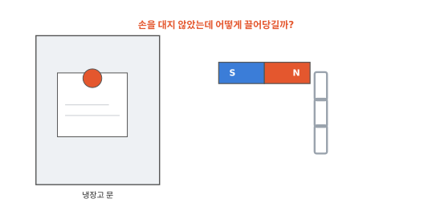
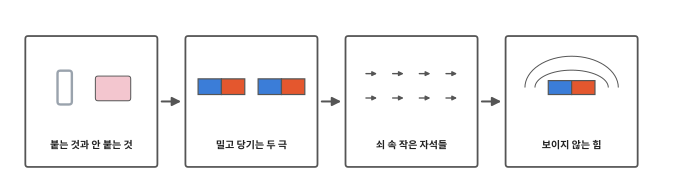
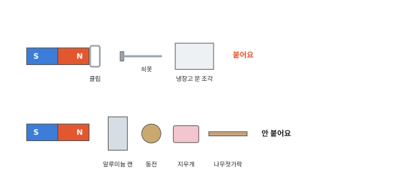
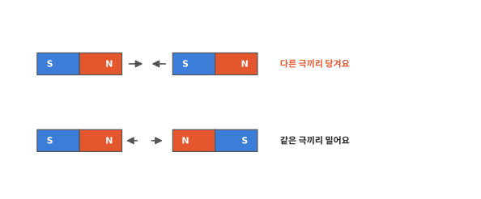
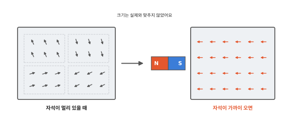
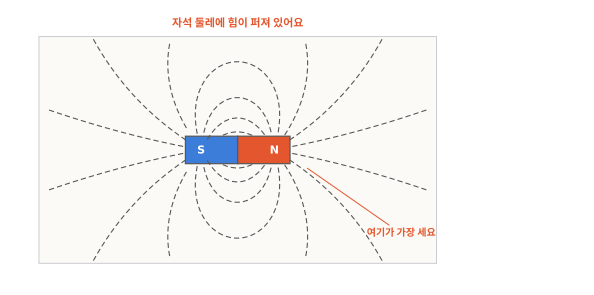
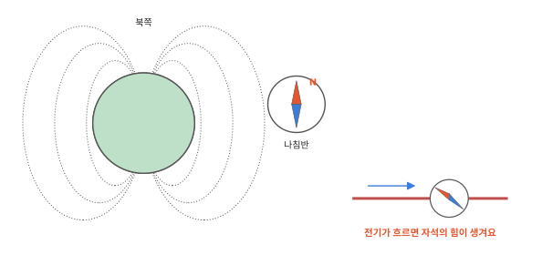

# 자석은 왜 붙을까요?

## 냉장고 자석

냉장고 문에 자석을 대면 딱 붙어요. 자석으로 그림 한 장을 눌러 붙여 둘 수도 있어요. 막대자석을 쇠 클립 가까이 가져가면 클립이 저절로 끌려와 달라붙어요. 손을 대지 않았는데 자석은 어떻게 끌어당길까요?

## 이 편에서 볼 것

[11편](11-electricity.md) 끝에서 전기와 자석은 사이가 아주 가깝다고 했어요. 그 이야기는 맨 끝에서 하기로 하고 자석이 무엇을 끌어당기는지부터 봐요.

## 붙는 것과 안 붙는 것

집 안 물건에 자석을 대 보면 붙는 것과 안 붙는 것이 나뉘어요. 쇠(철)로 만든 클립, 못, 냉장고 문은 붙어요. 종이, 플라스틱, 나무, 지우개는 붙지 않아요.

반짝이는 금속이어도 안 붙는 것이 많아요. 음료수 알루미늄 캔이나 동전은 자석을 대도 그대로 있어요. 숟가락이나 열쇠처럼 쇠처럼 보여도 철이 아닌 금속으로 만든 것은 안 붙기도 해요. 자석은 철 말고는 거의 끌어당기지 않아요.

자석은 종이나 얇은 플라스틱을 사이에 두어도 끌어당겨요. 그래서 그림 한 장을 사이에 끼우고도 냉장고에 붙어 있어요.

## 밀고 당기는 두 극

막대자석은 양 끝에서 끌어당기는 힘이 가장 세요. 이 부분을 **극**이라고 해요. 한쪽 끝은 N극, 다른 쪽 끝은 S극이에요. 흔히 N극은 빨강, S극은 파랑으로 칠해요.

자석 두 개의 극을 마주 대 보면 재미있는 일이 생겨요. N극과 S극처럼 다른 극끼리는 서로 끌어당겨 딱 붙어요. N극과 N극처럼 같은 극끼리는 서로 밀어내서 아무리 눌러도 잘 붙지 않아요.

## 쇠 속 작은 자석들

왜 철만 자석에 잘 붙을까요? [11편](11-electricity.md)에서 원자 속에는 아주 작은 전기 알갱이가 있다고 했지요. 이 전기 알갱이는 하나하나가 아주아주 작은 자석처럼 굴어요. 대부분의 물질에서는 이 작은 자석들이 제각각이거나 서로 힘을 지워서 자석의 힘이 거의 드러나지 않아요. 알루미늄도 그래요.

철은 달라요. 철 속 작은 자석들은 이웃끼리 같은 쪽을 보려는 성질이 있어서 작은 무리마다 같은 쪽을 봐요. 그런데 무리마다 보는 쪽이 제각각이라 클립 하나로 보면 힘이 드러나지 않아요. 자석을 가까이 가져가면 무리들이 자석의 힘에 끌려 모두 같은 쪽으로 돌아서요. 그러면 클립이 잠깐 자석이 되어 자석 쪽으로 끌려와요. 자석에 붙은 클립 끝에 다른 클립이 또 매달리는 것도 클립이 잠깐 자석이 되었기 때문이에요.

교실에서 아이들이 제각각 다른 쪽을 보고 있다가 선생님이 앞에서 부르면 모두 앞을 보는 모습과 닮았어요. 자리는 그대로이고 보는 쪽만 바뀌어요. 다만 아이들은 스스로 돌아보지만 작은 자석은 자석의 힘에 돌려져요. 자석을 치우면 클립 속 무리들은 대부분 다시 제각각이 되고 조금만 같은 쪽을 본 채 남아요. 그래서 자석에 오래 붙여 둔 쇠못은 약한 자석이 되기도 해요.

## 보이지 않는 힘

자석은 닿지 않아도 끌어당겨요. 자석 둘레에 눈에 보이지 않는 힘이 퍼져 있어요. 이 힘은 자석에 가까울수록 세고 멀어질수록 약해져요.

이 힘이 퍼진 모양을 볼 수도 있어요. 막대자석 위에 종이를 덮고 쇠를 아주 곱게 간 철가루를 뿌린 뒤 종이를 톡톡 두드려요. 철가루 하나하나가 잠깐 작은 자석이 되어 자석의 힘을 따라 줄지어 서요. 그러면 한쪽 극에서 다른 쪽 극으로 둥글게 이어지는 줄무늬가 생겨요. 양 끝 극 가까이에 철가루가 가장 빽빽하게 모여요. 힘이 가장 센 곳이에요.

## 지구도 큰 자석이에요

나침반 바늘은 가볍게 돌 수 있게 만든 작은 자석이에요. 근처에 쇠나 다른 자석이 없으면 바늘의 한쪽 끝은 북쪽을 가리켜요. 지구 전체가 커다란 자석처럼 둘레에 보이지 않는 힘을 퍼뜨리고 있어서 바늘이 그 힘을 따라 돌아서요. 북쪽을 가리키는 끝이 N극이에요. N은 북쪽을 뜻하는 영어 낱말의 첫 글자예요.

이제 전기 이야기예요. 전기 알갱이가 한 방향으로 흐르면 그 둘레에 자석의 힘이 생겨요. 센 전기가 흐르는 전선 바로 위에 나침반을 두면 바늘이 돌아가요. 이 실험은 집에서 따라 하지 말고 학교에서 선생님과 함께 해요. 쇠막대에 전선을 여러 번 감고 전기를 흘리면 쇠막대가 센 자석이 되는데 이것을 **전자석**이라고 해요. 전기를 끊으면 자석의 힘도 사라져서 고철 처리장 크레인은 전자석으로 무거운 쇠를 들었다 놓아요.

1편에서 물질은 늘 꿈틀거리는 아주 작은 알갱이로 되어 있다고 했어요. 그 알갱이가 얼마나 붙어 있는지에 따라 얼음과 물과 수증기가 갈렸어요. 알갱이가 꿈틀거리는 세기가 온도였어요. 원자가 짝을 바꾸면 불이 탔고 그때 나온 에너지는 열과 빛으로 모습을 바꿨어요. 공기 알갱이를 밀고 당기는 떨림은 소리가 되었어요. 원자 속 전기 알갱이가 흐르면 전기가 되고 쇠 속 작은 자석들이 같은 쪽을 보면 자석이 돼요. 열두 편의 이야기가 모두 작은 알갱이에서 시작했어요.

## 정리

- 자석은 철로 만든 것을 끌어당겨요. 알루미늄, 동전, 종이, 플라스틱은 붙지 않아요.
- 극: 막대자석에서 끌어당기는 힘이 가장 센 양 끝이에요. N극과 S극이 있어요. 같은 극끼리는 밀고 다른 극끼리는 당겨요.
- 철 속 작은 자석들이 같은 쪽을 보면 자석이 돼요. 자석을 가까이 대면 클립도 잠깐 자석이 되어 끌려와요.
- 지구도 큰 자석이라 나침반의 N극이 북쪽을 가리켜요.
- 전자석: 전선을 감은 쇠막대에 전기를 흘려 만든 자석이에요.

## 해 보기: 자석으로 놀기

1. 집 안 물건 열 가지를 골라 자석에 붙을지 먼저 맞혀 보고 대 봐요. 숟가락, 알루미늄 포일, 동전, 클립, 열쇠, 식은 냄비, 참치 캔 같은 것이 좋아요. 쇠처럼 보이는데 안 붙는 것이 있었나요?
2. 막대자석 끝에 클립 하나를 붙이고 그 클립 끝에 다른 클립을 대 보세요. 클립을 몇 개까지 줄줄이 매달 수 있는지 세어 봐요. 맨 위 클립을 손으로 잡고 자석만 떼면 아래 클립들이 떨어져요.
3. 막대자석 가운데를 실로 묶어 매달고 흔들림이 멈출 때까지 기다려요. 빨간 N극 끝이 어느 쪽을 가리키나요? 몇 번 해 봐도 같은 쪽인지 봐요.

안전 약속: 작은 자석은 어린 동생이 삼키지 않게 손 닿지 않는 곳에 둬요. 아주 센 자석은 손가락이 끼일 수 있으니 쓰지 않아요. 자석은 휴대폰, 카드, 시계 가까이 가져가지 않아요.

## 확인 문제

??? question "1. 극"
    막대자석에서 끌어당기는 힘이 가장 센 양 끝을 무엇이라고 할까요?

    **풀이**: 극이에요. N극과 S극이 있어요.

??? question "2. 마주 댄 두 자석"
    막대자석 두 개의 N극끼리 마주 대면 어떻게 될까요?

    **풀이**: 서로 밀어내요. 같은 극끼리는 밀고 다른 극끼리는 끌어당겨요.

??? question "3. 쇠와 알루미늄 골라내기"
    쇠 클립과 알루미늄 캔 조각이 섞여 있어요. 자석으로 둘을 골라낼 수 있을까요?

    **풀이**: 골라낼 수 있어요. 자석을 대면 쇠 클립만 붙어 올라오고 알루미늄 조각은 남아요. 철 속 작은 자석들은 자석이 다가오면 같은 쪽을 보지만 알루미늄에서는 자석의 힘이 거의 드러나지 않아요.

!!! abstract "어른을 위한 정리 (건너뛰어도 돼요)"
    - 모든 자석에는 N극과 S극이 있고 같은 극끼리 밀어내고 다른 극끼리 끌어당겨요. 자석을 잘라도 극이 하나만 있는 조각은 생기지 않아요.[^mag]
    - 철, 니켈, 코발트 같은 강자성체는 원자들의 자기 모멘트(주로 전자의 스핀에서 나와요)가 이웃끼리 같은 방향으로 정렬하는 성질이 있어 작은 자기 구역을 이뤄요. 외부 자기장이 걸리면 구역들이 정렬되어 물체가 자화되고 자석에 끌려요. 자기장을 치운 뒤에도 일부 정렬이 남으면 약한 자석이 돼요. 본문의 "작은 자석"은 이 자기 모멘트를, "무리"는 자기 구역을 가리켜요.[^ferro]
    - 알루미늄(상자성)이나 구리(반자성) 같은 물질은 자기장에 아주 약하게만 반응해서 일상에서는 자석에 붙지 않는 것으로 보여요. 스테인리스강도 종류에 따라 붙지 않는 것이 있어요.
    - 자석 둘레의 자기장은 자기력선으로 나타내며 자석 밖에서는 N극에서 나와 S극으로 들어가요. 자기력선이 빽빽할수록 자기장이 세요. 지구도 자기장이 있어서 나침반의 N극이 자북을 가리켜요. 자북은 지리적 북쪽과 조금 어긋나 있고 지구의 북쪽 근처는 자석으로 치면 S극에 해당해요.[^field]
    - 전류는 둘레에 자기장을 만들어요(외르스테드). 코일에 전류를 흘리면 전자석이 되고, 철심을 넣으면 훨씬 세져요.[^curr][^ferro]

## 더 깊이

??? info "자석을 반으로 자르면"
    막대자석을 반으로 자르면 N극 조각과 S극 조각으로 나뉠 것 같지만 그렇지 않아요. 잘린 조각마다 다시 N극과 S극이 생겨 작은 자석 두 개가 돼요. 아무리 잘게 잘라도 마찬가지예요.

??? info "자철석과 옛 나침반"
    아주 옛날 사람들은 저절로 쇠를 끌어당기는 돌을 발견했어요. 이 돌을 자철석이라고 해요. 자철석을 쇠바늘에 문지르면 바늘이 자석이 되어 물에 띄우면 늘 같은 쪽을 가리켰어요. 이렇게 만든 나침반 덕분에 사람들은 흐린 날에도 바다에서 길을 찾을 수 있었어요.

[^mag]: OpenStax, *College Physics 2e*, 22.1 ["Magnets"](https://openstax.org/books/college-physics-2e/pages/22-1-magnets).
[^ferro]: OpenStax, *College Physics 2e*, 22.2 ["Ferromagnets and Electromagnets"](https://openstax.org/books/college-physics-2e/pages/22-2-ferromagnets-and-electromagnets).
[^field]: OpenStax, *College Physics 2e*, 22.3 ["Magnetic Fields and Magnetic Field Lines"](https://openstax.org/books/college-physics-2e/pages/22-3-magnetic-fields-and-magnetic-field-lines).
[^curr]: OpenStax, *College Physics 2e*, 22.9 ["Magnetic Fields Produced by Currents: Ampere's Law"](https://openstax.org/books/college-physics-2e/pages/22-9-magnetic-fields-produced-by-currents-amperes-law).
