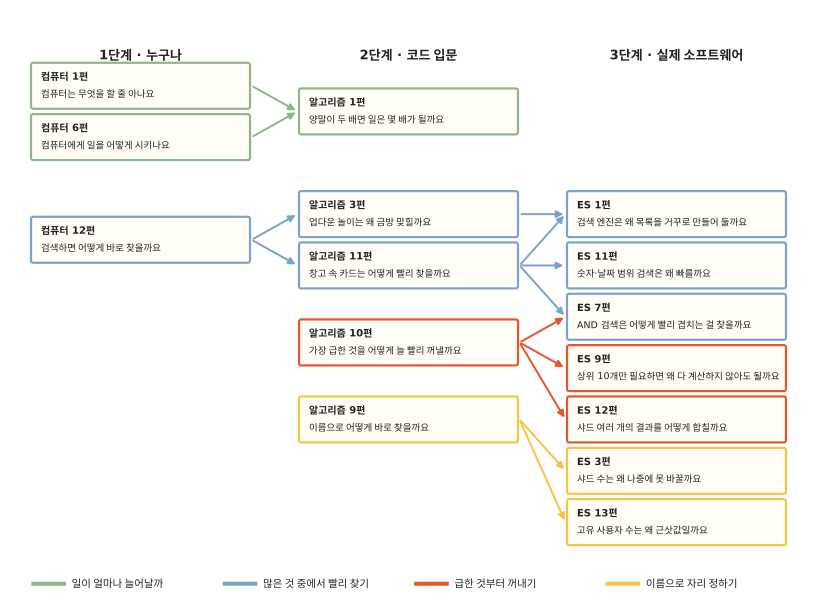

# 길 안내

이 사이트의 글은 세 단계로 나뉘어 있어요. 1단계는 누구나 읽을 수 있고 2단계는 코드를 막 배우는 분, 3단계는 실제 소프트웨어 속을 들여다보고 싶은 분을 생각하고 썼어요.

단계가 달라도 같은 생각이 이어져요. 1단계 컴퓨터 12편의 도감 찾아보기는 2단계에서 업다운 놀이와 B-트리로 다시 나오고 3단계에서는 검색 엔진의 역색인이 돼요. 아래 그림은 이렇게 이어지는 글을 선으로 묶은 거예요.

## 길마다 읽는 차례

**일이 얼마나 늘어날까**: [컴퓨터 1편](computer/01-what-computers-do.md) → [컴퓨터 6편](computer/06-how-to-tell-computers.md) → [알고리즘 1편](algorithms/01-why-big-o.md)

**많은 것 중에서 빨리 찾기**: [컴퓨터 12편](computer/12-how-search-works.md) → [알고리즘 3편](algorithms/03-why-sorted-is-fast.md) → [알고리즘 11편](algorithms/11-btree.md) → [ES 1편](elasticsearch/01-inverted-index.md) → [ES 7편](elasticsearch/07-intersection.md) → [ES 11편](elasticsearch/11-bkd.md)

**급한 것부터 꺼내기**: [알고리즘 10편](algorithms/10-heap.md) → [ES 9편](elasticsearch/09-top-k.md) → [ES 12편](elasticsearch/12-distributed-search.md)

**이름으로 자리 정하기**: [알고리즘 9편](algorithms/09-hash.md) → [ES 3편](elasticsearch/03-routing.md) → [ES 13편](elasticsearch/13-cardinality.md)

글마다 제목 아래에 단계 딱지가 붙어 있어요. 3단계 글 머리의 "먼저 읽으면 좋은 글"과 1·2단계 글 끝의 "다음 단계에서 이어져요"를 따라가도 이 길을 그대로 걸을 수 있어요.
