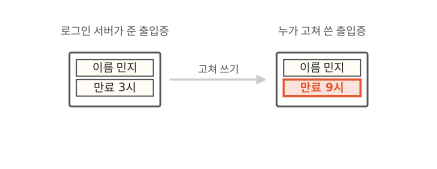
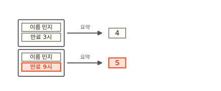
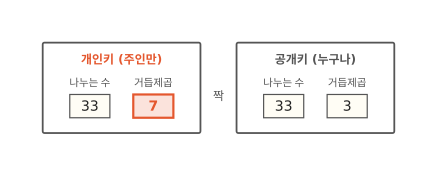
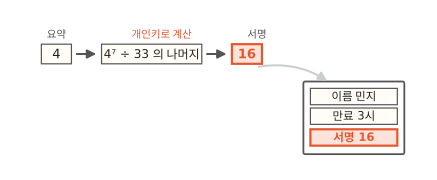
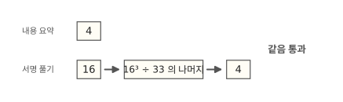
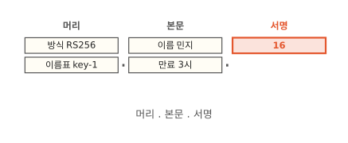
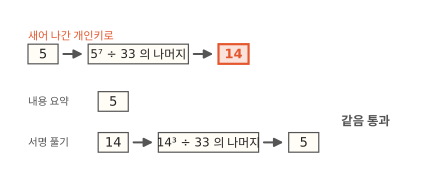
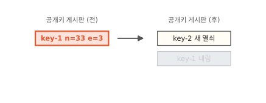

# 디지털 서명: 고쳐 쓴 로그인 토큰이 들키는 까닭

앱에 한 번 로그인하면 한동안은 비밀번호를 다시 묻지 않아요. 로그인 서버가 "이 사람은 민지예요"라고 적은 출입증을 건네주고 앱은 그 출입증을 다른 서버에 내밀기 때문이에요. 이 출입증을 **로그인 토큰**이라고 해요. 이 글에서는 누가 출입증 글자를 고치면 왜 들키는지 알아봐요. 출입증을 만드는 열쇠가 새어 나가면 진짜와 가짜를 가릴 수 없게 되는 까닭도 함께 보여요.

!!! abstract "이 글에서 알게 되는 것"
    1. 서명은 내용을 요약한 숫자를 개인키로 계산한 값이에요. 받는 쪽은 공개키로 서명을 풀어서 요약 숫자와 같은지 봐요. 개인키는 서명을 만드는 열쇠라서 주인만 가져요. 공개키는 서명을 확인하는 열쇠라서 누구에게 보여 줘도 돼요.
    2. 내용을 한 글자만 고쳐도 요약 숫자가 바뀌어서 서명이 맞지 않아요. 맞는 서명을 새로 만들려면 개인키가 있어야 해요.
    3. 개인키가 새어 나가면 가짜 출입증도 확인을 통과해요. 그때는 열쇠를 새로 만들고 옛 공개키를 내려야 해요.

## 1. 출입증은 글자라서 누구나 고쳐 쓸 수 있어요

로그인 서버가 민지에게 출입증을 하나 줬어요. 적힌 건 두 줄이에요. 이름은 민지이고 3시까지 쓸 수 있어요. 민지가 다른 서버에 이 출입증을 내밀면 그 서버는 "민지구나" 하고 들여보내요.

그런데 출입증은 컴퓨터 속 글자예요. 누가 "3시"를 "9시"로 고쳐서 내밀면 어떻게 될까요? 아래 그림에서 오른쪽 출입증의 빨간 칸을 보세요.

**그림 1.** 글자 하나만 고치면 3시까지 쓸 출입증이 9시까지 쓰는 출입증이 돼요.
{ .fig-cap }

받는 서버가 보기에 두 출입증은 똑같이 생겼어요. 이름을 다른 사람으로 바꿔도 알아챌 수 없어요. 그래서 출입증에는 "로그인 서버가 이 내용대로 써 줬다"는 표시가 따로 있어야 해요. 종이 출입증이라면 도장을 찍겠죠. 컴퓨터에서는 그 도장을 숫자 계산으로 만들어요.

## 2. 해시는 내용을 짧은 숫자 하나로 요약해요

도장을 찍기 전에 할 일이 하나 있어요. 출입증 내용을 짧은 숫자 하나로 줄이는 거예요. 내용이 길든 짧든 결과는 늘 같은 길이의 숫자가 나와요. 이렇게 요약 숫자를 내 주는 계산을 **해시**라고 해요.

해시는 내용이 한 글자만 달라도 전혀 다른 숫자를 내요. 실제 요약 숫자는 아주 길어서 이 글에서는 작은 숫자로 정해 둘게요. "민지, 3시"의 요약 숫자는 4이고 "민지, 9시"의 요약 숫자는 5예요. 아래 그림에서 두 줄 끝의 숫자를 보세요.

**그림 2.** 만료 시각 하나만 바꿔도 요약 숫자가 4에서 5로 바뀌어요.
{ .fig-cap }

요약 숫자만 보고는 원래 내용을 알 수 없어요. 그래서 해시는 내용이 바뀌었는지 알아내는 데 써요.

## 3. 개인키로 서명하고 공개키로 확인해요

요약 숫자 4가 나왔어요. 이제 여기에 도장을 찍을 차례예요. [컴퓨터 10편](../computer/10-how-to-keep-messages-secret.md)의 열쇠는 보내는 쪽과 받는 쪽이 같은 숫자를 나눠 가졌어요. 서명에 쓰는 열쇠는 둘이 서로 달라요. 도장은 짝이 맞는 열쇠 두 개로 만들어요. 한 열쇠는 로그인 서버만 갖고 아무에게도 보여 주지 않아요. 이걸 **개인키**라고 해요. 다른 열쇠는 누구에게 보여 줘도 돼요. 이걸 **공개키**라고 해요. 두 열쇠는 처음부터 한 쌍으로 함께 만들어요.

실제 열쇠는 수백 자리 숫자예요. 여기서는 아주 작은 짝을 쓸게요. 열쇠마다 나누는 수와 거듭제곱 수가 하나씩 들어 있어요. 나누는 수 33은 두 열쇠에 똑같이 들어 있고 거듭제곱 수만 7과 3으로 달라요. 아래 그림의 왼쪽이 개인키, 오른쪽이 공개키예요.

**그림 3.** 개인키는 33과 7이고 공개키는 33과 3이에요.
{ .fig-cap }

로그인 서버는 요약 숫자 4를 7제곱해요. 4를 일곱 개 곱하면 16384예요. 이걸 33으로 나누면 나머지가 16이에요. 이 16을 **서명**이라고 해요. 로그인 서버는 출입증 맨 아래에 서명 16을 적어서 건네줘요. 아래 그림에서 계산 결과 16이 어디로 가는지 보세요.

**그림 4.** 요약 숫자 4를 개인키로 계산한 16이 출입증의 서명 칸에 들어가요.
{ .fig-cap }

받는 서버는 공개키로 확인해요. 할 일은 두 가지예요. 먼저 받은 출입증의 내용을 스스로 요약해요. "민지, 3시"이니 4가 나와요. 다음으로 서명 16을 3제곱하고 33으로 나눈 나머지를 구해요. 16을 세 개 곱하면 4096이고 33으로 나눈 나머지는 4예요. 아래 그림에서 두 줄 끝의 숫자를 비교해 보세요.

**그림 5.** 내용 요약도 4이고 서명을 푼 값도 4라서 출입증이 통과해요.
{ .fig-cap }

개인키로 계산한 값을 공개키로 계산했더니 원래 숫자 4로 돌아왔어요. 두 열쇠가 같은 33으로 나누고 7과 3이 짝으로 만들어졌기 때문이에요. 짝이 아닌 열쇠로 계산하면 엉뚱한 숫자가 나와요.

## 4. 고쳐 쓴 출입증은 서명이 맞지 않아요

이번에는 누가 1절처럼 "3시"를 "9시"로 고쳐 쓰고 서명 16은 그대로 둔 채 내밀었다고 해 볼게요. 받는 서버는 3절과 똑같이 두 가지를 계산해요. 아래 그림에서 빨간 두 숫자를 보세요.

**그림 6.** 고친 내용의 요약은 5인데 서명을 풀면 4가 나와서 거부돼요.
{ .fig-cap }

내용이 바뀌었으니 요약 숫자는 5가 됐어요. 서명은 그대로라서 풀면 여전히 4가 나와요. 둘이 다르니 받는 서버는 출입증을 받지 않아요.

여기서 이런 생각이 들 거예요. "서명도 같이 고치면 되잖아?" 요약 숫자 5에 맞는 서명을 만들려면 5를 7제곱해야 해요. 그런데 7은 개인키에만 있어서 로그인 서버 밖에는 없어요.

그럼 공개키 33과 3을 보고 7을 알아낼 수는 없을까요? 이 글의 작은 숫자라면 할 수 있어요. 33이 3과 11을 곱한 수라는 걸 금방 찾으면 거꾸로 계산해서 7이 나와요. 실제 열쇠에서 33 자리에 오는 숫자는 600자리가 넘어요. 그 숫자가 어떤 두 수의 곱인지 찾는 일은 지금 있는 컴퓨터를 다 써도 끝나지 않아요. 그래서 공개키는 누구에게 보여 줘도 괜찮아요.

## 5. JWT는 이 출입증을 글자로 적은 거예요

웹 서비스에서 많이 쓰는 로그인 토큰인 **JWT**가 지금까지 만든 출입증과 같은 짜임이에요. JWT는 점 두 개로 나뉜 세 덩어리 글자예요. 아래 그림에서 세 덩어리를 보세요.

**그림 7.** JWT는 머리, 본문, 서명을 점으로 이은 글자예요.
{ .fig-cap }

- **머리**에는 서명 방식과 열쇠 이름표가 들어 있어요. RS256은 3절의 거듭제곱 계산에 SHA-256이라는 해시를 붙인 방식의 이름이에요.
- **본문**에는 누구인지와 언제까지 쓸 수 있는지가 들어 있어요.
- **서명**은 머리와 본문을 이은 글자 전체를 요약해서 개인키로 계산한 값이에요.

머리까지 요약에 넣는 까닭은 머리를 바꿔치기해도 서명이 맞지 않게 하려는 거예요. 누가 서명 방식이나 이름표를 바꾸면 요약 숫자가 달라지니까요.

머리와 본문은 암호로 숨긴 글자가 아니에요. 누구나 풀어서 읽을 수 있어요. JWT가 막는 일은 내용을 고쳐 쓰는 것뿐이에요. 그래서 비밀번호처럼 숨겨야 하는 건 본문에 넣지 않아요.

받는 서버는 공개키를 어디서 얻을까요? 로그인 서버가 자기 공개키들을 웹 주소 하나에 목록으로 올려 둬요. 이 목록을 **JWKS**라고 해요. 받는 서버는 이 목록을 가끔 받아 두었다가 토큰 머리의 이름표를 보고 맞는 공개키를 골라요.

공개키를 토큰 안에 같이 넣어 보내면 안 돼요. 가짜를 만드는 사람이 자기 열쇠 한 쌍을 새로 만들면 자기 개인키로 서명하고 자기 공개키를 넣어 보낼 수 있거든요. 받는 서버는 그 공개키로 확인해서 통과시켜 버려요.

## 6. 개인키가 새면 가짜도 통과해요

지금까지 본 안전은 개인키의 7을 로그인 서버만 갖고 있다는 데 달려 있어요. 서버 설정 파일이 밖으로 나가거나 서버 메모리를 통째로 저장한 파일이 나가면 그 안에 든 7도 같이 나가요.

7을 손에 넣은 사람은 "민지, 9시" 출입증을 만들고 요약 숫자 5의 서명을 스스로 계산해요. 5를 일곱 개 곱해서 33으로 나누면 나머지가 14예요. 아래 그림에서 받는 서버가 무엇을 보는지 보세요.

**그림 8.** 새어 나간 개인키로 만든 서명 14는 공개키로 풀면 5가 나와서 통과해요.
{ .fig-cap }

받는 서버는 4절과 똑같이 확인해요. 내용 요약도 5이고 서명을 푼 값도 5예요. 진짜 출입증과 구별할 방법이 없어요. 이름을 다른 사람으로 바꾸면 그 사람 행세를 할 수 있어요. 만료를 몇 년 뒤로 적으면 그동안 계속 쓸 수 있고요.

이때 할 수 있는 일은 하나예요. 새 열쇠 한 쌍을 만들고 옛 열쇠를 버리는 거예요. 아래 그림에서 공개키 목록이 어떻게 바뀌는지 보세요.

**그림 9.** 공개키 목록에서 key-1을 내리면 옛 개인키로 만든 출입증은 모두 확인에 실패해요.
{ .fig-cap }

로그인 서버는 새 개인키로 서명하고 새 공개키를 목록에 올려요. 그리고 옛 공개키를 목록에서 내려요. 그러면 받는 서버는 key-1 이름표가 붙은 토큰에 맞는 공개키를 찾지 못해서 거부해요. 이 일을 **키 교체**라고 해요.

순서를 지켜야 해요. 새 공개키가 목록에 먼저 올라가 있어야 서명을 새 열쇠로 바꿀 수 있어요. 순서가 거꾸로면 받는 서버가 새 열쇠로 서명한 진짜 토큰까지 거부해요.

열쇠가 새지 않게 하고 새더라도 피해를 줄이는 습관도 있어요.

- 개인키는 그 키로 서명하는 프로그램에만 둬요. 쓰지 않는 프로그램이 갖고 있으면 새는 길만 늘어요.
- 시험용 서버와 실제 서버는 다른 열쇠를 써요. 시험용 서버는 지키는 손이 덜 가서 새기 쉬워요.
- 개인키는 설정 파일이나 코드 저장소에 적지 않고 비밀값 보관소에 둬요.
- 받는 쪽은 서명만 보지 않고 본문도 확인해요. 발급한 곳과 받을 곳이 맞는지 보고 쓸 수 있는 기간이 너무 길지 않은지도 봐요. 서명 방식은 미리 정한 하나만 받아요.

## 정리

로그인 토큰의 서명은 내용을 요약한 숫자를 개인키로 계산한 값이에요. 받는 쪽은 공개키로 서명을 풀어서 내용의 요약 숫자와 같은지 확인해요. 출입증 예시에서는 요약 4를 7로 계산한 서명 16을 3으로 풀면 다시 4가 나왔어요.

내용을 한 글자라도 고치면 요약 숫자가 달라져요. 거기 맞는 서명을 새로 만들려면 개인키가 있어야 해서 고쳐 쓴 토큰은 들켜요. 공개키에서 개인키를 거꾸로 찾는 일은 실제 크기의 숫자에서는 끝나지 않아요.

개인키가 새어 나가면 이 확인은 가짜를 막지 못해요. 그때는 새 열쇠를 만들고 옛 공개키를 목록에서 내려야 해요.

### 새로 나온 말

- **해시**: 내용을 같은 길이의 짧은 숫자로 요약하는 계산. "민지, 3시"는 4, "민지, 9시"는 5처럼 한 글자만 달라도 결과가 바뀌어요.
- **개인키**: 서명을 만드는 열쇠. 주인만 가져요. 예시의 33과 7이에요.
- **공개키**: 서명을 확인하는 열쇠. 누구나 봐도 돼요. 예시의 33과 3이에요.
- **서명**: 요약 숫자를 개인키로 계산한 값. 예시의 16이에요.
- **로그인 토큰**: 로그인한 뒤 앱이 서버에 내미는 출입증.
- **JWT**: 머리, 본문, 서명을 점으로 이은 로그인 토큰.
- **JWKS**: 받는 쪽이 가져가도록 공개키를 모아 웹 주소에 올려 둔 목록.
- **키 교체**: 새 열쇠 한 쌍을 만들고 옛 공개키를 목록에서 내리는 일.
